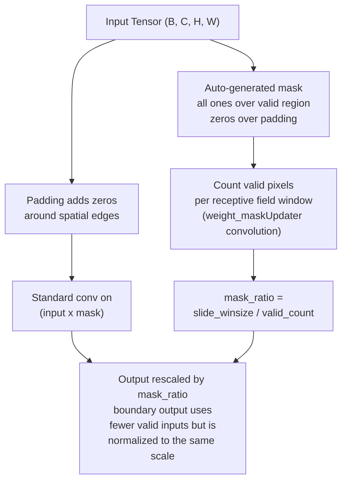
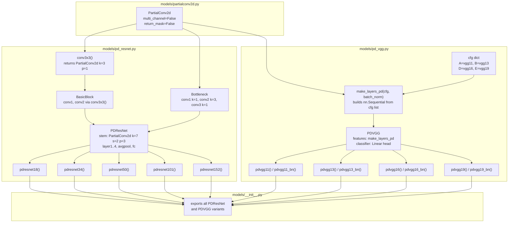

<!-- source: DeepWiki mcp.deepwiki.com · repo NVIDIA/partialconv · page 4 Use Case: Padding Replacement · fetched 2026-10-26 -->

# Use Case: Padding Replacement

<details>
<summary>Relevant source files</summary>

The following files were used as context for generating this wiki page:

- [README.MD](README.MD)
- [models/__init__.py](models/__init__.py)
- [models/pd_resnet.py](models/pd_resnet.py)
- [models/pd_vgg.py](models/pd_vgg.py)

</details>


This page covers how `PartialConv2d` is used as a drop-in replacement for `nn.Conv2d` at every convolutional layer boundary in a standard classification network. The goal is to eliminate the boundary artifacts introduced by zero, reflection, or replication padding without changing the network's external interface.

This page does not cover the image inpainting use case (where masks propagate layer-to-layer); for that, see [Use Case: Image Inpainting](#5). For a full reference on the `PartialConv2d` class parameters and forward-pass internals, see [PartialConv2d: The Core Layer](#2).

---

## The Problem with Conventional Padding

When a convolutional layer is applied near the spatial boundary of a feature map, the receptive field extends beyond the valid data region. Standard padding strategies fill those out-of-bounds positions with synthetic values:

| Padding Scheme | Boundary Fill Strategy | Consequence |
|---|---|---|
| Zero padding | Fills with 0 | Network must learn to ignore the zeros; can cause systematic activation bias at borders |
| Reflection padding | Mirrors pixel values | Introduces repeated structure that doesn't exist in real images |
| Replication padding | Repeats edge pixel | Smears edge pixels outward |

All three methods introduce values that do not correspond to real input data. Partial convolution avoids this by tracking *which positions contain valid data* and normalizing the convolution output by the number of valid input pixels in each receptive field window.

---

## Drop-in Replacement: Before and After

The transition from standard to partial-convolution-based padding is a one-line change in layer construction. No mask input is required in padding-replacement mode.

**Before (standard zero padding):**
```python
nn.Conv2d(3, 16, kernel_size=3, stride=1, padding=1, bias=False)
```

**After (partial convolution padding):**
```python
PartialConv2d(3, 16, kernel_size=3, stride=1, padding=1, bias=False)
```

Sources: [README.MD:34-40]()

When `multi_channel` and `return_mask` are both left at their defaults (`False`), `PartialConv2d` behaves as follows:

- On the first forward call, it auto-generates an all-ones mask (all pixels are valid) — no mask argument is needed from the caller.
- It computes `mask_ratio` from the ratio of the full receptive field size to the number of valid (non-padded) positions.
- The output is renormalized so that boundary positions are not biased by the padded zeros.
- It returns only the output tensor, not an updated mask, so the downstream layer receives a plain tensor identical in shape to what `nn.Conv2d` would produce.

This makes `PartialConv2d` a true structural drop-in: existing code does not need to thread a mask through the network.

---

## How Partial Convolution Fixes the Boundary Bias

**Diagram: Boundary Normalization Mechanism**



Sources: [models/partialconv2d.py]()

At an interior position, the full kernel window lands on valid pixels, so `mask_ratio = 1` and the output is unchanged. At a corner position with a 3×3 kernel, only 4 of 9 positions are valid; `mask_ratio = 9/4` scales the output up to match the scale of a full-window convolution. This prevents boundary positions from producing systematically lower activations, which is the root cause of boundary artifacts.

---

## Model Families

The repository provides two families of classification networks built entirely from `PartialConv2d` layers: `PDResNet` and `PDVGG`. Both are defined in `models/` and exported via `models/__init__.py`.

**Diagram: Code Entities for the Padding-Replacement Use Case**



Sources: [models/__init__.py:1-2](), [models/pd_resnet.py:1-232](), [models/pd_vgg.py:1-220]()

---

## PDResNet Family

`PDResNet` ([models/pd_resnet.py:115-171]()) is structurally identical to standard ResNet, with every `nn.Conv2d` replaced by `PartialConv2d`.

**Stem layer** ([models/pd_resnet.py:120-121]()):
```
PartialConv2d(3, 64, kernel_size=7, stride=2, padding=3, bias=False)
```

**Residual blocks** use a shared helper `conv3x3` ([models/pd_resnet.py:38-41]()):
```
PartialConv2d(in_planes, out_planes, kernel_size=3, stride=stride, padding=1, bias=False)
```

**Downsample shortcuts** in `_make_layer` also use `PartialConv2d` with `kernel_size=1` ([models/pd_resnet.py:143-145]()).

| Factory Function | Block Type | Layer Counts |
|---|---|---|
| `pdresnet18` | `BasicBlock` | [2, 2, 2, 2] |
| `pdresnet34` | `BasicBlock` | [3, 4, 6, 3] |
| `pdresnet50` | `Bottleneck` | [3, 4, 6, 3] |
| `pdresnet101` | `Bottleneck` | [3, 4, 23, 3] |
| `pdresnet152` | `Bottleneck` | [3, 8, 36, 3] |

Sources: [models/pd_resnet.py:174-231]()

For full documentation of the building blocks and architecture details, see [PDResNet Architectures](#4.1).

---

## PDVGG Family

`PDVGG` ([models/pd_vgg.py:48-82]()) mirrors the standard VGG design. The feature extractor is built by `make_layers_pd` ([models/pd_vgg.py:85-98]()), which iterates over a `cfg` list and substitutes `PartialConv2d` wherever `nn.Conv2d` would appear:

```python
conv2d = PartialConv2d(in_channels, v, kernel_size=3, padding=1)
```

The classifier head remains a standard 3-layer `nn.Linear` stack (input: `512 * 7 * 7`, requiring a 224×224 input image).

| Config Key | Factory Functions | Conv Layers |
|---|---|---|
| `'A'` | `pdvgg11`, `pdvgg11_bn` | 8 conv layers |
| `'B'` | `pdvgg13`, `pdvgg13_bn` | 10 conv layers |
| `'D'` | `pdvgg16`, `pdvgg16_bn` | 13 conv layers |
| `'E'` | `pdvgg19`, `pdvgg19_bn` | 16 conv layers |

Sources: [models/pd_vgg.py:103-108](), [models/pd_vgg.py:111-220]()

For full documentation of the cfg dictionary and layer construction details, see [PDVGG Architectures](#4.2).

---

## Pretrained Weights

The `model_urls` dictionaries in both `pd_resnet.py` and `pd_vgg.py` have empty URL strings ([models/pd_resnet.py:30-36](), [models/pd_vgg.py:28-45]()), meaning pretrained weights cannot be loaded programmatically via the `pretrained=True` flag at this time. The README references a Dropbox link for manually downloadable checkpoints.

---

## Empirical Results

The repository includes comparison results from 5 independent runs on ImageNet:

| Model | Padding | Notes |
|---|---|---|
| `resnet50` | Zero (default) | Baseline |
| `pdresnet50` | Partial conv | Consistent top-1 improvement |
| `vgg16_bn` | Zero (default) | Baseline |
| `pdvgg16_bn` | Partial conv | Consistent top-1 improvement |

Partial convolution padding outperforms zero, reflection, and replication padding across all tested architectures. The README reports best top-1 accuracy and standard deviation over 5 runs for all four padding schemes.

Sources: [README.MD:108-114]()

---

## Using the Models in Training

These models are consumed by `main.py` by passing their name to the `-a` argument. The training script maintains two separate model registries: `models_partial` (the `models/` package in this repository) and `models_baseline` (torchvision).

```
python main.py -a pdresnet50 --data_train /path/.../train ...
python main.py -a pdvgg16_bn --data_train /path/.../train ...
```

Sources: [README.MD:81-100]()

For full documentation of `main.py` arguments and the training loop, see [Training on ImageNet](#6).

---

