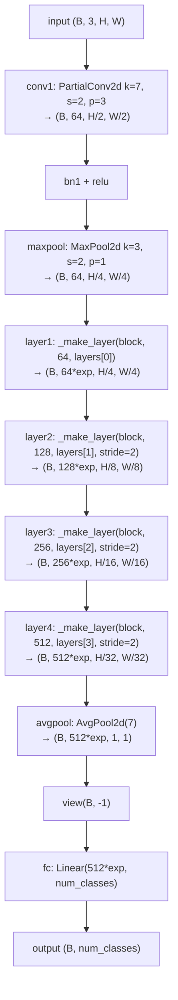
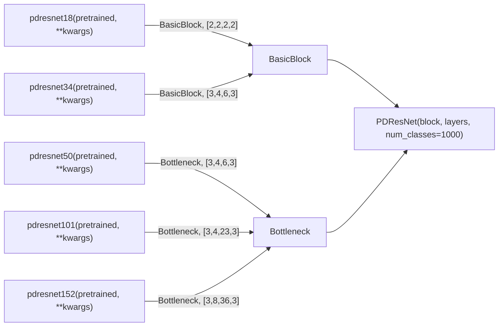

<!-- source: DeepWiki mcp.deepwiki.com · repo NVIDIA/partialconv · page 4.1 PDResNet Architectures · fetched 2026-10-26 -->

# PDResNet Architectures

<details>
<summary>Relevant source files</summary>

The following files were used as context for generating this wiki page:

- [models/partialconv2d.py](models/partialconv2d.py)
- [models/pd_resnet.py](models/pd_resnet.py)

</details>


## Purpose and Scope

This page documents the five PDResNet variants (18, 34, 50, 101, 152) defined in [models/pd_resnet.py](). These are direct adaptations of the standard ResNet family in which every `nn.Conv2d` layer — including the stem, residual blocks, and downsample shortcuts — is replaced with `PartialConv2d`. The result is a drop-in image classification network that uses partial convolution padding instead of zero padding at all spatial boundaries.

This page covers the building blocks (`BasicBlock`, `Bottleneck`), the top-level `PDResNet` class, and the five factory functions. For details on how `PartialConv2d` itself works internally, see [PartialConv2d: The Core Layer](#2). For the analogous VGG-based models, see [PDVGG Architectures](#4.2). For the ImageNet training script that instantiates these models, see [Training on ImageNet](#6).

---

## Model Variants at a Glance

| Factory Function | Block Type | Layer Config `[l1, l2, l3, l4]` | Total Layers | `block.expansion` | Output of `fc` |
|---|---|---|---|---|---|
| `pdresnet18` | `BasicBlock` | `[2, 2, 2, 2]` | 18 | 1 | `num_classes` |
| `pdresnet34` | `BasicBlock` | `[3, 4, 6, 3]` | 34 | 1 | `num_classes` |
| `pdresnet50` | `Bottleneck` | `[3, 4, 6, 3]` | 50 | 4 | `num_classes` |
| `pdresnet101` | `Bottleneck` | `[3, 4, 23, 3]` | 101 | 4 | `num_classes` |
| `pdresnet152` | `Bottleneck` | `[3, 8, 36, 3]` | 152 | 4 | `num_classes` |

All five variants default to `num_classes=1000` for ImageNet classification.

Sources: [models/pd_resnet.py:18-19](), [models/pd_resnet.py:174-231]()

---

## Pretrained Weights

All entries in `model_urls` are currently empty strings:

```
model_urls = {
    'pdresnet18': '',
    'pdresnet34': '',
    ...
}
```

Calling any factory function with `pretrained=True` will trigger a `model_zoo.load_url('')` call, which will fail at runtime. Pretrained weights are not yet available. Always pass `pretrained=False` (the default).

Sources: [models/pd_resnet.py:30-36]()

---

## Building Blocks

### `conv3x3` Helper

[models/pd_resnet.py:38-41]()

A module-level helper that constructs a `PartialConv2d` with `kernel_size=3`, `padding=1`, and `bias=False`. It is used by `BasicBlock` for both of its convolutional layers.

```
conv3x3(in_planes, out_planes, stride=1)
→ PartialConv2d(in_planes, out_planes, kernel_size=3, stride=stride, padding=1, bias=False)
```

### `BasicBlock`

[models/pd_resnet.py:44-73]()

Used by pdresnet18 and pdresnet34. Contains two sequential 3×3 `PartialConv2d` layers, each followed by `BatchNorm2d` and `ReLU`. The residual shortcut optionally passes through a `downsample` module.

**Forward pass:**

```
x → conv1 → bn1 → relu → conv2 → bn2 → (+ residual) → relu
```

`expansion = 1`: output channels equal `planes`.

### `Bottleneck`

[models/pd_resnet.py:76-112]()

Used by pdresnet50, pdresnet101, and pdresnet152. Contains three `PartialConv2d` layers in a 1×1 → 3×3 → 1×1 configuration. The 1×1 layers compress and expand channels; the 3×3 layer handles spatial features.

**Forward pass:**

```
x → conv1(1×1) → bn1 → relu
  → conv2(3×3) → bn2 → relu
  → conv3(1×1) → bn3
  → (+ residual) → relu
```

`expansion = 4`: output channels are `planes * 4`.

---

**Block structure comparison:**

**Figure: BasicBlock and Bottleneck internal structure**

```mermaid
graph TD
    subgraph "BasicBlock (expansion=1)"
        BA["input (inplanes)"]
        B1["conv1: PartialConv2d 3x3"]
        B2["bn1 + relu"]
        B3["conv2: PartialConv2d 3x3"]
        B4["bn2"]
        B5["+ residual"]
        B6["relu → output (planes)"]
        BA --> B1 --> B2 --> B3 --> B4 --> B5 --> B6
        BA -->|"downsample (if needed)"| B5
    end

    subgraph "Bottleneck (expansion=4)"
        NA["input (inplanes)"]
        N1["conv1: PartialConv2d 1x1"]
        N2["bn1 + relu"]
        N3["conv2: PartialConv2d 3x3"]
        N4["bn2 + relu"]
        N5["conv3: PartialConv2d 1x1"]
        N6["bn3"]
        N7["+ residual"]
        N8["relu → output (planes*4)"]
        NA --> N1 --> N2 --> N3 --> N4 --> N5 --> N6 --> N7 --> N8
        NA -->|"downsample (if needed)"| N7
    end
```



Sources: [models/pd_resnet.py:44-112]()

---

## `PDResNet` Class

[models/pd_resnet.py:115-171]()

The top-level model class. Its `__init__` accepts `block` (either `BasicBlock` or `Bottleneck`), `layers` (a 4-element list of block counts), and `num_classes` (default 1000).

### Stem

```
conv1: PartialConv2d(3, 64, kernel_size=7, stride=2, padding=3, bias=False)
bn1:   BatchNorm2d(64)
relu:  ReLU(inplace=True)
maxpool: MaxPool2d(kernel_size=3, stride=2, padding=1)
```

The 7×7 stem convolution is a `PartialConv2d`, not `nn.Conv2d`. This is significant because it is the layer most exposed to spatial boundaries in the input image.

### Residual Stages

`_make_layer` builds each of the four residual stages:

[models/pd_resnet.py:139-154]()

| Stage | Channels (`planes`) | Stride | Blocks |
|---|---|---|---|
| `layer1` | 64 | 1 | `layers[0]` |
| `layer2` | 128 | 2 | `layers[1]` |
| `layer3` | 256 | 2 | `layers[2]` |
| `layer4` | 512 | 2 | `layers[3]` |

When `stride != 1` or the number of input channels does not match `planes * block.expansion`, a `downsample` shortcut is inserted. This shortcut is:

```
nn.Sequential(
    PartialConv2d(inplanes, planes * block.expansion, kernel_size=1, stride=stride, bias=False),
    BatchNorm2d(planes * block.expansion),
)
```

The `PartialConv2d` used in downsample shortcuts has `kernel_size=1`, so boundary behavior differs from the 3×3 layers, but it is still a `PartialConv2d` rather than a plain `nn.Conv2d`.

### Head

```
avgpool: AvgPool2d(7, stride=1)
fc:      Linear(512 * block.expansion, num_classes)
```

The classification head uses standard `nn.Linear`. No partial convolution is needed here because it operates on a spatially pooled feature vector.

### Weight Initialization

[models/pd_resnet.py:132-137]()

After all layers are built, `PDResNet.__init__` initializes weights:

- `PartialConv2d` weights → `kaiming_normal_` with `mode='fan_out'`, `nonlinearity='relu'`
- `BatchNorm2d` weight → constant 1, bias → constant 0

---

**Figure: PDResNet full forward pass**



Sources: [models/pd_resnet.py:115-171]()

---

## Factory Functions

Each factory function constructs a `PDResNet` with the appropriate `block` type and `layers` configuration, then optionally loads pretrained weights.

**Figure: Factory functions mapping to PDResNet configurations**



Sources: [models/pd_resnet.py:174-231]()

---

## `PartialConv2d` Usage in PDResNet

In the padding-replacement use case, `PartialConv2d` is configured with default values for `multi_channel` (`False`) and `return_mask` (`False`). No mask is explicitly passed during the forward call; the layer auto-generates an all-ones mask and caches the computed `mask_ratio` between calls of the same input shape. This makes `PartialConv2d` behave as a drop-in replacement for `nn.Conv2d` from the caller's perspective.

Every `PartialConv2d` inside `PDResNet` operates this way. The complete set of locations is:

| Location | Kernel | Stride | Notes |
|---|---|---|---|
| `PDResNet.conv1` | 7×7 | 2 | Stem layer |
| `BasicBlock.conv1` via `conv3x3` | 3×3 | variable | First block conv |
| `BasicBlock.conv2` via `conv3x3` | 3×3 | 1 | Second block conv |
| `Bottleneck.conv1` | 1×1 | 1 | Channel compression |
| `Bottleneck.conv2` | 3×3 | variable | Spatial conv |
| `Bottleneck.conv3` | 1×1 | 1 | Channel expansion |
| `downsample[0]` (in `_make_layer`) | 1×1 | variable | Shortcut projection |

All have `bias=False`, so the bias correction branch in `PartialConv2d.forward` is inactive; the output is simply `raw_out * mask_ratio`.

Sources: [models/pd_resnet.py:38-41](), [models/pd_resnet.py:80-86](), [models/pd_resnet.py:119-121](), [models/pd_resnet.py:141-146](), [models/partialconv2d.py:72-77]()

---

## Module Exports

[models/pd_resnet.py:18-19]()

The `__all__` list exports:

```python
['PDResNet', 'pdresnet18', 'pdresnet34', 'pdresnet50', 'pdresnet101', 'pdresnet152']
```

These are re-exported through `models/__init__.py` and accessed in `main.py` via the `models_partial` namespace. When passing `-a pdresnet50` to the training script, `main.py` resolves this to `models_partial.pdresnet50`. For full details on how the training script uses these models, see [Training on ImageNet](#6).

Sources: [models/pd_resnet.py:18-19]()

---

