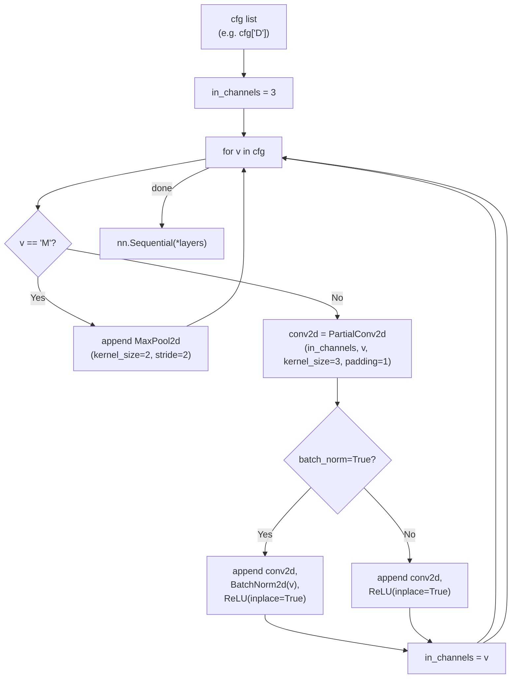
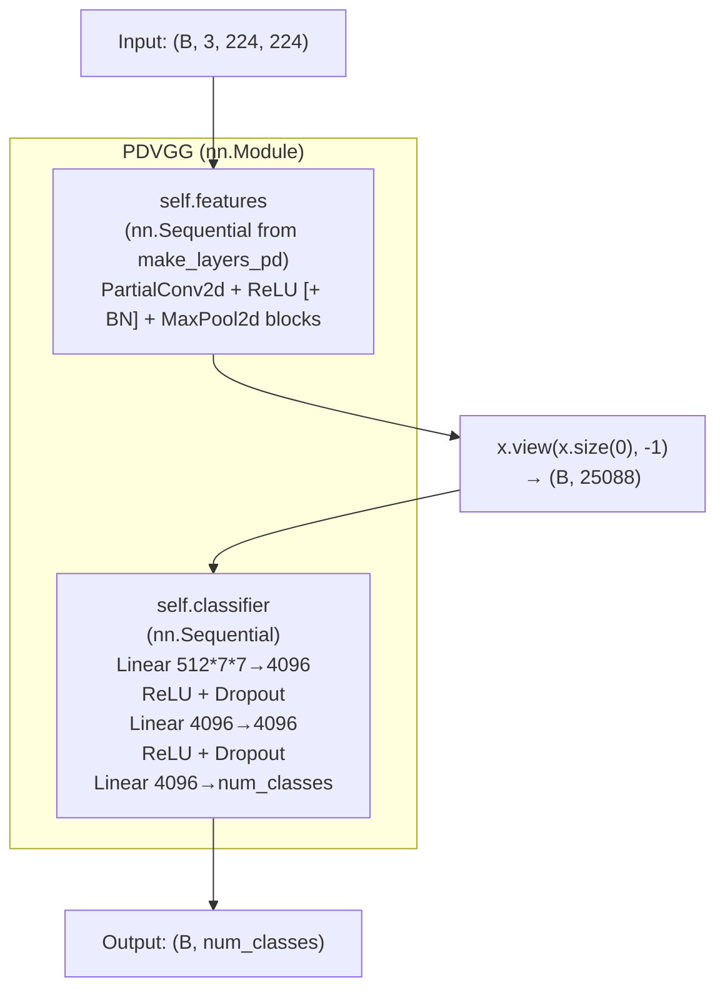
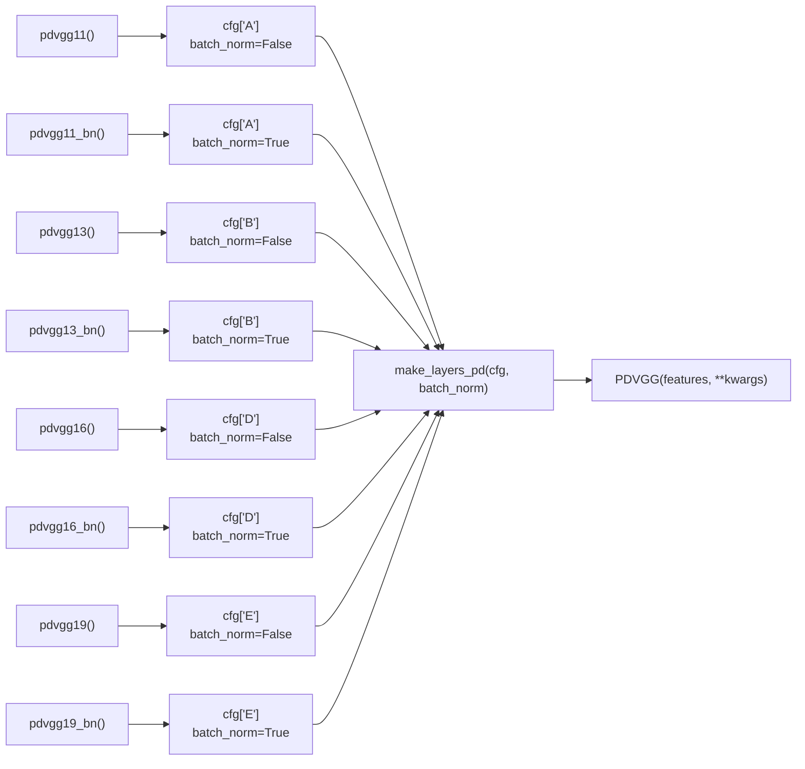

<!-- source: DeepWiki mcp.deepwiki.com · repo NVIDIA/partialconv · page 4.2 PDVGG Architectures · fetched 2026-10-26 -->

# PDVGG Architectures

<details>
<summary>Relevant source files</summary>

The following files were used as context for generating this wiki page:

- [models/partialconv2d.py](models/partialconv2d.py)
- [models/pd_vgg.py](models/pd_vgg.py)

</details>


This page documents the eight PDVGG model variants defined in [models/pd_vgg.py](), which adapt the standard VGG network family to use `PartialConv2d` in place of `nn.Conv2d` throughout the feature extractor. The purpose is to eliminate zero-padding boundary artifacts during ImageNet classification (see page [4](4) for the general motivation behind padding replacement). The classifier head is unchanged from the original VGG design.

This page does not cover the inpainting use of `PartialConv2d` (see page [5](5)) or the ResNet-based partial conv models (see page [4.1](4.1)).

---

## Overview

The PDVGG models are direct architectural analogues of the torchvision VGG family. Every `nn.Conv2d` in the feature extractor is replaced with a `PartialConv2d` instance configured with `multi_channel=False` and `return_mask=False`, making it a transparent drop-in for boundary-aware padding. The fully-connected classifier is standard PyTorch and is shared identically across all variants.

Eight public factory functions are exported:

| Function | Config Key | Depth | Batch Norm |
|---|---|---|---|
| `pdvgg11` | `A` | 8 conv layers | No |
| `pdvgg11_bn` | `A` | 8 conv layers | Yes |
| `pdvgg13` | `B` | 10 conv layers | No |
| `pdvgg13_bn` | `B` | 10 conv layers | Yes |
| `pdvgg16` | `D` | 13 conv layers | No |
| `pdvgg16_bn` | `D` | 13 conv layers | Yes |
| `pdvgg19` | `E` | 16 conv layers | No |
| `pdvgg19_bn` | `E` | 16 conv layers | Yes |

Sources: [models/pd_vgg.py:19-22](), [models/pd_vgg.py:111-220]()

---

## The `cfg` Dictionary

All architectural variation is encoded in a single `cfg` dictionary mapping a single-letter key to an ordered list. Integer values represent a `PartialConv2d` layer with that number of output channels; the string `'M'` represents a `MaxPool2d(kernel_size=2, stride=2)` layer.

[models/pd_vgg.py:103-108]()

| Key | Sequence (abbreviated) | Used by |
|---|---|---|
| `A` | `64, M, 128, M, 256, 256, M, 512, 512, M, 512, 512, M` | `pdvgg11`, `pdvgg11_bn` |
| `B` | `64, 64, M, 128, 128, M, 256, 256, M, 512, 512, M, 512, 512, M` | `pdvgg13`, `pdvgg13_bn` |
| `D` | `64, 64, M, 128, 128, M, 256, 256, 256, M, 512, 512, 512, M, 512, 512, 512, M` | `pdvgg16`, `pdvgg16_bn` |
| `E` | `64, 64, M, 128, 128, M, 256, 256, 256, 256, M, 512, 512, 512, 512, M, 512, 512, 512, 512, M` | `pdvgg19`, `pdvgg19_bn` |

All configs start from 3 input channels (RGB) and end with a `MaxPool2d`, producing a `512 × 7 × 7` feature map given a `224 × 224` input.

Sources: [models/pd_vgg.py:103-108]()

---

## `make_layers_pd`: The Feature Extractor Builder

**Diagram: `make_layers_pd` Build Logic**



Sources: [models/pd_vgg.py:85-98]()

The function `make_layers_pd(cfg, batch_norm=False)` accepts a config list and a boolean flag. Key points:

- Every convolutional entry creates a `PartialConv2d` with `kernel_size=3` and `padding=1`. No `multi_channel` or `return_mask` keyword is passed, so both default to `False` — this is the padding-replacement mode.
- `'M'` entries create a standard `nn.MaxPool2d`. Pooling layers are not replaced.
- When `batch_norm=True`, a `BatchNorm2d` is inserted between the `PartialConv2d` and the `ReLU`.
- The returned `nn.Sequential` becomes the `features` attribute of a `PDVGG` instance.

Sources: [models/pd_vgg.py:85-98](), [models/partialconv2d.py:15-30]()

---

## The `PDVGG` Class

**Diagram: `PDVGG` Structure**



Sources: [models/pd_vgg.py:48-69]()

The `PDVGG` class is defined at [models/pd_vgg.py:48-69](). Key details:

- **Constructor signature:** `PDVGG(features, num_classes=1000, init_weights=True)`
- `features` is always the result of `make_layers_pd(...)`.
- The classifier is hard-coded to expect a `512 * 7 * 7 = 25088`-dimensional input, which assumes a `224 × 224` spatial input fed through five `MaxPool2d` stages (each halving resolution: `224 → 112 → 56 → 28 → 14 → 7`).
- The classifier head is identical to the original VGG design: no partial convolutions appear here.
- `forward` simply calls `self.features(x)`, flattens, then calls `self.classifier(x)`.

### Weight Initialization

`_initialize_weights` at [models/pd_vgg.py:71-82]() applies:

| Module type | Initialization |
|---|---|
| `nn.Conv2d` or `PartialConv2d` | `kaiming_normal` (fan_out, relu); bias → 0 |
| `nn.BatchNorm2d` | weight → 1, bias → 0 |
| `nn.Linear` | normal(0, 0.01); bias → 0 |

Note that `PartialConv2d` is checked explicitly alongside `nn.Conv2d` to ensure it is also initialized.

Sources: [models/pd_vgg.py:71-82]()

---

## Factory Functions

Each of the eight factory functions follows the same pattern:

1. If `pretrained=True`, set `init_weights=False` in kwargs to skip random initialization.
2. Construct `PDVGG(make_layers_pd(cfg[key], batch_norm=...), **kwargs)`.
3. If `pretrained=True`, call `model.load_state_dict(model_zoo.load_url(model_urls[name]))`.

**Diagram: Factory Function to cfg Key Mapping**



Sources: [models/pd_vgg.py:111-220]()

### Pretrained Weight Availability

All entries in `model_urls` are empty strings:

```
'pdvgg16_bn': '',
'pdvgg19_bn': '',
...
```

Passing `pretrained=True` to any factory function will therefore fail at the `model_zoo.load_url` call. No pretrained weights are currently distributed.

Sources: [models/pd_vgg.py:28-45]()

---

## Module Exports

The file's `__all__` list at [models/pd_vgg.py:19-22]() exports all eight factory functions and the `PDVGG` class. These are re-exported by [models/__init__.py]() alongside the PDResNet variants, making them accessible via `import models` in `main.py`. See page [6](6) for how `main.py` selects between these and the torchvision baseline models.

Sources: [models/pd_vgg.py:19-22]()

---

## Relationship to `PartialConv2d`

Every convolutional layer inside a PDVGG `features` block is a `PartialConv2d` instance with its two custom parameters at their defaults:

| Parameter | Value in PDVGG | Effect |
|---|---|---|
| `multi_channel` | `False` (default) | Single-channel mask; mask updater shape is `(1, 1, kH, kW)` |
| `return_mask` | `False` (default) | Forward returns only the output tensor, not the updated mask |

Because no mask is ever passed in at inference time, `PartialConv2d` auto-generates an all-ones mask on the first call and caches it. On subsequent calls with the same input shape, it reuses the cached `update_mask` and `mask_ratio`, skipping the mask path entirely. This makes the runtime overhead negligible for standard classification workloads.

For a full description of how `PartialConv2d` computes its output and updates the mask, see page [2](2).

Sources: [models/pd_vgg.py:85-98](), [models/partialconv2d.py:43-83]()

---

