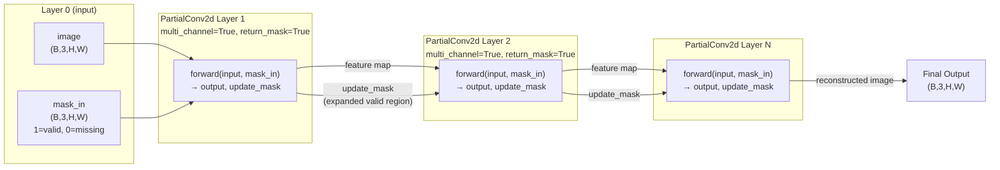
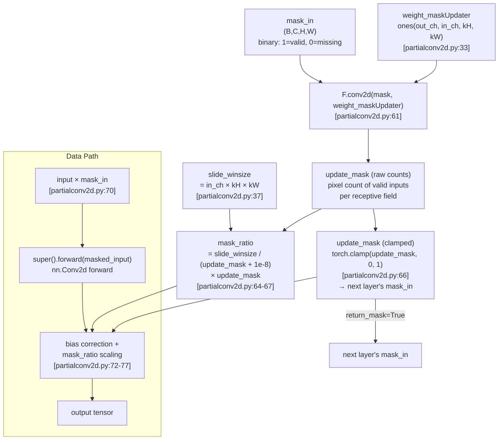
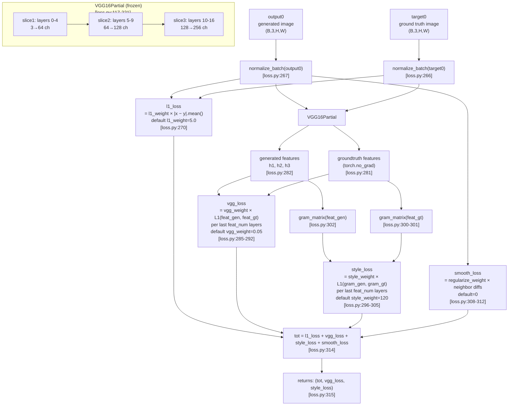
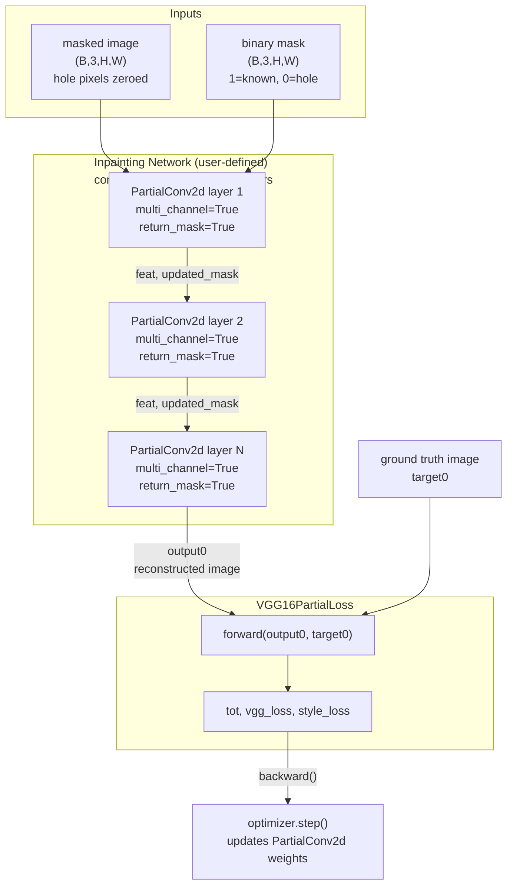

<!-- source: DeepWiki mcp.deepwiki.com · repo NVIDIA/partialconv · page 5 Use Case: Image Inpainting · fetched 2026-10-26 -->

# Use Case: Image Inpainting

<details>
<summary>Relevant source files</summary>

The following files were used as context for generating this wiki page:

- [README.MD](README.MD)
- [models/loss.py](models/loss.py)
- [models/partialconv2d.py](models/partialconv2d.py)

</details>


This page covers how `PartialConv2d` is configured and composed to solve the image inpainting problem: reconstructing missing or masked regions in an image. It explains the mask propagation flow across network layers and how the composite training loss drives the reconstruction. For the internal mechanics of a single `PartialConv2d` forward pass, see [PartialConv2d: The Core Layer](#2) and [Mask Propagation Mechanics](#2.1). For the detailed loss function reference, see [Loss Functions](#5.1).

---

## Overview

Image inpainting requires a network to:

1. Accept a partially-observed image (pixels in the "hole" region are unknown).
2. Accept a binary mask indicating which pixels are valid (1) and which are missing (0).
3. Produce a plausible reconstruction for the missing region.

Standard convolutions treat all input pixels equally, which causes invalid (missing) pixels to pollute feature maps. Partial convolution addresses this by re-normalizing each output activation by the fraction of valid pixels in its receptive field, then propagating an updated mask forward so downstream layers know which locations are now considered "filled."

The two constructor flags that switch `PartialConv2d` into inpainting mode are:

| Flag | Value | Effect |
|---|---|---|
| `multi_channel` | `True` | Mask has shape `(B, C, H, W)` — a separate mask per channel |
| `return_mask` | `False` (padding) | Layer returns only the output tensor |
| `return_mask` | `True` (inpainting) | Layer returns `(output, updated_mask)` for chaining |

From the README:

```
# partial convolution for inpainting
PartialConv2d(3, 16, kernel_size=3, stride=1, padding=1, bias=False,
              multi_channel=True, return_mask=True)
```

Sources: [README.MD:42-46](), [models/partialconv2d.py:14-28]()

---

## Mask Propagation Across Layers

In an inpainting network, every layer is a `PartialConv2d` with `return_mask=True`. The mask output of layer `n` becomes the mask input of layer `n+1`. This creates a chain where the "known" region expands with network depth.

**Diagram 1: Layer-to-layer mask and feature flow**



Sources: [models/partialconv2d.py:43-83]()

---

## How a Single Layer Updates the Mask

Within each `PartialConv2d` forward pass, the mask update follows these steps:

1. **Count valid pixels** — convolve the mask with an all-ones kernel of the same spatial size as the convolution kernel. The result (`update_mask`) contains the number of valid pixels in each receptive field window.
2. **Compute normalization ratio** — `mask_ratio = slide_winsize / (update_mask + 1e-8)`, then multiply by the binary `update_mask` to zero out positions where no valid pixels existed.
3. **Normalize data path output** — the raw convolution output is scaled by `mask_ratio` so that the contribution of valid pixels is independent of how many were present.
4. **Produce binary updated mask** — `update_mask` is clamped to `[0, 1]`, so any output position that had at least one valid input pixel becomes 1 in the new mask.

The key consequence: once a position has *any* valid neighbors, it becomes valid in the next layer's mask. The hole shrinks layer by layer.

**Diagram 2: Internal computation variables for inpainting mode**



Sources: [models/partialconv2d.py:32-83]()

---

## The `multi_channel` Flag in Inpainting Context

When `multi_channel=True`, the mask updater kernel has shape `(out_channels, in_channels, kH, kW)` instead of `(1, 1, kH, kW)`. This allows each output channel to have an independently tracked mask, which is necessary when the network operates on per-channel features where some channels may carry different validity information.

| Parameter | Padding use case | Inpainting use case |
|---|---|---|
| `multi_channel` | `False` | `True` |
| `return_mask` | `False` | `True` |
| `weight_maskUpdater` shape | `(1, 1, kH, kW)` | `(out_ch, in_ch, kH, kW)` |
| `slide_winsize` | `1 × kH × kW` | `in_ch × kH × kW` |
| Output | `tensor` | `(tensor, update_mask)` |

Sources: [models/partialconv2d.py:32-41](), [models/partialconv2d.py:80-83]()

---

## Training Objective: `VGG16PartialLoss`

The inpainting network is trained with a composite loss defined in `models/loss.py`. The `VGG16PartialLoss` class (which extends `PerceptualLoss`) combines four terms:

**Diagram 3: Loss computation data flow**



Sources: [models/loss.py:225-315]()

### Loss Term Summary

| Loss Term | Weight Parameter | Default | Description |
|---|---|---|---|
| L1 pixel loss | `l1_alpha` | `5.0` | Mean absolute pixel difference after normalization |
| Perceptual (VGG content) | `perceptual_alpha` | `0.05` | L1 between VGG feature maps of generated vs. ground truth |
| Style (Gram matrix) | `style_alpha` | `120.0` | L1 between Gram matrices of VGG features |
| Smoothness regularizer | `smooth_alpha` | `0` | Mean absolute horizontal + vertical pixel differences |

The `feat_num` parameter (default `3`) controls how many of the VGG slices contribute to perceptual and style losses. With `layer_num=3`, slices `slice1`, `slice2`, and `slice3` are used; the last `feat_num` entries from the feature list are iterated at [models/loss.py:287-292]() and [models/loss.py:297-305]().

Sources: [models/loss.py:229-252](), [models/loss.py:285-305]()

---

## `gram_matrix` Function

The Gram matrix captures texture statistics by computing the correlation between feature channels. It is defined at [models/loss.py:17-40]().

For a feature map of shape `(B, C, H, W)`:

1. Reshape to `(B, C, H×W)`.
2. Transpose to `(B, H×W, C)`.
3. Compute `features @ features^T` normalized by `C×H×W`.

The implementation uses `torch.baddbmm` rather than a direct division to avoid numerical underflow in mixed-precision (FP16) training:

```
gram = torch.baddbmm(input, features, features_t, beta=0, alpha=1./(ch * h * w))
```

This is one of the AMP-required changes documented in the README. See [Mixed Precision (AMP) Training](#6.1) for all required changes.

Sources: [models/loss.py:17-40](), [README.MD:66-73]()

---

## `VGG16Partial`: The Feature Extractor

`VGG16Partial` ([models/loss.py:117-221]()) is a frozen VGG-16 feature extractor used only for loss computation. It is not a partial-convolution network itself — it uses standard `nn.Conv2d`. "Partial" in the name refers to it being a partial (truncated) VGG-16.

| Attribute | Detail |
|---|---|
| Base model | `torchvision.models.vgg16` with custom `make_vgg16_layers` |
| Pooling | `MaxPool2d` by default; `AvgPool2d` if `style_avg_pool=True` |
| Slices available | Up to 4 (`slice1` through `slice4`) |
| Weights frozen | Yes — `requires_grad=False` for all parameters |
| Normalization | ImageNet mean/std via `normalize_batch` (div_factor=1.0) |

The `VGG16Partial` forward pass returns a list of intermediate feature maps, one per slice, which are then compared against those of the ground truth image.

Sources: [models/loss.py:92-221]()

---

## End-to-End Inpainting Pipeline

**Diagram 4: Full inpainting pipeline from input to loss**



Sources: [models/partialconv2d.py:43-83](), [models/loss.py:254-315]()

---

## Mixed Precision Considerations

When training with NVIDIA Apex AMP (FP16), three changes are required that directly affect the inpainting components:

1. **`amp.initialize`** — wrap both the inpainting model and `vgg_feat_loss` with AMP.
2. **Gram matrix division** — replace single-step `/ (ch * h * w)` with `torch.baddbmm(..., alpha=1./(ch * h * w))` at [models/loss.py:31]().
3. **Epsilon guard** — change `1e-8` to `1e-6` in the `mask_ratio` computation at [models/partialconv2d.py:64]() to prevent underflow.

See [Mixed Precision (AMP) Training](#6.1) for the complete guide.

Sources: [README.MD:48-78](), [models/loss.py:29-32](), [models/partialconv2d.py:63-64]()

---

