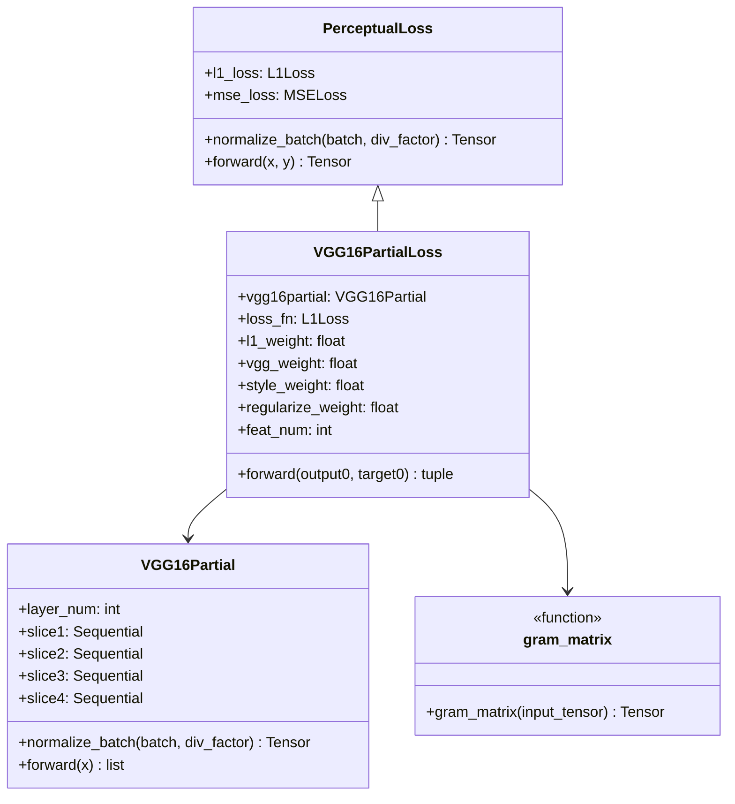
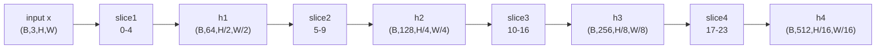
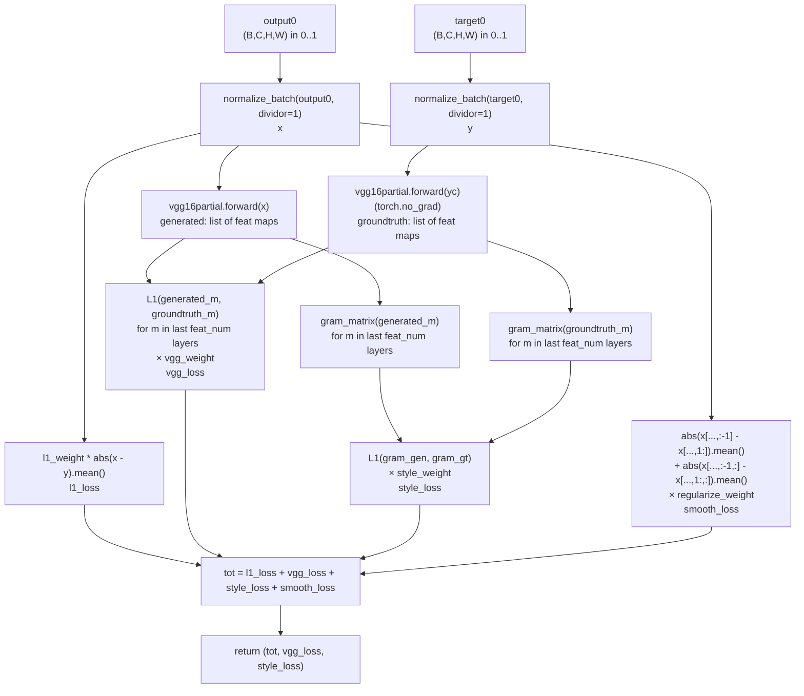

<!-- source: DeepWiki mcp.deepwiki.com · repo NVIDIA/partialconv · page 5.1 Loss Functions · fetched 2026-10-26 -->

# Loss Functions

<details>
<summary>Relevant source files</summary>

The following files were used as context for generating this wiki page:

- [README.MD](README.MD)
- [models/loss.py](models/loss.py)

</details>


This page is a full reference for `models/loss.py`, which implements the composite loss function used to train the image inpainting model. It covers `gram_matrix`, `PerceptualLoss`, `VGG16Partial`, and `VGG16PartialLoss`.

For the broader context of how these losses fit into the inpainting pipeline, see the Image Inpainting use case page ([5](#5)). For AMP-specific changes to this loss module, see [6.1](#6.1).

---

## Module Overview

`models/loss.py` assembles four distinct loss signals into a single differentiable objective. The central class is `VGG16PartialLoss`, which extends `PerceptualLoss` and internally uses a frozen `VGG16Partial` feature extractor.

**Module-level class diagram:**



Sources: [models/loss.py:1-316]()

---

## `gram_matrix`

**Function:** `gram_matrix(input_tensor)` [models/loss.py:17-40]()

Computes the Gram matrix of a batch of feature maps, used for the style loss term.

**Input:** a tensor of shape `(B, C, H, W)`.

**Steps:**
1. Reshape to `(B, C, H*W)`.
2. Transpose to get `(B, H*W, C)`.
3. Compute batch matrix multiply: `features @ features_t`, scaled by `1 / (C * H * W)`.

The scaling is applied via `torch.baddbmm` with `alpha=1./(ch * h * w)` rather than a post-hoc division. This two-step approach avoids FP16 overflow during mixed-precision training. See [6.1](#6.1) for details.

```
gram[b] = features[b] @ features[b]^T  /  (C × H × W)
```

The result has shape `(B, C, C)` — a channel-to-channel correlation matrix, normalized by spatial extent.

Sources: [models/loss.py:17-40]()

---

## `PerceptualLoss`

**Class:** `PerceptualLoss(nn.Module)` [models/loss.py:42-90]()

A lightweight base class providing:

- **`normalize_batch(batch, div_factor=255.)`** [models/loss.py:53-76](): Normalizes an image tensor using ImageNet mean and standard deviation. The input is first divided by `div_factor` (default `255.0`), then shifted and scaled per channel.

  | Channel | Mean  | Std   |
  |---------|-------|-------|
  | R (0)   | 0.485 | 0.229 |
  | G (1)   | 0.456 | 0.224 |
  | B (2)   | 0.406 | 0.225 |

- **`forward(x, y)`** [models/loss.py:78-90](): Applies `normalize_batch` to both inputs and returns their L1 distance.

`PerceptualLoss` is not used standalone in this repo; it serves as the base class for `VGG16PartialLoss`.

Sources: [models/loss.py:42-90]()

---

## `VGG16Partial`

**Class:** `VGG16Partial(nn.Module)` [models/loss.py:117-221]()

A frozen VGG16 feature extractor used to produce intermediate feature maps for the perceptual and style losses. All parameters have `requires_grad=False`.

### Construction

The constructor takes a `vgg_path` (path to pretrained weights) and a `layer_num` (1–4) controlling how many VGG slices are instantiated [models/loss.py:121-159]().

The VGG16 feature layers are divided into sequential slices based on the standard VGG16 architecture built by `make_vgg16_layers()`:

| Attribute  | Layer indices | Channels     | Description                    |
|------------|---------------|--------------|--------------------------------|
| `slice1`   | 0–4           | 3 → 64       | 2× Conv + ReLU + MaxPool       |
| `slice2`   | 5–9           | 64 → 128     | 2× Conv + ReLU + MaxPool       |
| `slice3`   | 10–16         | 128 → 256    | 3× Conv + ReLU + MaxPool       |
| `slice4`   | 17–23         | 256 → 512    | 3× Conv + ReLU + MaxPool       |

Only slices up to `layer_num` are instantiated. For example, `layer_num=3` creates `slice1`, `slice2`, and `slice3`.

### `make_vgg16_layers`

**Function:** `make_vgg16_layers(style_avg_pool=False)` [models/loss.py:92-115]()

Builds a custom `nn.Sequential` from a fixed `vgg16_cfg` list. When `style_avg_pool=True`, pooling layers use `nn.AvgPool2d` instead of `nn.MaxPool2d`. This is distinct from the VGG in the padding models (which uses `PartialConv2d`); here, standard `nn.Conv2d` is used throughout.

### `normalize_batch`

`VGG16Partial` has its own `normalize_batch` [models/loss.py:161-185]() with a default `div_factor=1.0`. This is because `VGG16PartialLoss` assumes its inputs are already in `[0, 1]` rather than `[0, 255]`.

### Forward pass

`forward(x)` [models/loss.py:187-221]() passes the input through slices sequentially and returns a list of intermediate feature maps `[h1]`, `[h1, h2]`, `[h1, h2, h3]`, or `[h1, h2, h3, h4]` depending on `layer_num`.

**Feature extraction flow:**



Sources: [models/loss.py:92-221]()

---

## `VGG16PartialLoss`

**Class:** `VGG16PartialLoss(PerceptualLoss)` [models/loss.py:225-315]()

The composite loss used for inpainting training. It combines four terms.

### Constructor Parameters

```python
VGG16PartialLoss(
    l1_alpha=5.0,
    perceptual_alpha=0.05,
    style_alpha=120,
    smooth_alpha=0,
    feat_num=3,
    vgg_path='~/.torch/vgg16-397923af.pth'
)
```

[models/loss.py:229-252]()

| Parameter          | Attribute              | Default | Purpose                                      |
|--------------------|------------------------|---------|----------------------------------------------|
| `l1_alpha`         | `l1_weight`            | `5.0`   | Weight for pixel-level L1 loss               |
| `perceptual_alpha` | `vgg_weight`           | `0.05`  | Weight for VGG content (perceptual) loss     |
| `style_alpha`      | `style_weight`         | `120`   | Weight for Gram-matrix style loss            |
| `smooth_alpha`     | `regularize_weight`    | `0`     | Weight for smoothness regularization         |
| `feat_num`         | `feat_num`             | `3`     | Number of VGG slices used for losses         |
| `vgg_path`         | —                      | —       | Path to pretrained VGG16 weights             |

Note: `feat_num` selects the *last* `feat_num` feature maps from `VGG16Partial`'s output list. With `layer_num=3` (the default in `VGG16Partial`) and `feat_num=3`, all three feature maps are used.

### Forward Pass

`forward(output0, target0)` [models/loss.py:254-315]() expects both arguments to be in `[0, 1]`. Returns a tuple `(total_loss, vgg_loss, style_loss)`.

**Forward pass data flow:**



Sources: [models/loss.py:254-315]()

---

## The Four Loss Terms

### 1. L1 Loss

[models/loss.py:269-270]()

Pixel-wise absolute difference between normalized output and target, weighted by `l1_weight`:

```
l1_loss = l1_weight × mean(|x − y|)
```

Applied to the ImageNet-normalized versions of both images. Default weight: **5.0**.

### 2. Perceptual (VGG Content) Loss

[models/loss.py:285-292]()

L1 distance between intermediate VGG16 feature maps of the generated and ground-truth images:

```
vgg_loss = vgg_weight × Σ L1(generated[m], groundtruth[m])
           for m in [len−feat_num, len)
```

Ground-truth features are computed under `torch.no_grad()` to avoid storing unnecessary gradients [models/loss.py:280-281](). Default weight: **0.05**.

### 3. Style (Gram Matrix) Loss

[models/loss.py:296-305]()

L1 distance between Gram matrices of the generated and ground-truth VGG feature maps:

```
style_loss = style_weight × Σ L1(gram_matrix(generated[m]), gram_matrix(groundtruth[m]))
             for m in [len−feat_num, len)
```

The Gram matrix captures channel-to-channel correlations, which encode texture statistics independent of spatial layout. Default weight: **120**.

### 4. Smoothness Regularization

[models/loss.py:308-312]()

Penalizes pixel discontinuities in both horizontal and vertical directions:

```
smooth_loss = regularize_weight × (
    mean(|x[..., :, :-1] − x[..., :, 1:]|) +   # horizontal
    mean(|x[..., :-1, :] − x[..., 1:, :]|)      # vertical
)
```

Default weight: **0** (disabled). Enable by passing a non-zero `smooth_alpha`.

### Summary Table

| Term             | Formula                                      | Default Weight | Controlled by          |
|------------------|----------------------------------------------|----------------|------------------------|
| L1               | `mean(|x − y|)`                              | 5.0            | `l1_alpha`             |
| Perceptual / VGG | `Σ L1(feat_gen, feat_gt)`                    | 0.05           | `perceptual_alpha`     |
| Style / Gram     | `Σ L1(gram(feat_gen), gram(feat_gt))`        | 120            | `style_alpha`          |
| Smoothness       | `mean(|Δx_h|) + mean(|Δx_v|)`               | 0 (off)        | `smooth_alpha`         |

Sources: [models/loss.py:269-315]()

---

## VGG Feature Map Selection

`feat_num` controls which VGG slices contribute to the perceptual and style losses. The iteration is always over the *last* `feat_num` elements of the feature list returned by `VGG16Partial.forward()`:

```python
for m in range(len(generated) - self.feat_num, len(generated)):
```

[models/loss.py:287-291](), [models/loss.py:298-304]()

With default settings (`layer_num=3`, `feat_num=3`), the generated list is `[h1, h2, h3]` and all three slices contribute. Setting `feat_num=1` would use only the deepest slice (`h3`).

| `layer_num` | `feat_num` | Feature maps used       |
|-------------|------------|-------------------------|
| 3           | 3          | h1, h2, h3              |
| 3           | 2          | h2, h3                  |
| 4           | 4          | h1, h2, h3, h4          |
| 4           | 2          | h3, h4                  |

Sources: [models/loss.py:121-137](), [models/loss.py:285-305]()

---

## VGG Feature Extraction: Conditional Computation

Both the perceptual and style loss branches are guarded by weight checks [models/loss.py:276]():

```python
if self.vgg_weight != 0 or self.style_weight != 0:
    # run vgg16partial on both generated and ground truth
```

This means the VGG forward pass is skipped entirely when both weights are zero, which saves computation during ablation experiments or L1-only training runs.

Sources: [models/loss.py:276-305]()

---

## Numerical Stability Notes

Two aspects of `models/loss.py` are specifically designed for mixed-precision (FP16) training:

1. **`gram_matrix` uses `torch.baddbmm`** with `alpha=1./(ch * h * w)` instead of a single large division [models/loss.py:30-31](). A single division of a large matrix product can overflow FP16 range.

2. **`normalize_batch` in `VGG16Partial`** defaults to `div_factor=1.0` because the inpainting pipeline passes images already scaled to `[0, 1]`, avoiding an unnecessary division.

For additional AMP changes outside this file (epsilon in `partialconv2d.py`, `amp.initialize` usage), see [6.1](#6.1).

Sources: [models/loss.py:29-38](), [README.MD:66-77]()

---

