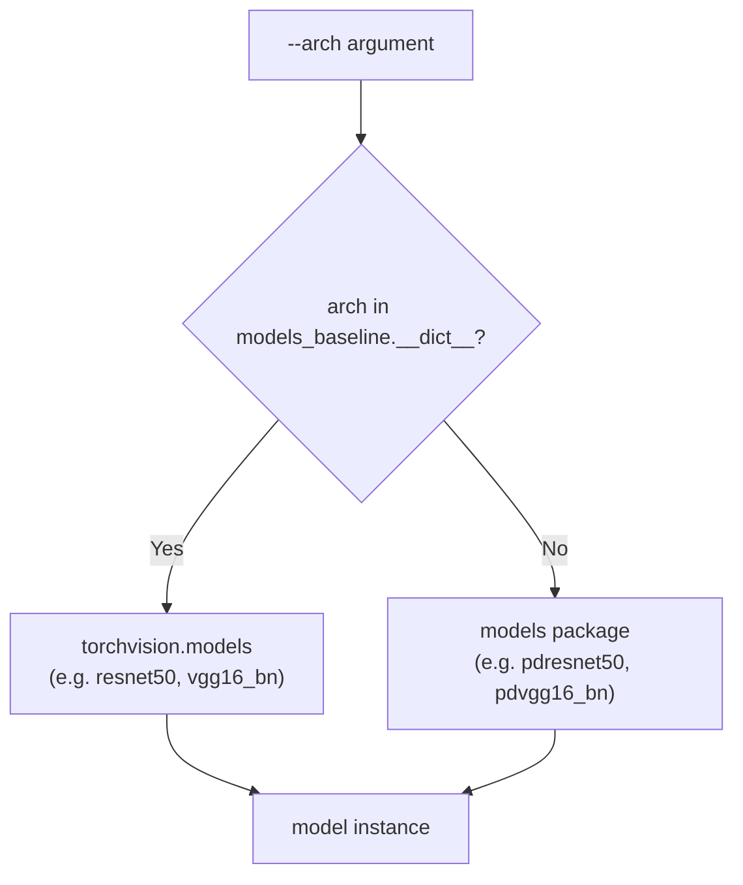
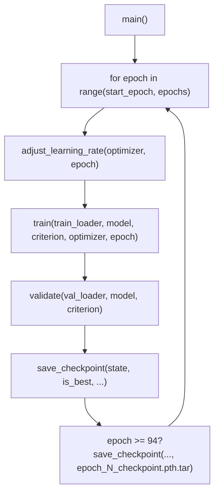

<!-- source: DeepWiki mcp.deepwiki.com · repo NVIDIA/partialconv · page 6 Training on ImageNet · fetched 2026-10-26 -->

# Training on ImageNet

<details>
<summary>Relevant source files</summary>

The following files were used as context for generating this wiki page:

- [README.MD](README.MD)
- [main.py](main.py)

</details>


`main.py` is the single entry point for training and evaluating classification models on ImageNet. It handles both zero-padding baseline architectures (from `torchvision.models`) and partial-convolution-based architectures (from `models/`) under a unified CLI. This page covers the training script only — for details on the partial convolution layer itself, see [PartialConv2d: The Core Layer](#2). For the PDResNet and PDVGG architectures being trained, see [PDResNet Architectures](#4.1) and [PDVGG Architectures](#4.2). For AMP/mixed-precision training, see [Mixed Precision (AMP) Training](#6.1).

---

## Dual Model Source Pattern

The script imports two model registries and merges them into a single namespace for the `-a`/`--arch` argument:

[main.py:38-50]()

```
torchvision.models  →  models_baseline   (zero-padding networks)
models/             →  models_partial    (partial conv networks)
```

At model construction time, the arch string is looked up in `models_baseline.__dict__` first; if not found there, it falls back to `models_partial.__dict__`:

[main.py:147-159]()

**Dual Model Source Resolution**



Sources: [main.py:38-50](), [main.py:147-159]()

---

## CLI Arguments

All arguments are registered via `argparse`. The table below covers every parameter:

| Argument | Short | Default | Type | Description |
|---|---|---|---|---|
| `--data_train` | — | — | `str` | Path to training dataset root |
| `--data_val` | — | — | `str` | Path to validation dataset root |
| `--arch` | `-a` | `resnet50` | `str` | Model architecture name |
| `--workers` | `-j` | `4` | `int` | Number of data loading worker processes |
| `--epochs` | — | `100` | `int` | Total number of training epochs |
| `--start-epoch` | — | `0` | `int` | Starting epoch (useful for resuming) |
| `--batch-size` | `-b` | `192` | `int` | Mini-batch size |
| `--lr` | — | `0.1` | `float` | Initial learning rate |
| `--momentum` | — | `0.9` | `float` | SGD momentum |
| `--weight-decay` | `--wd` | `1e-4` | `float` | L2 weight decay |
| `--print-freq` | `-p` | `10` | `int` | Console/log print frequency (in batches) |
| `--resume` | — | `''` | `str` | Path to checkpoint to resume from |
| `--evaluate` | `-e` | `False` | `flag` | Run validation only, no training |
| `--pretrained` | — | `False` | `flag` | Load pretrained weights |
| `--world-size` | — | `1` | `int` | Number of distributed processes |
| `--dist-url` | — | `tcp://...` | `str` | Distributed init URL |
| `--dist-backend` | — | `gloo` | `str` | Distributed backend |
| `--seed` | — | `None` | `int` | Random seed (enables cuDNN determinism) |
| `--gpu` | — | `None` | `int` | Single GPU id to use |
| `--prefix` | — | `''` | `str` | String tag embedded in checkpoint directory name |
| `--ckptdirprefix` | — | `''` | `str` | Filesystem prefix for checkpoint directory |

Sources: [main.py:53-107]()

---

## Example Commands

These are the four invocations documented in the README:

**ResNet50 — zero padding (baseline)**
```
python main.py -a resnet50 \
  --data_train /path/ILSVRC/Data/CLS-LOC/train \
  --data_val   /path/ILSVRC/Data/CLS-LOC/perfolder_val \
  --batch-size 192 --workers 32 \
  --prefix multigpu_b192 --ckptdirprefix experiment_1/
```

**ResNet50 — partial convolution padding**
```
python main.py -a pdresnet50 \
  --data_train /path/ILSVRC/Data/CLS-LOC/train \
  --data_val   /path/ILSVRC/Data/CLS-LOC/perfolder_val \
  --batch-size 192 --workers 32 \
  --prefix multigpu_b192 --ckptdirprefix experiment_1/
```

**VGG16-BN — zero padding (baseline)**
```
python main.py -a vgg16_bn \
  --data_train /path/ILSVRC/Data/CLS-LOC/train \
  --data_val   /path/ILSVRC/Data/CLS-LOC/perfolder_val \
  --batch-size 192 --workers 32 \
  --prefix multigpu_b192 --ckptdirprefix experiment_1/
```

**VGG16-BN — partial convolution padding**
```
python main.py -a pdvgg16_bn \
  --data_train /path/ILSVRC/Data/CLS-LOC/train \
  --data_val   /path/ILSVRC/Data/CLS-LOC/perfolder_val \
  --batch-size 192 --workers 32 \
  --prefix multigpu_b192 --ckptdirprefix experiment_1/
```

Sources: [README.MD:81-100]()

---

## Data Pipeline

The data pipeline uses `torchvision.datasets.ImageFolder` with the following transforms:

| Split | Transforms |
|---|---|
| **Train** | `RandomResizedCrop(224)` → `RandomHorizontalFlip()` → `ToTensor()` → `Normalize(mean, std)` |
| **Val** | `Resize(256)` → `CenterCrop(224)` → `ToTensor()` → `Normalize(mean, std)` |

ImageNet normalization constants: `mean=[0.485, 0.456, 0.406]`, `std=[0.229, 0.224, 0.225]`.

Distributed training uses `torch.utils.data.distributed.DistributedSampler` for the training set; the validation loader is always sequential with `shuffle=False`.

Sources: [main.py:209-242]()

---

## Training Loop Structure

The `main()` function orchestrates the outer epoch loop. The `train()` and `validate()` functions handle one epoch each.

**Training and Validation Flow**



Sources: [main.py:258-288]()

### `train()` — One Epoch

[main.py:291-347]()

Steps per batch:
1. Move `input` and `target` to GPU.
2. Forward pass: `output = model(input)`.
3. Compute `loss = criterion(output, target)` using `CrossEntropyLoss`.
4. Measure top-1 and top-5 accuracy via `accuracy()`.
5. `optimizer.zero_grad()` → `loss.backward()` → `optimizer.step()`.
6. Update `AverageMeter` instances for `batch_time`, `data_time`, `losses`, `top1`, `top5`.
7. Print and log every `print_freq` batches.

### `validate()` — One Epoch

[main.py:350-405]()

Runs under `torch.no_grad()` with `model.eval()`. Computes loss and top-1/top-5 accuracy. Returns `top1.avg` which is compared against `best_prec1` to decide whether a checkpoint is the best so far.

---

## Multi-GPU and Distributed Setup

[main.py:168-179]()

| Mode | Condition | Mechanism |
|---|---|---|
| Single GPU | `--gpu N` | `model.cuda(args.gpu)` |
| Distributed | `--world-size > 1` | `DistributedDataParallel` |
| Data parallel (non-VGG) | default | `torch.nn.DataParallel(model).cuda()` |
| Data parallel (VGG) | `'vgg' in args.arch` | `DataParallel` applied only to `model.features` |

The VGG-specific branch (`'vgg' in args.arch`) wraps only `model.features` in `DataParallel` because the classifier head is a separate `nn.Sequential`. This applies to both `vgg*` (baseline) and `pdvgg*` (partial conv) variants.

Sources: [main.py:168-179]()

---

## Optimizer and Loss

| Component | Class | Configuration |
|---|---|---|
| Loss | `nn.CrossEntropyLoss` | Standard cross-entropy, placed on CUDA |
| Optimizer | `torch.optim.SGD` | `lr=0.1`, `momentum=0.9`, `weight_decay=1e-4` |

Only parameters where `requires_grad=True` are passed to the optimizer:

[main.py:185-187]()

---

## Learning Rate Schedule

The `adjust_learning_rate()` function implements step decay:

[main.py:432-436]()

```
lr = initial_lr × 0.1^(epoch // 30)
```

This reduces the learning rate by a factor of 10 at epochs 30, 60, and 90. With the default 100 epochs, the learning rate schedule has four phases:

| Epochs | LR factor |
|---|---|
| 0–29 | `lr × 1.0` |
| 30–59 | `lr × 0.1` |
| 60–89 | `lr × 0.01` |
| 90–99 | `lr × 0.001` |

---

## Checkpoint System

The `save_checkpoint()` function [main.py:408-411]() saves a dictionary containing:

| Key | Value |
|---|---|
| `epoch` | Current epoch + 1 |
| `arch` | Architecture name string |
| `state_dict` | `model.state_dict()` |
| `best_prec1` | Best top-1 accuracy seen so far |
| `optimizer` | `optimizer.state_dict()` |

**Checkpoint directory** is constructed as:
```
{ckptdirprefix}checkpoint_{arch}_{prefix}/
```

**Two checkpointing policies are active simultaneously:**
1. `checkpoint.pth.tar` — overwritten every epoch; if `is_best`, also copied to `model_best.pth.tar`.
2. `epoch_N_checkpoint.pth.tar` — individual snapshot saved for every epoch from epoch 94 onward [main.py:281-288]().

Resuming from a checkpoint restores `start_epoch`, `best_prec1`, `model.state_dict()`, and `optimizer.state_dict()` [main.py:190-203]().

Sources: [main.py:190-203](), [main.py:269-288](), [main.py:408-411]()

---

## `AverageMeter` Utility

[main.py:414-429]()

`AverageMeter` is a lightweight class that tracks the running average of a scalar. It is used to aggregate `batch_time`, `data_time`, `losses`, `top1`, and `top5` within a single epoch.

| Attribute | Meaning |
|---|---|
| `val` | Most recent value passed to `update()` |
| `sum` | Running sum |
| `count` | Total number of samples accumulated |
| `avg` | `sum / count` |

`update(val, n=1)` increments `sum` by `val * n` and `count` by `n`, making it correct for batches of varying size.

---

## `accuracy()` Utility

[main.py:439-453]()

Computes top-k precision for an arbitrary list of `k` values (called with `topk=(1, 5)`). Returns a list of tensors, each representing `correct_in_top_k / batch_size * 100`. Runs entirely under `torch.no_grad()`.

---

## Logging

Every print statement is mirrored to a text file at `{checkpoint_dir}/loss.txt` (stored in `args.logger_fname`). The file is opened in append mode (`"a"`) on each write, so it persists across resume runs. A timestamp header is written at startup [main.py:120-123]().

Sources: [main.py:115-123](), [main.py:329-347](), [main.py:389-403]()

---

