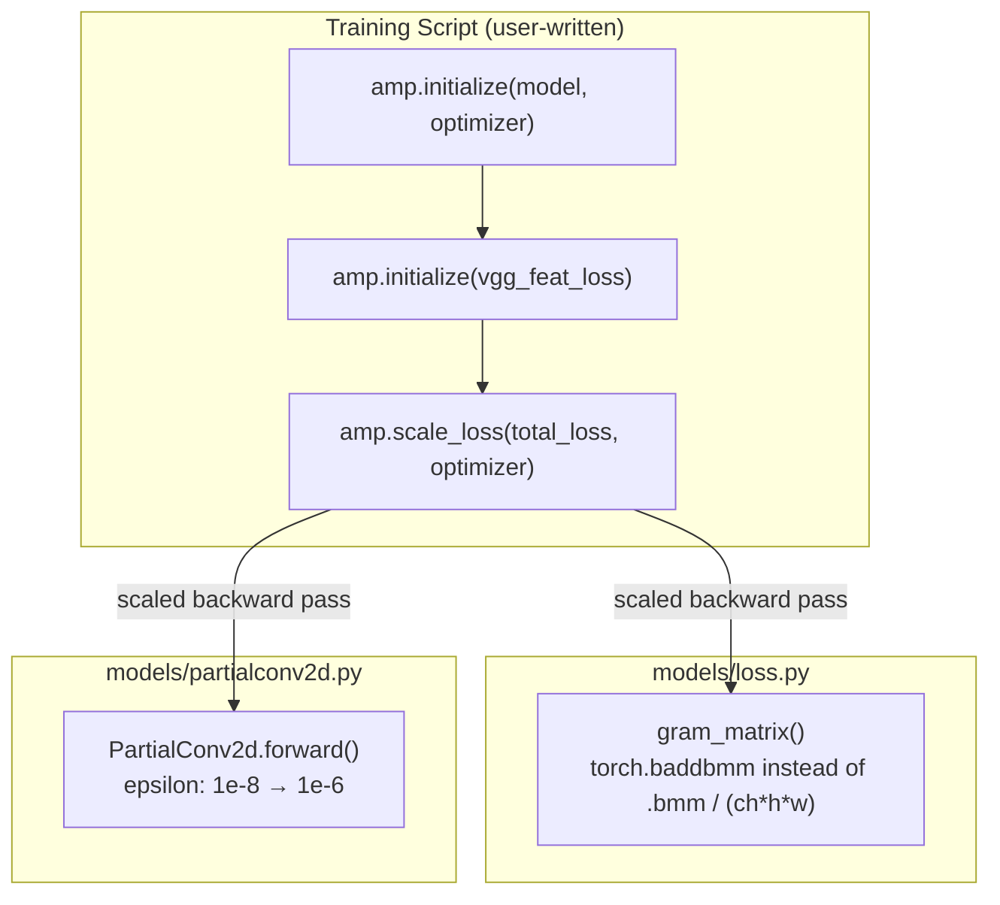
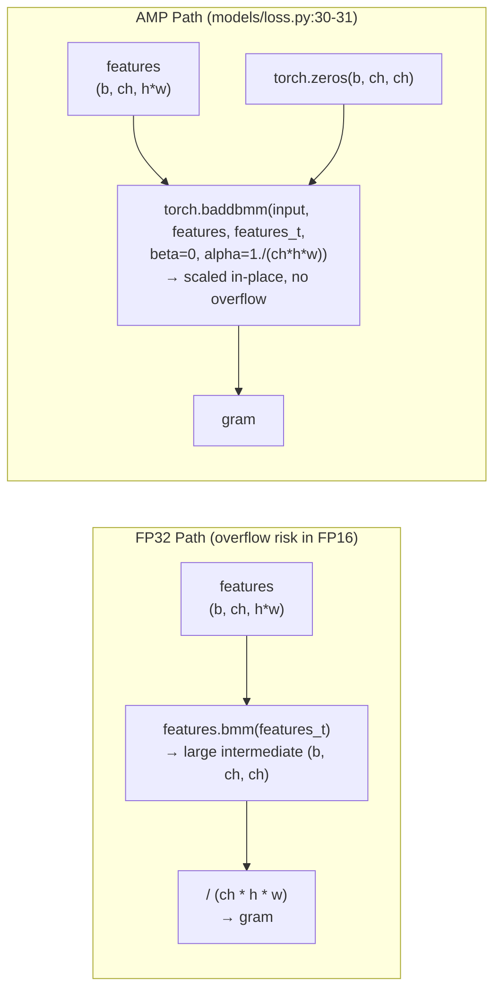
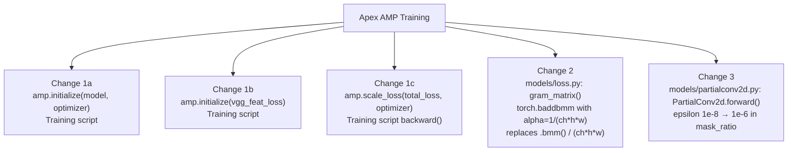

<!-- source: DeepWiki mcp.deepwiki.com · repo NVIDIA/partialconv · page 6.1 Mixed Precision (AMP) Training · fetched 2026-10-26 -->

# Mixed Precision (AMP) Training

<details>
<summary>Relevant source files</summary>

The following files were used as context for generating this wiki page:

- [README.MD](README.MD)
- [models/loss.py](models/loss.py)
- [models/partialconv2d.py](models/partialconv2d.py)

</details>


## Purpose and Scope

This page documents the code-level changes required to enable NVIDIA Apex Automatic Mixed Precision (AMP) training for the **image inpainting** use case. Mixed precision training reduces memory usage and improves throughput by running portions of the network in FP16, but two numerical issues in this codebase — a large Gram matrix product and a very small epsilon constant — require targeted fixes.

This page covers only the AMP integration changes. For the full training loop and CLI arguments, see [Training on ImageNet](#6). For details on the loss functions being modified here, see [Loss Functions](#5.1). For the `PartialConv2d` epsilon guard in context, see [Mask Propagation Mechanics](#2.1).

> **Prerequisite**: Install NVIDIA Apex from [https://github.com/NVIDIA/apex](https://github.com/NVIDIA/apex) before using any of the AMP APIs referenced below.

---

## Why Standard AMP Is Insufficient

FP16 has a significantly smaller dynamic range than FP32 (max ~65504, min ~6×10⁻⁵). Two operations in this codebase produce values outside this range during typical training:

| Operation | FP32 Safe? | FP16 Problem |
|---|---|---|
| `features.bmm(features_t) / (ch * h * w)` in `gram_matrix` | Yes | Intermediate `bmm` result overflows before division |
| `slide_winsize / (update_mask + 1e-8)` in `PartialConv2d.forward` | Yes | `1e-8` underflows to zero in FP16, causing division by zero |

The standard `amp.initialize` / `amp.scale_loss` pattern handles gradient scaling but does **not** fix these computational overflow/underflow issues. The sections below describe all required changes.

Sources: `README.MD` [README.MD:48-78](), `models/loss.py` [models/loss.py:29-38](), `models/partialconv2d.py` [models/partialconv2d.py:63-64]()

---

## Overview of Required Changes

**Change flow diagram: where each AMP fix applies**



Sources: `README.MD` [README.MD:48-78]()

---

## Change 1 — `amp.initialize` and `amp.scale_loss`

These are the standard Apex AMP integration points. They must be applied in the training script (not in this repository's source files directly, as they depend on the user's training infrastructure).

**What to initialize:**

```python
from apex import amp

# Model and optimizer
self.model, self.optimizer = amp.initialize(
    self.model, self.optimizer, opt_level=args.amp_opt_level
)

# VGG loss module (contains frozen VGG16 weights that participate in forward)
self.vgg_feat_loss = amp.initialize(
    self.vgg_feat_loss, opt_level=args.amp_opt_level
)
```

Note that `vgg_feat_loss` (an instance of `VGG16PartialLoss`) must be passed to `amp.initialize` separately from the main model, because it is a standalone `nn.Module` with its own parameters.

**Scaled backward pass:**

```python
with amp.scale_loss(total_loss, self.g_optimizer) as scaled_loss:
    scaled_loss.backward()
```

`amp.scale_loss` multiplies the loss by a dynamic scale factor before `.backward()`, then unscales the gradients before the optimizer step. This prevents FP16 gradient underflow.

Sources: `README.MD` [README.MD:51-63]()

---

## Change 2 — Gram Matrix: Replace `.bmm` with `torch.baddbmm`

**File:** `models/loss.py`, function `gram_matrix` [models/loss.py:17-40]()

### The Problem

In FP32, the Gram matrix is computed as:

```python
gram = features.bmm(features_t) / (ch * h * w)
```

The intermediate result of `features.bmm(features_t)` is the sum of products across `ch * h * w` elements. For a typical VGG feature map (e.g., 256 channels, 32×32 spatial), this product can reach values in the millions — far beyond FP16's maximum of ~65504, causing overflow to `inf`.

### The Fix

`torch.baddbmm` accepts a scalar `alpha` argument that scales the result element-by-element **during** the batched matrix multiplication, avoiding the large intermediate value:

```python
input = torch.zeros(b, ch, ch).type(features.type())
gram = torch.baddbmm(
    input, features, features_t,
    beta=0, alpha=1./(ch * h * w), out=None
)
```

`alpha=1./(ch * h * w)` applies the normalization divisor at the BLAS level, so the accumulator never holds the unnormalized large values.

**Diagram: Gram matrix computation — FP32 path vs AMP path**



The alternative naive FP16-safe approach (commented out in the source) is sequential partial division:

```python
features = features / (ch * h)
gram = features.bmm(features_t) / w
```

This keeps intermediate values smaller by splitting the divisor across two steps, but the `baddbmm` approach is both cleaner and more numerically precise.

Sources: `models/loss.py` [models/loss.py:17-40](), `README.MD` [README.MD:66-73]()

---

## Change 3 — Epsilon Guard: `1e-8` → `1e-6`

**File:** `models/partialconv2d.py`, method `PartialConv2d.forward` [models/partialconv2d.py:63-67]()

### The Problem

In `PartialConv2d.forward`, `mask_ratio` is computed as:

```python
self.mask_ratio = self.slide_winsize / (self.update_mask + 1e-8)
```

The `1e-8` epsilon prevents division by zero when no valid pixels fall in a receptive field. However, FP16 cannot represent values smaller than approximately `6×10⁻⁵`. When `update_mask` values are near zero, `1e-8` rounds to exactly `0.0` in FP16, recreating the division-by-zero condition the epsilon was meant to prevent.

### The Fix

Increase the epsilon to `1e-6`, which is representable in FP16:

```python
# FP32-only training (current default in source):
self.mask_ratio = self.slide_winsize / (self.update_mask + 1e-8)

# For mixed precision training:
self.mask_ratio = self.slide_winsize / (self.update_mask + 1e-6)
```

The comment at [models/partialconv2d.py:63]() already documents this: `# for mixed precision training, change 1e-8 to 1e-6`.

### FP16 Representable Range Context

| Constant | FP16 Representable? | Notes |
|---|---|---|
| `1e-8` | **No** | Rounds to `0.0` in FP16 |
| `1e-7` | **No** | Below FP16 minimum subnormal |
| `1e-6` | Yes (subnormal) | Minimum safe value |
| `1e-5` | Yes | Comfortable margin |

Sources: `models/partialconv2d.py` [models/partialconv2d.py:63-67](), `README.MD` [README.MD:75-77]()

---

## Summary of All Required Changes



| # | Location | Change | Reason |
|---|---|---|---|
| 1a | Training script | `amp.initialize(model, optimizer)` | Standard AMP init |
| 1b | Training script | `amp.initialize(vgg_feat_loss)` | Separate VGG module needs its own AMP init |
| 1c | Training script | `amp.scale_loss(total_loss, optimizer)` | Prevent FP16 gradient underflow |
| 2 | `models/loss.py` → `gram_matrix` | `torch.baddbmm(..., alpha=1./(ch*h*w))` | Prevent FP16 overflow in Gram matrix intermediate |
| 3 | `models/partialconv2d.py` → `PartialConv2d.forward` | `1e-8` → `1e-6` in `mask_ratio` denominator | `1e-8` is not representable in FP16 |

Sources: `README.MD` [README.MD:48-78](), `models/loss.py` [models/loss.py:29-38](), `models/partialconv2d.py` [models/partialconv2d.py:63-64]()