# Page: Overview

# Overview

<details>
<summary>Relevant source files</summary>

The following files were used as context for generating this wiki page:

- [README.MD](README.MD)
- [models/partialconv2d.py](models/partialconv2d.py)

</details>


This page introduces the `NVIDIA/partialconv` repository: its motivation, the single core mechanism it provides, and the two distinct use cases built on top of it. For detailed reference on specific systems, follow the links in each section to the appropriate sub-pages.

---

## Purpose

The repository provides a PyTorch implementation of **partial convolution**, a convolution variant that conditions its output on a binary validity mask. It is described in two NVIDIA research publications:

- **Padding**: *Partial Convolution based Padding* (arXiv 2018) — replaces zero/reflection/replication padding at image boundaries.
- **Inpainting**: *Image Inpainting for Irregular Holes Using Partial Convolutions* (ECCV 2018) — fills missing image regions by propagating a mask through layers.

Both use cases share a single implementation: [models/partialconv2d.py]().

---

## Why Partial Convolution?

Standard `nn.Conv2d` with zero padding introduces boundary artifacts because padded pixels carry no real signal but are treated identically to valid pixels during convolution. Partial convolution conditions each output on only the valid (non-padded, non-missing) pixels within the receptive field, then re-normalizes the result.

The repository includes benchmark comparisons showing consistent top-1 accuracy improvements over zero, reflection, and replication padding across ResNet and VGG architectures on ImageNet (see `imgs/compare_all_padding.png`, `imgs/compare_with_zero_padding_bar.png`).

| Padding type | Description |
|---|---|
| Zero padding | Pads with 0; introduces boundary bias |
| Reflection padding | Mirrors image content at borders |
| Replication padding | Repeats edge pixels at borders |
| **Partial conv padding** | Conditions on valid pixels only; re-normalizes |

---

## Repository Structure

**Repository file map: roles of every significant file**

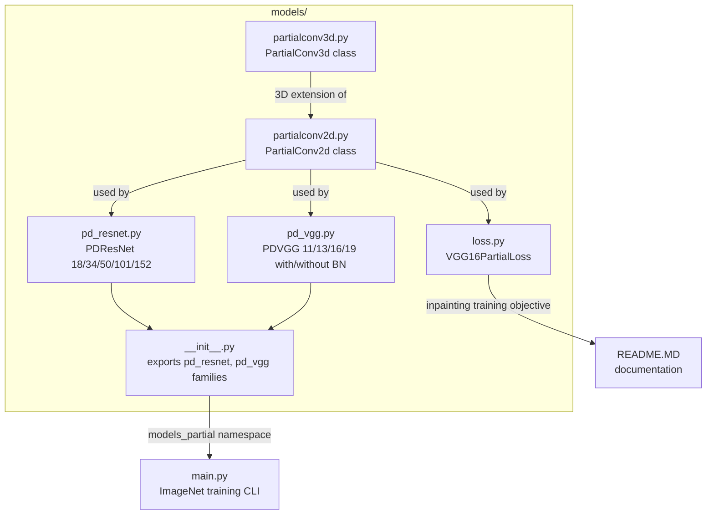

Sources: [README.MD:1-138](), [models/partialconv2d.py:1-84]()

---

## The Two Primary Use Cases

Both use cases are controlled by two constructor flags on `PartialConv2d`: `multi_channel` and `return_mask`.

| Flag | Default | Use case |
|---|---|---|
| `multi_channel=False` | `False` | Padding replacement — single-channel mask applied uniformly |
| `multi_channel=True` | `False` | Inpainting — per-channel mask tracks each channel independently |
| `return_mask=False` | `False` | Padding replacement — mask is not passed to next layer |
| `return_mask=True` | `False` | Inpainting — updated mask propagates to the next layer |

**How PartialConv2d maps to use cases and downstream components**

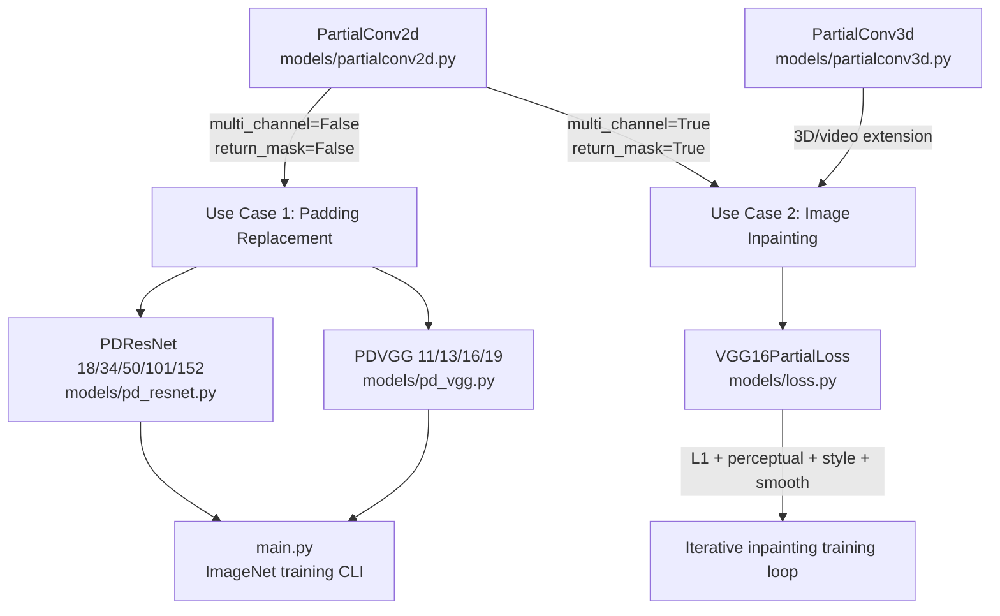

Sources: [models/partialconv2d.py:14-83](), [README.MD:32-46]()

---

## Core Mechanism: PartialConv2d

`PartialConv2d` (in [models/partialconv2d.py:14]()) extends `nn.Conv2d`. The forward pass has three stages:

1. **Mask path** — count valid pixels per receptive field, compute normalization ratio, update the mask to binary (clamped 0→1).
2. **Data path** — zero out invalid input positions, apply standard convolution weights via `super().forward()`.
3. **Output assembly** — multiply by the mask ratio and re-add bias to normalize for the fraction of valid pixels used.

```
output = (raw_conv(input × mask) − bias) × mask_ratio + bias   [if bias]
output = raw_conv(input × mask) × mask_ratio                    [no bias]
```

The mask ratio is: `slide_winsize / (update_mask + 1e-8)`, where `slide_winsize = kernel_h × kernel_w` (or `in_channels × kernel_h × kernel_w` in multi-channel mode).

For a full technical breakdown, see the [PartialConv2d reference](#2) and [Mask Propagation Mechanics](#2.1).

---

## Use Case 1: Padding Replacement

Replace `nn.Conv2d` with `PartialConv2d` (default flags) at layer boundaries to eliminate padding artifacts:

```
# before
nn.Conv2d(3, 16, kernel_size=3, stride=1, padding=1, bias=False)

# after
PartialConv2d(3, 16, kernel_size=3, stride=1, padding=1, bias=False)
```

This substitution is applied throughout the `PDResNet` and `PDVGG` model families. Training against ImageNet is handled by `main.py`. For details, see:
- [Use Case: Padding Replacement](#4)
- [PDResNet Architectures](#4.1)
- [PDVGG Architectures](#4.2)
- [Training on ImageNet](#6)

---

## Use Case 2: Image Inpainting

With `multi_channel=True, return_mask=True`, each layer receives the updated mask from the previous layer. This allows the model to track which spatial positions have been filled at each stage of the network. The training objective is defined in `VGG16PartialLoss` ([models/loss.py]()) and combines:

| Component | Weight (default) |
|---|---|
| L1 reconstruction loss | 5.0 |
| Perceptual (VGG feature) loss | 0.05 |
| Style (Gram matrix) loss | 120 |
| Smoothness regularizer | 0 |

For details, see [Use Case: Image Inpainting](#5) and [Loss Functions](#5.1).

---

## 3D Extension

`PartialConv3d` ([models/partialconv3d.py]()) applies the same mechanism over 5D tensors `(B, C, D, H, W)` for video or volumetric data. It is structurally parallel to `PartialConv2d`. For details, see [PartialConv3d](#3).

---

## Key Entry Points

| File | Role |
|---|---|
| `models/partialconv2d.py` | `PartialConv2d` — the core layer |
| `models/partialconv3d.py` | `PartialConv3d` — 3D extension |
| `models/pd_resnet.py` | `PDResNet`, `BasicBlock`, `Bottleneck` |
| `models/pd_vgg.py` | `PDVGG`, `make_layers_pd` |
| `models/loss.py` | `VGG16PartialLoss`, `VGG16Partial`, `gram_matrix` |
| `models/__init__.py` | Exports all `pd_resnet` and `pd_vgg` factory functions |
| `main.py` | ImageNet training CLI — `--arch` selects model family |

Sources: [README.MD:32-100](), [models/partialconv2d.py:14-84]()

---

# Page: PartialConv2d: The Core Layer

# PartialConv2d: The Core Layer

<details>
<summary>Relevant source files</summary>

The following files were used as context for generating this wiki page:

- [README.MD](README.MD)
- [models/partialconv2d.py](models/partialconv2d.py)

</details>


This page is a complete reference for the `PartialConv2d` class defined in [models/partialconv2d.py](). It covers the constructor interface, all internal state variables, and the full forward-pass computation in detail. For a high-level orientation to the repository, see the [Overview](#1). For how masks propagate specifically at boundaries and across channels, see [Mask Propagation Mechanics](#2.1). For the 3D analog of this class, see [PartialConv3d](#3).

---

## Class Overview

`PartialConv2d` ([models/partialconv2d.py:14]()) extends `nn.Conv2d` directly. It accepts all standard `nn.Conv2d` constructor arguments plus two custom keyword arguments. All standard parameters (`in_channels`, `out_channels`, `kernel_size`, `stride`, `padding`, `dilation`, `bias`, etc.) are passed through to the parent class unchanged.

The core idea: before applying a convolution, invalid (masked-out) input pixels are zeroed and the output is rescaled by the ratio of valid pixels seen in each receptive field. This eliminates the influence of padding-introduced zeros on feature values at boundaries.

**Two use cases are supported by the same class:**

| Use Case | `multi_channel` | `return_mask` | Description |
|---|---|---|---|
| Padding replacement | `False` (default) | `False` (default) | Drop-in for `nn.Conv2d`; no mask needed at call sites |
| Image inpainting | `True` | `True` | Mask is passed in, updated, and returned for the next layer |

---

## Constructor Parameters

[models/partialconv2d.py:15-41]()

| Parameter | Type | Default | Purpose |
|---|---|---|---|
| `*args` | positional | — | Forwarded to `nn.Conv2d` |
| `**kwargs` | keyword | — | Forwarded to `nn.Conv2d` after custom keys are removed |
| `multi_channel` | `bool` | `False` | If `True`, the mask has shape `(B, C, H, W)`; if `False`, shape `(1, 1, H, W)` |
| `return_mask` | `bool` | `False` | If `True`, `forward()` returns `(output, updated_mask)` instead of just `output` |

Both custom parameters are extracted from `kwargs` before `super().__init__()` is called, so they are never passed to PyTorch's `nn.Conv2d`.

Sources: [models/partialconv2d.py:15-41]()

---

## Internal State Variables

After `__init__` completes, the following instance attributes exist on the object:

| Attribute | Shape | Role |
|---|---|---|
| `weight_maskUpdater` | `(out_ch, in_ch, kH, kW)` if `multi_channel`, else `(1, 1, kH, kW)` | All-ones kernel used to count valid pixels in each receptive field |
| `slide_winsize` | scalar `int` | `in_ch × kH × kW` (multi-channel) or `1 × kH × kW` (single-channel); the maximum possible valid-pixel count in one receptive field |
| `last_size` | 4-tuple `(B, C, H, W)` | Cached input shape; used to skip mask recomputation when shape is unchanged and no `mask_in` is provided |
| `update_mask` | `(B, out_ch, H', W')` or `(1, 1, H', W')` | Binary mask for the current layer's output (1 = at least one valid input pixel was seen) |
| `mask_ratio` | same shape as `update_mask` | Normalization factor `slide_winsize / valid_count`; zero where `update_mask` is zero |

Sources: [models/partialconv2d.py:32-41]()

---

## Forward Pass

**Signature:** `forward(self, input, mask_in=None)`

[models/partialconv2d.py:43-83]()

The forward pass has three stages: the mask path, the data path, and output assembly.

**Diagram: `PartialConv2d.forward()` data flow**

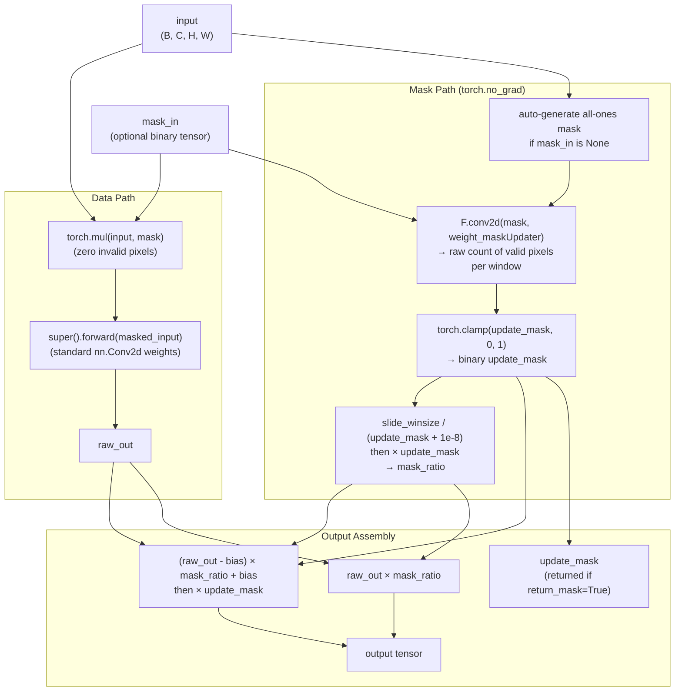

Sources: [models/partialconv2d.py:43-83]()

---

### Stage 1: Mask Path

[models/partialconv2d.py:45-67]()

This stage runs inside `torch.no_grad()` so it does not participate in gradient computation.

**Condition for execution:** the mask path runs if either `mask_in is not None` (mask was explicitly provided) or `input.shape != self.last_size` (shape has changed since last call). If neither condition holds, the cached `update_mask` and `mask_ratio` from the previous call are reused.

**Steps:**

1. **Type alignment** — if `weight_maskUpdater` is on a different device or dtype than `input`, it is moved to match: [models/partialconv2d.py:49-50]()

2. **Auto-mask generation** — if `mask_in is None`, a fresh all-ones mask is created. Shape depends on `multi_channel`: `(B, C, H, W)` when `True`, `(1, 1, H, W)` when `False`. [models/partialconv2d.py:52-59]()

3. **Valid pixel counting** — `F.conv2d` is called with `weight_maskUpdater` (all ones) and the same `stride`, `padding`, and `dilation` as the data convolution. The result `update_mask` holds the count of valid (1-valued) pixels that fell within each output position's receptive field. [models/partialconv2d.py:61]()

4. **Mask ratio computation** — `mask_ratio = slide_winsize / (update_mask + 1e-8)`. The epsilon prevents division by zero for fully-masked regions. [models/partialconv2d.py:64]()

5. **Binarization** — `update_mask` is clamped to `[0, 1]`, making it binary: any position that saw at least one valid pixel becomes 1. [models/partialconv2d.py:66]()

6. **Zero-out invalid output positions** — `mask_ratio` is multiplied element-wise by the binarized `update_mask`, ensuring positions with no valid inputs receive a ratio of 0 rather than a very large number. [models/partialconv2d.py:67]()

> **AMP note:** For mixed-precision (FP16) training, the epsilon should be changed from `1e-8` to `1e-6` to avoid numerical instability. See [Mixed Precision (AMP) Training](#6.1).

---

### Stage 2: Data Path

[models/partialconv2d.py:70]()

```
raw_out = super().forward(torch.mul(input, mask) if mask_in is not None else input)
```

- If `mask_in` was provided, `input` is element-wise multiplied with the mask first, zeroing all invalid pixel locations.
- If `mask_in` is `None` (padding-replacement use case), the raw `input` is passed directly since the auto-generated mask is all ones.
- `super().forward()` applies the standard `nn.Conv2d` learned weights to the (possibly masked) input.

---

### Stage 3: Output Assembly

[models/partialconv2d.py:72-83]()

The raw convolution output is normalized by `mask_ratio` and has its bias re-applied correctly.

**Without bias:**
```
output = raw_out × mask_ratio
```

**With bias** (bias must be removed before scaling, then added back):
```
output = (raw_out - bias) × mask_ratio + bias
output = output × update_mask          # zero positions with no valid inputs
```

The bias re-application is necessary because the standard `nn.Conv2d` forward adds bias to every output position uniformly. After partial convolution normalization, positions with no valid inputs should have output 0, not the bias value.

**Diagram: Bias correction logic**

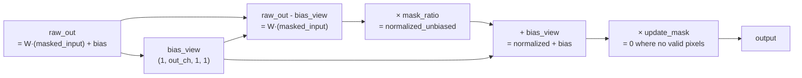

Sources: [models/partialconv2d.py:72-83]()

---

### Return Value

| Condition | Return value |
|---|---|
| `self.return_mask == False` | `output` (tensor) |
| `self.return_mask == True` | `(output, self.update_mask)` (tuple of tensors) |

When chaining layers for inpainting, the returned `update_mask` from layer N is passed as `mask_in` to layer N+1.

---

## Caching Behavior

`PartialConv2d` caches the mask computation across calls using `self.last_size`. The cache is a single slot storing the most recent `update_mask` and `mask_ratio`.

**Diagram: Caching decision in `forward()`**

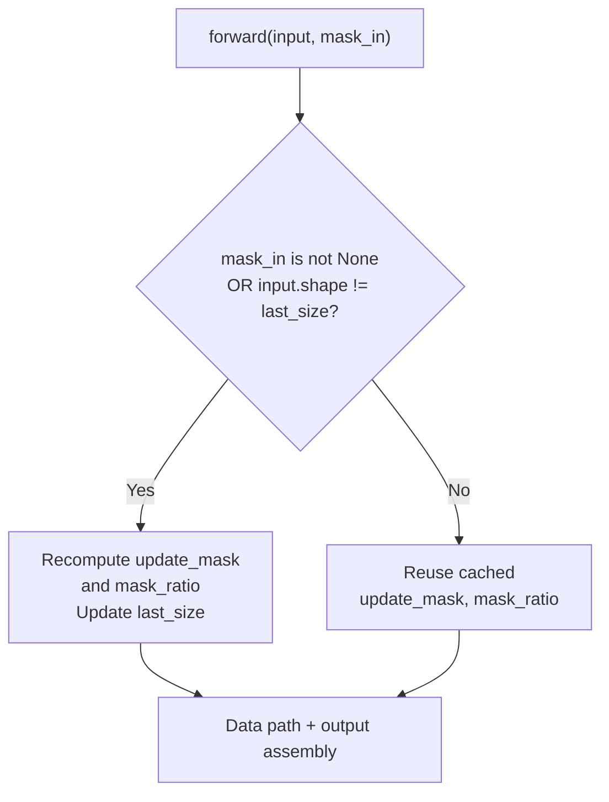

**Implications:**

- When used as a padding replacement (no `mask_in`, fixed input size), the mask computation runs only on the first call and is cached thereafter. Subsequent calls skip it entirely.
- When used for inpainting (with `mask_in` provided), the mask path always runs, because `mask_in is not None` is always true.
- The cache is **not** thread-safe. Using a single `PartialConv2d` instance across multiple parallel data streams with different shapes can produce incorrect results.

Sources: [models/partialconv2d.py:39-41](), [models/partialconv2d.py:45-46]()

---

## `multi_channel` vs Single-Channel Masks

**Diagram: Effect of `multi_channel` on tensor shapes**

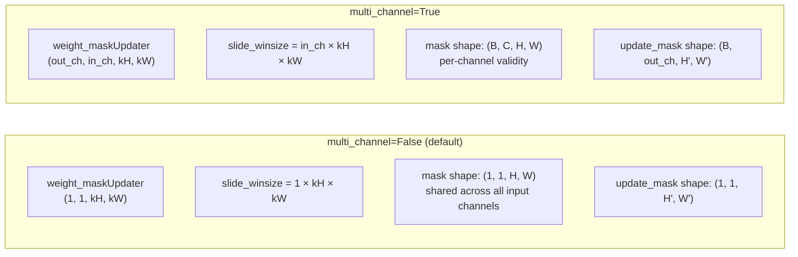

- **`multi_channel=False`**: A single spatial mask applies to all input channels equally. This is appropriate for padding replacement where the invalid region is determined by spatial position only.
- **`multi_channel=True`**: Each input channel can independently be valid or invalid at a given spatial position. This is used for image inpainting where the mask may vary per channel (e.g., after partial fill-in from a previous layer's output).

Sources: [models/partialconv2d.py:32-37]()

---

## Complete Variable Reference

The following table maps every named variable in `forward()` to its role:

| Variable | Defined at | Description |
|---|---|---|
| `mask` | [models/partialconv2d.py:55-59]() | The effective mask: either `mask_in` or an auto-generated all-ones tensor |
| `self.update_mask` (pre-clamp) | [models/partialconv2d.py:61]() | Raw count of valid pixels in each output receptive field |
| `self.mask_ratio` | [models/partialconv2d.py:64]() | `slide_winsize / (update_mask + 1e-8)` before zeroing |
| `self.update_mask` (post-clamp) | [models/partialconv2d.py:66]() | Binary output mask (1 = valid, 0 = no valid inputs seen) |
| `self.mask_ratio` (final) | [models/partialconv2d.py:67]() | `mask_ratio × update_mask`; zero where output is invalid |
| `raw_out` | [models/partialconv2d.py:70]() | Result of standard `nn.Conv2d` applied to the masked input |
| `bias_view` | [models/partialconv2d.py:73]() | `self.bias` reshaped to `(1, out_ch, 1, 1)` for broadcasting |
| `output` | [models/partialconv2d.py:74-77]() | Final corrected output tensor |

Sources: [models/partialconv2d.py:43-83]()

---

# Page: Mask Propagation Mechanics

# Mask Propagation Mechanics

<details>
<summary>Relevant source files</summary>

The following files were used as context for generating this wiki page:

- [README.MD](README.MD)
- [models/partialconv2d.py](models/partialconv2d.py)

</details>


This page is a focused reference on how masks are created, convolved, normalized, and passed forward within a single `PartialConv2d` forward call ([models/partialconv2d.py]()). It covers the mask path exclusively: the epsilon guard, the raw-count-to-binary conversion, the `mask_ratio` normalization formula, and the behavioral difference between `multi_channel=True` and `multi_channel=False`.

For the complete picture of the `PartialConv2d` layer including the data path and bias correction, see the parent page [2](#2). For how masks propagate across *multiple layers* in an inpainting pipeline, see [5](#5).

---

## Overview of the Mask Path

In a standard `nn.Conv2d`, all input pixels are treated as equally valid. `PartialConv2d` adds a parallel **mask path** that runs alongside the data convolution. The mask path answers the question: *"For each output position, how many of the input pixels in its receptive field were valid?"* The answer is used to scale the output so that the convolution result is not diluted by zero-padded or missing pixels.

The entire mask path runs inside `torch.no_grad()` and produces two instance variables:

| Variable | Meaning |
|---|---|
| `self.update_mask` | Binary mask for the output spatial positions (1 = at least one valid input pixel) |
| `self.mask_ratio` | Per-position scale factor that compensates for partially-valid receptive fields |

Sources: [models/partialconv2d.py:40-67]()

---

## The Mask Updater Kernel (`weight_maskUpdater`)

The mask update is implemented as a plain `F.conv2d` with a fixed all-ones kernel called `weight_maskUpdater`. This kernel is created once in `__init__` and is never trained. Its shape depends on the `multi_channel` flag.

**Mask Updater Kernel: Shape by Mode**

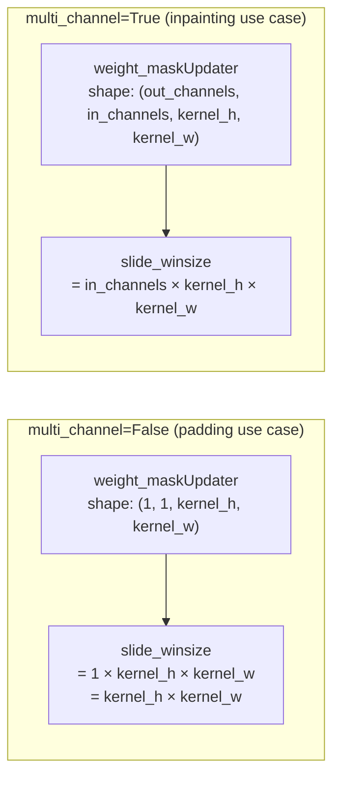

Sources: [models/partialconv2d.py:32-37]()

`slide_winsize` is always the product of the last three dimensions of `weight_maskUpdater`. When `multi_channel=False`, in-channel count is 1 and `slide_winsize` equals the spatial kernel area. When `multi_channel=True`, each channel adds to the total count of "slots" in the receptive field.

---

## Mask Input: Provided vs Auto-Generated

Every call to `forward(input, mask_in=None)` either receives an explicit mask or generates one automatically. The shape of the auto-generated mask also depends on `multi_channel`.

**Mask Generation Logic**

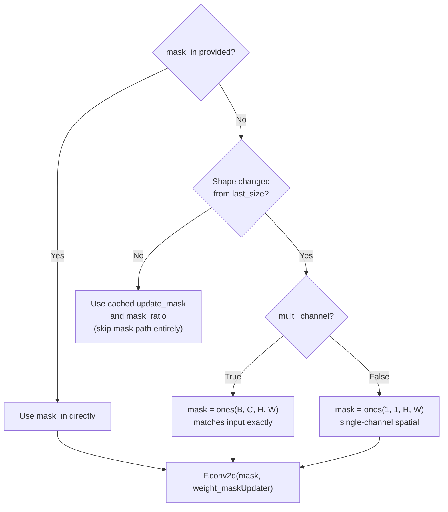

Sources: [models/partialconv2d.py:43-61]()

When `mask_in=None` and the input shape is the same as `last_size`, the entire mask path is skipped and the previously computed `update_mask` and `mask_ratio` are reused. This caching avoids redundant computation in the common case where all inputs to a layer have the same shape (e.g., inference on a fixed-size image).

---

## Step-by-Step Mask Update Computation

The following steps happen in sequence inside the `torch.no_grad()` block.

**Mask Path: Sequence of Operations**

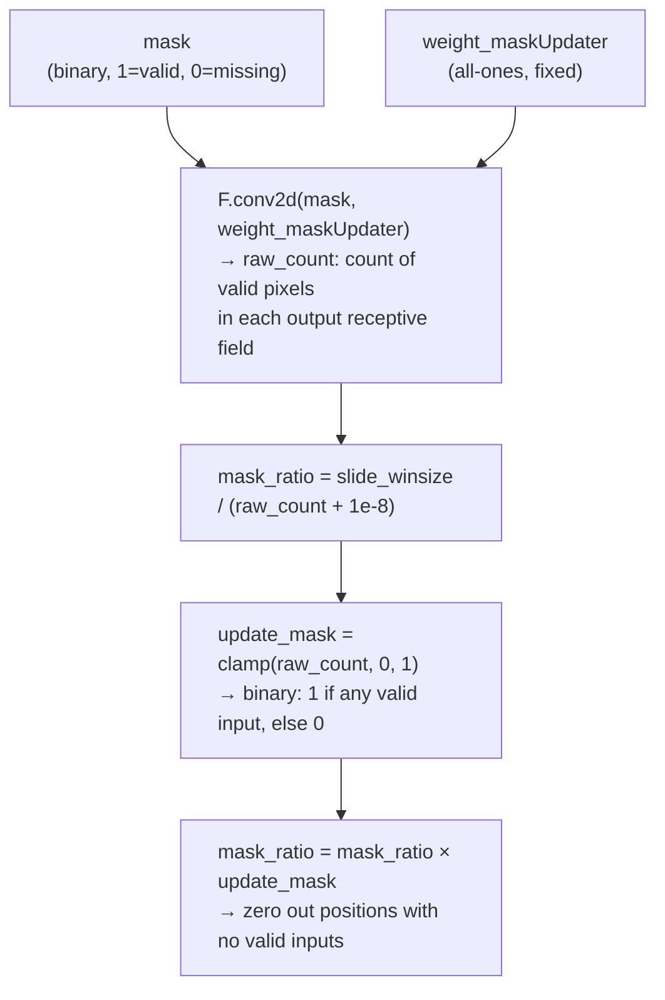

Sources: [models/partialconv2d.py:61-67]()

### Step 1: Count valid pixels per receptive field

```
F.conv2d(mask, weight_maskUpdater, bias=None, stride=..., padding=..., dilation=..., groups=1)
```

Because `weight_maskUpdater` is all-ones, this convolution simply sums the mask values in each kernel window. The result `raw_count[b, c, h, w]` is the number of valid (mask=1) input pixels that contribute to output position `(b, c, h, w)`.

### Step 2: Compute `mask_ratio` from raw counts

```
self.mask_ratio = self.slide_winsize / (self.update_mask + 1e-8)
```

*(Note: at this line, `self.update_mask` still holds the raw count, before the clamp.)*

`slide_winsize` is the maximum possible number of valid pixels in any receptive field. Dividing by the raw count amplifies output values at partially-covered positions. A position where only half the receptive field was valid gets a ratio of approximately 2.0, rescaling the partial sum back to a full-window equivalent.

### Step 3: Epsilon guard

The `+ 1e-8` term prevents division by zero when `raw_count = 0`. At such positions the ratio would otherwise be infinite. The subsequent multiplication in step 4 will zero these positions out anyway, but the guard keeps the intermediate tensor numerically finite.

> **AMP note:** For mixed-precision (FP16) training the epsilon is increased to `1e-6` to avoid underflow in half precision. See page [6.1](#6.1) for the full AMP requirements.

### Step 4: Clamp raw counts to binary

```
self.update_mask = torch.clamp(self.update_mask, 0, 1)
```

Any position with at least one valid input pixel becomes 1; fully empty positions become 0. This binary tensor is what gets returned as the "new mask" for the next layer when `return_mask=True`.

### Step 5: Zero out invalid positions in `mask_ratio`

```
self.mask_ratio = torch.mul(self.mask_ratio, self.update_mask)
```

Positions with zero valid inputs get `mask_ratio = 0`. This means the output at those positions will be forced to zero (or bias-only after bias correction), preventing the large epsilon-divided value from contaminating the output.

---

## `multi_channel=True` vs `multi_channel=False`

The `multi_channel` flag controls whether the mask is treated as a single shared spatial map or as a per-channel map. The table below summarizes all resulting differences.

| Property | `multi_channel=False` | `multi_channel=True` |
|---|---|---|
| `weight_maskUpdater` shape | `(1, 1, k_h, k_w)` | `(out_ch, in_ch, k_h, k_w)` |
| `slide_winsize` | `k_h × k_w` | `in_ch × k_h × k_w` |
| Auto-generated mask shape | `(1, 1, H, W)` | `(B, C, H, W)` |
| Mask channels | 1 (broadcasts) | Matches input channels |
| Typical use case | Padding replacement | Image inpainting |
| `update_mask` output shape | `(1, 1, H_out, W_out)` | `(B, out_ch, H_out, W_out)` |

When `multi_channel=False`, a single spatial binary map controls validity for all channels uniformly. When `multi_channel=True`, each channel's validity is tracked independently, which is required for inpainting where the per-channel mask may differ.

Sources: [models/partialconv2d.py:32-37](), [models/partialconv2d.py:52-57]()

---

## Behavior at Boundary Regions

The following table captures the exact behavior for the three classes of output positions that arise when a partially-filled mask passes through the layer.

| Receptive Field State | `raw_count` | `mask_ratio` (before zeroing) | `update_mask` (after clamp) | `mask_ratio` (after zeroing) | Output Effect |
|---|---|---|---|---|---|
| All pixels valid | `slide_winsize` | ≈ 1.0 | 1 | ≈ 1.0 | No amplification |
| Some pixels valid (`N` out of total) | `N` | `slide_winsize / N` | 1 | `slide_winsize / N` | Output amplified by `slide_winsize/N` |
| No pixels valid | 0 | `slide_winsize / 1e-8` (large) | 0 | 0.0 | Output zeroed entirely |

The amplification at partially-valid positions is the key normalization step: it ensures the convolution output represents "what the sum would have been had all pixels been valid," rather than a deflated partial sum.

Sources: [models/partialconv2d.py:61-67]()

---

## How the Updated Mask Feeds the Next Layer

When `return_mask=True`, `forward()` returns a tuple `(output, self.update_mask)`. The caller (typically an inpainting U-Net) passes `self.update_mask` as `mask_in` to the next `PartialConv2d` layer. This causes the mask to propagate layer by layer.

**Layer-to-Layer Mask Propagation**

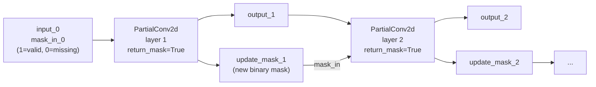

Each successive `update_mask` is at least as large as the previous one (more positions become valid), because holes can only shrink — a position needs just one valid neighbor to transition from 0 to 1. This is the mechanism by which inpainting models progressively fill in missing regions across the depth of the network.

Sources: [models/partialconv2d.py:43-83]()

---

# Page: PartialConv3d: The 3D Extension

# PartialConv3d: The 3D Extension

<details>
<summary>Relevant source files</summary>

The following files were used as context for generating this wiki page:

- [models/partialconv2d.py](models/partialconv2d.py)
- [models/partialconv3d.py](models/partialconv3d.py)

</details>


`PartialConv3d` is a direct extension of the partial convolution mechanism to three spatial dimensions, enabling its use with volumetric data such as video (depth × height × width). This page documents the `PartialConv3d` class found in [models/partialconv3d.py](), covering its constructor, forward-pass computation, and all places where it diverges from the 2D counterpart.

For the foundational explanation of how partial convolution works—mask propagation, bias correction, `mask_ratio` normalization, and the `multi_channel`/`return_mask` flags—see the [PartialConv2d: The Core Layer](#2) page and its sub-page [Mask Propagation Mechanics](#2.1). This page focuses only on what is different in the 3D version.

---

## Class Overview

`PartialConv3d` is defined in [models/partialconv3d.py:14-85]() and subclasses `nn.Conv3d` the same way `PartialConv2d` subclasses `nn.Conv2d`.

**Class hierarchy diagram: PartialConv3d**

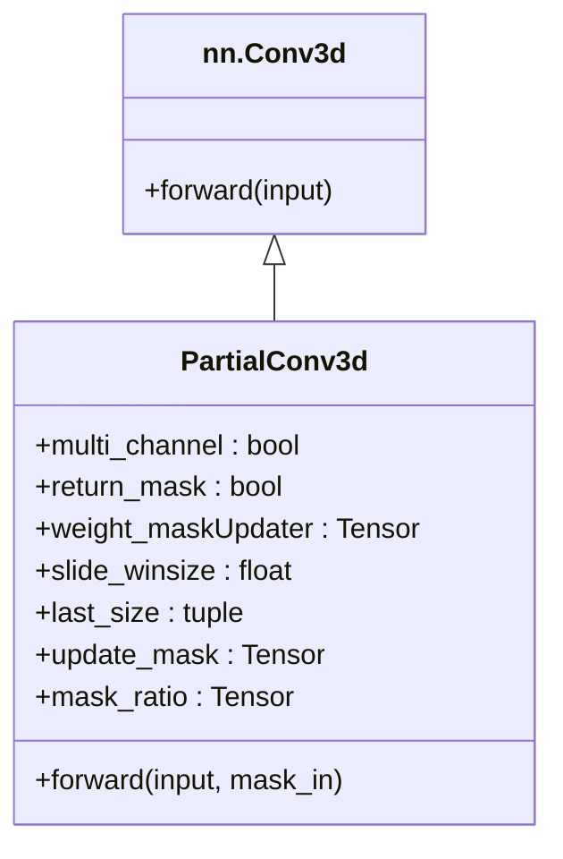

Sources: [models/partialconv3d.py:14-41]()

---

## Constructor

The constructor signature is identical to `PartialConv2d`. Two custom keyword arguments are extracted before the remaining arguments are forwarded to `nn.Conv3d`:

| Keyword argument | Type | Default | Effect |
|---|---|---|---|
| `multi_channel` | `bool` | `False` | If `True`, `weight_maskUpdater` has shape `(out_channels, in_channels, kD, kH, kW)` (one mask per channel). If `False`, shape is `(1, 1, kD, kH, kW)`. |
| `return_mask` | `bool` | `False` | If `True`, `forward` returns `(output, update_mask)` instead of just `output`. |

After the call to `super().__init__()`, three internal members are initialized:

- **`weight_maskUpdater`** — an all-ones tensor used in `F.conv3d` to count valid pixels in each receptive field [models/partialconv3d.py:32-35]().
- **`slide_winsize`** — the total number of elements in a single receptive field: `in_channels × kD × kH × kW` (or `1 × kD × kH × kW` when `multi_channel=False`) [models/partialconv3d.py:37]().
- **`last_size`** — a 5-tuple `(None, None, None, None, None)`, used to cache whether the mask needs to be recomputed [models/partialconv3d.py:39]().

### `slide_winsize` formula comparison

| Class | Formula | Tensor dimensions accessed |
|---|---|---|
| `PartialConv2d` | `shape[1] × shape[2] × shape[3]` | `(out_ch, in_ch, kH, kW)` → 3 dims |
| `PartialConv3d` | `shape[1] × shape[2] × shape[3] × shape[4]` | `(out_ch, in_ch, kD, kH, kW)` → 4 dims |

The extra `shape[4]` term accounts for the depth kernel dimension [models/partialconv3d.py:37]().

Sources: [models/partialconv3d.py:15-41]()

---

## Input Format

The `forward` method immediately asserts that the input tensor has exactly five dimensions [models/partialconv3d.py:44]():

```
assert len(input.shape) == 5
```

The expected layout is `(B, C, D, H, W)`:

| Dimension | Symbol | Meaning |
|---|---|---|
| 0 | B | Batch size |
| 1 | C | Channels |
| 2 | D | Depth (temporal frames, or z-slices) |
| 3 | H | Height |
| 4 | W | Width |

The corresponding `PartialConv2d` asserts `len(input.shape) == 4`, operating on `(B, C, H, W)`.

Sources: [models/partialconv3d.py:43-44](), [models/partialconv2d.py:44]()

---

## Forward Pass Computation

The structure of the forward pass mirrors `PartialConv2d` exactly, with every 2D PyTorch primitive replaced by its 3D counterpart.

**Forward pass data-flow diagram: PartialConv3d**

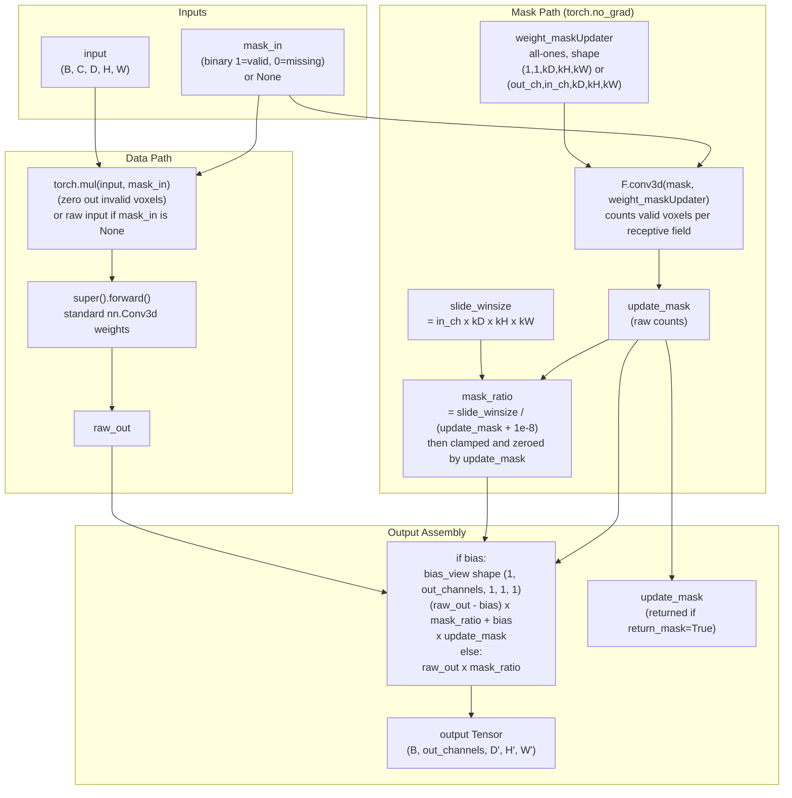

Sources: [models/partialconv3d.py:43-85]()

---

## Differences from PartialConv2d

The table below is a complete list of every concrete difference between the two implementations.

**Structural differences: PartialConv2d vs PartialConv3d**

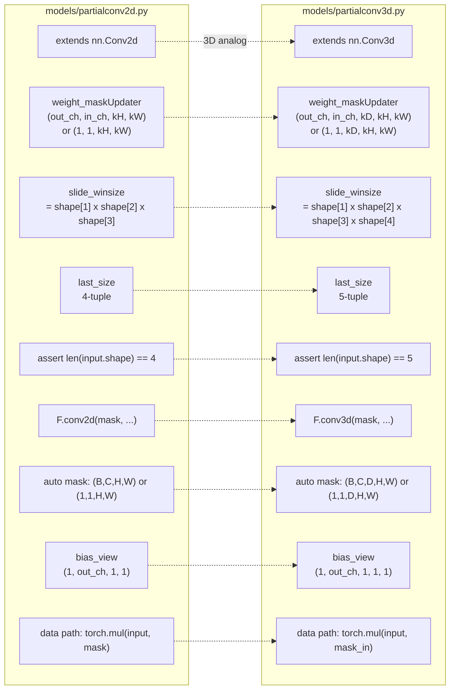

| Aspect | `PartialConv2d` | `PartialConv3d` |
|---|---|---|
| Base class | `nn.Conv2d` | `nn.Conv3d` |
| Input rank assertion | `== 4` | `== 5` |
| `weight_maskUpdater` rank | 4 | 5 (adds depth `kD`) |
| `slide_winsize` factors | `shape[1] × shape[2] × shape[3]` | `shape[1] × shape[2] × shape[3] × shape[4]` |
| `last_size` initial value | `(None, None, None, None)` | `(None, None, None, None, None)` |
| Mask convolution | `F.conv2d` | `F.conv3d` |
| Auto-mask shape (no `multi_channel`) | `(1, 1, H, W)` | `(1, 1, D, H, W)` |
| Auto-mask shape (`multi_channel`) | `(B, C, H, W)` | `(B, C, D, H, W)` |
| `bias_view` shape | `(1, out_channels, 1, 1)` | `(1, out_channels, 1, 1, 1)` |
| Data-path masking variable | `mask` (local, may be auto-generated) | `mask_in` (the argument directly) |
| AMP epsilon comment | Present | Absent |

Sources: [models/partialconv2d.py:14-83](), [models/partialconv3d.py:14-85]()

---

## Subtle Behavioral Difference in the Data Path

There is one implementation-level difference worth noting. In `PartialConv2d`, the data path uses a local variable `mask` [models/partialconv2d.py:70]():

```python
# 2D: uses local `mask`, which is either mask_in or an auto-generated all-ones tensor
raw_out = super(PartialConv2d, self).forward(torch.mul(input, mask) if mask_in is not None else input)
```

In `PartialConv3d`, the data path uses `mask_in` directly [models/partialconv3d.py:72]():

```python
# 3D: uses mask_in argument directly
raw_out = super(PartialConv3d, self).forward(torch.mul(input, mask_in) if mask_in is not None else input)
```

The functional result is equivalent in both cases: when `mask_in is None`, neither version multiplies the input by a mask (the 2D version would multiply by all-ones, but that is a no-op). When `mask_in` is provided, both multiply the input by it before the convolution.

Sources: [models/partialconv2d.py:70](), [models/partialconv3d.py:72]()

---

## Caching Behavior

`PartialConv3d` reuses the same input-shape caching mechanism as `PartialConv2d`. The mask path (inside `torch.no_grad()`) is only re-executed when either:

1. `mask_in` is explicitly provided (mask propagation mode), or
2. The input tensor shape changes from the previous call.

`last_size` stores the previous 5-tuple `(B, C, D, H, W)`. If neither condition is met, `update_mask` and `mask_ratio` from the prior call are reused directly [models/partialconv3d.py:45-46]().

This optimization is primarily useful in the padding-replacement use case (see [Use Case: Padding Replacement](#4)), where the mask is all-ones and never changes between calls of the same shape.

Sources: [models/partialconv3d.py:39-66]()

---

## Usage in Context

`PartialConv3d` is the natural choice when extending either use case from 2D to 3D:

| Use case | 2D class | 3D class | Typical `multi_channel` | Typical `return_mask` |
|---|---|---|---|---|
| Padding replacement | `PartialConv2d` | `PartialConv3d` | `False` | `False` |
| Video inpainting | `PartialConv2d` | `PartialConv3d` | `True` | `True` |

As shown in the repository overview (Diagram 1), `PartialConv3d` currently stands alone in the codebase—no pre-built 3D model architectures (equivalent to `PDResNet` or `PDVGG`) are provided. It is intended to be used directly as a drop-in replacement for `nn.Conv3d` in user-defined networks.

For the inpainting training objective and loss module, see [Loss Functions](#5.1).

Sources: [models/partialconv3d.py:14-85](), [models/partialconv2d.py:14-83]()

---

# Page: Use Case: Padding Replacement

# Use Case: Padding Replacement

<details>
<summary>Relevant source files</summary>

The following files were used as context for generating this wiki page:

- [README.MD](README.MD)
- [models/__init__.py](models/__init__.py)
- [models/pd_resnet.py](models/pd_resnet.py)
- [models/pd_vgg.py](models/pd_vgg.py)

</details>


This page covers how `PartialConv2d` is used as a drop-in replacement for `nn.Conv2d` at every convolutional layer boundary in a standard classification network. The goal is to eliminate the boundary artifacts introduced by zero, reflection, or replication padding without changing the network's external interface.

This page does not cover the image inpainting use case (where masks propagate layer-to-layer); for that, see [Use Case: Image Inpainting](#5). For a full reference on the `PartialConv2d` class parameters and forward-pass internals, see [PartialConv2d: The Core Layer](#2).

---

## The Problem with Conventional Padding

When a convolutional layer is applied near the spatial boundary of a feature map, the receptive field extends beyond the valid data region. Standard padding strategies fill those out-of-bounds positions with synthetic values:

| Padding Scheme | Boundary Fill Strategy | Consequence |
|---|---|---|
| Zero padding | Fills with 0 | Network must learn to ignore the zeros; can cause systematic activation bias at borders |
| Reflection padding | Mirrors pixel values | Introduces repeated structure that doesn't exist in real images |
| Replication padding | Repeats edge pixel | Smears edge pixels outward |

All three methods introduce values that do not correspond to real input data. Partial convolution avoids this by tracking *which positions contain valid data* and normalizing the convolution output by the number of valid input pixels in each receptive field window.

---

## Drop-in Replacement: Before and After

The transition from standard to partial-convolution-based padding is a one-line change in layer construction. No mask input is required in padding-replacement mode.

**Before (standard zero padding):**
```python
nn.Conv2d(3, 16, kernel_size=3, stride=1, padding=1, bias=False)
```

**After (partial convolution padding):**
```python
PartialConv2d(3, 16, kernel_size=3, stride=1, padding=1, bias=False)
```

Sources: [README.MD:34-40]()

When `multi_channel` and `return_mask` are both left at their defaults (`False`), `PartialConv2d` behaves as follows:

- On the first forward call, it auto-generates an all-ones mask (all pixels are valid) — no mask argument is needed from the caller.
- It computes `mask_ratio` from the ratio of the full receptive field size to the number of valid (non-padded) positions.
- The output is renormalized so that boundary positions are not biased by the padded zeros.
- It returns only the output tensor, not an updated mask, so the downstream layer receives a plain tensor identical in shape to what `nn.Conv2d` would produce.

This makes `PartialConv2d` a true structural drop-in: existing code does not need to thread a mask through the network.

---

## How Partial Convolution Fixes the Boundary Bias

**Diagram: Boundary Normalization Mechanism**

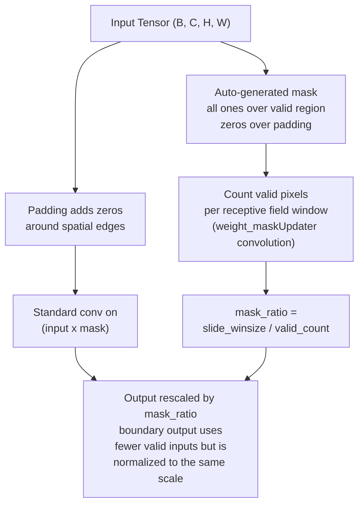

Sources: [models/partialconv2d.py]()

At an interior position, the full kernel window lands on valid pixels, so `mask_ratio = 1` and the output is unchanged. At a corner position with a 3×3 kernel, only 4 of 9 positions are valid; `mask_ratio = 9/4` scales the output up to match the scale of a full-window convolution. This prevents boundary positions from producing systematically lower activations, which is the root cause of boundary artifacts.

---

## Model Families

The repository provides two families of classification networks built entirely from `PartialConv2d` layers: `PDResNet` and `PDVGG`. Both are defined in `models/` and exported via `models/__init__.py`.

**Diagram: Code Entities for the Padding-Replacement Use Case**

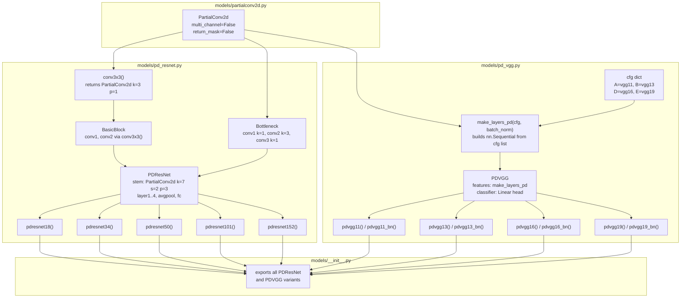

Sources: [models/__init__.py:1-2](), [models/pd_resnet.py:1-232](), [models/pd_vgg.py:1-220]()

---

## PDResNet Family

`PDResNet` ([models/pd_resnet.py:115-171]()) is structurally identical to standard ResNet, with every `nn.Conv2d` replaced by `PartialConv2d`.

**Stem layer** ([models/pd_resnet.py:120-121]()):
```
PartialConv2d(3, 64, kernel_size=7, stride=2, padding=3, bias=False)
```

**Residual blocks** use a shared helper `conv3x3` ([models/pd_resnet.py:38-41]()):
```
PartialConv2d(in_planes, out_planes, kernel_size=3, stride=stride, padding=1, bias=False)
```

**Downsample shortcuts** in `_make_layer` also use `PartialConv2d` with `kernel_size=1` ([models/pd_resnet.py:143-145]()).

| Factory Function | Block Type | Layer Counts |
|---|---|---|
| `pdresnet18` | `BasicBlock` | [2, 2, 2, 2] |
| `pdresnet34` | `BasicBlock` | [3, 4, 6, 3] |
| `pdresnet50` | `Bottleneck` | [3, 4, 6, 3] |
| `pdresnet101` | `Bottleneck` | [3, 4, 23, 3] |
| `pdresnet152` | `Bottleneck` | [3, 8, 36, 3] |

Sources: [models/pd_resnet.py:174-231]()

For full documentation of the building blocks and architecture details, see [PDResNet Architectures](#4.1).

---

## PDVGG Family

`PDVGG` ([models/pd_vgg.py:48-82]()) mirrors the standard VGG design. The feature extractor is built by `make_layers_pd` ([models/pd_vgg.py:85-98]()), which iterates over a `cfg` list and substitutes `PartialConv2d` wherever `nn.Conv2d` would appear:

```python
conv2d = PartialConv2d(in_channels, v, kernel_size=3, padding=1)
```

The classifier head remains a standard 3-layer `nn.Linear` stack (input: `512 * 7 * 7`, requiring a 224×224 input image).

| Config Key | Factory Functions | Conv Layers |
|---|---|---|
| `'A'` | `pdvgg11`, `pdvgg11_bn` | 8 conv layers |
| `'B'` | `pdvgg13`, `pdvgg13_bn` | 10 conv layers |
| `'D'` | `pdvgg16`, `pdvgg16_bn` | 13 conv layers |
| `'E'` | `pdvgg19`, `pdvgg19_bn` | 16 conv layers |

Sources: [models/pd_vgg.py:103-108](), [models/pd_vgg.py:111-220]()

For full documentation of the cfg dictionary and layer construction details, see [PDVGG Architectures](#4.2).

---

## Pretrained Weights

The `model_urls` dictionaries in both `pd_resnet.py` and `pd_vgg.py` have empty URL strings ([models/pd_resnet.py:30-36](), [models/pd_vgg.py:28-45]()), meaning pretrained weights cannot be loaded programmatically via the `pretrained=True` flag at this time. The README references a Dropbox link for manually downloadable checkpoints.

---

## Empirical Results

The repository includes comparison results from 5 independent runs on ImageNet:

| Model | Padding | Notes |
|---|---|---|
| `resnet50` | Zero (default) | Baseline |
| `pdresnet50` | Partial conv | Consistent top-1 improvement |
| `vgg16_bn` | Zero (default) | Baseline |
| `pdvgg16_bn` | Partial conv | Consistent top-1 improvement |

Partial convolution padding outperforms zero, reflection, and replication padding across all tested architectures. The README reports best top-1 accuracy and standard deviation over 5 runs for all four padding schemes.

Sources: [README.MD:108-114]()

---

## Using the Models in Training

These models are consumed by `main.py` by passing their name to the `-a` argument. The training script maintains two separate model registries: `models_partial` (the `models/` package in this repository) and `models_baseline` (torchvision).

```
python main.py -a pdresnet50 --data_train /path/.../train ...
python main.py -a pdvgg16_bn --data_train /path/.../train ...
```

Sources: [README.MD:81-100]()

For full documentation of `main.py` arguments and the training loop, see [Training on ImageNet](#6).

---

# Page: PDResNet Architectures

# PDResNet Architectures

<details>
<summary>Relevant source files</summary>

The following files were used as context for generating this wiki page:

- [models/partialconv2d.py](models/partialconv2d.py)
- [models/pd_resnet.py](models/pd_resnet.py)

</details>


## Purpose and Scope

This page documents the five PDResNet variants (18, 34, 50, 101, 152) defined in [models/pd_resnet.py](). These are direct adaptations of the standard ResNet family in which every `nn.Conv2d` layer — including the stem, residual blocks, and downsample shortcuts — is replaced with `PartialConv2d`. The result is a drop-in image classification network that uses partial convolution padding instead of zero padding at all spatial boundaries.

This page covers the building blocks (`BasicBlock`, `Bottleneck`), the top-level `PDResNet` class, and the five factory functions. For details on how `PartialConv2d` itself works internally, see [PartialConv2d: The Core Layer](#2). For the analogous VGG-based models, see [PDVGG Architectures](#4.2). For the ImageNet training script that instantiates these models, see [Training on ImageNet](#6).

---

## Model Variants at a Glance

| Factory Function | Block Type | Layer Config `[l1, l2, l3, l4]` | Total Layers | `block.expansion` | Output of `fc` |
|---|---|---|---|---|---|
| `pdresnet18` | `BasicBlock` | `[2, 2, 2, 2]` | 18 | 1 | `num_classes` |
| `pdresnet34` | `BasicBlock` | `[3, 4, 6, 3]` | 34 | 1 | `num_classes` |
| `pdresnet50` | `Bottleneck` | `[3, 4, 6, 3]` | 50 | 4 | `num_classes` |
| `pdresnet101` | `Bottleneck` | `[3, 4, 23, 3]` | 101 | 4 | `num_classes` |
| `pdresnet152` | `Bottleneck` | `[3, 8, 36, 3]` | 152 | 4 | `num_classes` |

All five variants default to `num_classes=1000` for ImageNet classification.

Sources: [models/pd_resnet.py:18-19](), [models/pd_resnet.py:174-231]()

---

## Pretrained Weights

All entries in `model_urls` are currently empty strings:

```
model_urls = {
    'pdresnet18': '',
    'pdresnet34': '',
    ...
}
```

Calling any factory function with `pretrained=True` will trigger a `model_zoo.load_url('')` call, which will fail at runtime. Pretrained weights are not yet available. Always pass `pretrained=False` (the default).

Sources: [models/pd_resnet.py:30-36]()

---

## Building Blocks

### `conv3x3` Helper

[models/pd_resnet.py:38-41]()

A module-level helper that constructs a `PartialConv2d` with `kernel_size=3`, `padding=1`, and `bias=False`. It is used by `BasicBlock` for both of its convolutional layers.

```
conv3x3(in_planes, out_planes, stride=1)
→ PartialConv2d(in_planes, out_planes, kernel_size=3, stride=stride, padding=1, bias=False)
```

### `BasicBlock`

[models/pd_resnet.py:44-73]()

Used by pdresnet18 and pdresnet34. Contains two sequential 3×3 `PartialConv2d` layers, each followed by `BatchNorm2d` and `ReLU`. The residual shortcut optionally passes through a `downsample` module.

**Forward pass:**

```
x → conv1 → bn1 → relu → conv2 → bn2 → (+ residual) → relu
```

`expansion = 1`: output channels equal `planes`.

### `Bottleneck`

[models/pd_resnet.py:76-112]()

Used by pdresnet50, pdresnet101, and pdresnet152. Contains three `PartialConv2d` layers in a 1×1 → 3×3 → 1×1 configuration. The 1×1 layers compress and expand channels; the 3×3 layer handles spatial features.

**Forward pass:**

```
x → conv1(1×1) → bn1 → relu
  → conv2(3×3) → bn2 → relu
  → conv3(1×1) → bn3
  → (+ residual) → relu
```

`expansion = 4`: output channels are `planes * 4`.

---

**Block structure comparison:**

**Figure: BasicBlock and Bottleneck internal structure**


Sources: [models/pd_resnet.py:44-112]()

---

## `PDResNet` Class

[models/pd_resnet.py:115-171]()

The top-level model class. Its `__init__` accepts `block` (either `BasicBlock` or `Bottleneck`), `layers` (a 4-element list of block counts), and `num_classes` (default 1000).

### Stem

```
conv1: PartialConv2d(3, 64, kernel_size=7, stride=2, padding=3, bias=False)
bn1:   BatchNorm2d(64)
relu:  ReLU(inplace=True)
maxpool: MaxPool2d(kernel_size=3, stride=2, padding=1)
```

The 7×7 stem convolution is a `PartialConv2d`, not `nn.Conv2d`. This is significant because it is the layer most exposed to spatial boundaries in the input image.

### Residual Stages

`_make_layer` builds each of the four residual stages:

[models/pd_resnet.py:139-154]()

| Stage | Channels (`planes`) | Stride | Blocks |
|---|---|---|---|
| `layer1` | 64 | 1 | `layers[0]` |
| `layer2` | 128 | 2 | `layers[1]` |
| `layer3` | 256 | 2 | `layers[2]` |
| `layer4` | 512 | 2 | `layers[3]` |

When `stride != 1` or the number of input channels does not match `planes * block.expansion`, a `downsample` shortcut is inserted. This shortcut is:

```
nn.Sequential(
    PartialConv2d(inplanes, planes * block.expansion, kernel_size=1, stride=stride, bias=False),
    BatchNorm2d(planes * block.expansion),
)
```

The `PartialConv2d` used in downsample shortcuts has `kernel_size=1`, so boundary behavior differs from the 3×3 layers, but it is still a `PartialConv2d` rather than a plain `nn.Conv2d`.

### Head

```
avgpool: AvgPool2d(7, stride=1)
fc:      Linear(512 * block.expansion, num_classes)
```

The classification head uses standard `nn.Linear`. No partial convolution is needed here because it operates on a spatially pooled feature vector.

### Weight Initialization

[models/pd_resnet.py:132-137]()

After all layers are built, `PDResNet.__init__` initializes weights:

- `PartialConv2d` weights → `kaiming_normal_` with `mode='fan_out'`, `nonlinearity='relu'`
- `BatchNorm2d` weight → constant 1, bias → constant 0

---

**Figure: PDResNet full forward pass**

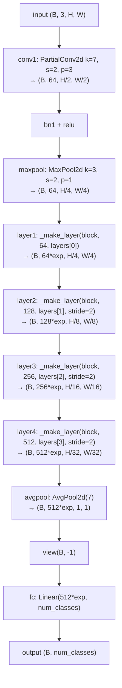

Sources: [models/pd_resnet.py:115-171]()

---

## Factory Functions

Each factory function constructs a `PDResNet` with the appropriate `block` type and `layers` configuration, then optionally loads pretrained weights.

**Figure: Factory functions mapping to PDResNet configurations**

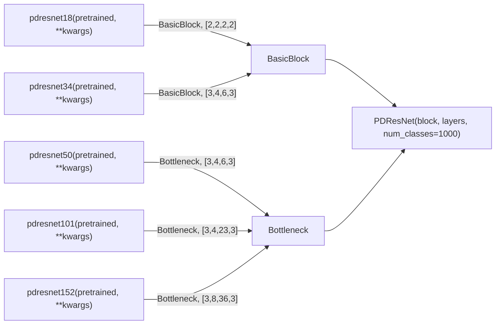

Sources: [models/pd_resnet.py:174-231]()

---

## `PartialConv2d` Usage in PDResNet

In the padding-replacement use case, `PartialConv2d` is configured with default values for `multi_channel` (`False`) and `return_mask` (`False`). No mask is explicitly passed during the forward call; the layer auto-generates an all-ones mask and caches the computed `mask_ratio` between calls of the same input shape. This makes `PartialConv2d` behave as a drop-in replacement for `nn.Conv2d` from the caller's perspective.

Every `PartialConv2d` inside `PDResNet` operates this way. The complete set of locations is:

| Location | Kernel | Stride | Notes |
|---|---|---|---|
| `PDResNet.conv1` | 7×7 | 2 | Stem layer |
| `BasicBlock.conv1` via `conv3x3` | 3×3 | variable | First block conv |
| `BasicBlock.conv2` via `conv3x3` | 3×3 | 1 | Second block conv |
| `Bottleneck.conv1` | 1×1 | 1 | Channel compression |
| `Bottleneck.conv2` | 3×3 | variable | Spatial conv |
| `Bottleneck.conv3` | 1×1 | 1 | Channel expansion |
| `downsample[0]` (in `_make_layer`) | 1×1 | variable | Shortcut projection |

All have `bias=False`, so the bias correction branch in `PartialConv2d.forward` is inactive; the output is simply `raw_out * mask_ratio`.

Sources: [models/pd_resnet.py:38-41](), [models/pd_resnet.py:80-86](), [models/pd_resnet.py:119-121](), [models/pd_resnet.py:141-146](), [models/partialconv2d.py:72-77]()

---

## Module Exports

[models/pd_resnet.py:18-19]()

The `__all__` list exports:

```python
['PDResNet', 'pdresnet18', 'pdresnet34', 'pdresnet50', 'pdresnet101', 'pdresnet152']
```

These are re-exported through `models/__init__.py` and accessed in `main.py` via the `models_partial` namespace. When passing `-a pdresnet50` to the training script, `main.py` resolves this to `models_partial.pdresnet50`. For full details on how the training script uses these models, see [Training on ImageNet](#6).

Sources: [models/pd_resnet.py:18-19]()

---

# Page: PDVGG Architectures

# PDVGG Architectures

<details>
<summary>Relevant source files</summary>

The following files were used as context for generating this wiki page:

- [models/partialconv2d.py](models/partialconv2d.py)
- [models/pd_vgg.py](models/pd_vgg.py)

</details>


This page documents the eight PDVGG model variants defined in [models/pd_vgg.py](), which adapt the standard VGG network family to use `PartialConv2d` in place of `nn.Conv2d` throughout the feature extractor. The purpose is to eliminate zero-padding boundary artifacts during ImageNet classification (see page [4](4) for the general motivation behind padding replacement). The classifier head is unchanged from the original VGG design.

This page does not cover the inpainting use of `PartialConv2d` (see page [5](5)) or the ResNet-based partial conv models (see page [4.1](4.1)).

---

## Overview

The PDVGG models are direct architectural analogues of the torchvision VGG family. Every `nn.Conv2d` in the feature extractor is replaced with a `PartialConv2d` instance configured with `multi_channel=False` and `return_mask=False`, making it a transparent drop-in for boundary-aware padding. The fully-connected classifier is standard PyTorch and is shared identically across all variants.

Eight public factory functions are exported:

| Function | Config Key | Depth | Batch Norm |
|---|---|---|---|
| `pdvgg11` | `A` | 8 conv layers | No |
| `pdvgg11_bn` | `A` | 8 conv layers | Yes |
| `pdvgg13` | `B` | 10 conv layers | No |
| `pdvgg13_bn` | `B` | 10 conv layers | Yes |
| `pdvgg16` | `D` | 13 conv layers | No |
| `pdvgg16_bn` | `D` | 13 conv layers | Yes |
| `pdvgg19` | `E` | 16 conv layers | No |
| `pdvgg19_bn` | `E` | 16 conv layers | Yes |

Sources: [models/pd_vgg.py:19-22](), [models/pd_vgg.py:111-220]()

---

## The `cfg` Dictionary

All architectural variation is encoded in a single `cfg` dictionary mapping a single-letter key to an ordered list. Integer values represent a `PartialConv2d` layer with that number of output channels; the string `'M'` represents a `MaxPool2d(kernel_size=2, stride=2)` layer.

[models/pd_vgg.py:103-108]()

| Key | Sequence (abbreviated) | Used by |
|---|---|---|
| `A` | `64, M, 128, M, 256, 256, M, 512, 512, M, 512, 512, M` | `pdvgg11`, `pdvgg11_bn` |
| `B` | `64, 64, M, 128, 128, M, 256, 256, M, 512, 512, M, 512, 512, M` | `pdvgg13`, `pdvgg13_bn` |
| `D` | `64, 64, M, 128, 128, M, 256, 256, 256, M, 512, 512, 512, M, 512, 512, 512, M` | `pdvgg16`, `pdvgg16_bn` |
| `E` | `64, 64, M, 128, 128, M, 256, 256, 256, 256, M, 512, 512, 512, 512, M, 512, 512, 512, 512, M` | `pdvgg19`, `pdvgg19_bn` |

All configs start from 3 input channels (RGB) and end with a `MaxPool2d`, producing a `512 × 7 × 7` feature map given a `224 × 224` input.

Sources: [models/pd_vgg.py:103-108]()

---

## `make_layers_pd`: The Feature Extractor Builder

**Diagram: `make_layers_pd` Build Logic**

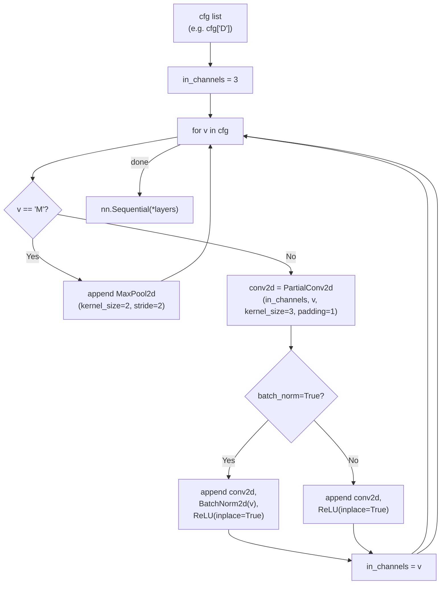

Sources: [models/pd_vgg.py:85-98]()

The function `make_layers_pd(cfg, batch_norm=False)` accepts a config list and a boolean flag. Key points:

- Every convolutional entry creates a `PartialConv2d` with `kernel_size=3` and `padding=1`. No `multi_channel` or `return_mask` keyword is passed, so both default to `False` — this is the padding-replacement mode.
- `'M'` entries create a standard `nn.MaxPool2d`. Pooling layers are not replaced.
- When `batch_norm=True`, a `BatchNorm2d` is inserted between the `PartialConv2d` and the `ReLU`.
- The returned `nn.Sequential` becomes the `features` attribute of a `PDVGG` instance.

Sources: [models/pd_vgg.py:85-98](), [models/partialconv2d.py:15-30]()

---

## The `PDVGG` Class

**Diagram: `PDVGG` Structure**

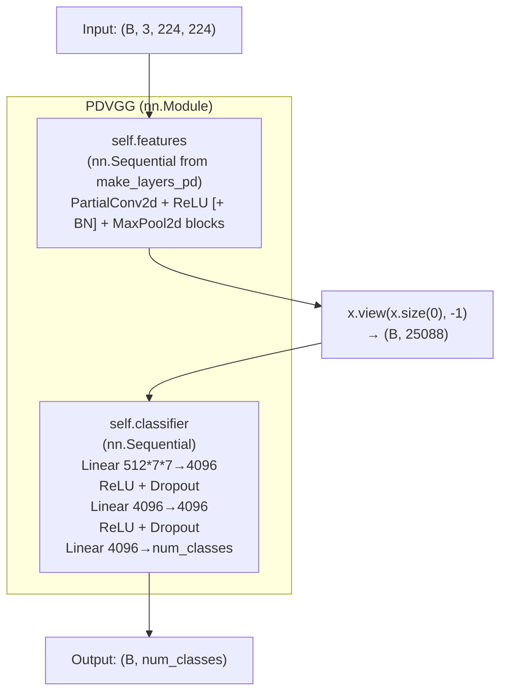

Sources: [models/pd_vgg.py:48-69]()

The `PDVGG` class is defined at [models/pd_vgg.py:48-69](). Key details:

- **Constructor signature:** `PDVGG(features, num_classes=1000, init_weights=True)`
- `features` is always the result of `make_layers_pd(...)`.
- The classifier is hard-coded to expect a `512 * 7 * 7 = 25088`-dimensional input, which assumes a `224 × 224` spatial input fed through five `MaxPool2d` stages (each halving resolution: `224 → 112 → 56 → 28 → 14 → 7`).
- The classifier head is identical to the original VGG design: no partial convolutions appear here.
- `forward` simply calls `self.features(x)`, flattens, then calls `self.classifier(x)`.

### Weight Initialization

`_initialize_weights` at [models/pd_vgg.py:71-82]() applies:

| Module type | Initialization |
|---|---|
| `nn.Conv2d` or `PartialConv2d` | `kaiming_normal` (fan_out, relu); bias → 0 |
| `nn.BatchNorm2d` | weight → 1, bias → 0 |
| `nn.Linear` | normal(0, 0.01); bias → 0 |

Note that `PartialConv2d` is checked explicitly alongside `nn.Conv2d` to ensure it is also initialized.

Sources: [models/pd_vgg.py:71-82]()

---

## Factory Functions

Each of the eight factory functions follows the same pattern:

1. If `pretrained=True`, set `init_weights=False` in kwargs to skip random initialization.
2. Construct `PDVGG(make_layers_pd(cfg[key], batch_norm=...), **kwargs)`.
3. If `pretrained=True`, call `model.load_state_dict(model_zoo.load_url(model_urls[name]))`.

**Diagram: Factory Function to cfg Key Mapping**

```mermaid
graph LR
    pdvgg11["pdvgg11()"] --> cfgA["cfg['A']\nbatch_norm=False"]
    pdvgg11_bn["pdvgg11_bn()"] --> cfgA_bn["cfg['A']\nbatch_norm=True"]
    pdvgg13["pdvgg13()"] --> cfgB["cfg['B']\nbatch_norm=False"]
    pdvgg13_bn["pdvgg13_bn()"] --> cfgB_bn["cfg['B']\nbatch_norm=True"]
    pdvgg16["pdvgg16()"] --> cfgD["cfg['D']\nbatch_norm=False"]
    pdvgg16_bn["pdvgg16_bn()"] --> cfgD_bn["cfg['D']\nbatch_norm=True"]
    pdvgg19["pdvgg19()"] --> cfgE["cfg['E']\nbatch_norm=False"]
    pdvgg19_bn["pdvgg19_bn()"] --> cfgE_bn["cfg['E']\nbatch_norm=True"]

    cfgA --> makeLayersPD["make_layers_pd(cfg, batch_norm)"]
    cfgA_bn --> makeLayersPD
    cfgB --> makeLayersPD
    cfgB_bn --> makeLayersPD
    cfgD --> makeLayersPD
    cfgD_bn --> makeLayersPD
    cfgE --> makeLayersPD
    cfgE_bn --> makeLayersPD

    makeLayersPD --> PDVGG["PDVGG(features, **kwargs)"]
```

Sources: [models/pd_vgg.py:111-220]()

### Pretrained Weight Availability

All entries in `model_urls` are empty strings:

```
'pdvgg16_bn': '',
'pdvgg19_bn': '',
...
```

Passing `pretrained=True` to any factory function will therefore fail at the `model_zoo.load_url` call. No pretrained weights are currently distributed.

Sources: [models/pd_vgg.py:28-45]()

---

## Module Exports

The file's `__all__` list at [models/pd_vgg.py:19-22]() exports all eight factory functions and the `PDVGG` class. These are re-exported by [models/__init__.py]() alongside the PDResNet variants, making them accessible via `import models` in `main.py`. See page [6](6) for how `main.py` selects between these and the torchvision baseline models.

Sources: [models/pd_vgg.py:19-22]()

---

## Relationship to `PartialConv2d`

Every convolutional layer inside a PDVGG `features` block is a `PartialConv2d` instance with its two custom parameters at their defaults:

| Parameter | Value in PDVGG | Effect |
|---|---|---|
| `multi_channel` | `False` (default) | Single-channel mask; mask updater shape is `(1, 1, kH, kW)` |
| `return_mask` | `False` (default) | Forward returns only the output tensor, not the updated mask |

Because no mask is ever passed in at inference time, `PartialConv2d` auto-generates an all-ones mask on the first call and caches it. On subsequent calls with the same input shape, it reuses the cached `update_mask` and `mask_ratio`, skipping the mask path entirely. This makes the runtime overhead negligible for standard classification workloads.

For a full description of how `PartialConv2d` computes its output and updates the mask, see page [2](2).

Sources: [models/pd_vgg.py:85-98](), [models/partialconv2d.py:43-83]()

---

# Page: Use Case: Image Inpainting

# Use Case: Image Inpainting

<details>
<summary>Relevant source files</summary>

The following files were used as context for generating this wiki page:

- [README.MD](README.MD)
- [models/loss.py](models/loss.py)
- [models/partialconv2d.py](models/partialconv2d.py)

</details>


This page covers how `PartialConv2d` is configured and composed to solve the image inpainting problem: reconstructing missing or masked regions in an image. It explains the mask propagation flow across network layers and how the composite training loss drives the reconstruction. For the internal mechanics of a single `PartialConv2d` forward pass, see [PartialConv2d: The Core Layer](#2) and [Mask Propagation Mechanics](#2.1). For the detailed loss function reference, see [Loss Functions](#5.1).

---

## Overview

Image inpainting requires a network to:

1. Accept a partially-observed image (pixels in the "hole" region are unknown).
2. Accept a binary mask indicating which pixels are valid (1) and which are missing (0).
3. Produce a plausible reconstruction for the missing region.

Standard convolutions treat all input pixels equally, which causes invalid (missing) pixels to pollute feature maps. Partial convolution addresses this by re-normalizing each output activation by the fraction of valid pixels in its receptive field, then propagating an updated mask forward so downstream layers know which locations are now considered "filled."

The two constructor flags that switch `PartialConv2d` into inpainting mode are:

| Flag | Value | Effect |
|---|---|---|
| `multi_channel` | `True` | Mask has shape `(B, C, H, W)` — a separate mask per channel |
| `return_mask` | `False` (padding) | Layer returns only the output tensor |
| `return_mask` | `True` (inpainting) | Layer returns `(output, updated_mask)` for chaining |

From the README:

```
# partial convolution for inpainting
PartialConv2d(3, 16, kernel_size=3, stride=1, padding=1, bias=False,
              multi_channel=True, return_mask=True)
```

Sources: [README.MD:42-46](), [models/partialconv2d.py:14-28]()

---

## Mask Propagation Across Layers

In an inpainting network, every layer is a `PartialConv2d` with `return_mask=True`. The mask output of layer `n` becomes the mask input of layer `n+1`. This creates a chain where the "known" region expands with network depth.

**Diagram 1: Layer-to-layer mask and feature flow**

```mermaid
flowchart LR
    subgraph "Layer 0 (input)"
        I0["image\n(B,3,H,W)"]
        M0["mask_in\n(B,3,H,W)\n1=valid, 0=missing"]
    end

    subgraph "PartialConv2d Layer 1\nmulti_channel=True, return_mask=True"
        PC1["forward(input, mask_in)\n→ output, update_mask"]
    end

    subgraph "PartialConv2d Layer 2\nmulti_channel=True, return_mask=True"
        PC2["forward(input, mask_in)\n→ output, update_mask"]
    end

    subgraph "PartialConv2d Layer N"
        PCN["forward(input, mask_in)\n→ output, update_mask"]
    end

    I0 --> PC1
    M0 --> PC1
    PC1 -->|"feature map"| PC2
    PC1 -->|"update_mask\n(expanded valid region)"| PC2
    PC2 -->|"feature map"| PCN
    PC2 -->|"update_mask"| PCN
    PCN -->|"reconstructed image"| OUT["Final Output\n(B,3,H,W)"]
```

Sources: [models/partialconv2d.py:43-83]()

---

## How a Single Layer Updates the Mask

Within each `PartialConv2d` forward pass, the mask update follows these steps:

1. **Count valid pixels** — convolve the mask with an all-ones kernel of the same spatial size as the convolution kernel. The result (`update_mask`) contains the number of valid pixels in each receptive field window.
2. **Compute normalization ratio** — `mask_ratio = slide_winsize / (update_mask + 1e-8)`, then multiply by the binary `update_mask` to zero out positions where no valid pixels existed.
3. **Normalize data path output** — the raw convolution output is scaled by `mask_ratio` so that the contribution of valid pixels is independent of how many were present.
4. **Produce binary updated mask** — `update_mask` is clamped to `[0, 1]`, so any output position that had at least one valid input pixel becomes 1 in the new mask.

The key consequence: once a position has *any* valid neighbors, it becomes valid in the next layer's mask. The hole shrinks layer by layer.

**Diagram 2: Internal computation variables for inpainting mode**

```mermaid
flowchart TD
    MIN["mask_in\n(B,C,H,W)\nbinary: 1=valid, 0=missing"]
    WMU["weight_maskUpdater\nones(out_ch, in_ch, kH, kW)\n[partialconv2d.py:33]"]
    CONV["F.conv2d(mask, weight_maskUpdater)\n[partialconv2d.py:61]"]
    UM_RAW["update_mask (raw counts)\npixel count of valid inputs\nper receptive field"]
    SW["slide_winsize\n= in_ch × kH × kW\n[partialconv2d.py:37]"]
    MR["mask_ratio\n= slide_winsize / (update_mask + 1e-8)\n× update_mask\n[partialconv2d.py:64-67]"]
    UM_BIN["update_mask (clamped)\ntorch.clamp(update_mask, 0, 1)\n[partialconv2d.py:66]\n→ next layer's mask_in"]

    MIN --> CONV
    WMU --> CONV
    CONV --> UM_RAW
    UM_RAW --> MR
    SW --> MR
    UM_RAW --> UM_BIN

    subgraph "Data Path"
        MASKED["input × mask_in\n[partialconv2d.py:70]"]
        RAW["super().forward(masked_input)\nnn.Conv2d forward"]
        BIAS["bias correction +\nmask_ratio scaling\n[partialconv2d.py:72-77]"]
        OUT["output tensor"]
    end

    MR --> BIAS
    UM_BIN --> BIAS
    MASKED --> RAW --> BIAS --> OUT
    UM_BIN -->|"return_mask=True"| NEXT["next layer's mask_in"]
```

Sources: [models/partialconv2d.py:32-83]()

---

## The `multi_channel` Flag in Inpainting Context

When `multi_channel=True`, the mask updater kernel has shape `(out_channels, in_channels, kH, kW)` instead of `(1, 1, kH, kW)`. This allows each output channel to have an independently tracked mask, which is necessary when the network operates on per-channel features where some channels may carry different validity information.

| Parameter | Padding use case | Inpainting use case |
|---|---|---|
| `multi_channel` | `False` | `True` |
| `return_mask` | `False` | `True` |
| `weight_maskUpdater` shape | `(1, 1, kH, kW)` | `(out_ch, in_ch, kH, kW)` |
| `slide_winsize` | `1 × kH × kW` | `in_ch × kH × kW` |
| Output | `tensor` | `(tensor, update_mask)` |

Sources: [models/partialconv2d.py:32-41](), [models/partialconv2d.py:80-83]()

---

## Training Objective: `VGG16PartialLoss`

The inpainting network is trained with a composite loss defined in `models/loss.py`. The `VGG16PartialLoss` class (which extends `PerceptualLoss`) combines four terms:

**Diagram 3: Loss computation data flow**

```mermaid
flowchart TD
    OUTPUT["output0\ngenerated image\n(B,3,H,W)"]
    TARGET["target0\nground truth image\n(B,3,H,W)"]

    OUTPUT --> NBO["normalize_batch(output0)\n[loss.py:267]"]
    TARGET --> NBT["normalize_batch(target0)\n[loss.py:266]"]

    NBO --> L1["l1_loss\n= l1_weight × |x − y|.mean()\ndefault l1_weight=5.0\n[loss.py:270]"]
    NBT --> L1

    subgraph "VGG16Partial (frozen)\n[loss.py:117-221]"
        S1["slice1: layers 0-4\n3→64 ch"]
        S2["slice2: layers 5-9\n64→128 ch"]
        S3["slice3: layers 10-16\n128→256 ch"]
        S1 --> S2 --> S3
    end

    NBO --> VGG16Partial
    NBT --> VGG16Partial

    VGG16Partial --> FG["generated features\nh1, h2, h3\n[loss.py:282]"]
    VGG16Partial --> FT["groundtruth features\n(torch.no_grad)\n[loss.py:281]"]

    FG --> PERC["vgg_loss\n= vgg_weight × L1(feat_gen, feat_gt)\nper last feat_num layers\ndefault vgg_weight=0.05\n[loss.py:285-292]"]
    FT --> PERC

    FG --> GRAM_G["gram_matrix(feat_gen)\n[loss.py:302]"]
    FT --> GRAM_T["gram_matrix(feat_gt)\n[loss.py:300-301]"]
    GRAM_G --> STYLE["style_loss\n= style_weight × L1(gram_gen, gram_gt)\nper last feat_num layers\ndefault style_weight=120\n[loss.py:296-305]"]
    GRAM_T --> STYLE

    NBO --> SMOOTH["smooth_loss\n= regularize_weight × neighbor diffs\ndefault=0\n[loss.py:308-312]"]

    L1 --> TOTAL["tot = l1_loss + vgg_loss + style_loss + smooth_loss\n[loss.py:314]"]
    PERC --> TOTAL
    STYLE --> TOTAL
    SMOOTH --> TOTAL
    TOTAL --> RETURN["returns: (tot, vgg_loss, style_loss)\n[loss.py:315]"]
```

Sources: [models/loss.py:225-315]()

### Loss Term Summary

| Loss Term | Weight Parameter | Default | Description |
|---|---|---|---|
| L1 pixel loss | `l1_alpha` | `5.0` | Mean absolute pixel difference after normalization |
| Perceptual (VGG content) | `perceptual_alpha` | `0.05` | L1 between VGG feature maps of generated vs. ground truth |
| Style (Gram matrix) | `style_alpha` | `120.0` | L1 between Gram matrices of VGG features |
| Smoothness regularizer | `smooth_alpha` | `0` | Mean absolute horizontal + vertical pixel differences |

The `feat_num` parameter (default `3`) controls how many of the VGG slices contribute to perceptual and style losses. With `layer_num=3`, slices `slice1`, `slice2`, and `slice3` are used; the last `feat_num` entries from the feature list are iterated at [models/loss.py:287-292]() and [models/loss.py:297-305]().

Sources: [models/loss.py:229-252](), [models/loss.py:285-305]()

---

## `gram_matrix` Function

The Gram matrix captures texture statistics by computing the correlation between feature channels. It is defined at [models/loss.py:17-40]().

For a feature map of shape `(B, C, H, W)`:

1. Reshape to `(B, C, H×W)`.
2. Transpose to `(B, H×W, C)`.
3. Compute `features @ features^T` normalized by `C×H×W`.

The implementation uses `torch.baddbmm` rather than a direct division to avoid numerical underflow in mixed-precision (FP16) training:

```
gram = torch.baddbmm(input, features, features_t, beta=0, alpha=1./(ch * h * w))
```

This is one of the AMP-required changes documented in the README. See [Mixed Precision (AMP) Training](#6.1) for all required changes.

Sources: [models/loss.py:17-40](), [README.MD:66-73]()

---

## `VGG16Partial`: The Feature Extractor

`VGG16Partial` ([models/loss.py:117-221]()) is a frozen VGG-16 feature extractor used only for loss computation. It is not a partial-convolution network itself — it uses standard `nn.Conv2d`. "Partial" in the name refers to it being a partial (truncated) VGG-16.

| Attribute | Detail |
|---|---|
| Base model | `torchvision.models.vgg16` with custom `make_vgg16_layers` |
| Pooling | `MaxPool2d` by default; `AvgPool2d` if `style_avg_pool=True` |
| Slices available | Up to 4 (`slice1` through `slice4`) |
| Weights frozen | Yes — `requires_grad=False` for all parameters |
| Normalization | ImageNet mean/std via `normalize_batch` (div_factor=1.0) |

The `VGG16Partial` forward pass returns a list of intermediate feature maps, one per slice, which are then compared against those of the ground truth image.

Sources: [models/loss.py:92-221]()

---

## End-to-End Inpainting Pipeline

**Diagram 4: Full inpainting pipeline from input to loss**

```mermaid
flowchart TD
    subgraph "Inputs"
        IMG["masked image\n(B,3,H,W)\nhole pixels zeroed"]
        MASK["binary mask\n(B,3,H,W)\n1=known, 0=hole"]
    end

    subgraph "Inpainting Network (user-defined)\ncomposed of PartialConv2d layers"
        L1P["PartialConv2d layer 1\nmulti_channel=True\nreturn_mask=True"]
        L2P["PartialConv2d layer 2\nmulti_channel=True\nreturn_mask=True"]
        LNP["PartialConv2d layer N\nmulti_channel=True\nreturn_mask=True"]
        L1P -->|"feat, updated_mask"| L2P
        L2P -->|"feat, updated_mask"| LNP
    end

    IMG --> L1P
    MASK --> L1P

    LNP -->|"output0\nreconstructed image"| LOSS

    subgraph "VGG16PartialLoss\n[loss.py:225]"
        LOSS["forward(output0, target0)"]
        LOSS --> TOT["tot, vgg_loss, style_loss"]
    end

    GT["ground truth image\ntarget0"] --> LOSS

    TOT -->|"backward()"| OPT["optimizer.step()\nupdates PartialConv2d weights"]
```

Sources: [models/partialconv2d.py:43-83](), [models/loss.py:254-315]()

---

## Mixed Precision Considerations

When training with NVIDIA Apex AMP (FP16), three changes are required that directly affect the inpainting components:

1. **`amp.initialize`** — wrap both the inpainting model and `vgg_feat_loss` with AMP.
2. **Gram matrix division** — replace single-step `/ (ch * h * w)` with `torch.baddbmm(..., alpha=1./(ch * h * w))` at [models/loss.py:31]().
3. **Epsilon guard** — change `1e-8` to `1e-6` in the `mask_ratio` computation at [models/partialconv2d.py:64]() to prevent underflow.

See [Mixed Precision (AMP) Training](#6.1) for the complete guide.

Sources: [README.MD:48-78](), [models/loss.py:29-32](), [models/partialconv2d.py:63-64]()

---

# Page: Loss Functions

# Loss Functions

<details>
<summary>Relevant source files</summary>

The following files were used as context for generating this wiki page:

- [README.MD](README.MD)
- [models/loss.py](models/loss.py)

</details>


This page is a full reference for `models/loss.py`, which implements the composite loss function used to train the image inpainting model. It covers `gram_matrix`, `PerceptualLoss`, `VGG16Partial`, and `VGG16PartialLoss`.

For the broader context of how these losses fit into the inpainting pipeline, see the Image Inpainting use case page ([5](#5)). For AMP-specific changes to this loss module, see [6.1](#6.1).

---

## Module Overview

`models/loss.py` assembles four distinct loss signals into a single differentiable objective. The central class is `VGG16PartialLoss`, which extends `PerceptualLoss` and internally uses a frozen `VGG16Partial` feature extractor.

**Module-level class diagram:**

```mermaid
classDiagram
    class PerceptualLoss {
        +l1_loss: L1Loss
        +mse_loss: MSELoss
        +normalize_batch(batch, div_factor) Tensor
        +forward(x, y) Tensor
    }

    class VGG16Partial {
        +layer_num: int
        +slice1: Sequential
        +slice2: Sequential
        +slice3: Sequential
        +slice4: Sequential
        +normalize_batch(batch, div_factor) Tensor
        +forward(x) list
    }

    class VGG16PartialLoss {
        +vgg16partial: VGG16Partial
        +loss_fn: L1Loss
        +l1_weight: float
        +vgg_weight: float
        +style_weight: float
        +regularize_weight: float
        +feat_num: int
        +forward(output0, target0) tuple
    }

    class gram_matrix {
        <<function>>
        +gram_matrix(input_tensor) Tensor
    }

    PerceptualLoss <|-- VGG16PartialLoss
    VGG16PartialLoss --> VGG16Partial
    VGG16PartialLoss --> gram_matrix
```

Sources: [models/loss.py:1-316]()

---

## `gram_matrix`

**Function:** `gram_matrix(input_tensor)` [models/loss.py:17-40]()

Computes the Gram matrix of a batch of feature maps, used for the style loss term.

**Input:** a tensor of shape `(B, C, H, W)`.

**Steps:**
1. Reshape to `(B, C, H*W)`.
2. Transpose to get `(B, H*W, C)`.
3. Compute batch matrix multiply: `features @ features_t`, scaled by `1 / (C * H * W)`.

The scaling is applied via `torch.baddbmm` with `alpha=1./(ch * h * w)` rather than a post-hoc division. This two-step approach avoids FP16 overflow during mixed-precision training. See [6.1](#6.1) for details.

```
gram[b] = features[b] @ features[b]^T  /  (C × H × W)
```

The result has shape `(B, C, C)` — a channel-to-channel correlation matrix, normalized by spatial extent.

Sources: [models/loss.py:17-40]()

---

## `PerceptualLoss`

**Class:** `PerceptualLoss(nn.Module)` [models/loss.py:42-90]()

A lightweight base class providing:

- **`normalize_batch(batch, div_factor=255.)`** [models/loss.py:53-76](): Normalizes an image tensor using ImageNet mean and standard deviation. The input is first divided by `div_factor` (default `255.0`), then shifted and scaled per channel.

  | Channel | Mean  | Std   |
  |---------|-------|-------|
  | R (0)   | 0.485 | 0.229 |
  | G (1)   | 0.456 | 0.224 |
  | B (2)   | 0.406 | 0.225 |

- **`forward(x, y)`** [models/loss.py:78-90](): Applies `normalize_batch` to both inputs and returns their L1 distance.

`PerceptualLoss` is not used standalone in this repo; it serves as the base class for `VGG16PartialLoss`.

Sources: [models/loss.py:42-90]()

---

## `VGG16Partial`

**Class:** `VGG16Partial(nn.Module)` [models/loss.py:117-221]()

A frozen VGG16 feature extractor used to produce intermediate feature maps for the perceptual and style losses. All parameters have `requires_grad=False`.

### Construction

The constructor takes a `vgg_path` (path to pretrained weights) and a `layer_num` (1–4) controlling how many VGG slices are instantiated [models/loss.py:121-159]().

The VGG16 feature layers are divided into sequential slices based on the standard VGG16 architecture built by `make_vgg16_layers()`:

| Attribute  | Layer indices | Channels     | Description                    |
|------------|---------------|--------------|--------------------------------|
| `slice1`   | 0–4           | 3 → 64       | 2× Conv + ReLU + MaxPool       |
| `slice2`   | 5–9           | 64 → 128     | 2× Conv + ReLU + MaxPool       |
| `slice3`   | 10–16         | 128 → 256    | 3× Conv + ReLU + MaxPool       |
| `slice4`   | 17–23         | 256 → 512    | 3× Conv + ReLU + MaxPool       |

Only slices up to `layer_num` are instantiated. For example, `layer_num=3` creates `slice1`, `slice2`, and `slice3`.

### `make_vgg16_layers`

**Function:** `make_vgg16_layers(style_avg_pool=False)` [models/loss.py:92-115]()

Builds a custom `nn.Sequential` from a fixed `vgg16_cfg` list. When `style_avg_pool=True`, pooling layers use `nn.AvgPool2d` instead of `nn.MaxPool2d`. This is distinct from the VGG in the padding models (which uses `PartialConv2d`); here, standard `nn.Conv2d` is used throughout.

### `normalize_batch`

`VGG16Partial` has its own `normalize_batch` [models/loss.py:161-185]() with a default `div_factor=1.0`. This is because `VGG16PartialLoss` assumes its inputs are already in `[0, 1]` rather than `[0, 255]`.

### Forward pass

`forward(x)` [models/loss.py:187-221]() passes the input through slices sequentially and returns a list of intermediate feature maps `[h1]`, `[h1, h2]`, `[h1, h2, h3]`, or `[h1, h2, h3, h4]` depending on `layer_num`.

**Feature extraction flow:**

```mermaid
flowchart LR
    X["input x\n(B,3,H,W)"]
    S1["slice1\n0-4"]
    S2["slice2\n5-9"]
    S3["slice3\n10-16"]
    S4["slice4\n17-23"]
    H1["h1\n(B,64,H/2,W/2)"]
    H2["h2\n(B,128,H/4,W/4)"]
    H3["h3\n(B,256,H/8,W/8)"]
    H4["h4\n(B,512,H/16,W/16)"]

    X --> S1 --> H1 --> S2 --> H2 --> S3 --> H3 --> S4 --> H4
```

Sources: [models/loss.py:92-221]()

---

## `VGG16PartialLoss`

**Class:** `VGG16PartialLoss(PerceptualLoss)` [models/loss.py:225-315]()

The composite loss used for inpainting training. It combines four terms.

### Constructor Parameters

```python
VGG16PartialLoss(
    l1_alpha=5.0,
    perceptual_alpha=0.05,
    style_alpha=120,
    smooth_alpha=0,
    feat_num=3,
    vgg_path='~/.torch/vgg16-397923af.pth'
)
```

[models/loss.py:229-252]()

| Parameter          | Attribute              | Default | Purpose                                      |
|--------------------|------------------------|---------|----------------------------------------------|
| `l1_alpha`         | `l1_weight`            | `5.0`   | Weight for pixel-level L1 loss               |
| `perceptual_alpha` | `vgg_weight`           | `0.05`  | Weight for VGG content (perceptual) loss     |
| `style_alpha`      | `style_weight`         | `120`   | Weight for Gram-matrix style loss            |
| `smooth_alpha`     | `regularize_weight`    | `0`     | Weight for smoothness regularization         |
| `feat_num`         | `feat_num`             | `3`     | Number of VGG slices used for losses         |
| `vgg_path`         | —                      | —       | Path to pretrained VGG16 weights             |

Note: `feat_num` selects the *last* `feat_num` feature maps from `VGG16Partial`'s output list. With `layer_num=3` (the default in `VGG16Partial`) and `feat_num=3`, all three feature maps are used.

### Forward Pass

`forward(output0, target0)` [models/loss.py:254-315]() expects both arguments to be in `[0, 1]`. Returns a tuple `(total_loss, vgg_loss, style_loss)`.

**Forward pass data flow:**

```mermaid
flowchart TD
    OUT0["output0\n(B,C,H,W) in 0..1"]
    TGT0["target0\n(B,C,H,W) in 0..1"]

    OUT0 --> NX["normalize_batch(output0, dividor=1)\nx"]
    TGT0 --> NY["normalize_batch(target0, dividor=1)\ny"]

    NX --> L1["l1_weight * abs(x - y).mean()\nl1_loss"]
    NX --> VGG16["vgg16partial.forward(x)\ngenerated: list of feat maps"]
    NY --> VGG16GT["vgg16partial.forward(yc)\n(torch.no_grad)\ngroundtruth: list of feat maps"]

    VGG16 --> PERC["L1(generated_m, groundtruth_m)\nfor m in last feat_num layers\n× vgg_weight\nvgg_loss"]
    VGG16GT --> PERC

    VGG16 --> GRAMGEN["gram_matrix(generated_m)\nfor m in last feat_num layers"]
    VGG16GT --> GRAMGT["gram_matrix(groundtruth_m)\nfor m in last feat_num layers"]
    GRAMGEN --> STYLE["L1(gram_gen, gram_gt)\n× style_weight\nstyle_loss"]
    GRAMGT --> STYLE

    NX --> SMOOTH["abs(x[...,:-1] - x[...,1:]).mean()\n+ abs(x[...,:-1,:] - x[...,1:,:]).mean()\n× regularize_weight\nsmooth_loss"]

    L1 --> TOT["tot = l1_loss + vgg_loss + style_loss + smooth_loss"]
    PERC --> TOT
    STYLE --> TOT
    SMOOTH --> TOT

    TOT --> RET["return (tot, vgg_loss, style_loss)"]
```

Sources: [models/loss.py:254-315]()

---

## The Four Loss Terms

### 1. L1 Loss

[models/loss.py:269-270]()

Pixel-wise absolute difference between normalized output and target, weighted by `l1_weight`:

```
l1_loss = l1_weight × mean(|x − y|)
```

Applied to the ImageNet-normalized versions of both images. Default weight: **5.0**.

### 2. Perceptual (VGG Content) Loss

[models/loss.py:285-292]()

L1 distance between intermediate VGG16 feature maps of the generated and ground-truth images:

```
vgg_loss = vgg_weight × Σ L1(generated[m], groundtruth[m])
           for m in [len−feat_num, len)
```

Ground-truth features are computed under `torch.no_grad()` to avoid storing unnecessary gradients [models/loss.py:280-281](). Default weight: **0.05**.

### 3. Style (Gram Matrix) Loss

[models/loss.py:296-305]()

L1 distance between Gram matrices of the generated and ground-truth VGG feature maps:

```
style_loss = style_weight × Σ L1(gram_matrix(generated[m]), gram_matrix(groundtruth[m]))
             for m in [len−feat_num, len)
```

The Gram matrix captures channel-to-channel correlations, which encode texture statistics independent of spatial layout. Default weight: **120**.

### 4. Smoothness Regularization

[models/loss.py:308-312]()

Penalizes pixel discontinuities in both horizontal and vertical directions:

```
smooth_loss = regularize_weight × (
    mean(|x[..., :, :-1] − x[..., :, 1:]|) +   # horizontal
    mean(|x[..., :-1, :] − x[..., 1:, :]|)      # vertical
)
```

Default weight: **0** (disabled). Enable by passing a non-zero `smooth_alpha`.

### Summary Table

| Term             | Formula                                      | Default Weight | Controlled by          |
|------------------|----------------------------------------------|----------------|------------------------|
| L1               | `mean(|x − y|)`                              | 5.0            | `l1_alpha`             |
| Perceptual / VGG | `Σ L1(feat_gen, feat_gt)`                    | 0.05           | `perceptual_alpha`     |
| Style / Gram     | `Σ L1(gram(feat_gen), gram(feat_gt))`        | 120            | `style_alpha`          |
| Smoothness       | `mean(|Δx_h|) + mean(|Δx_v|)`               | 0 (off)        | `smooth_alpha`         |

Sources: [models/loss.py:269-315]()

---

## VGG Feature Map Selection

`feat_num` controls which VGG slices contribute to the perceptual and style losses. The iteration is always over the *last* `feat_num` elements of the feature list returned by `VGG16Partial.forward()`:

```python
for m in range(len(generated) - self.feat_num, len(generated)):
```

[models/loss.py:287-291](), [models/loss.py:298-304]()

With default settings (`layer_num=3`, `feat_num=3`), the generated list is `[h1, h2, h3]` and all three slices contribute. Setting `feat_num=1` would use only the deepest slice (`h3`).

| `layer_num` | `feat_num` | Feature maps used       |
|-------------|------------|-------------------------|
| 3           | 3          | h1, h2, h3              |
| 3           | 2          | h2, h3                  |
| 4           | 4          | h1, h2, h3, h4          |
| 4           | 2          | h3, h4                  |

Sources: [models/loss.py:121-137](), [models/loss.py:285-305]()

---

## VGG Feature Extraction: Conditional Computation

Both the perceptual and style loss branches are guarded by weight checks [models/loss.py:276]():

```python
if self.vgg_weight != 0 or self.style_weight != 0:
    # run vgg16partial on both generated and ground truth
```

This means the VGG forward pass is skipped entirely when both weights are zero, which saves computation during ablation experiments or L1-only training runs.

Sources: [models/loss.py:276-305]()

---

## Numerical Stability Notes

Two aspects of `models/loss.py` are specifically designed for mixed-precision (FP16) training:

1. **`gram_matrix` uses `torch.baddbmm`** with `alpha=1./(ch * h * w)` instead of a single large division [models/loss.py:30-31](). A single division of a large matrix product can overflow FP16 range.

2. **`normalize_batch` in `VGG16Partial`** defaults to `div_factor=1.0` because the inpainting pipeline passes images already scaled to `[0, 1]`, avoiding an unnecessary division.

For additional AMP changes outside this file (epsilon in `partialconv2d.py`, `amp.initialize` usage), see [6.1](#6.1).

Sources: [models/loss.py:29-38](), [README.MD:66-77]()

---

# Page: Training on ImageNet

# Training on ImageNet

<details>
<summary>Relevant source files</summary>

The following files were used as context for generating this wiki page:

- [README.MD](README.MD)
- [main.py](main.py)

</details>


`main.py` is the single entry point for training and evaluating classification models on ImageNet. It handles both zero-padding baseline architectures (from `torchvision.models`) and partial-convolution-based architectures (from `models/`) under a unified CLI. This page covers the training script only — for details on the partial convolution layer itself, see [PartialConv2d: The Core Layer](#2). For the PDResNet and PDVGG architectures being trained, see [PDResNet Architectures](#4.1) and [PDVGG Architectures](#4.2). For AMP/mixed-precision training, see [Mixed Precision (AMP) Training](#6.1).

---

## Dual Model Source Pattern

The script imports two model registries and merges them into a single namespace for the `-a`/`--arch` argument:

[main.py:38-50]()

```
torchvision.models  →  models_baseline   (zero-padding networks)
models/             →  models_partial    (partial conv networks)
```

At model construction time, the arch string is looked up in `models_baseline.__dict__` first; if not found there, it falls back to `models_partial.__dict__`:

[main.py:147-159]()

**Dual Model Source Resolution**

```mermaid
flowchart TD
    A["--arch argument"]
    B{"arch in models_baseline.__dict__?"}
    C["torchvision.models\n(e.g. resnet50, vgg16_bn)"]
    D["models package\n(e.g. pdresnet50, pdvgg16_bn)"]
    E["model instance"]

    A --> B
    B -->|"Yes"| C --> E
    B -->|"No"| D --> E
```

Sources: [main.py:38-50](), [main.py:147-159]()

---

## CLI Arguments

All arguments are registered via `argparse`. The table below covers every parameter:

| Argument | Short | Default | Type | Description |
|---|---|---|---|---|
| `--data_train` | — | — | `str` | Path to training dataset root |
| `--data_val` | — | — | `str` | Path to validation dataset root |
| `--arch` | `-a` | `resnet50` | `str` | Model architecture name |
| `--workers` | `-j` | `4` | `int` | Number of data loading worker processes |
| `--epochs` | — | `100` | `int` | Total number of training epochs |
| `--start-epoch` | — | `0` | `int` | Starting epoch (useful for resuming) |
| `--batch-size` | `-b` | `192` | `int` | Mini-batch size |
| `--lr` | — | `0.1` | `float` | Initial learning rate |
| `--momentum` | — | `0.9` | `float` | SGD momentum |
| `--weight-decay` | `--wd` | `1e-4` | `float` | L2 weight decay |
| `--print-freq` | `-p` | `10` | `int` | Console/log print frequency (in batches) |
| `--resume` | — | `''` | `str` | Path to checkpoint to resume from |
| `--evaluate` | `-e` | `False` | `flag` | Run validation only, no training |
| `--pretrained` | — | `False` | `flag` | Load pretrained weights |
| `--world-size` | — | `1` | `int` | Number of distributed processes |
| `--dist-url` | — | `tcp://...` | `str` | Distributed init URL |
| `--dist-backend` | — | `gloo` | `str` | Distributed backend |
| `--seed` | — | `None` | `int` | Random seed (enables cuDNN determinism) |
| `--gpu` | — | `None` | `int` | Single GPU id to use |
| `--prefix` | — | `''` | `str` | String tag embedded in checkpoint directory name |
| `--ckptdirprefix` | — | `''` | `str` | Filesystem prefix for checkpoint directory |

Sources: [main.py:53-107]()

---

## Example Commands

These are the four invocations documented in the README:

**ResNet50 — zero padding (baseline)**
```
python main.py -a resnet50 \
  --data_train /path/ILSVRC/Data/CLS-LOC/train \
  --data_val   /path/ILSVRC/Data/CLS-LOC/perfolder_val \
  --batch-size 192 --workers 32 \
  --prefix multigpu_b192 --ckptdirprefix experiment_1/
```

**ResNet50 — partial convolution padding**
```
python main.py -a pdresnet50 \
  --data_train /path/ILSVRC/Data/CLS-LOC/train \
  --data_val   /path/ILSVRC/Data/CLS-LOC/perfolder_val \
  --batch-size 192 --workers 32 \
  --prefix multigpu_b192 --ckptdirprefix experiment_1/
```

**VGG16-BN — zero padding (baseline)**
```
python main.py -a vgg16_bn \
  --data_train /path/ILSVRC/Data/CLS-LOC/train \
  --data_val   /path/ILSVRC/Data/CLS-LOC/perfolder_val \
  --batch-size 192 --workers 32 \
  --prefix multigpu_b192 --ckptdirprefix experiment_1/
```

**VGG16-BN — partial convolution padding**
```
python main.py -a pdvgg16_bn \
  --data_train /path/ILSVRC/Data/CLS-LOC/train \
  --data_val   /path/ILSVRC/Data/CLS-LOC/perfolder_val \
  --batch-size 192 --workers 32 \
  --prefix multigpu_b192 --ckptdirprefix experiment_1/
```

Sources: [README.MD:81-100]()

---

## Data Pipeline

The data pipeline uses `torchvision.datasets.ImageFolder` with the following transforms:

| Split | Transforms |
|---|---|
| **Train** | `RandomResizedCrop(224)` → `RandomHorizontalFlip()` → `ToTensor()` → `Normalize(mean, std)` |
| **Val** | `Resize(256)` → `CenterCrop(224)` → `ToTensor()` → `Normalize(mean, std)` |

ImageNet normalization constants: `mean=[0.485, 0.456, 0.406]`, `std=[0.229, 0.224, 0.225]`.

Distributed training uses `torch.utils.data.distributed.DistributedSampler` for the training set; the validation loader is always sequential with `shuffle=False`.

Sources: [main.py:209-242]()

---

## Training Loop Structure

The `main()` function orchestrates the outer epoch loop. The `train()` and `validate()` functions handle one epoch each.

**Training and Validation Flow**

```mermaid
flowchart TD
    MAIN["main()"]
    EPOCH["for epoch in range(start_epoch, epochs)"]
    ALR["adjust_learning_rate(optimizer, epoch)"]
    TRAIN["train(train_loader, model, criterion, optimizer, epoch)"]
    VAL["validate(val_loader, model, criterion)"]
    CKPT["save_checkpoint(state, is_best, ...)"]
    LATE["epoch >= 94?\nsave_checkpoint(..., epoch_N_checkpoint.pth.tar)"]

    MAIN --> EPOCH
    EPOCH --> ALR --> TRAIN --> VAL --> CKPT --> LATE --> EPOCH
```

Sources: [main.py:258-288]()

### `train()` — One Epoch

[main.py:291-347]()

Steps per batch:
1. Move `input` and `target` to GPU.
2. Forward pass: `output = model(input)`.
3. Compute `loss = criterion(output, target)` using `CrossEntropyLoss`.
4. Measure top-1 and top-5 accuracy via `accuracy()`.
5. `optimizer.zero_grad()` → `loss.backward()` → `optimizer.step()`.
6. Update `AverageMeter` instances for `batch_time`, `data_time`, `losses`, `top1`, `top5`.
7. Print and log every `print_freq` batches.

### `validate()` — One Epoch

[main.py:350-405]()

Runs under `torch.no_grad()` with `model.eval()`. Computes loss and top-1/top-5 accuracy. Returns `top1.avg` which is compared against `best_prec1` to decide whether a checkpoint is the best so far.

---

## Multi-GPU and Distributed Setup

[main.py:168-179]()

| Mode | Condition | Mechanism |
|---|---|---|
| Single GPU | `--gpu N` | `model.cuda(args.gpu)` |
| Distributed | `--world-size > 1` | `DistributedDataParallel` |
| Data parallel (non-VGG) | default | `torch.nn.DataParallel(model).cuda()` |
| Data parallel (VGG) | `'vgg' in args.arch` | `DataParallel` applied only to `model.features` |

The VGG-specific branch (`'vgg' in args.arch`) wraps only `model.features` in `DataParallel` because the classifier head is a separate `nn.Sequential`. This applies to both `vgg*` (baseline) and `pdvgg*` (partial conv) variants.

Sources: [main.py:168-179]()

---

## Optimizer and Loss

| Component | Class | Configuration |
|---|---|---|
| Loss | `nn.CrossEntropyLoss` | Standard cross-entropy, placed on CUDA |
| Optimizer | `torch.optim.SGD` | `lr=0.1`, `momentum=0.9`, `weight_decay=1e-4` |

Only parameters where `requires_grad=True` are passed to the optimizer:

[main.py:185-187]()

---

## Learning Rate Schedule

The `adjust_learning_rate()` function implements step decay:

[main.py:432-436]()

```
lr = initial_lr × 0.1^(epoch // 30)
```

This reduces the learning rate by a factor of 10 at epochs 30, 60, and 90. With the default 100 epochs, the learning rate schedule has four phases:

| Epochs | LR factor |
|---|---|
| 0–29 | `lr × 1.0` |
| 30–59 | `lr × 0.1` |
| 60–89 | `lr × 0.01` |
| 90–99 | `lr × 0.001` |

---

## Checkpoint System

The `save_checkpoint()` function [main.py:408-411]() saves a dictionary containing:

| Key | Value |
|---|---|
| `epoch` | Current epoch + 1 |
| `arch` | Architecture name string |
| `state_dict` | `model.state_dict()` |
| `best_prec1` | Best top-1 accuracy seen so far |
| `optimizer` | `optimizer.state_dict()` |

**Checkpoint directory** is constructed as:
```
{ckptdirprefix}checkpoint_{arch}_{prefix}/
```

**Two checkpointing policies are active simultaneously:**
1. `checkpoint.pth.tar` — overwritten every epoch; if `is_best`, also copied to `model_best.pth.tar`.
2. `epoch_N_checkpoint.pth.tar` — individual snapshot saved for every epoch from epoch 94 onward [main.py:281-288]().

Resuming from a checkpoint restores `start_epoch`, `best_prec1`, `model.state_dict()`, and `optimizer.state_dict()` [main.py:190-203]().

Sources: [main.py:190-203](), [main.py:269-288](), [main.py:408-411]()

---

## `AverageMeter` Utility

[main.py:414-429]()

`AverageMeter` is a lightweight class that tracks the running average of a scalar. It is used to aggregate `batch_time`, `data_time`, `losses`, `top1`, and `top5` within a single epoch.

| Attribute | Meaning |
|---|---|
| `val` | Most recent value passed to `update()` |
| `sum` | Running sum |
| `count` | Total number of samples accumulated |
| `avg` | `sum / count` |

`update(val, n=1)` increments `sum` by `val * n` and `count` by `n`, making it correct for batches of varying size.

---

## `accuracy()` Utility

[main.py:439-453]()

Computes top-k precision for an arbitrary list of `k` values (called with `topk=(1, 5)`). Returns a list of tensors, each representing `correct_in_top_k / batch_size * 100`. Runs entirely under `torch.no_grad()`.

---

## Logging

Every print statement is mirrored to a text file at `{checkpoint_dir}/loss.txt` (stored in `args.logger_fname`). The file is opened in append mode (`"a"`) on each write, so it persists across resume runs. A timestamp header is written at startup [main.py:120-123]().

Sources: [main.py:115-123](), [main.py:329-347](), [main.py:389-403]()

---

# Page: Mixed Precision (AMP) Training

# Mixed Precision (AMP) Training

<details>
<summary>Relevant source files</summary>

The following files were used as context for generating this wiki page:

- [README.MD](README.MD)
- [models/loss.py](models/loss.py)
- [models/partialconv2d.py](models/partialconv2d.py)

</details>


## Purpose and Scope

This page documents the code-level changes required to enable NVIDIA Apex Automatic Mixed Precision (AMP) training for the **image inpainting** use case. Mixed precision training reduces memory usage and improves throughput by running portions of the network in FP16, but two numerical issues in this codebase — a large Gram matrix product and a very small epsilon constant — require targeted fixes.

This page covers only the AMP integration changes. For the full training loop and CLI arguments, see [Training on ImageNet](#6). For details on the loss functions being modified here, see [Loss Functions](#5.1). For the `PartialConv2d` epsilon guard in context, see [Mask Propagation Mechanics](#2.1).

> **Prerequisite**: Install NVIDIA Apex from [https://github.com/NVIDIA/apex](https://github.com/NVIDIA/apex) before using any of the AMP APIs referenced below.

---

## Why Standard AMP Is Insufficient

FP16 has a significantly smaller dynamic range than FP32 (max ~65504, min ~6×10⁻⁵). Two operations in this codebase produce values outside this range during typical training:

| Operation | FP32 Safe? | FP16 Problem |
|---|---|---|
| `features.bmm(features_t) / (ch * h * w)` in `gram_matrix` | Yes | Intermediate `bmm` result overflows before division |
| `slide_winsize / (update_mask + 1e-8)` in `PartialConv2d.forward` | Yes | `1e-8` underflows to zero in FP16, causing division by zero |

The standard `amp.initialize` / `amp.scale_loss` pattern handles gradient scaling but does **not** fix these computational overflow/underflow issues. The sections below describe all required changes.

Sources: `README.MD` [README.MD:48-78](), `models/loss.py` [models/loss.py:29-38](), `models/partialconv2d.py` [models/partialconv2d.py:63-64]()

---

## Overview of Required Changes

**Change flow diagram: where each AMP fix applies**

```mermaid
flowchart TD
    subgraph "Training Script (user-written)"
        C1A["amp.initialize(model, optimizer)"]
        C1B["amp.initialize(vgg_feat_loss)"]
        C1C["amp.scale_loss(total_loss, optimizer)"]
    end

    subgraph "models/loss.py"
        C2["gram_matrix()\ntorch.baddbmm instead of .bmm / (ch*h*w)"]
    end

    subgraph "models/partialconv2d.py"
        C3["PartialConv2d.forward()\nepsilon: 1e-8 → 1e-6"]
    end

    C1A --> C1B --> C1C
    C1C -->|"scaled backward pass"| C2
    C1C -->|"scaled backward pass"| C3
```

Sources: `README.MD` [README.MD:48-78]()

---

## Change 1 — `amp.initialize` and `amp.scale_loss`

These are the standard Apex AMP integration points. They must be applied in the training script (not in this repository's source files directly, as they depend on the user's training infrastructure).

**What to initialize:**

```python
from apex import amp

# Model and optimizer
self.model, self.optimizer = amp.initialize(
    self.model, self.optimizer, opt_level=args.amp_opt_level
)

# VGG loss module (contains frozen VGG16 weights that participate in forward)
self.vgg_feat_loss = amp.initialize(
    self.vgg_feat_loss, opt_level=args.amp_opt_level
)
```

Note that `vgg_feat_loss` (an instance of `VGG16PartialLoss`) must be passed to `amp.initialize` separately from the main model, because it is a standalone `nn.Module` with its own parameters.

**Scaled backward pass:**

```python
with amp.scale_loss(total_loss, self.g_optimizer) as scaled_loss:
    scaled_loss.backward()
```

`amp.scale_loss` multiplies the loss by a dynamic scale factor before `.backward()`, then unscales the gradients before the optimizer step. This prevents FP16 gradient underflow.

Sources: `README.MD` [README.MD:51-63]()

---

## Change 2 — Gram Matrix: Replace `.bmm` with `torch.baddbmm`

**File:** `models/loss.py`, function `gram_matrix` [models/loss.py:17-40]()

### The Problem

In FP32, the Gram matrix is computed as:

```python
gram = features.bmm(features_t) / (ch * h * w)
```

The intermediate result of `features.bmm(features_t)` is the sum of products across `ch * h * w` elements. For a typical VGG feature map (e.g., 256 channels, 32×32 spatial), this product can reach values in the millions — far beyond FP16's maximum of ~65504, causing overflow to `inf`.

### The Fix

`torch.baddbmm` accepts a scalar `alpha` argument that scales the result element-by-element **during** the batched matrix multiplication, avoiding the large intermediate value:

```python
input = torch.zeros(b, ch, ch).type(features.type())
gram = torch.baddbmm(
    input, features, features_t,
    beta=0, alpha=1./(ch * h * w), out=None
)
```

`alpha=1./(ch * h * w)` applies the normalization divisor at the BLAS level, so the accumulator never holds the unnormalized large values.

**Diagram: Gram matrix computation — FP32 path vs AMP path**

```mermaid
flowchart LR
    subgraph "FP32 Path (overflow risk in FP16)"
        F1["features\n(b, ch, h*w)"]
        F1 --> BMM["features.bmm(features_t)\n→ large intermediate (b, ch, ch)"]
        BMM --> DIV["/ (ch * h * w)\n→ gram"]
    end

    subgraph "AMP Path (models/loss.py:30-31)"
        F2["features\n(b, ch, h*w)"]
        ZERO["torch.zeros(b, ch, ch)"]
        F2 --> BADDBMM["torch.baddbmm(input, features, features_t,\nbeta=0, alpha=1./(ch*h*w))\n→ scaled in-place, no overflow"]
        ZERO --> BADDBMM
        BADDBMM --> GRAM2["gram"]
    end
```

The alternative naive FP16-safe approach (commented out in the source) is sequential partial division:

```python
features = features / (ch * h)
gram = features.bmm(features_t) / w
```

This keeps intermediate values smaller by splitting the divisor across two steps, but the `baddbmm` approach is both cleaner and more numerically precise.

Sources: `models/loss.py` [models/loss.py:17-40](), `README.MD` [README.MD:66-73]()

---

## Change 3 — Epsilon Guard: `1e-8` → `1e-6`

**File:** `models/partialconv2d.py`, method `PartialConv2d.forward` [models/partialconv2d.py:63-67]()

### The Problem

In `PartialConv2d.forward`, `mask_ratio` is computed as:

```python
self.mask_ratio = self.slide_winsize / (self.update_mask + 1e-8)
```

The `1e-8` epsilon prevents division by zero when no valid pixels fall in a receptive field. However, FP16 cannot represent values smaller than approximately `6×10⁻⁵`. When `update_mask` values are near zero, `1e-8` rounds to exactly `0.0` in FP16, recreating the division-by-zero condition the epsilon was meant to prevent.

### The Fix

Increase the epsilon to `1e-6`, which is representable in FP16:

```python
# FP32-only training (current default in source):
self.mask_ratio = self.slide_winsize / (self.update_mask + 1e-8)

# For mixed precision training:
self.mask_ratio = self.slide_winsize / (self.update_mask + 1e-6)
```

The comment at [models/partialconv2d.py:63]() already documents this: `# for mixed precision training, change 1e-8 to 1e-6`.

### FP16 Representable Range Context

| Constant | FP16 Representable? | Notes |
|---|---|---|
| `1e-8` | **No** | Rounds to `0.0` in FP16 |
| `1e-7` | **No** | Below FP16 minimum subnormal |
| `1e-6` | Yes (subnormal) | Minimum safe value |
| `1e-5` | Yes | Comfortable margin |

Sources: `models/partialconv2d.py` [models/partialconv2d.py:63-67](), `README.MD` [README.MD:75-77]()

---

## Summary of All Required Changes

```mermaid
flowchart TD
    AMP["Apex AMP Training"]

    AMP --> CH1["Change 1a\namp.initialize(model, optimizer)\nTraining script"]
    AMP --> CH2["Change 1b\namp.initialize(vgg_feat_loss)\nTraining script"]
    AMP --> CH3["Change 1c\namp.scale_loss(total_loss, optimizer)\nTraining script backward()"]
    AMP --> CH4["Change 2\nmodels/loss.py: gram_matrix()\ntorch.baddbmm with alpha=1/(ch*h*w)\nreplaces .bmm() / (ch*h*w)"]
    AMP --> CH5["Change 3\nmodels/partialconv2d.py: PartialConv2d.forward()\nepsilon 1e-8 → 1e-6 in mask_ratio"]
```

| # | Location | Change | Reason |
|---|---|---|---|
| 1a | Training script | `amp.initialize(model, optimizer)` | Standard AMP init |
| 1b | Training script | `amp.initialize(vgg_feat_loss)` | Separate VGG module needs its own AMP init |
| 1c | Training script | `amp.scale_loss(total_loss, optimizer)` | Prevent FP16 gradient underflow |
| 2 | `models/loss.py` → `gram_matrix` | `torch.baddbmm(..., alpha=1./(ch*h*w))` | Prevent FP16 overflow in Gram matrix intermediate |
| 3 | `models/partialconv2d.py` → `PartialConv2d.forward` | `1e-8` → `1e-6` in `mask_ratio` denominator | `1e-8` is not representable in FP16 |

Sources: `README.MD` [README.MD:48-78](), `models/loss.py` [models/loss.py:29-38](), `models/partialconv2d.py` [models/partialconv2d.py:63-64]()