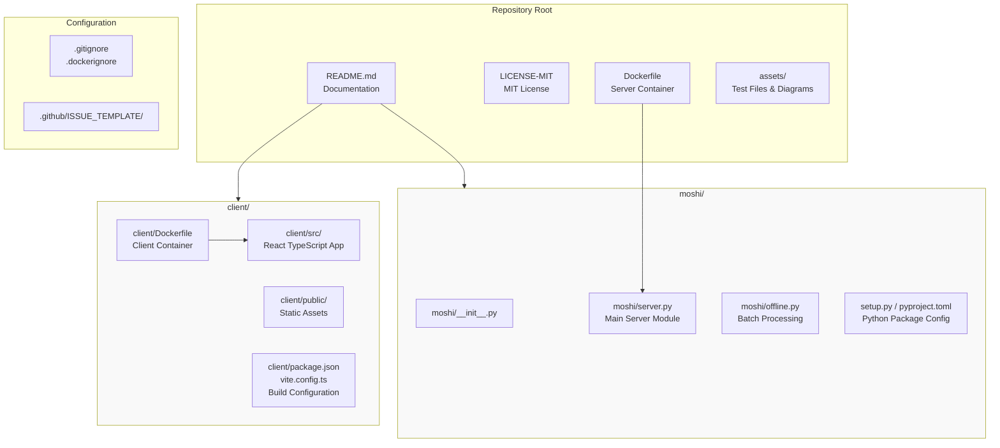
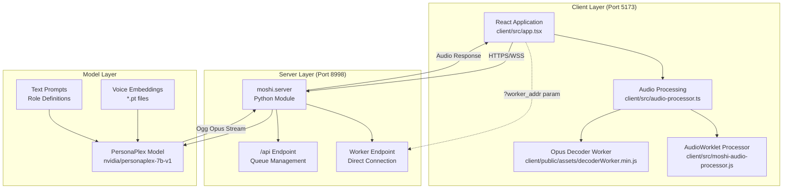
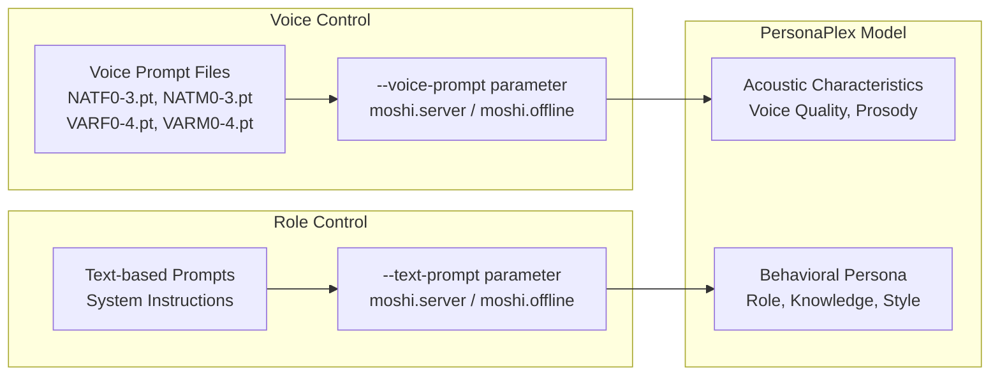
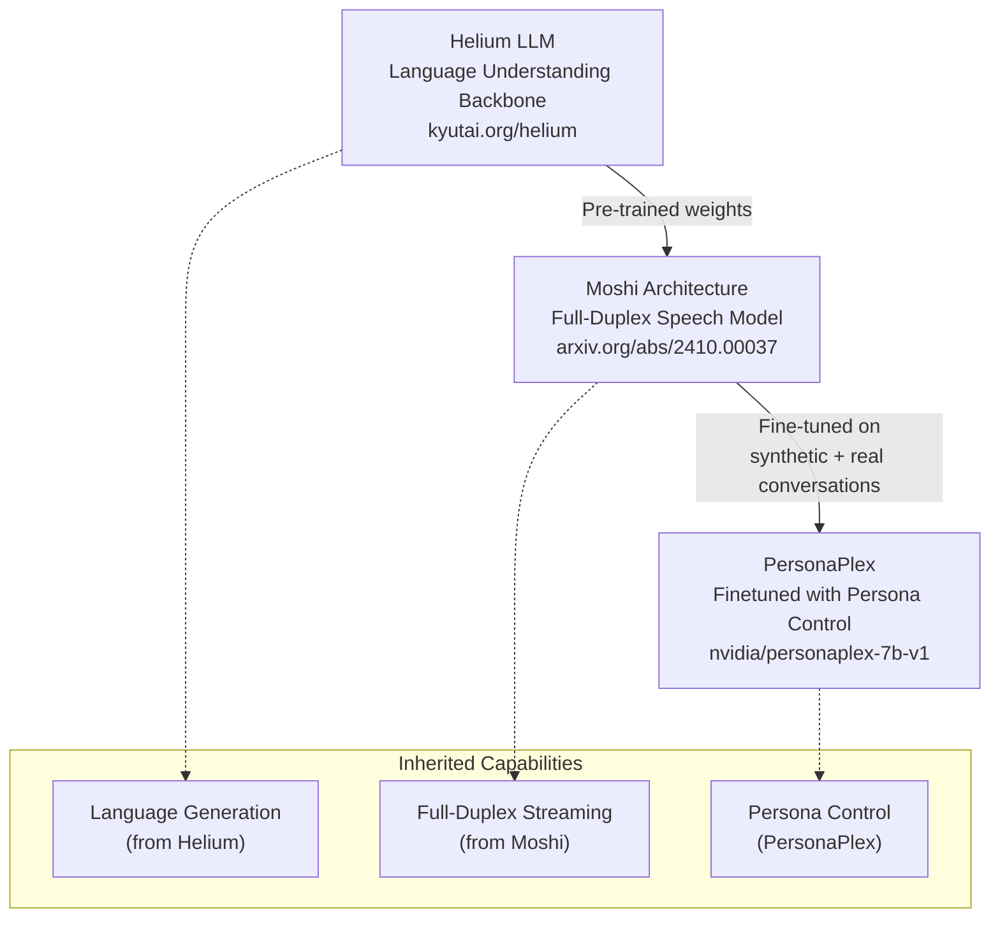
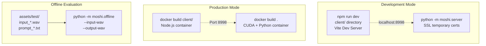

<!-- source: DeepWiki mcp.deepwiki.com · repo NVIDIA/personaplex · page 1 Overview · fetched 2026-10-26 -->

# Overview

Relevant source files

The following files were used as context for generating this wiki page:

- [README.md](README.md)
- [assets/architecture_diagram.png](assets/architecture_diagram.png)

## Purpose and Scope

This document provides a high-level introduction to PersonaPlex, a real-time full-duplex conversational speech model with persona control capabilities. It covers the core concepts, architecture overview, and key components of the system. For step-by-step installation and usage instructions, see [Quick Start](#1.1). For detailed architectural information about component interactions and data flow, see [System Architecture](#1.2).

**Sources:** [README.md:1-8]()

---

## What is PersonaPlex

PersonaPlex is a speech-to-speech conversational model that enables natural, low-latency spoken interactions with controllable personas. The system supports:

| Feature | Description |
|---------|-------------|
| **Full-Duplex Communication** | Simultaneous bidirectional audio streaming without turn-taking constraints |
| **Persona Control** | Dual control mechanisms via text-based role prompts and audio-based voice conditioning |
| **Real-Time Processing** | Low-latency streaming suitable for interactive conversations |
| **Pre-packaged Voices** | 18 voice embeddings (8 natural, 10 variety) across male and female voices |
| **Training Foundation** | Hybrid training on synthetic task-oriented and real conversational data |

The model is built on the Moshi architecture and leverages the Helium LLM backbone for language understanding and generalization capabilities.

**Sources:** [README.md:1-8](), [README.md:72-79]()

---

## Repository Structure

**Sources:** [README.md:1-142](), [Dockerfile:1-50](), [client/Dockerfile:1-25]()

---

## Three-Layer Architecture

PersonaPlex implements a three-layer architecture separating concerns between user interface, application logic, and model inference:

### Client Layer

The client layer provides the user interface and handles all browser-side audio processing. Key components:

- **React Application** ([client/src/app.tsx]()): Main UI built with React and TypeScript
- **Audio Processor** ([client/src/audio-processor.ts]()): Coordinates microphone input and speaker output
- **Opus Decoder** ([client/public/assets/decoderWorker.min.js]()): WebAssembly-based decoder running in Web Worker
- **Audio Worklet** ([client/src/moshi-audio-processor.js]()): Low-latency audio buffering and playback

### Server Layer

The server layer runs the Python application that manages model inference and client connections. Key modules:

- **moshi.server** ([moshi/server.py]()): Main server module handling HTTPS on port 8998
- **Queue API** (`/api` endpoint): Manages client queue and load balancing
- **Worker Endpoint**: Optional direct connection bypassing queue for lower latency

### Model Layer

The model layer contains the PersonaPlex model weights and configuration:

- **PersonaPlex Model**: 7B parameter model hosted on HuggingFace (`nvidia/personaplex-7b-v1`)
- **Voice Embeddings**: Pre-packaged `.pt` files for 18 voice presets (NAT*/VAR*)
- **Text Prompts**: String-based role definitions for persona behavior

**Sources:** [README.md:1-142](), [Dockerfile:1-50](), [client/Dockerfile:1-25]()

---

## Persona Control Mechanisms

PersonaPlex provides two orthogonal control mechanisms for persona customization:

### Voice Conditioning

Voice prompts control acoustic characteristics through pre-trained embeddings:

| Category | Voices | Description |
|----------|--------|-------------|
| **Natural Female** | `NATF0`, `NATF1`, `NATF2`, `NATF3` | Conversational, natural-sounding female voices |
| **Natural Male** | `NATM0`, `NATM1`, `NATM2`, `NATM3` | Conversational, natural-sounding male voices |
| **Variety Female** | `VARF0`, `VARF1`, `VARF2`, `VARF3`, `VARF4` | More varied female voices with distinctive characteristics |
| **Variety Male** | `VARM0`, `VARM1`, `VARM2`, `VARM3`, `VARM4` | More varied male voices with distinctive characteristics |

Voice prompts are specified using the `--voice-prompt` parameter when launching the server or offline evaluation script. For detailed information about voice conditioning, see [Voice Conditioning](#2.1).

### Text-Based Role Prompts

Text prompts define the behavioral persona through natural language instructions. The model supports several prompt categories based on training data:

| Category | Example | Use Case |
|----------|---------|----------|
| **Assistant** | "You are a wise and friendly teacher..." | QA-focused assistance |
| **Service** | "You work for CitySan Services..." | Customer service scenarios |
| **Casual** | "You enjoy having a good conversation." | Open-ended dialogue |
| **Generalization** | "You are an astronaut on a Mars mission..." | Out-of-distribution scenarios |

Text prompts are provided as strings via the `--text-prompt` parameter. For detailed guidance on writing effective prompts, see [Text-based Role Prompts](#2.2).

**Sources:** [README.md:71-133]()

---

## Model Hierarchy and Foundation

PersonaPlex builds on established foundation models through a hierarchical architecture:

### Foundation Layers

1. **Helium LLM**: Provides broad language understanding and generation capabilities from extensive pre-training corpus
2. **Moshi Architecture**: Adds full-duplex speech-to-speech capabilities without turn-taking constraints
3. **PersonaPlex**: Introduces persona control through voice conditioning and role prompts via fine-tuning

This hierarchical approach enables PersonaPlex to:
- Generalize to out-of-distribution prompts (inherited from Helium)
- Maintain natural conversational flow with simultaneous bidirectional audio (from Moshi)
- Control both acoustic characteristics and behavioral personas (PersonaPlex contribution)

For detailed information about model architecture and training methodology, see [Model Architecture](#2) and [Training Data and Methodology](#2.3).

**Sources:** [README.md:8](), [README.md:128-133]()

---

## Training Data Sources

PersonaPlex is trained on a hybrid dataset combining synthetic and real conversational data:

| Data Source | Type | Purpose |
|-------------|------|---------|
| **Synthetic - Fixed Assistant** | Task-oriented QA | Trains fixed assistant role with consistent "wise teacher" persona |
| **Synthetic - Varying Service** | Customer service scenarios | Trains diverse service roles (waste management, restaurant, rental companies) |
| **Fisher English Corpus** | Real telephone conversations | Provides natural conversational patterns and turn-taking |
| **LLM-Labeled Fisher** | Real conversations with generated prompts | Enables open-ended casual conversation capabilities |

The training data directly maps to runtime capabilities:
- Synthetic assistant data → Assistant role prompts
- Synthetic service data → Service role prompts
- Fisher Corpus with LLM labels → Casual conversation prompts
- Helium backbone → Generalization to novel prompts

For detailed information about training methodology and data processing, see [Training Data and Methodology](#2.3).

**Sources:** [README.md:83-133]()

---

## Deployment Modes

PersonaPlex supports three primary deployment modes:

### Development Mode

Local development without containerization. Requires Python 3.12+ and Node.js 20+. See [Quick Start](#1.1) for setup instructions.

### Production Mode

Containerized deployment with Docker for reproducible environments. Requires NVIDIA GPU with CUDA support. See [Deployment and Containerization](#5) for details.

### Offline Evaluation

Batch processing mode for testing without real-time constraints. Processes WAV files and produces output audio and transcripts. See [Offline Evaluation](#3.2) for usage.

**Sources:** [README.md:16-69]()

---

## Key Technologies

PersonaPlex leverages modern technologies across the stack:

| Layer | Technology | Purpose |
|-------|------------|---------|
| **Model** | PyTorch, HuggingFace Transformers | Model inference and weight management |
| **Server** | Python 3.12, `moshi.server` module | Application server with SSL support |
| **Client Build** | Vite, TypeScript, React | Fast development and optimized production builds |
| **Client Audio** | WebAssembly (Opus/Speex), AudioWorklet | High-performance browser audio processing |
| **Packaging** | UV (Python), npm (JavaScript) | Fast dependency resolution |
| **Container** | Docker, NVIDIA CUDA runtime | Reproducible GPU-enabled deployment |

**Sources:** [README.md:1-142](), [Dockerfile:1-50](), [client/Dockerfile:1-25]()

---

## License and Access

PersonaPlex is released under dual licensing:

- **Code**: MIT License ([LICENSE-MIT]()) - permissive open source license for all source code
- **Model Weights**: NVIDIA Open Model License - requires accepting license at [nvidia/personaplex-7b-v1](https://huggingface.co/nvidia/personaplex-7b-v1)

Access to model weights requires HuggingFace authentication via the `HF_TOKEN` environment variable. For details about licensing terms, see [Licensing](#9).

**Sources:** [LICENSE-MIT:1-24](), [README.md:26-30](), [README.md:135-137]()

---

