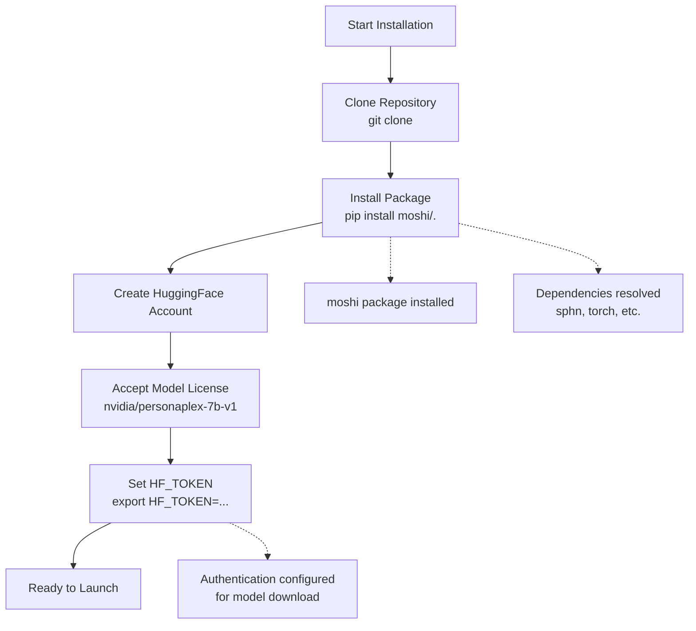
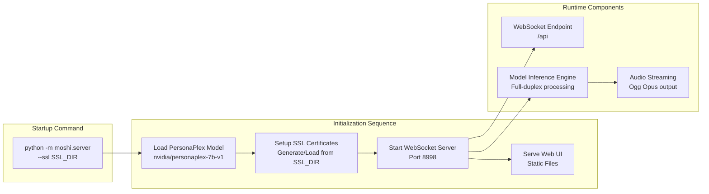

<!-- source: DeepWiki mcp.deepwiki.com · repo NVIDIA/personaplex · page 1.1 Quick Start · fetched 2026-10-26 -->

# Quick Start

<details>
<summary>Relevant source files</summary>

The following files were used as context for generating this wiki page:

- [README.md](README.md)

</details>


This page provides step-by-step instructions for installing and running PersonaPlex, from initial setup through launching the server and accessing the web interface. It covers prerequisite installation, HuggingFace authentication, and basic server operation.

For detailed information about deployment in production environments, see [Production Deployment](#5.3). For information about configuring personas and voices, see [Voice Conditioning](#2.1) and [Text-based Role Prompts](#2.2).

---

## Prerequisites

Before installing PersonaPlex, ensure your system meets the following requirements:

| Requirement | Description | Notes |
|------------|-------------|-------|
| Python | Version 3.12 | Required by the moshi server |
| pip | Python package installer | For installing dependencies |
| HuggingFace Account | With accepted model license | Required to download model weights |
| GPU (Optional) | NVIDIA GPU with CUDA support | Strongly recommended for real-time performance |
| Network Access | Internet connection | For downloading model weights (~7B parameters) |

**Sources**: [README.md:18-23](), [Dockerfile:11]()

---

## Installation Process

The following diagram shows the complete installation workflow and the key components that get installed:

### Installation Flow



**Sources**: [README.md:18-30]()

---

## Step-by-Step Installation

### Step 1: Clone the Repository

Download the PersonaPlex repository:

```bash
git clone https://github.com/NVIDIA/personaplex.git
cd personaplex
```

### Step 2: Install the Moshi Package

Install the moshi package and its dependencies using pip:

```bash
pip install moshi/.
```

This installs the `moshi` Python package from the local `moshi/` directory. The installation includes:
- Core moshi server module
- Audio processing dependencies
- Model inference components
- WebSocket server for client communication

**Note**: For containerized installation, see [Server Container](#5.1).

**Sources**: [README.md:20-23]()

---

## HuggingFace Authentication

PersonaPlex requires authentication to download model weights from HuggingFace.

### Step 1: Accept the Model License

1. Log in to your HuggingFace account at [huggingface.co](https://huggingface.co)
2. Navigate to the PersonaPlex model page: `nvidia/personaplex-7b-v1`
3. Review and accept the NVIDIA Open Model License

### Step 2: Configure Authentication Token

Set your HuggingFace token as an environment variable:

```bash
export HF_TOKEN=<YOUR_HUGGINGFACE_TOKEN>
```

To make this persistent across sessions, add it to your shell profile (`.bashrc`, `.zshrc`, etc.):

```bash
echo 'export HF_TOKEN=<YOUR_HUGGINGFACE_TOKEN>' >> ~/.bashrc
source ~/.bashrc
```

**Sources**: [README.md:25-30]()

---

## Launching the Server

### Server Architecture and Startup

The following diagram shows the server startup process and the components that are initialized:



**Sources**: [README.md:32-42](), [Dockerfile:19]()

### Basic Server Launch

Launch the server with temporary SSL certificates:

```bash
SSL_DIR=$(mktemp -d); python -m moshi.server --ssl "$SSL_DIR"
```

This command:
1. Creates a temporary directory for SSL certificates
2. Launches the `moshi.server` module as a Python application
3. Generates self-signed SSL certificates in `SSL_DIR`
4. Starts the HTTPS server on port 8998
5. Downloads the PersonaPlex model weights (first run only)

**Expected Output**:
```
Access the Web UI directly at https://11.54.401.33:8998
```

**Note**: The IP address shown will match your machine's network address.

**Sources**: [README.md:34-42]()

### Server Launch Options

| Option | Description | Example |
|--------|-------------|---------|
| `--ssl` | Directory for SSL certificates | `--ssl /path/to/ssl` |
| Port | Server port (default: 8998) | Configured in server module |

For detailed server configuration options, see [Server Deployment](#3.1).

**Sources**: [README.md:34-37](), [Dockerfile:16-19]()

---

## Accessing the Web UI

### Local Access

If running on your local machine, access the web interface at:

```
https://localhost:8998
```

### Remote Access

If running on a remote server, use the URL printed by the server startup script. The server automatically detects and displays the accessible URL:

```
Access the Web UI directly at https://<SERVER_IP>:8998
```

### SSL Certificate Warning

Since the server uses self-signed SSL certificates, your browser will display a security warning. This is expected behavior for local development:

1. Click "Advanced" or equivalent in your browser
2. Click "Proceed to localhost (unsafe)" or equivalent
3. The warning will not appear on subsequent visits

For production deployment with proper SSL certificates, see [Production Deployment](#5.3).

**Sources**: [README.md:39-42]()

---

## Verification and Testing

### Quick Verification with Offline Mode

To verify the installation without launching the full server, use the offline evaluation script:

```bash
HF_TOKEN=<TOKEN> \
python -m moshi.offline \
  --voice-prompt "NATF2.pt" \
  --input-wav "assets/test/input_assistant.wav" \
  --seed 42424242 \
  --output-wav "output.wav" \
  --output-text "output.json"
```

This command:
- Processes a test audio file through the model
- Uses the NATF2 voice (Natural Female voice 2)
- Generates an output audio file and transcript
- Verifies that model loading and inference work correctly

### Verification Checklist

| Component | How to Verify | Expected Result |
|-----------|--------------|-----------------|
| Package Installation | `python -c "import moshi"` | No import errors |
| HF Authentication | Check `$HF_TOKEN` is set | Token value displayed |
| Model Download | First server launch | Model downloads successfully |
| Server Running | Access web UI at localhost:8998 | UI loads successfully |
| Audio Processing | Speak into microphone in UI | Audio response plays back |

**Sources**: [README.md:44-57]()

---

## Common Quick Start Issues

### Issue: Model Download Fails

**Symptom**: Server fails to start with authentication errors

**Solution**:
1. Verify `HF_TOKEN` is set: `echo $HF_TOKEN`
2. Confirm license accepted at huggingface.co/nvidia/personaplex-7b-v1
3. Check internet connectivity

### Issue: SSL Certificate Error Blocks Access

**Symptom**: Browser blocks access with security error

**Solution**:
1. Click "Advanced" in browser security warning
2. Select "Proceed to localhost" or equivalent
3. Alternatively, use a custom SSL directory with valid certificates

### Issue: Port 8998 Already in Use

**Symptom**: Server fails to start with "Address already in use"

**Solution**:
1. Check for existing server process: `lsof -i :8998`
2. Kill existing process or use different port
3. Modify server configuration to use alternative port

**Sources**: [README.md:25-42]()

---

## Next Steps

After successfully launching PersonaPlex, explore the following:

- **Voice Configuration**: Experiment with different voice prompts (NATF0-3, NATM0-3, VARF0-4, VARM0-4). See [Voice Conditioning](#2.1)
- **Persona Prompting**: Define custom personas for assistant, service, or casual conversation scenarios. See [Text-based Role Prompts](#2.2)
- **Production Deployment**: Deploy with Docker containers for scalable operation. See [Server Container](#5.1) and [Client Container](#5.2)
- **Offline Evaluation**: Run batch processing and testing. See [Offline Evaluation](#3.2)

**Sources**: [README.md:71-134]()

---

