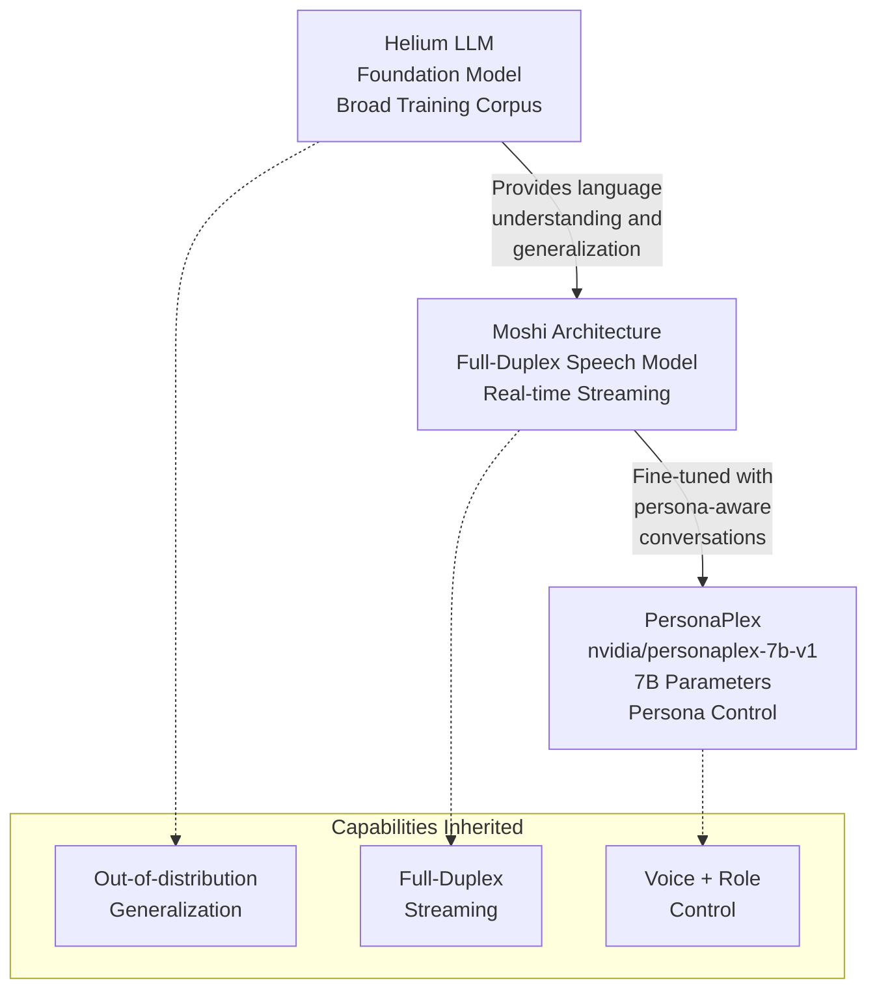
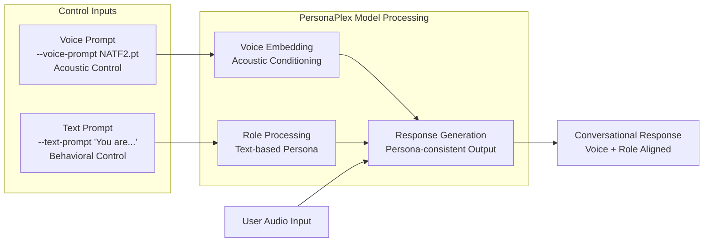
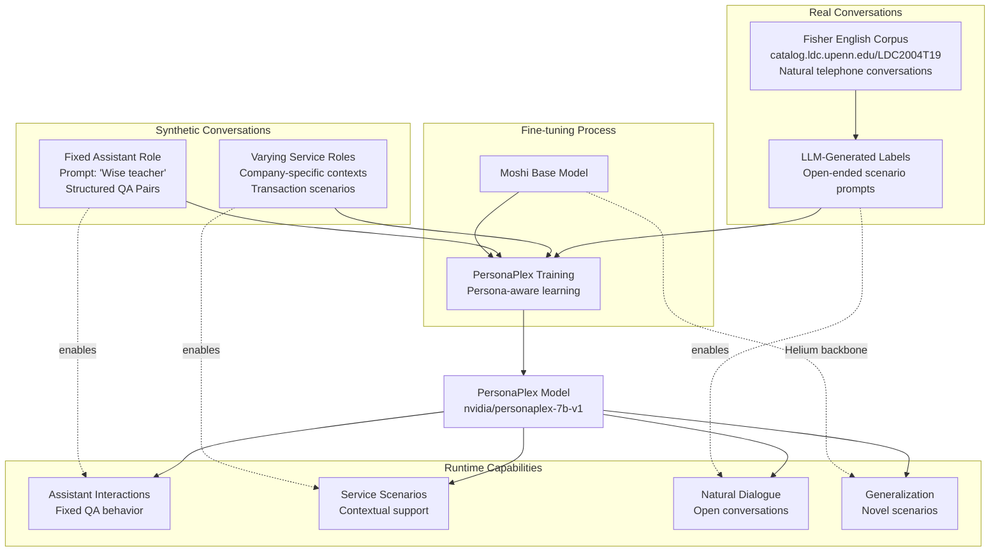
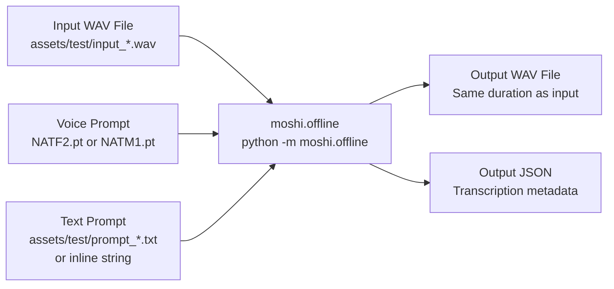
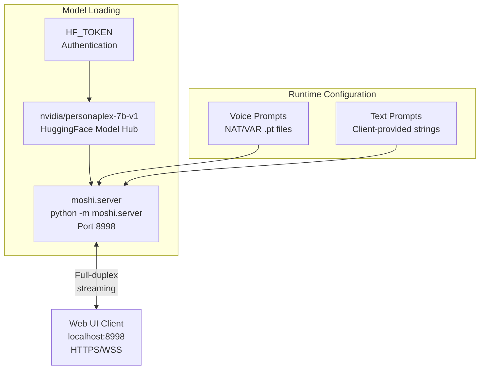
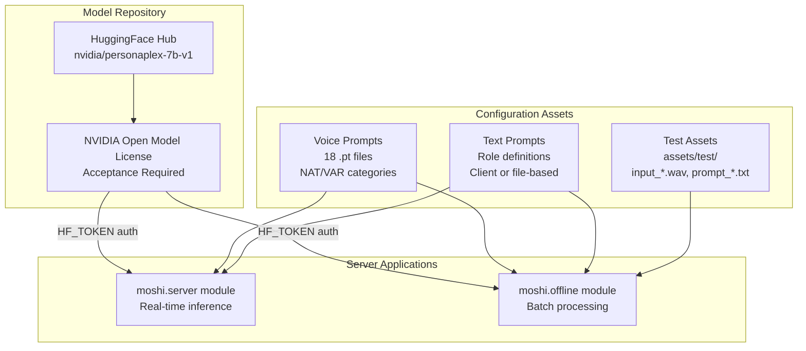

<!-- source: DeepWiki mcp.deepwiki.com · repo NVIDIA/personaplex · page 2 Model Architecture · fetched 2026-10-26 -->

# Model Architecture

Relevant source files

The following files were used as context for generating this wiki page:

- [README.md](README.md)

## Purpose and Scope

This page documents the PersonaPlex model architecture, including its hierarchical foundation (Helium LLM → Moshi → PersonaPlex), the dual control mechanisms (voice and text prompts), and the training methodology that enables persona-aware conversational speech generation. 

For detailed information on voice prompt usage and acoustic control, see [Voice Conditioning](#2.1). For text-based persona definition and prompt engineering, see [Text-based Role Prompts](#2.2). For comprehensive training data sources and methodology, see [Training Data and Methodology](#2.3).

---

## Model Hierarchy

PersonaPlex is built on a three-tier architecture that inherits capabilities from underlying models while adding persona control mechanisms.

### Hierarchical Foundation

**Sources:** [README.md:8](), [README.md:129-133]()

### Model Components

| Component | Source | Role | Key Capability |
|-----------|--------|------|----------------|
| **Helium LLM** | Kyutai Foundation | Language backbone | Broad domain knowledge, out-of-distribution generalization |
| **Moshi Architecture** | Pre-trained base | Speech-to-speech framework | Full-duplex streaming, low-latency interaction |
| **PersonaPlex** | Fine-tuned model | Persona-aware layer | Voice conditioning, role-based behavior control |

**Model Identifier:** `nvidia/personaplex-7b-v1` (7 billion parameters)

**Sources:** [README.md:3](), [README.md:8](), [README.md:129-133]()

---

## Persona Control Mechanisms

PersonaPlex provides dual control over conversational behavior: acoustic characteristics via voice prompts and behavioral characteristics via text prompts.

### Control Architecture

**Sources:** [README.md:52-53](), [README.md:64-65]()

### Voice Prompt System

PersonaPlex includes 18 pre-packaged voice embeddings organized into two categories:

| Category | Description | Available Voices |
|----------|-------------|------------------|
| **Natural (NAT)** | More natural, conversational voices | `NATF0`, `NATF1`, `NATF2`, `NATF3` (female) `NATM0`, `NATM1`, `NATM2`, `NATM3` (male) |
| **Variety (VAR)** | More varied, diverse acoustic characteristics | `VARF0`, `VARF1`, `VARF2`, `VARF3`, `VARF4` (female) `VARM0`, `VARM1`, `VARM2`, `VARM3`, `VARM4` (male) |

**File Format:** `.pt` files (PyTorch tensors containing voice embeddings)

**Usage Example:** `--voice-prompt "NATF2.pt"` in `moshi.offline` or `moshi.server`

**Sources:** [README.md:71-79]()

### Text-based Role Prompts

Text prompts define the behavioral persona, role, and conversational style. The model supports four primary prompt categories:

#### 1. Assistant Role
- **Training:** Fixed synthetic conversations with consistent "wise teacher" persona
- **Prompt Template:** `You are a wise and friendly teacher. Answer questions or provide advice in a clear and engaging way.`
- **Use Case:** Question-answering, educational interactions
- **Benchmark:** FullDuplexBench "User Interruption" category

**Sources:** [README.md:83-92]()

#### 2. Customer Service Roles
- **Training:** Varying synthetic conversations with company-specific scenarios
- **Prompt Structure:** Company name, agent name, specific information context
- **Example:** `You work for CitySan Services which is a waste management and your name is Ayelen Lucero. Information: Verify customer name Omar Torres...`
- **Use Case:** Service interactions, transaction support, information provision

**Sources:** [README.md:94-106]()

#### 3. Casual Conversations
- **Training:** Real conversations from Fisher English Corpus with LLM-generated labels
- **Prompt Range:** From minimal (`You enjoy having a good conversation.`) to detailed with background/context
- **Use Case:** Open-ended dialogue, natural conversation flow
- **Benchmark:** FullDuplexBench "Pause Handling", "Backchannel", "Smooth Turn Taking" categories

**Sources:** [README.md:108-125]()

#### 4. Generalization Scenarios
- **Capability Source:** Helium LLM backbone's broad training corpus
- **Characteristic:** Out-of-distribution prompts beyond training data
- **Example:** Astronaut scenario (`You enjoy having a good conversation. Have a technical discussion about fixing a reactor core on a spaceship to Mars...`)
- **Note:** Emergent behavior, not directly trained

**Sources:** [README.md:128-133]()

---

## Training Approach

PersonaPlex employs a hybrid training strategy combining synthetic and real conversational data to achieve both task-specific competence and natural dialogue capabilities.

### Training Data Pipeline

**Sources:** [README.md:8](), [README.md:83-84](), [README.md:94](), [README.md:108-109](), [README.md:129-130]()

### Training Data Categories

| Data Source | Type | Purpose | Maps to Runtime Capability |
|-------------|------|---------|---------------------------|
| **Fixed Assistant** | Synthetic | Structured question-answering with consistent "wise teacher" persona | Assistant role prompts, FullDuplexBench user interruption handling |
| **Varying Service** | Synthetic | Company-specific service scenarios with contextual information | Customer service role prompts, transaction support |
| **Fisher Corpus + LLM Labels** | Real + Synthetic labels | Natural telephone conversations annotated with open-ended prompts | Casual conversation prompts, natural turn-taking |
| **Helium Backbone** | Pre-training | Broad domain knowledge from foundation model | Generalization to novel scenarios |

**Sources:** [README.md:8](), [README.md:83-133]()

---

## Model Inference Modes

PersonaPlex supports two primary inference modes with different operational characteristics.

### Offline Evaluation Mode

**Command Structure:**
- `--voice-prompt`: Voice embedding file (e.g., `"NATF2.pt"`)
- `--text-prompt`: Role prompt string (inline or via file with `$(cat ...)`)
- `--input-wav`: Input audio file path
- `--output-wav`: Generated response audio file
- `--output-text`: JSON metadata output
- `--seed`: Random seed for reproducibility

**Sources:** [README.md:44-69]()

### Real-time Server Mode

**Server Launch:** `python -m moshi.server --ssl "$SSL_DIR"`

**Model Authentication:** Requires `HF_TOKEN` environment variable and accepted license at `huggingface.co/nvidia/personaplex-7b-v1`

**Sources:** [README.md:25-42]()

---

## Integration Points

The PersonaPlex model architecture integrates with other system components through well-defined interfaces.

### Model Access Points

**Sources:** [README.md:25-29](), [README.md:44-69](), [README.md:71-79]()

### Configuration Parameters

| Parameter | Type | Location | Purpose |
|-----------|------|----------|---------|
| `--voice-prompt` | Command-line argument | `moshi.offline` / `moshi.server` | Specifies voice embedding file (e.g., `"NATF2.pt"`) |
| `--text-prompt` | Command-line argument | `moshi.offline` / `moshi.server` | Defines behavioral persona and role |
| `--input-wav` | Command-line argument | `moshi.offline` | Input audio file for offline processing |
| `--output-wav` | Command-line argument | `moshi.offline` | Output audio file path |
| `--output-text` | Command-line argument | `moshi.offline` | JSON metadata output path |
| `--seed` | Command-line argument | `moshi.offline` | Random seed for reproducible generation |
| `HF_TOKEN` | Environment variable | Authentication | HuggingFace API token for model access |

**Sources:** [README.md:29](), [README.md:50-68]()

---

## Model Characteristics

### Technical Specifications

| Specification | Value | Notes |
|---------------|-------|-------|
| **Model Size** | 7 billion parameters | Full precision model weights |
| **Architecture Base** | Moshi | Full-duplex speech-to-speech |
| **Foundation** | Helium LLM | Language understanding backbone |
| **Model ID** | `nvidia/personaplex-7b-v1` | HuggingFace model hub identifier |
| **License** | NVIDIA Open Model License | Separate from MIT code license |
| **Voice Prompts** | 18 pre-packaged | 8 NAT (natural) + 10 VAR (variety) |
| **Inference Latency** | Real-time capable | Full-duplex streaming support |
| **Training Data** | Synthetic + Real | Fixed assistant, varying service, Fisher Corpus |

**Sources:** [README.md:3](), [README.md:8](), [README.md:71-79](), [README.md:135-137]()

### Generalization Capabilities

PersonaPlex inherits broad generalization capabilities from the Helium LLM backbone, enabling plausible responses to out-of-distribution prompts:

- **Emergent Behavior:** Responds to scenarios not explicitly present in training data
- **Novel Context Handling:** Can adapt to unexpected conversational contexts (e.g., astronaut scenario)
- **Prompt Flexibility:** Encourages experimentation with diverse prompt formulations
- **Foundation Leverage:** Benefits from Helium's extensive pre-training corpus

**Example Out-of-Distribution Prompt:** The astronaut reactor core scenario demonstrates handling of technical, high-stakes dialogue in a space context—far from typical training scenarios.

**Sources:** [README.md:128-133]()

---

## Summary

PersonaPlex achieves persona-aware conversational speech through:

1. **Hierarchical Architecture:** Helium LLM (foundation) → Moshi (full-duplex) → PersonaPlex (persona control)
2. **Dual Control Mechanisms:** Voice prompts (acoustic) + text prompts (behavioral)
3. **Hybrid Training:** Synthetic conversations (structured tasks) + real conversations (natural dialogue)
4. **Pre-packaged Assets:** 18 voice embeddings (NAT/VAR categories), example text prompts for multiple scenarios
5. **Flexible Deployment:** Real-time server mode and offline batch processing
6. **Strong Generalization:** Helium backbone enables out-of-distribution prompt handling

For implementation details on voice conditioning mechanisms, see [Voice Conditioning](#2.1). For text prompt engineering guidance, see [Text-based Role Prompts](#2.2). For training data composition and methodology, see [Training Data and Methodology](#2.3).

**Sources:** [README.md:1-142]()

---

