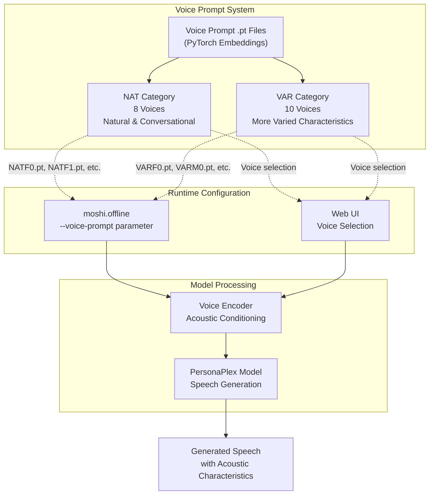
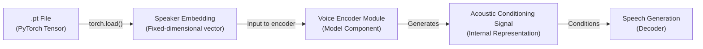
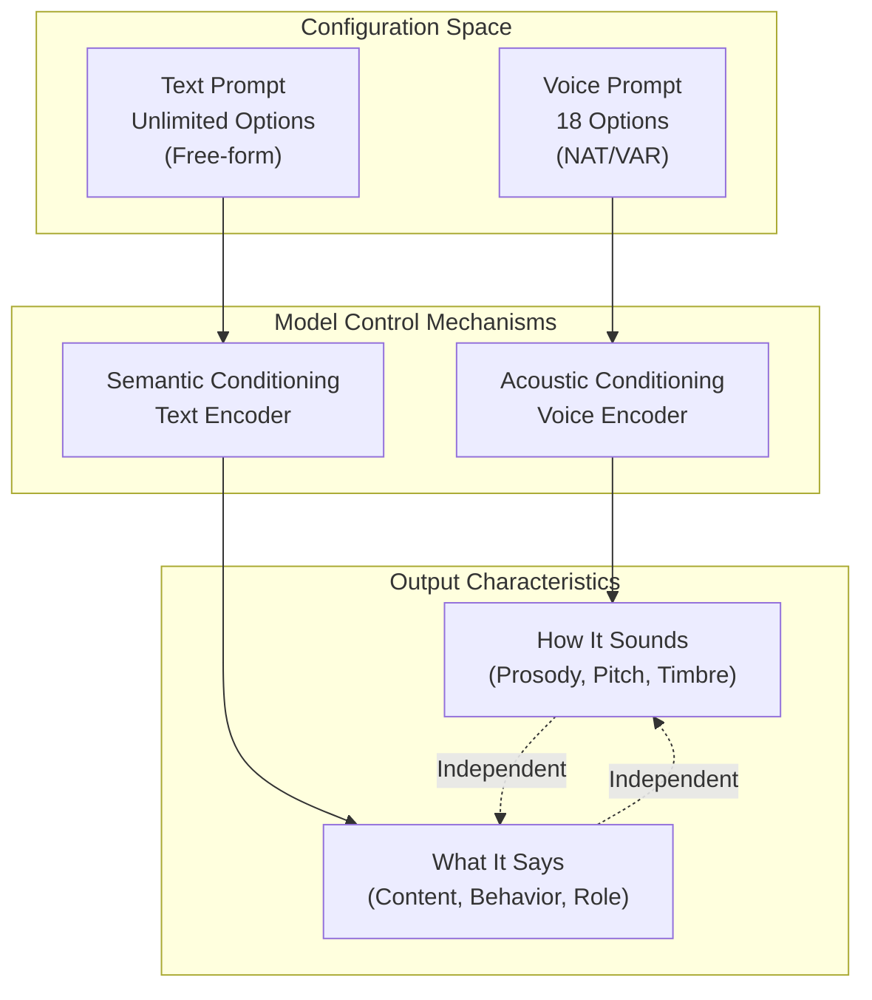
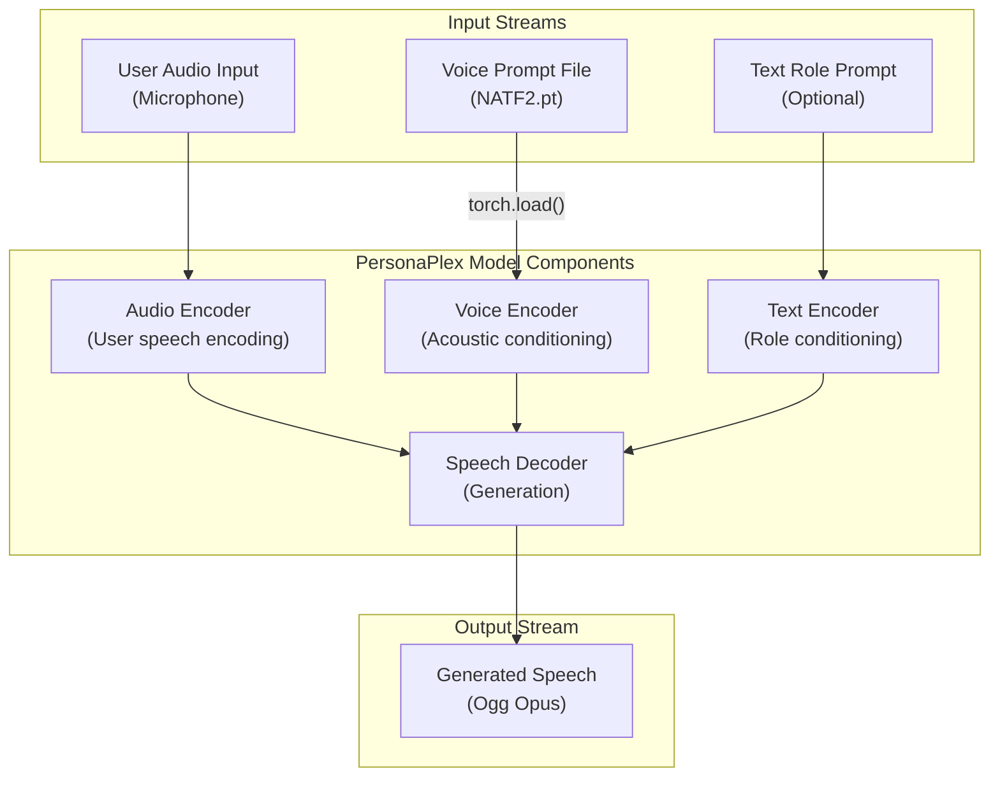

<!-- source: DeepWiki mcp.deepwiki.com · repo NVIDIA/personaplex · page 2.1 Voice Conditioning · fetched 2026-10-26 -->

# Voice Conditioning

<details>
<summary>Relevant source files</summary>

The following files were used as context for generating this wiki page:

- [README.md](README.md)

</details>


## Purpose and Scope

This document describes the voice conditioning system in PersonaPlex, which controls the acoustic characteristics of the model's generated speech through pre-packaged voice prompt embeddings stored as `.pt` files. Voice conditioning determines how the model sounds (pitch, tone, speaking style) independently of what it says. For controlling the content and behavioral persona of the model's responses, see [Text-based Role Prompts](#2.2).

**Sources:** [README.md:1-142]()

---

## Overview

Voice conditioning in PersonaPlex operates through a voice prompt system that uses pre-computed speaker embeddings to control the acoustic properties of generated speech. Unlike text prompts that define behavioral personas, voice prompts provide acoustic conditioning signals that influence prosodic features such as pitch range, speaking rate, and vocal timbre. The system provides 18 pre-packaged voice embeddings organized into two categories based on their acoustic characteristics.



**Diagram: Voice Conditioning Architecture**

The voice prompt embeddings are loaded at runtime and fed into the model's voice encoder to condition the acoustic generation process. This conditioning occurs independently of the text-based role prompts, allowing orthogonal control over what the model says (text prompt) and how it sounds (voice prompt).

**Sources:** [README.md:71-79](), [README.md:46-69]()

---

## Pre-packaged Voice Categories

PersonaPlex provides 18 pre-packaged voice embeddings organized into two categories based on their acoustic characteristics:

### NAT (Natural) Voices

NAT voices are designed to sound more natural and conversational, suitable for most interaction scenarios. These voices exhibit more typical prosodic patterns and speaking characteristics.

| Voice ID | Gender | Description |
|----------|--------|-------------|
| `NATF0` | Female | Natural conversational voice |
| `NATF1` | Female | Natural conversational voice |
| `NATF2` | Female | Natural conversational voice |
| `NATF3` | Female | Natural conversational voice |
| `NATM0` | Male | Natural conversational voice |
| `NATM1` | Male | Natural conversational voice |
| `NATM2` | Male | Natural conversational voice |
| `NATM3` | Male | Natural conversational voice |

### VAR (Variety) Voices

VAR voices provide more varied acoustic characteristics, offering greater diversity in pitch range, speaking rate, and vocal quality compared to NAT voices.

| Voice ID | Gender | Description |
|----------|--------|-------------|
| `VARF0` | Female | Varied acoustic characteristics |
| `VARF1` | Female | Varied acoustic characteristics |
| `VARF2` | Female | Varied acoustic characteristics |
| `VARF3` | Female | Varied acoustic characteristics |
| `VARF4` | Female | Varied acoustic characteristics |
| `VARM0` | Male | Varied acoustic characteristics |
| `VARM1` | Male | Varied acoustic characteristics |
| `VARM2` | Male | Varied acoustic characteristics |
| `VARM3` | Male | Varied acoustic characteristics |
| `VARM4` | Male | Varied acoustic characteristics |

**Sources:** [README.md:71-79]()

---

## Voice Prompt File Format

Voice prompts are stored as PyTorch serialized tensors with the `.pt` file extension. Each file contains a pre-computed speaker embedding that encodes the acoustic characteristics of a specific voice. These embeddings are generated during model training and packaged with the model weights.



**Diagram: Voice Prompt Processing Pipeline**

The `.pt` files are loaded at runtime using PyTorch's serialization utilities and fed into the model's voice encoding mechanism. The files are distributed alongside the model weights and do not require additional preprocessing or conversion.

**Sources:** [README.md:52-68]()

---

## Using Voice Prompts

### Offline Mode

In offline evaluation mode, voice prompts are specified using the `--voice-prompt` command-line parameter. The parameter accepts the voice ID with the `.pt` extension.

**Assistant example with NAT female voice:**
```bash
python -m moshi.offline \
  --voice-prompt "NATF2.pt" \
  --input-wav "assets/test/input_assistant.wav" \
  --seed 42424242 \
  --output-wav "output.wav" \
  --output-text "output.json"
```

**Service example with NAT male voice:**
```bash
python -m moshi.offline \
  --voice-prompt "NATM1.pt" \
  --text-prompt "$(cat assets/test/prompt_service.txt)" \
  --input-wav "assets/test/input_service.wav" \
  --seed 42424242 \
  --output-wav "output.wav" \
  --output-text "output.json"
```

The `--voice-prompt` parameter is independent of the `--text-prompt` parameter, demonstrating the orthogonal control over acoustic (voice) and behavioral (role) characteristics.

**Sources:** [README.md:46-69]()

### Web UI Mode

When running the Moshi server and accessing the Web UI, voice selection is available through the interface. The exact implementation of voice selection in the Web UI depends on the client application configuration.

```mermaid
sequenceDiagram
    participant User
    participant WebUI["Web UI<br/>(React Client)"]
    participant MoshiServer["moshi.server<br/>(Python Server)"]
    participant Model["PersonaPlex Model"]
    
    User->>WebUI: "Select voice (e.g., NATF2)"
    WebUI->>MoshiServer: "Send voice prompt ID + audio input"
    MoshiServer->>MoshiServer: "Load NATF2.pt embedding"
    MoshiServer->>Model: "Apply voice conditioning"
    Model->>Model: "Generate speech with acoustic characteristics"
    Model->>MoshiServer: "Ogg Opus audio stream"
    MoshiServer->>WebUI: "Stream response"
    WebUI->>User: "Playback with selected voice"
```

**Diagram: Voice Selection Flow in Web UI**

**Sources:** [README.md:34-42]()

---

## Voice Conditioning vs Text Prompts

Voice conditioning and text-based role prompts serve distinct, orthogonal purposes in controlling PersonaPlex's behavior:

| Aspect | Voice Conditioning | Text-based Role Prompts |
|--------|-------------------|------------------------|
| **Purpose** | Controls acoustic characteristics | Controls behavioral persona and content |
| **Input Format** | `.pt` files (PyTorch embeddings) | Natural language text strings |
| **Controls** | Pitch, tone, speaking rate, timbre | What the model says, role behavior |
| **Examples** | `NATF2.pt`, `VARM1.pt` | "You are a wise teacher", "You work for CitySan Services" |
| **Parameter** | `--voice-prompt` | `--text-prompt` |
| **Independence** | Can be changed without affecting content | Can be changed without affecting voice |
| **Number of Options** | 18 pre-packaged voices | Unlimited (free-form text) |

This orthogonal design allows flexible combination of any voice with any role. For example, a customer service role can use any of the 18 voices, and the wise teacher assistant can speak with either natural or varied acoustic characteristics.



**Diagram: Orthogonal Control through Voice and Text Prompts**

**Sources:** [README.md:46-69](), [README.md:81-133]()

---

## Technical Implementation

Voice conditioning is implemented through a voice encoder module that processes the loaded `.pt` embeddings and generates acoustic conditioning signals. These signals are injected into the model's decoder to influence the prosodic and acoustic characteristics of the generated speech.

### Command-line Parameter Handling

The `moshi.offline` module accepts the `--voice-prompt` parameter, which specifies the voice prompt file to load:

```bash
python -m moshi.offline --voice-prompt "NATF2.pt" [other parameters]
```

The parameter expects the voice ID followed by the `.pt` extension. The file is loaded from the model's voice prompt directory, which is bundled with the model weights downloaded from HuggingFace.

### Integration with Model Architecture



**Diagram: Voice Conditioning in Model Architecture**

The voice encoder processes the loaded embedding independently of the audio encoder (which processes user input) and text encoder (which processes role prompts). All three conditioning signals converge at the decoder, which generates speech that reflects the acoustic characteristics (from voice prompt), semantic content (from text prompt), and conversational context (from audio input).

### Model Hierarchy and Voice Conditioning

PersonaPlex inherits its voice conditioning capabilities from the Moshi architecture, which in turn is built on the Helium LLM backbone. The voice conditioning system is part of the fine-tuning process that adapts Moshi to support persona control while maintaining the full-duplex conversational capabilities.

**Sources:** [README.md:8](), [README.md:46-69]()

---

## Summary

Voice conditioning in PersonaPlex provides fine-grained control over acoustic characteristics through 18 pre-packaged voice embeddings organized into NAT (natural) and VAR (variety) categories. These `.pt` files are specified at runtime using the `--voice-prompt` parameter in offline mode or through voice selection in the Web UI. Voice conditioning operates independently of text-based role prompts, allowing orthogonal control over how the model sounds versus what it says. The system integrates with the model's voice encoder to generate acoustic conditioning signals that influence the prosodic features of generated speech without affecting semantic content or behavioral persona.

**Sources:** [README.md:1-142]()

---

