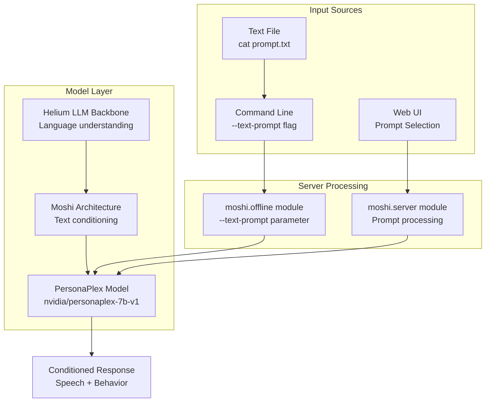
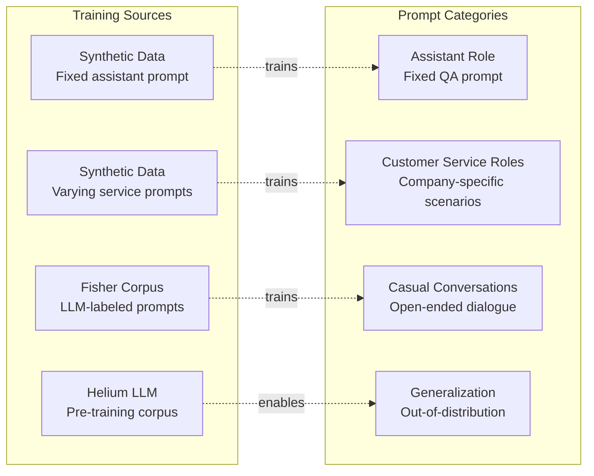
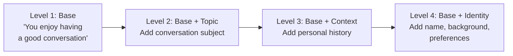
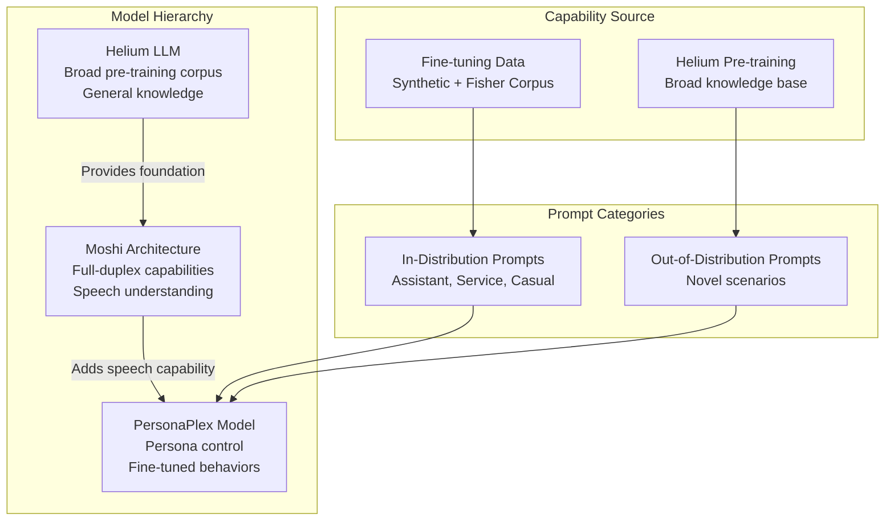
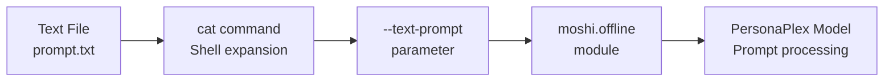

<!-- source: DeepWiki mcp.deepwiki.com · repo NVIDIA/personaplex · page 2.2 Text-based Role Prompts · fetched 2026-10-26 -->

# Text-based Role Prompts

<details>
<summary>Relevant source files</summary>

The following files were used as context for generating this wiki page:

- [README.md](README.md)
- [assets/test/prompt_service.txt](assets/test/prompt_service.txt)

</details>


## Purpose and Scope

This document explains PersonaPlex's text-based role prompt system, which enables persona control by defining the conversational behavior, role, and knowledge of the AI agent. Text-based role prompts work alongside voice conditioning to provide complete persona control: voice prompts (see [Voice Conditioning](#2.1)) control acoustic characteristics, while text prompts control conversational behavior, personality, and domain knowledge.

For information about how training data maps to these prompt categories, see [Training Data and Methodology](#2.3).

**Sources:** [README.md:1-142]()

---

## Text Prompt System Architecture

Text-based role prompts are string inputs passed to the PersonaPlex model that define the conversational persona. The model processes these prompts during initialization to condition its behavior throughout the conversation.

### Integration Points



**Diagram:** Text prompt flow from user input through server processing to model conditioning.

**Sources:** [README.md:44-69](), [README.md:81-133]()

### Command-Line Usage

Text prompts are specified using the `--text-prompt` parameter in the offline evaluation script:

```bash
python -m moshi.offline \
  --voice-prompt "NATM1.pt" \
  --text-prompt "$(cat assets/test/prompt_service.txt)" \
  --input-wav "assets/test/input_service.wav" \
  --output-wav "output.wav"
```

**Sources:** [README.md:60-69]()

---

## Prompt Categories

PersonaPlex supports four distinct prompt categories, each trained on specific conversation types and designed for different use cases.

### Category Overview



**Diagram:** Mapping between training data sources and prompt categories.

**Sources:** [README.md:83-133]()

---

## Assistant Role

The assistant role uses a fixed prompt designed for question-answering and educational interactions. This prompt produces behavior optimized for the "User Interruption" evaluation category in FullDuplexBench.

### Fixed Prompt Definition

```
You are a wise and friendly teacher. Answer questions or provide advice in a clear and engaging way.
```

### Characteristics

| Attribute | Value |
|-----------|-------|
| Prompt Type | Fixed, pre-defined |
| Training Data | Synthetic conversations |
| Primary Use Case | QA assistant interactions |
| FullDuplexBench Category | User Interruption |
| Conversation Style | Educational, explanatory |

### Usage Example

```bash
python -m moshi.offline \
  --voice-prompt "NATF2.pt" \
  --text-prompt "You are a wise and friendly teacher. Answer questions or provide advice in a clear and engaging way." \
  --input-wav "assets/test/input_assistant.wav" \
  --output-wav "output.wav"
```

**Sources:** [README.md:85-92](), [README.md:48-57]()

---

## Customer Service Roles

Customer service prompts support domain-specific scenarios where the model assumes a role within a company or organization. These prompts follow a structured format that includes role definition, company information, and relevant operational details.

### Prompt Structure

```mermaid
graph TB
    subgraph "Prompt Components"
        Company["Company Context<br/>'You work for [Company]'"]
        Industry["Industry Type<br/>'which is a [industry]'"]
        Name["Agent Name<br/>'your name is [Name]'"]
        Info["Operational Information<br/>'Information: [details]'"]
        
        Company --> Industry
        Industry --> Name
        Name --> Info
    end
    
    subgraph "Example: SwiftPlex Appliances"
        ExCompany["'You work for SwiftPlex Appliances'"]
        ExIndustry["'which is a appliance repair company'"]
        ExName["'your name is Farhod Toshmatov'"]
        ExInfo["'Information: The dishwasher model<br/>is out of stock...'"]
        
        ExCompany --> ExIndustry
        ExIndustry --> ExName
        ExName --> ExInfo
    end
```



**Diagram:** Service prompt structural components with concrete example.

### Service Prompt Examples

#### Waste Management Service

```
You work for CitySan Services which is a waste management and your name is Ayelen Lucero. Information: Verify customer name Omar Torres. Current schedule: every other week. Upcoming pickup: April 12th. Compost bin service available for $8/month add-on.
```

**Components:**
- **Company:** CitySan Services
- **Industry:** Waste management
- **Agent Name:** Ayelen Lucero
- **Information:** Customer verification, schedule details, service options

#### Restaurant Service

```
You work for Jerusalem Shakshuka which is a restaurant and your name is Owen Foster. Information: There are two shakshuka options: Classic (poached eggs, $9.50) and Spicy (scrambled eggs with jalapenos, $10.25). Sides include warm pita ($2.50) and Israeli salad ($3). No combo offers. Available for drive-through until 9 PM.
```

**Components:**
- **Company:** Jerusalem Shakshuka
- **Industry:** Restaurant
- **Agent Name:** Owen Foster
- **Information:** Menu items, pricing, service hours

#### Drone Rental Service

```
You work for AeroRentals Pro which is a drone rental company and your name is Tomaz Novak. Information: AeroRentals Pro has the following availability: PhoenixDrone X ($65/4 hours, $110/8 hours), and the premium SpectraDrone 9 ($95/4 hours, $160/8 hours). Deposit required: $150 for standard models, $300 for premium.
```

**Components:**
- **Company:** AeroRentals Pro
- **Industry:** Drone rental
- **Agent Name:** Tomaz Novak
- **Information:** Inventory, pricing tiers, deposit requirements

### Test Asset Example

The repository includes a service prompt test file at [assets/test/prompt_service.txt:1-1]():

```
You work for SwiftPlex Appliances which is a appliance repair company and your name is Farhod Toshmatov. Information: The dishwasher model is out of stock for replacement parts; we can use an alternative part with a 3-day delay. Labor cost remains $60 per hour.
```

This prompt is used in the service example at [README.md:59-69]() with the corresponding audio file `assets/test/input_service.wav`.

**Sources:** [README.md:94-105](), [assets/test/prompt_service.txt:1-1]()

---

## Casual Conversations

Casual conversation prompts are designed for open-ended dialogue scenarios. These prompts are based on real conversational data from the Fisher English Corpus with LLM-generated labels, enabling natural, flexible interactions.

### Base Prompt

The minimal casual conversation prompt is:

```
You enjoy having a good conversation.
```

This prompt is recommended for the following FullDuplexBench evaluation categories:
- Pause Handling
- Backchannel
- Smooth Turn Taking

### Extended Casual Prompts

Extended prompts add specific conversation topics or contexts while maintaining the casual, open-ended nature.

#### Topic-Specific Prompts

| Prompt Pattern | Example |
|----------------|---------|
| **Base + Topic** | `You enjoy having a good conversation. Have a casual discussion about eating at home versus dining out.` |
| **Base + Emotional Context** | `You enjoy having a good conversation. Have an empathetic discussion about the meaning of family amid uncertainty.` |
| **Base + Personal Details** | `You enjoy having a good conversation. Have a reflective conversation about career changes and feeling of home. You have lived in California for 21 years and consider San Francisco your home. You work as a teacher and have traveled a lot. You dislike meetings.` |
| **Base + Identity + Preferences** | `You enjoy having a good conversation. Have a casual conversation about favorite foods and cooking experiences. You are David Green, a former baker now living in Boston. You enjoy cooking diverse international dishes and appreciate many ethnic restaurants.` |

### Prompt Complexity Levels



**Diagram:** Casual conversation prompt complexity progression.

**Sources:** [README.md:107-125]()

---

## Generalization and Out-of-Distribution Prompts

PersonaPlex inherits generalization capabilities from the underlying Helium LLM backbone, enabling plausible responses to prompts outside its training distribution. This allows creative experimentation with novel scenarios.

### Helium Backbone Integration



**Diagram:** Generalization capability flow from Helium backbone to out-of-distribution prompt handling.

### Astronaut Scenario Example

The Web UI features an out-of-distribution prompt demonstrating emergent capabilities:

```
You enjoy having a good conversation. Have a technical discussion about fixing a reactor core on a spaceship to Mars. You are an astronaut on a Mars mission. Your name is Alex. You are already dealing with a reactor core meltdown on a Mars mission. Several ship systems are failing, and continued instability will lead to catastrophic failure. You explain what is happening and you urgently ask for help thinking through how to stabilize the reactor.
```

### Characteristics of Generalization Prompts

| Attribute | Description |
|-----------|-------------|
| Training Coverage | Not directly trained on this scenario |
| Knowledge Source | Helium LLM pre-training corpus |
| Behavior | Plausible responses based on general knowledge |
| Purpose | Demonstrate emergent capabilities |
| Risk | May produce less reliable outputs than in-distribution prompts |

**Sources:** [README.md:129-133]()

---

## Prompt Design Guidelines

### Structural Patterns

The following table summarizes the recommended structural patterns for each prompt category:

| Category | Required Components | Optional Components | Example Length |
|----------|-------------------|-------------------|----------------|
| **Assistant** | Role description, interaction style | None (fixed prompt) | 20 words |
| **Service** | Company name, industry, agent name, information block | Specific policies, pricing, schedules | 30-50 words |
| **Casual** | Base phrase ("You enjoy having...") | Topic, context, identity, preferences | 10-80 words |
| **Generalization** | Base phrase, scenario description | Character name, urgency, technical details | 40-100 words |

### Best Practices

1. **Clarity:** Use clear, direct language without ambiguity
2. **Structure:** Follow the established patterns for each category
3. **Specificity:** Include concrete details (names, numbers, policies) for service roles
4. **Length:** Keep prompts concise while including necessary context
5. **Consistency:** Maintain similar formatting across prompts of the same category

### Command-Line Integration Pattern



**Diagram:** Text prompt file integration pattern using shell command expansion.

The pattern `--text-prompt "$(cat assets/test/prompt_service.txt)"` allows storing prompts in separate files for reusability and version control.

**Sources:** [README.md:64](), [README.md:81-133]()

---

## Relationship to FullDuplexBench Evaluation

PersonaPlex prompts map to specific evaluation categories in the FullDuplexBench benchmark:

| Prompt Type | FullDuplexBench Category | Evaluation Focus |
|-------------|-------------------------|------------------|
| Assistant ("wise and friendly teacher") | User Interruption | How model handles being interrupted during responses |
| Casual ("You enjoy having a good conversation") | Pause Handling | How model manages conversational pauses |
| Casual ("You enjoy having a good conversation") | Backchannel | How model produces acknowledgment sounds |
| Casual ("You enjoy having a good conversation") | Smooth Turn Taking | How model transitions between speakers |

**Sources:** [README.md:92](), [README.md:126]()

---

## Summary

Text-based role prompts provide behavioral and knowledge conditioning for PersonaPlex, complementing voice prompts to enable complete persona control. The four prompt categories—assistant, service, casual, and generalization—map to specific training data sources and use cases, with structured patterns that balance flexibility and consistency. The integration with the Helium LLM backbone enables both reliable in-distribution behavior and plausible out-of-distribution responses.

For voice conditioning capabilities, see [Voice Conditioning](#2.1). For details on how training data enables these prompt categories, see [Training Data and Methodology](#2.3).

**Sources:** [README.md:1-142](), [assets/test/prompt_service.txt:1-1]()

---

