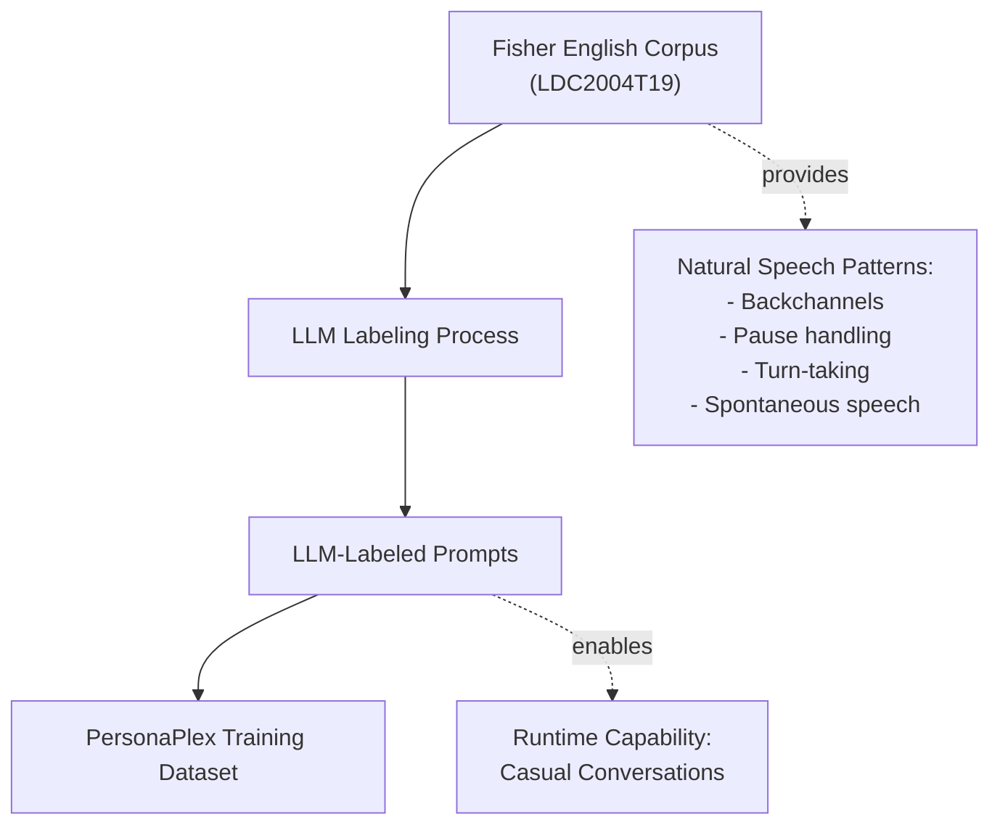
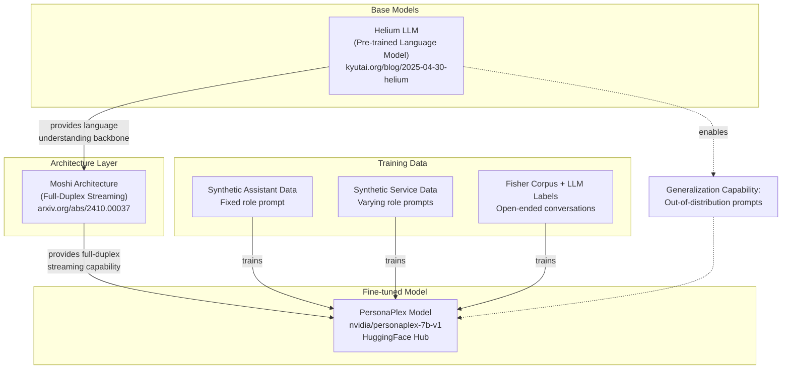
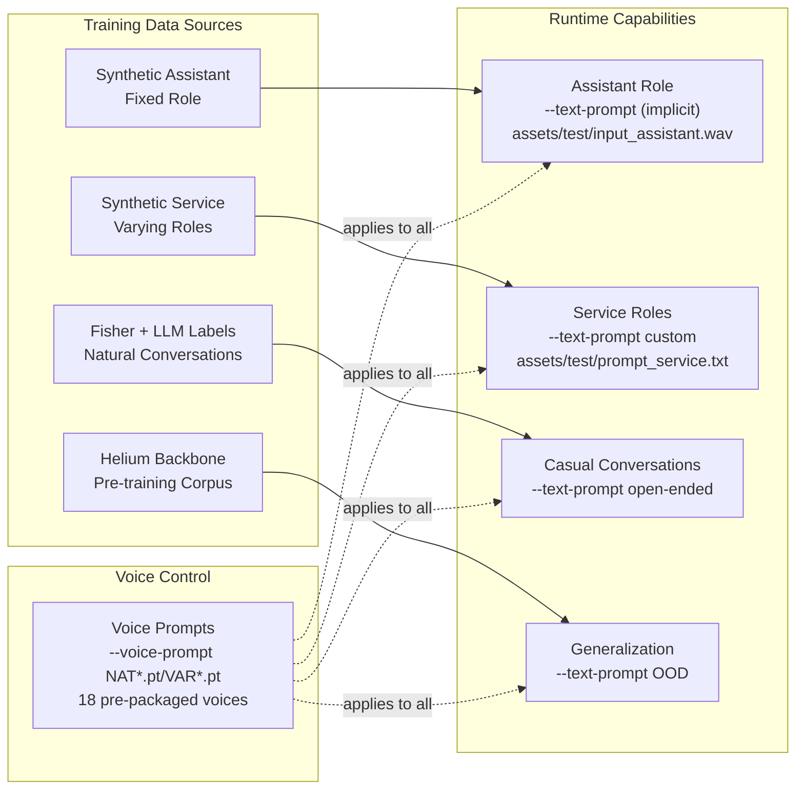
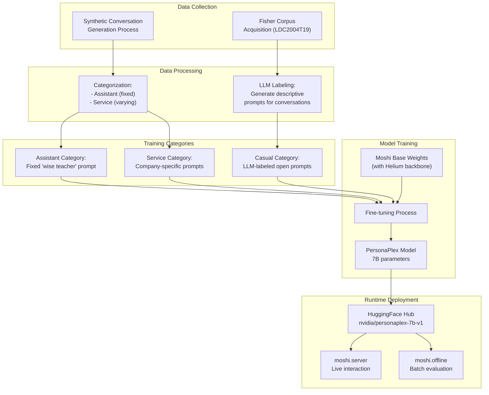

<!-- source: DeepWiki mcp.deepwiki.com · repo NVIDIA/personaplex · page 2.3 Training Data and Methodology · fetched 2026-10-26 -->

# Training Data and Methodology

<details>
<summary>Relevant source files</summary>

The following files were used as context for generating this wiki page:

- [README.md](README.md)

</details>


## Purpose and Scope

This document details the training data sources and methodology used to create the PersonaPlex model. It covers the hybrid training approach combining synthetic and real conversations, the specific data categories and their purposes, and how the training methodology enables persona control at runtime. For information about how to use the trained model's persona control features, see [Voice Conditioning](#2.1) and [Text-based Role Prompts](#2.2). For details on the model architecture itself, see [Model Architecture](#2).

---

## Training Data Overview

PersonaPlex employs a **hybrid training approach** that combines synthetic conversations with real human conversations to achieve both task-specific competence and natural dialogue capabilities. This dual-source strategy enables the model to handle structured assistant/service scenarios while maintaining conversational naturalness.

**Training Data Composition**

| Data Source | Type | Purpose | Runtime Capability |
|------------|------|---------|-------------------|
| Synthetic - Fixed Assistant | Synthetic | QA assistant behaviors | Fixed assistant role interactions |
| Synthetic - Service Roles | Synthetic | Company-specific scenarios | Variable service role interactions |
| Fisher English Corpus | Real | Natural conversational patterns | Open-ended casual conversations |
| Fisher + LLM Labels | Real + Synthetic | Labeled natural dialogue | Contextual casual conversations |

**Sources:** README.md:8, README.md:83-125

---

## Synthetic Training Data

### Fixed Assistant Role Category

The synthetic dataset includes conversations following a **fixed assistant role** with the consistent system prompt:

```
You are a wise and friendly teacher. Answer questions or provide advice in a clear and engaging way.
```

This category trains the model to:
- Answer factual questions with authority
- Provide guidance and advice
- Maintain an educational, supportive persona
- Handle user interruptions gracefully (as evaluated in FullDuplexBench)

**Runtime Usage:** This prompt is specifically designed for the "User Interruption" evaluation category in FullDuplexBench and general QA assistant scenarios. Test assets for this category include [assets/test/input_assistant.wav]().

**Example Offline Evaluation Command:**

```bash
python -m moshi.offline \
  --voice-prompt "NATF2.pt" \
  --input-wav "assets/test/input_assistant.wav" \
  --seed 42424242 \
  --output-wav "output.wav" \
  --output-text "output.json"
```

**Sources:** README.md:85-92, README.md:48-57

### Varying Service Role Category

The synthetic dataset also includes **varying customer service role** scenarios with company-specific contexts. These scenarios train the model to:
- Represent specific businesses and services
- Access and communicate structured information (schedules, pricing, availability)
- Maintain role consistency (name, company, domain)
- Handle transactional conversations

**Service Role Template Structure:**

| Component | Example |
|-----------|---------|
| Company Context | "You work for CitySan Services which is a waste management" |
| Agent Identity | "and your name is Ayelen Lucero" |
| Structured Information | "Current schedule: every other week. Upcoming pickup: April 12th." |
| Service Details | "Compost bin service available for $8/month add-on" |

**Example Service Prompts:**

1. **Waste Management Service** [README.md:98]()
   ```
   You work for CitySan Services which is a waste management and your name is Ayelen Lucero. 
   Information: Verify customer name Omar Torres. Current schedule: every other week. 
   Upcoming pickup: April 12th. Compost bin service available for $8/month add-on.
   ```

2. **Restaurant Service** [README.md:101-102]()
   ```
   You work for Jerusalem Shakshuka which is a restaurant and your name is Owen Foster. 
   Information: There are two shakshuka options: Classic (poached eggs, $9.50) and 
   Spicy (scrambled eggs with jalapenos, $10.25). Sides include warm pita ($2.50) 
   and Israeli salad ($3). No combo offers. Available for drive-through until 9 PM.
   ```

3. **Drone Rental Service** [README.md:104-105]()
   ```
   You work for AeroRentals Pro which is a drone rental company and your name is Tomaz Novak. 
   Information: AeroRentals Pro has the following availability: PhoenixDrone X 
   ($65/4 hours, $110/8 hours), and the premium SpectraDrone 9 ($95/4 hours, $160/8 hours). 
   Deposit required: $150 for standard models, $300 for premium.
   ```

**Runtime Usage:** Test assets include [assets/test/input_service.wav]() and [assets/test/prompt_service.txt]().

**Example Offline Evaluation Command:**

```bash
python -m moshi.offline \
  --voice-prompt "NATM1.pt" \
  --text-prompt "$(cat assets/test/prompt_service.txt)" \
  --input-wav "assets/test/input_service.wav" \
  --seed 42424242 \
  --output-wav "output.wav" \
  --output-text "output.json"
```

**Sources:** README.md:94-105, README.md:59-69

---

## Real Conversation Data

### Fisher English Corpus

PersonaPlex incorporates real human conversations from the **Fisher English Corpus** (LDC2004T19), a collection of conversational telephone speech. This dataset provides:
- Natural conversational patterns and rhythms
- Authentic backchannel behaviors
- Real pause handling and turn-taking dynamics
- Spontaneous speech characteristics

**Fisher Corpus Integration:**



**Sources:** README.md:109

### LLM-Labeled Prompt Generation

The Fisher Corpus conversations are enhanced with **LLM-generated descriptive prompts** that capture the conversational context and style. This labeling process creates training pairs where:
- The audio contains natural human conversation
- The text prompt describes the conversational goal or context
- The model learns to align prompt semantics with conversational behaviors

**Casual Conversation Prompt Examples:**

| Complexity Level | Example Prompt | Purpose |
|-----------------|----------------|---------|
| Minimal | "You enjoy having a good conversation." | Basic open-ended dialogue |
| Topic-Specific | "You enjoy having a good conversation. Have a casual discussion about eating at home versus dining out." | Focused conversational topic |
| Thematic | "You enjoy having a good conversation. Have an empathetic discussion about the meaning of family amid uncertainty." | Emotional/thematic depth |
| Detailed Context | "You enjoy having a good conversation. Have a reflective conversation about career changes and feeling of home. You have lived in California for 21 years and consider San Francisco your home. You work as a teacher and have traveled a lot. You dislike meetings." | Rich personal context |
| Character Background | "You enjoy having a good conversation. Have a casual conversation about favorite foods and cooking experiences. You are David Green, a former baker now living in Boston. You enjoy cooking diverse international dishes and appreciate many ethnic restaurants." | Full character definition |

**FullDuplexBench Evaluation:** The minimal prompt "You enjoy having a good conversation." is used for evaluating "Pause Handling", "Backchannel", and "Smooth Turn Taking" categories in FullDuplexBench.

**Sources:** README.md:109-126

---

## Model Hierarchy and Fine-tuning Strategy

### Training Pipeline Architecture



**Model Access:**

The trained PersonaPlex model is distributed via HuggingFace Hub and requires authentication:

```bash
export HF_TOKEN=<YOUR_HUGGINGFACE_TOKEN>
```

Model weights are automatically downloaded by the `moshi.server` and `moshi.offline` modules when accessed with valid credentials.

**Sources:** README.md:8, README.md:129-130, README.md:25-30

### Fine-tuning Approach

PersonaPlex employs a **fine-tuning strategy** that:

1. **Starts with Moshi weights**: Inherits full-duplex streaming capabilities and basic conversational competence
2. **Leverages Helium backbone**: Benefits from broad pre-training corpus for language understanding
3. **Adds persona control**: Learns to condition responses on text-based role prompts and audio-based voice prompts
4. **Maintains generalization**: Retains ability to handle out-of-distribution prompts due to strong foundation

**Fine-tuning Benefits:**

| Inherited from Base | Added by Fine-tuning |
|---------------------|---------------------|
| Full-duplex streaming | Text-based persona control |
| Low-latency inference | Voice conditioning |
| General language understanding | Task-specific behaviors (assistant, service) |
| Conversational competence | Natural dialogue patterns (Fisher) |
| Out-of-distribution handling | Consistent role maintenance |

**Sources:** README.md:8, README.md:129-133

---

## Training-to-Runtime Mapping

### Data Category to Runtime Capability

The training methodology directly enables specific runtime capabilities through the following mappings:



**Command-line Interface Mapping:**

The `moshi.offline` module provides command-line arguments that directly correspond to training data categories:

| Training Category | CLI Argument | Example Value |
|------------------|--------------|---------------|
| Any (voice control) | `--voice-prompt` | `"NATF2.pt"`, `"NATM1.pt"` |
| Assistant role | `--text-prompt` | (implicit default) |
| Service roles | `--text-prompt` | `"$(cat assets/test/prompt_service.txt)"` |
| Casual conversations | `--text-prompt` | `"You enjoy having a good conversation."` |
| Generalization | `--text-prompt` | Out-of-distribution prompts |
| Audio input | `--input-wav` | `"assets/test/input_assistant.wav"` |
| Random seed | `--seed` | `42424242` |
| Audio output | `--output-wav` | `"output.wav"` |
| Transcript output | `--output-text` | `"output.json"` |

**Sources:** README.md:48-69, README.md:72-79

### Evaluation Asset Organization

Test assets are organized by training category:

```
assets/test/
├── input_assistant.wav    # Audio for assistant role evaluation
├── input_service.wav      # Audio for service role evaluation
└── prompt_service.txt     # Text prompt for service role evaluation
```

**Sources:** README.md:53, README.md:64-66

---

## Generalization Capabilities

### Out-of-Distribution Prompt Handling

Thanks to the **Helium LLM backbone**, PersonaPlex inherits generalization capabilities that enable it to respond plausibly to prompts outside its explicit training distribution. The broad pre-training corpus of Helium allows the model to:

- Understand novel scenarios not present in training data
- Maintain conversational coherence with unexpected prompts
- Generate appropriate responses for creative or hypothetical situations
- Adapt persona behaviors to new contexts

### Astronaut Scenario Example

The web UI features an **out-of-distribution example** that demonstrates generalization:

```
You enjoy having a good conversation. Have a technical discussion about fixing a 
reactor core on a spaceship to Mars. You are an astronaut on a Mars mission. Your 
name is Alex. You are already dealing with a reactor core meltdown on a Mars mission. 
Several ship systems are failing, and continued instability will lead to catastrophic 
failure. You explain what is happening and you urgently ask for help thinking through 
how to stabilize the reactor.
```

This prompt:
- Was not in the training data (space scenarios, reactor physics)
- Requires domain knowledge (technical discussion)
- Involves high-stakes urgency (system failure)
- Defines specific character context (astronaut named Alex)

The model's ability to handle this scenario emerges from:
1. **Helium's broad pre-training**: Exposure to technical and scientific content
2. **Fisher Corpus training**: Natural conversational patterns for urgent/emotional dialogue
3. **Service role training**: Ability to adopt specific professional roles
4. **Synthetic prompt training**: Understanding of complex multi-sentence prompt structures

**Sources:** README.md:129-133

---

## Training Data Summary

**Complete Training Data Pipeline:**



**Key Training Statistics:**

| Model Component | Value |
|----------------|-------|
| Parameter Count | 7 billion (7B) |
| Base Architecture | Moshi |
| Language Backbone | Helium LLM |
| Training Categories | 3 (Assistant, Service, Casual) |
| Pre-packaged Voices | 18 (8 Natural, 10 Variety) |
| Real Data Source | Fisher English Corpus (LDC2004T19) |
| Distribution | HuggingFace Hub (nvidia/personaplex-7b-v1) |

**Sources:** README.md:1-142

---

