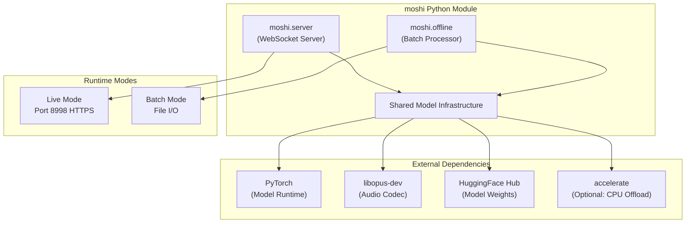
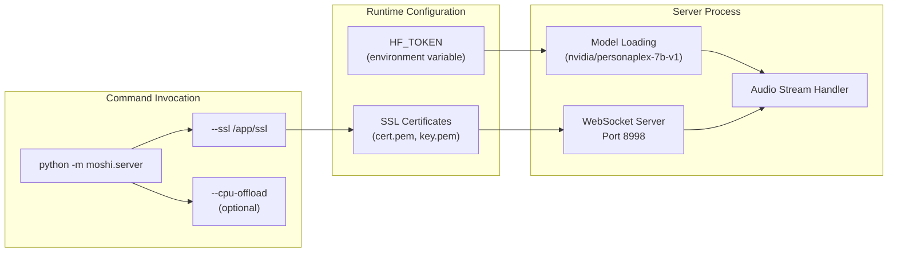
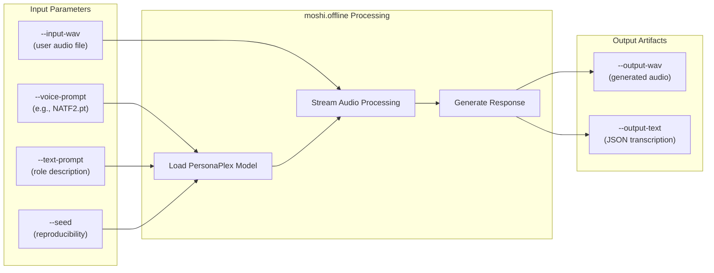
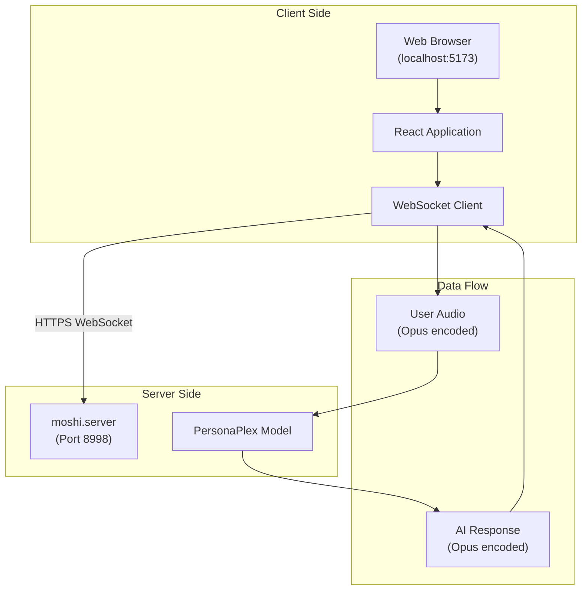

<!-- source: DeepWiki mcp.deepwiki.com · repo NVIDIA/personaplex · page 3 Server Application · fetched 2026-10-26 -->

# Server Application

<details>
<summary>Relevant source files</summary>

The following files were used as context for generating this wiki page:

- [Dockerfile](Dockerfile)
- [README.md](README.md)

</details>


The server application is a Python-based implementation that provides PersonaPlex's core inference capabilities. It operates in two primary modes: a real-time WebSocket server (`moshi.server`) for live conversational interactions, and a batch processing mode (`moshi.offline`) for offline evaluation. This document covers the high-level structure and operational modes of the server application.

For deployment instructions including SSL setup and GPU configuration, see [Server Deployment](#3.1). For detailed offline evaluation usage, see [Offline Evaluation](#3.2).

## Application Structure

The server application is a Python module named `moshi` that provides command-line entry points for different operational modes. The application is designed to run with Python 3.12 and relies on PyTorch for model inference, with optional CUDA support for GPU acceleration.



**Sources:** [Dockerfile:1-26](), [README.md:29-59]()

## Operational Modes

The server application supports two distinct operational modes, each designed for specific use cases:

| Mode | Entry Point | Purpose | I/O Method | SSL Required |
|------|-------------|---------|------------|--------------|
| **Live Server** | `python -m moshi.server` | Real-time conversational interaction | WebSocket streaming | Yes |
| **Batch Processing** | `python -m moshi.offline` | Offline evaluation and testing | WAV file I/O | No |

### Live Server Mode

The live server mode runs a WebSocket server that handles real-time, full-duplex audio streaming. This is the primary mode for interactive conversations with PersonaPlex.



**Sources:** [README.md:49-64](), [Dockerfile:25]()

The server must be launched with an SSL certificate directory, as HTTPS is required for browser microphone access. The server listens on port 8998 by default.

**Basic command:**
```bash
SSL_DIR=$(mktemp -d); python -m moshi.server --ssl "$SSL_DIR"
```

**With CPU offload (for GPUs with insufficient memory):**
```bash
SSL_DIR=$(mktemp -d); python -m moshi.server --ssl "$SSL_DIR" --cpu-offload
```

**Sources:** [README.md:51-59]()

### Batch Processing Mode

The offline mode processes a single input WAV file and generates output audio and text transcriptions. This mode is used for reproducible evaluation and testing.



**Sources:** [README.md:66-93]()

The offline mode accepts the same voice and text prompting mechanisms as the live server but operates on pre-recorded audio files. This enables deterministic testing and evaluation.

**Assistant example:**
```bash
HF_TOKEN=<TOKEN> python -m moshi.offline \
  --voice-prompt "NATF2.pt" \
  --input-wav "assets/test/input_assistant.wav" \
  --seed 42424242 \
  --output-wav "output.wav" \
  --output-text "output.json"
```

**Service example:**
```bash
HF_TOKEN=<TOKEN> python -m moshi.offline \
  --voice-prompt "NATM1.pt" \
  --text-prompt "$(cat assets/test/prompt_service.txt)" \
  --input-wav "assets/test/input_service.wav" \
  --seed 42424242 \
  --output-wav "output.wav" \
  --output-text "output.json"
```

**Sources:** [README.md:72-93]()

## Command-Line Interface

Both operational modes share common command-line arguments for model configuration:

| Argument | Required | Description | Used By |
|----------|----------|-------------|---------|
| `--ssl` | Yes (server) | Directory containing SSL certificates | `moshi.server` |
| `--cpu-offload` | No | Enable CPU offloading for large models | Both modes |
| `--voice-prompt` | No | Voice embedding file (e.g., "NATF2.pt") | Both modes |
| `--text-prompt` | No | Text-based role prompt | Both modes |
| `--input-wav` | Yes (offline) | Input audio file path | `moshi.offline` |
| `--output-wav` | Yes (offline) | Output audio file path | `moshi.offline` |
| `--output-text` | No (offline) | Output transcription JSON path | `moshi.offline` |
| `--seed` | No | Random seed for reproducibility | `moshi.offline` |

**Sources:** [README.md:51-93]()

## Authentication and Model Access

The server requires HuggingFace authentication to download PersonaPlex model weights from the `nvidia/personaplex-7b-v1` repository. This authentication is configured through the `HF_TOKEN` environment variable:

```bash
export HF_TOKEN=<YOUR_HUGGINGFACE_TOKEN>
```

Users must first accept the model license at [https://huggingface.co/nvidia/personaplex-7b-v1](https://huggingface.co/nvidia/personaplex-7b-v1) before the token will grant access.

**Sources:** [README.md:42-47]()

## Dependencies and Prerequisites

The server application requires specific system and Python dependencies:

### System Dependencies

The Opus audio codec development library must be installed before running the server:

```bash
# Ubuntu/Debian
sudo apt install libopus-dev

# Fedora/RHEL
sudo dnf install opus-devel
```

**Sources:** [README.md:20-27](), [Dockerfile:11]()

### Python Dependencies

The server is installed as a Python package:

```bash
pip install moshi/.
```

For Blackwell-based GPUs, PyTorch must be installed with CUDA 13.0 support:

```bash
pip install torch torchvision torchaudio --index-url https://download.pytorch.org/whl/cu130
```

**Sources:** [README.md:29-39]()

### Optional Dependencies

The `accelerate` package enables CPU offloading for systems with limited GPU memory:

```bash
pip install accelerate
```

This dependency is required when using the `--cpu-offload` flag in either operational mode.

**Sources:** [README.md:56-70]()

## Integration with Client

The live server mode integrates with the web client to provide the full PersonaPlex experience. The client connects to the server's WebSocket endpoint over HTTPS:



**Sources:** [README.md:61-64](), [Dockerfile:22]()

The server prints the access URL when launched:
```
Access the Web UI directly at https://11.54.401.33:8998
```

For details on client configuration and connection modes, see [Client Application](#4).

## Containerized Deployment

The server is designed to run in a Docker container based on NVIDIA CUDA runtime. The container setup is defined in the Dockerfile:

- **Base image:** `nvcr.io/nvidia/cuda:12.4.1-runtime-ubuntu22.04` [Dockerfile:1-4]()
- **Package manager:** `uv` for fast Python dependency installation [Dockerfile:6]()
- **Python environment:** Virtual environment at `/app/moshi/.venv` using Python 3.12 [Dockerfile:17-18]()
- **Working directory:** `/app/moshi/` [Dockerfile:14]()
- **Exposed port:** 8998 [Dockerfile:22]()
- **Default command:** `python -m moshi.server --ssl /app/ssl` [Dockerfile:25]()

For complete deployment instructions including SSL certificate generation and GPU configuration, see [Server Deployment](#3.1). For container build details, see [Server Container](#5.1).

**Sources:** [Dockerfile:1-26]()

---

