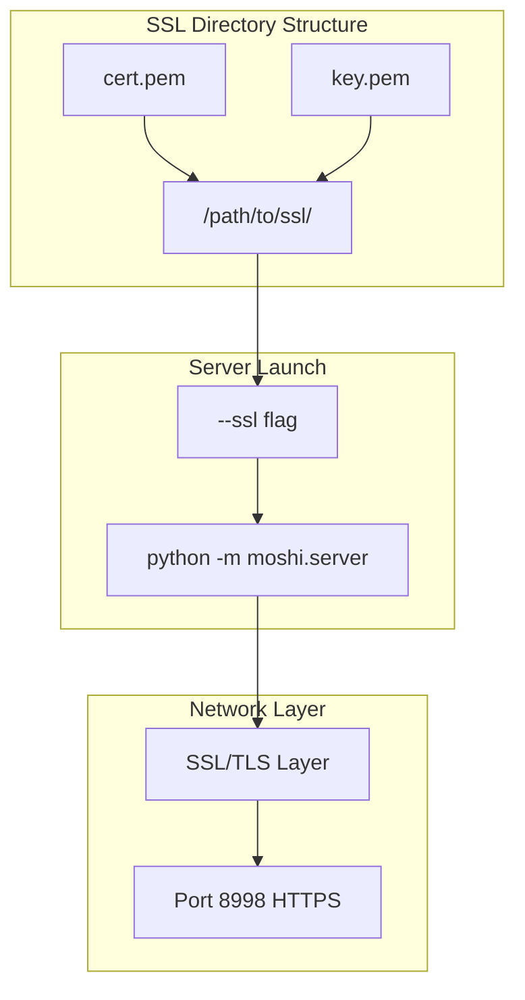
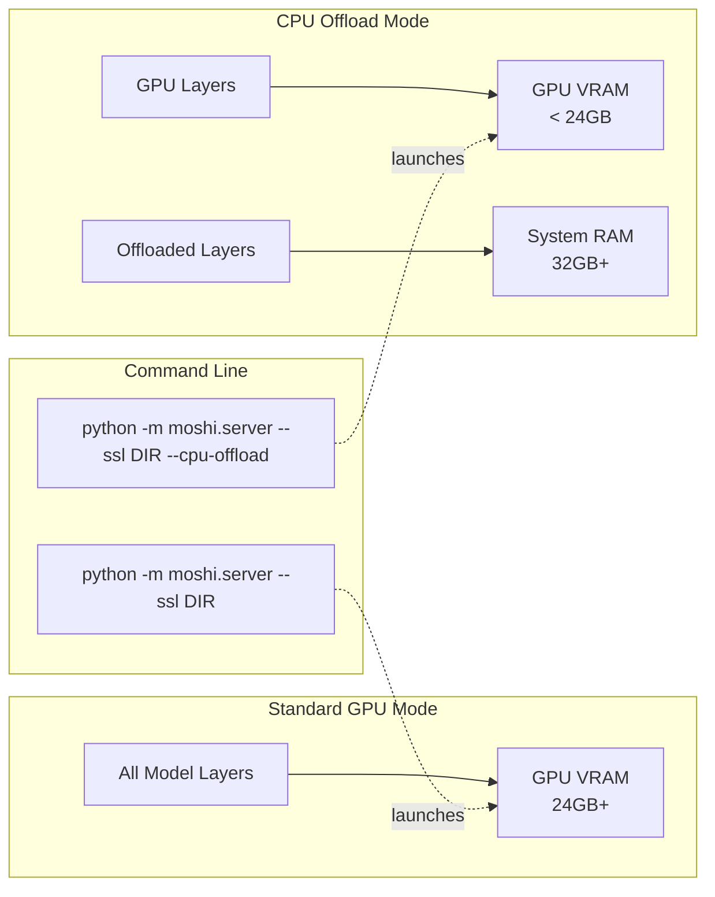
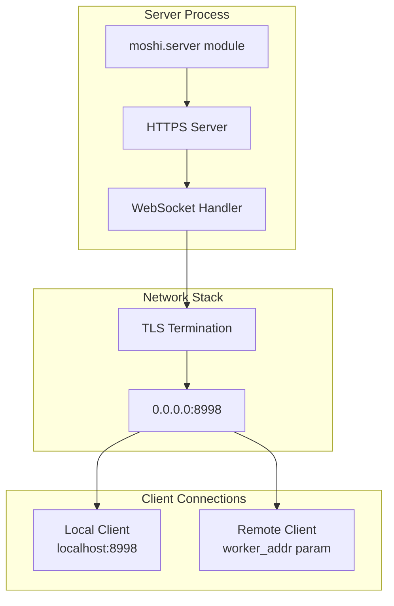
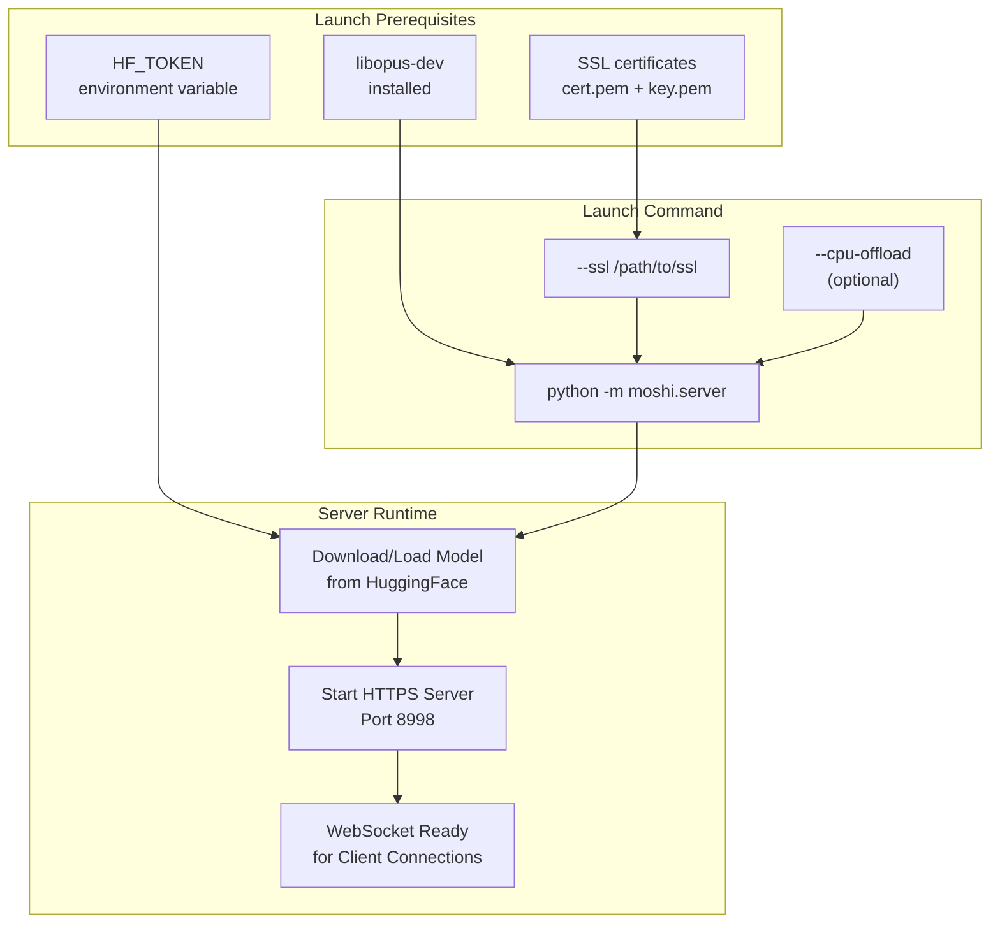

<!-- source: DeepWiki mcp.deepwiki.com · repo NVIDIA/personaplex · page 3.1 Server Deployment · fetched 2026-10-26 -->

# Server Deployment

<details>
<summary>Relevant source files</summary>

The following files were used as context for generating this wiki page:

- [Dockerfile](Dockerfile)
- [README.md](README.md)

</details>


This document provides guidance for deploying the PersonaPlex server component (`moshi.server`) for live conversational interactions. It covers prerequisites, SSL configuration, GPU requirements, server launch options, and network setup. For Docker-based containerized deployment, see [Server Container](#5.1). For batch processing of audio files, see [Offline Evaluation](#3.2).

---

## Prerequisites

### System Dependencies

The PersonaPlex server requires the Opus audio codec development library for real-time audio encoding and decoding:

| Operating System | Installation Command |
|-----------------|---------------------|
| Ubuntu/Debian | `sudo apt install libopus-dev` |
| Fedora/RHEL | `sudo dnf install opus-devel` |

**Sources:** [README.md:20-27]()

### GPU and CUDA Requirements

The server requires NVIDIA GPU with CUDA support for optimal performance. The recommended configuration is:

- **CUDA Version:** 12.4.1 or compatible
- **GPU Memory:** Minimum 24GB VRAM for standard operation
- **Driver:** NVIDIA driver compatible with CUDA 12.4+

For systems with limited GPU memory (< 24GB VRAM), CPU offload mode is available (see [CPU Offload Mode](#cpu-offload-mode) below).

For Blackwell-based GPUs, install PyTorch with CUDA 13.0 support:
```bash
pip install torch torchvision torchaudio --index-url https://download.pytorch.org/whl/cu130
```

**Sources:** [README.md:36-39](), [Dockerfile:1-4]()

### HuggingFace Authentication

The server downloads model weights from HuggingFace on first launch. Authentication is required:

1. Log in to HuggingFace and accept the model license at https://huggingface.co/nvidia/personaplex-7b-v1
2. Generate an access token from your HuggingFace account settings
3. Set the `HF_TOKEN` environment variable:

```bash
export HF_TOKEN=<YOUR_HUGGINGFACE_TOKEN>
```

**Sources:** [README.md:42-47]()

---

## SSL Certificate Setup

### SSL Requirement

The PersonaPlex client runs in a web browser and requires HTTPS to access the microphone via the Web Audio API. The server must serve connections over SSL/TLS on port 8998.

### Temporary Certificates (Development)

For local development and testing, the server can generate temporary self-signed certificates:

```bash
SSL_DIR=$(mktemp -d)
python -m moshi.server --ssl "$SSL_DIR"
```

This creates ephemeral certificates in a temporary directory that are deleted when the shell session ends.

### Persistent Certificates (Production)

For production deployment, create a dedicated SSL directory with persistent certificates:

```bash
mkdir -p /path/to/ssl
# Generate or copy your certificate files:
# - cert.pem (certificate)
# - key.pem (private key)
python -m moshi.server --ssl /path/to/ssl
```

The server expects the following files in the SSL directory:
- `cert.pem` - SSL certificate
- `key.pem` - Private key

**Sources:** [README.md:51-54](), [Dockerfile:20-25]()



**Diagram:** SSL Certificate Configuration Flow

**Sources:** [README.md:51-54](), [Dockerfile:20-25]()

---

## Server Launch Modes

### Standard GPU Mode

Launch the server with full GPU acceleration:

```bash
python -m moshi.server --ssl "$SSL_DIR"
```

This mode loads the entire PersonaPlex model (7B parameters) into GPU memory, providing optimal latency and throughput for real-time conversations.

The server will print the access URL when ready:
```
Access the Web UI directly at https://11.54.401.33:8998
```

If running locally, access the interface at `https://localhost:8998`.

**Sources:** [README.md:51-64]()

### CPU Offload Mode

For systems with insufficient GPU memory (< 24GB VRAM), use the `--cpu-offload` flag to distribute model layers across GPU and CPU:

```bash
python -m moshi.server --ssl "$SSL_DIR" --cpu-offload
```

**Requirements:**
- The `accelerate` package must be installed: `pip install accelerate`
- Sufficient system RAM (32GB+ recommended)

**Trade-offs:**
- Reduced latency compared to full GPU execution
- Enables deployment on consumer GPUs with limited VRAM
- Maintains acceptable performance for conversational interactions

**Sources:** [README.md:56-59]()



**Diagram:** GPU Memory Allocation Strategies

**Sources:** [README.md:56-59]()

---

## Network Configuration

### Port and Protocol

The PersonaPlex server operates on the following network configuration:

| Configuration | Value |
|--------------|-------|
| Port | 8998 |
| Protocol | HTTPS (TLS required) |
| Transport | WebSocket for streaming audio |
| Interface | All interfaces (0.0.0.0) |

### Client Connection

The client application connects to the server using WebSocket over HTTPS. The connection can be configured in two ways:

1. **Default Connection:** Client auto-detects server at `https://localhost:8998` when running locally
2. **Custom Worker Address:** Use the `?worker_addr=` URL parameter to specify a different server endpoint

**Sources:** [README.md:61-64](), [Dockerfile:22-25]()



**Diagram:** Server Network Architecture

**Sources:** [README.md:61-64](), [Dockerfile:22-25]()

---

## Memory Requirements and Optimization

### GPU Memory Profile

The PersonaPlex model has the following memory characteristics:

| Model Size | Standard GPU Memory | CPU Offload Memory |
|-----------|--------------------|--------------------|
| 7B parameters | ~24GB VRAM | ~12-16GB VRAM + 16-20GB RAM |

### Memory Optimization Strategies

**1. CPU Offload Layer Distribution**

When using `--cpu-offload`, the `accelerate` package automatically distributes model layers to balance latency and memory usage. Critical layers (early encoder/decoder layers) typically remain on GPU while later layers move to CPU.

**2. Batch Size Reduction**

The server processes one conversation stream at a time by default, optimizing memory for low-latency interaction rather than throughput.

**3. Model Precision**

The model uses mixed precision (FP16/BF16) automatically when available, reducing memory footprint without sacrificing quality.

**Sources:** [README.md:56-59]()

---

## Docker Deployment

For containerized deployment of the PersonaPlex server, including full build instructions, dependency management, and production considerations, see [Server Container](#5.1).

The Docker image handles:
- NVIDIA CUDA 12.4.1 base image
- Python 3.12 virtual environment with `uv` package manager
- System dependency installation (`libopus-dev`, `build-essential`)
- SSL directory mounting at `/app/ssl`
- Automatic entrypoint configuration

**Sources:** [Dockerfile:1-26]()

---

## Launch Configuration Reference

### Command-Line Options

The `moshi.server` module accepts the following primary options:

```bash
python -m moshi.server [OPTIONS]
```

| Option | Description | Required |
|--------|-------------|----------|
| `--ssl DIR` | Directory containing SSL certificates | Yes |
| `--cpu-offload` | Enable CPU offload for model layers | No |

### Environment Variables

| Variable | Purpose | Required |
|----------|---------|----------|
| `HF_TOKEN` | HuggingFace authentication token | Yes (first run) |

**Sources:** [README.md:49-59]()



**Diagram:** Server Launch Sequence

**Sources:** [README.md:49-64](), [Dockerfile:24-25]()

---

## Troubleshooting

### Common Issues

**Certificate Errors**

If the browser refuses to connect due to certificate errors with self-signed certificates:
- Click "Advanced" and accept the security exception
- For Chrome: Navigate to `chrome://flags/#allow-insecure-localhost` and enable the flag
- For Firefox: Click "Advanced" → "Accept the Risk and Continue"

**GPU Out of Memory**

If the server fails to launch with CUDA out-of-memory errors:
1. Use the `--cpu-offload` flag to distribute layers
2. Close other GPU-intensive applications
3. Consider using a GPU with more VRAM (24GB+ recommended)

**HuggingFace Authentication**

If model download fails:
1. Verify `HF_TOKEN` environment variable is set correctly
2. Ensure you've accepted the model license at https://huggingface.co/nvidia/personaplex-7b-v1
3. Check token permissions include model read access

**Port Already in Use**

If port 8998 is already occupied:
- Identify the process using: `lsof -i :8998` (Linux/macOS) or `netstat -ano | findstr :8998` (Windows)
- Terminate the conflicting process or modify the server code to use a different port

**Sources:** [README.md:42-64]()

---

