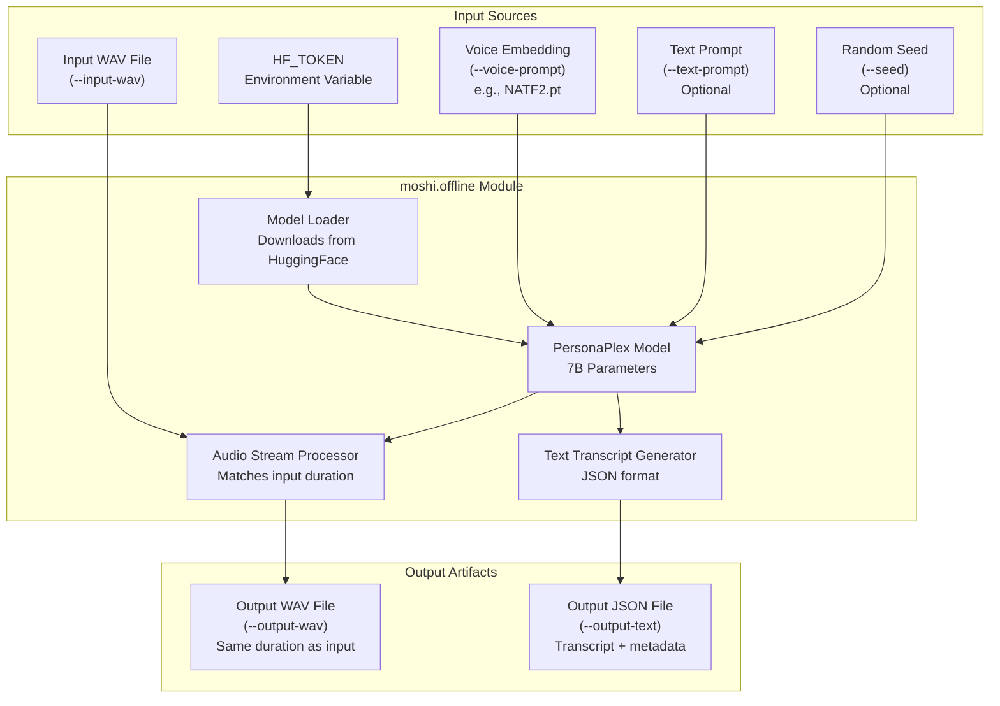
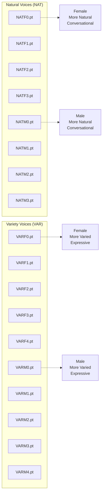
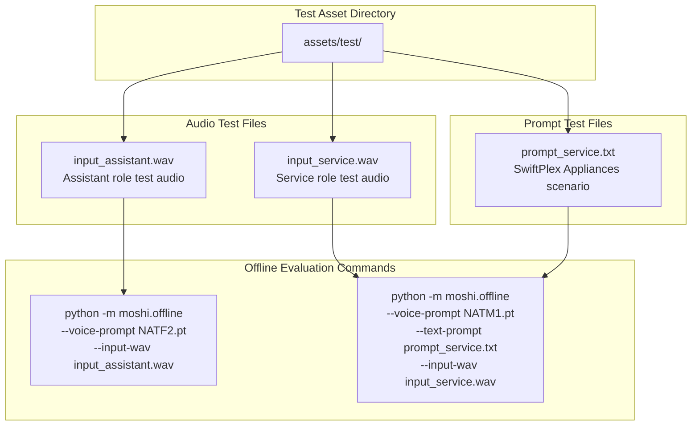
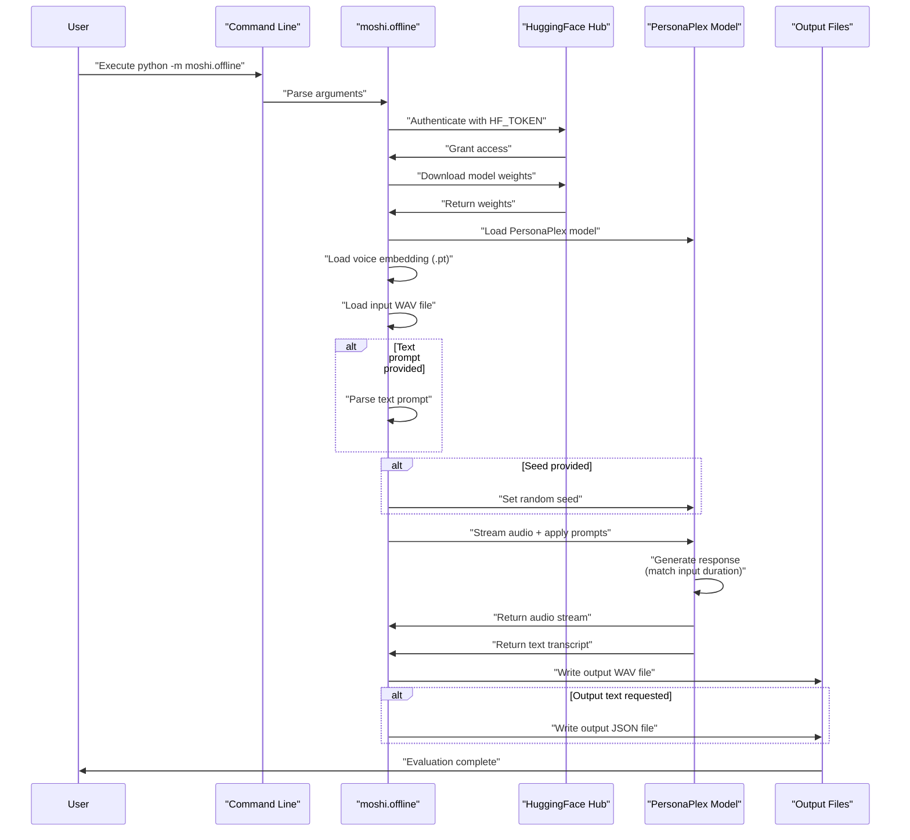

<!-- source: DeepWiki mcp.deepwiki.com · repo NVIDIA/personaplex · page 3.2 Offline Evaluation · fetched 2026-10-26 -->

# Offline Evaluation

<details>
<summary>Relevant source files</summary>

The following files were used as context for generating this wiki page:

- [README.md](README.md)
- [assets/test/input_assistant.wav](assets/test/input_assistant.wav)
- [assets/test/input_service.wav](assets/test/input_service.wav)
- [assets/test/prompt_service.txt](assets/test/prompt_service.txt)

</details>


## Purpose and Scope

This page documents the `moshi.offline` module, which provides batch audio processing capabilities for the PersonaPlex model. Unlike the real-time server mode covered in [Server Deployment](#3.1), offline evaluation processes pre-recorded audio files to generate conversational responses, making it suitable for benchmarking, testing, and reproducible evaluation workflows.

The offline module accepts WAV audio input, applies voice conditioning and optional text-based role prompts, and generates synchronized audio and text outputs. Output duration matches input duration, enabling controlled evaluation scenarios.

For real-time interaction capabilities, see [Server Deployment](#3.1). For details on voice conditioning and text prompts, see [Voice Conditioning](#2.1) and [Text-based Role Prompts](#2.2).

---

## Module Overview

The `moshi.offline` module provides a command-line interface for batch processing audio through the PersonaPlex model. It loads the model weights from HuggingFace, applies the specified voice and text prompts, and streams the input audio file through the model to generate a conversational response.

**Key characteristics:**
- **Deterministic output**: Accepts `--seed` parameter for reproducible results
- **Synchronized duration**: Output audio matches input audio length
- **Dual control**: Supports both voice conditioning via `.pt` embeddings and text-based role prompts
- **Multi-format output**: Generates both WAV audio and JSON text transcripts
- **Memory flexibility**: Supports CPU offload for memory-constrained environments

**Sources:** [README.md:69-96]()

---

## Command-Line Interface

The `moshi.offline` module is invoked as a Python module with various command-line arguments controlling model behavior, inputs, and outputs.

### Basic Invocation Pattern

```bash
HF_TOKEN=<token> python -m moshi.offline [options]
```

### Command-Line Parameters

| Parameter | Type | Required | Description |
|-----------|------|----------|-------------|
| `--voice-prompt` | string | Yes | Voice embedding filename (e.g., `NATF2.pt`, `NATM1.pt`) |
| `--input-wav` | path | Yes | Path to input WAV file containing user speech |
| `--output-wav` | path | Yes | Path for generated response audio (WAV format) |
| `--seed` | integer | No | Random seed for reproducible generation |
| `--output-text` | path | No | Path for text transcript output (JSON format) |
| `--text-prompt` | string | No | Text-based role prompt for persona control |
| `--cpu-offload` | flag | No | Enable CPU offload for memory-constrained GPUs |

### Environment Variables

| Variable | Required | Description |
|----------|----------|-------------|
| `HF_TOKEN` | Yes | HuggingFace authentication token for model access |

**Sources:** [README.md:69-96]()

---

## Offline Evaluation Data Flow



**Sources:** [README.md:69-96]()

---

## Usage Examples

### Assistant Role Evaluation

The assistant role uses a fixed prompt focused on teaching and advice. This example demonstrates basic offline evaluation with voice conditioning only:

```bash
HF_TOKEN=<TOKEN> \
python -m moshi.offline \
  --voice-prompt "NATF2.pt" \
  --input-wav "assets/test/input_assistant.wav" \
  --seed 42424242 \
  --output-wav "output.wav" \
  --output-text "output.json"
```

**Configuration breakdown:**
- **Voice**: `NATF2.pt` - Natural female voice variant 2
- **Input**: `assets/test/input_assistant.wav` - Pre-recorded user queries
- **Seed**: `42424242` - Ensures reproducible output
- **Outputs**: Both audio (`output.wav`) and text (`output.json`)

The assistant role uses the implicit prompt:
```
You are a wise and friendly teacher. Answer questions or provide advice in a clear and engaging way.
```

**Sources:** [README.md:75-84]()

---

### Customer Service Role Evaluation

Customer service scenarios require explicit text prompts to define the service context and agent persona:

```bash
HF_TOKEN=<TOKEN> \
python -m moshi.offline \
  --voice-prompt "NATM1.pt" \
  --text-prompt "$(cat assets/test/prompt_service.txt)" \
  --input-wav "assets/test/input_service.wav" \
  --seed 42424242 \
  --output-wav "output.wav" \
  --output-text "output.json"
```

**Configuration breakdown:**
- **Voice**: `NATM1.pt` - Natural male voice variant 1
- **Text prompt**: Loaded from `assets/test/prompt_service.txt`
- **Input**: `assets/test/input_service.wav` - Service-related user speech
- **Seed**: `42424242` - Ensures reproducible output

The text prompt from `assets/test/prompt_service.txt` specifies:
```
You work for SwiftPlex Appliances which is a appliance repair company and your name is Farhod Toshmatov. Information: The dishwasher model is out of stock for replacement parts; we can use an alternative part with a 3-day delay. Labor cost remains $60 per hour.
```

**Sources:** [README.md:86-96](), [assets/test/prompt_service.txt:1]()

---

### Custom Scenario Example

For custom evaluation scenarios, combine any voice embedding with a custom text prompt:

```bash
HF_TOKEN=<TOKEN> \
python -m moshi.offline \
  --voice-prompt "VARF3.pt" \
  --text-prompt "You enjoy having a good conversation. Have a casual discussion about eating at home versus dining out." \
  --input-wav "my_input.wav" \
  --seed 12345 \
  --output-wav "custom_output.wav" \
  --output-text "custom_output.json"
```

**Sources:** [README.md:69-96]()

---

## Voice Selection Reference



All voice embeddings are pre-packaged with the model and referenced by filename in the `--voice-prompt` parameter. Natural (NAT) voices provide more conversational quality, while Variety (VAR) voices offer more expressive range.

**Sources:** [README.md:98-106]()

---

## Output Formats

### Audio Output (`--output-wav`)

The generated audio file is written in WAV format with the following characteristics:
- **Duration**: Matches input file duration exactly
- **Format**: Uncompressed PCM WAV
- **Content**: Model's generated response audio, synchronized with input timing
- **Sample rate**: Standard speech model sampling rate

### Text Output (`--output-text`)

When specified, the `--output-text` parameter generates a JSON file containing:
- **Transcript**: Text transcription of the model's generated speech
- **Timing information**: Alignment data for generated tokens
- **Metadata**: Model configuration and parameters used

The JSON format enables programmatic analysis and evaluation metric computation.

**Sources:** [README.md:69-96]()

---

## Hardware Considerations

### GPU Memory Requirements

The PersonaPlex 7B model requires significant GPU memory for inference. For memory-constrained environments, use the `--cpu-offload` flag:

```bash
HF_TOKEN=<TOKEN> \
python -m moshi.offline \
  --voice-prompt "NATF2.pt" \
  --input-wav "input.wav" \
  --output-wav "output.wav" \
  --cpu-offload
```

**CPU offload requires:**
- Installation of the `accelerate` package: `pip install accelerate`
- Increased inference time due to CPU-GPU data transfers
- Sufficient system RAM for offloaded model layers

### CPU-Only Evaluation

For environments without GPU access, install CPU-only PyTorch before running offline evaluation:

```bash
pip install torch torchvision torchaudio --index-url https://download.pytorch.org/whl/cpu
```

CPU-only inference provides:
- **Advantages**: No GPU required, portable across systems
- **Disadvantages**: Significantly slower inference, unsuitable for real-time use

**Sources:** [README.md:59-62](), [README.md:73]()

---

## Integration with Test Assets

The `assets/test/` directory contains reference files for validation and benchmarking:



### Available Test Assets

| File | Purpose | Usage Context |
|------|---------|---------------|
| `input_assistant.wav` | User queries for assistant role | Tests basic QA capabilities without text prompts |
| `input_service.wav` | Customer inquiries | Tests customer service scenarios with text prompts |
| `prompt_service.txt` | SwiftPlex Appliances scenario | Provides structured service role definition |

These test files enable:
- **Reproducibility**: Fixed inputs for consistent evaluation
- **Benchmarking**: Standard scenarios for performance comparison
- **Validation**: Reference cases for model behavior verification

**Sources:** [README.md:75-96](), [assets/test/prompt_service.txt:1]()

---

## Evaluation Workflow



**Sources:** [README.md:69-96]()

---

## Best Practices

### Reproducibility

Always specify a `--seed` value for reproducible evaluation:
```bash
--seed 42424242
```

### Prompt Design

For customer service scenarios, structure text prompts with:
1. **Company and role identification**: "You work for [Company] which is a [type]"
2. **Agent name**: "your name is [Name]"
3. **Relevant information**: Specific details needed to handle inquiries

Example structure:
```
You work for [Company] which is a [business type] and your name is [Agent Name]. Information: [Specific details for this scenario].
```

### Voice Selection

- Use **NAT voices** for natural, conversational interactions
- Use **VAR voices** for more expressive or diverse speech patterns
- Match voice gender to scenario requirements when relevant

### Output Organization

Structure output files for systematic evaluation:
```
outputs/
├── assistant/
│   ├── NATF2_seed42_output.wav
│   └── NATF2_seed42_output.json
└── service/
    ├── NATM1_seed42_output.wav
    └── NATM1_seed42_output.json
```

**Sources:** [README.md:69-96]()

---

