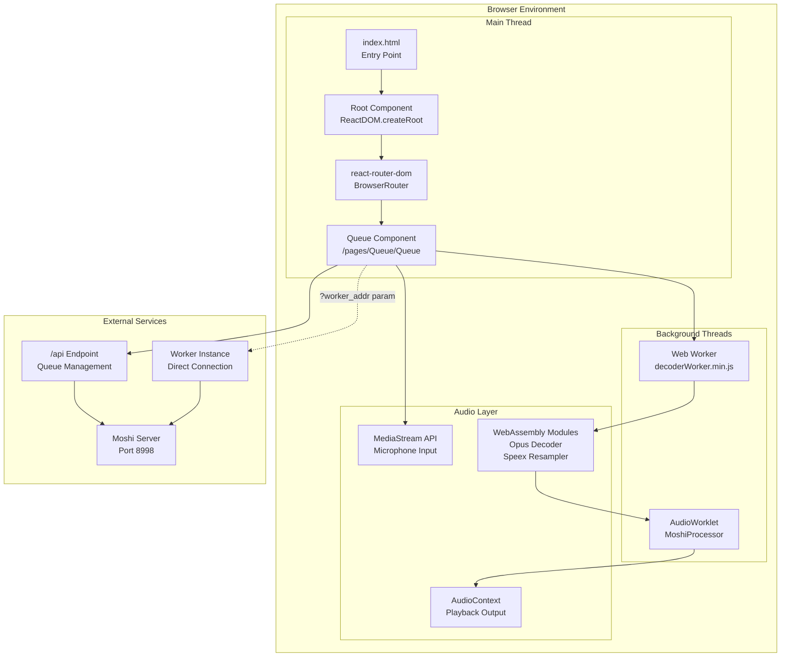
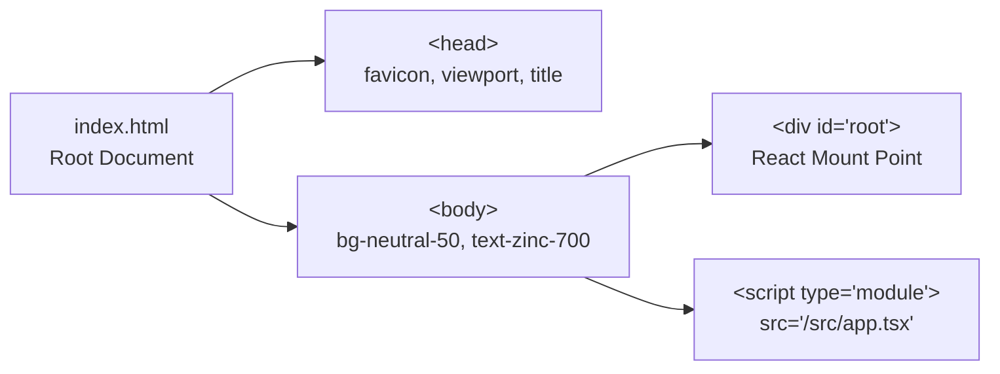
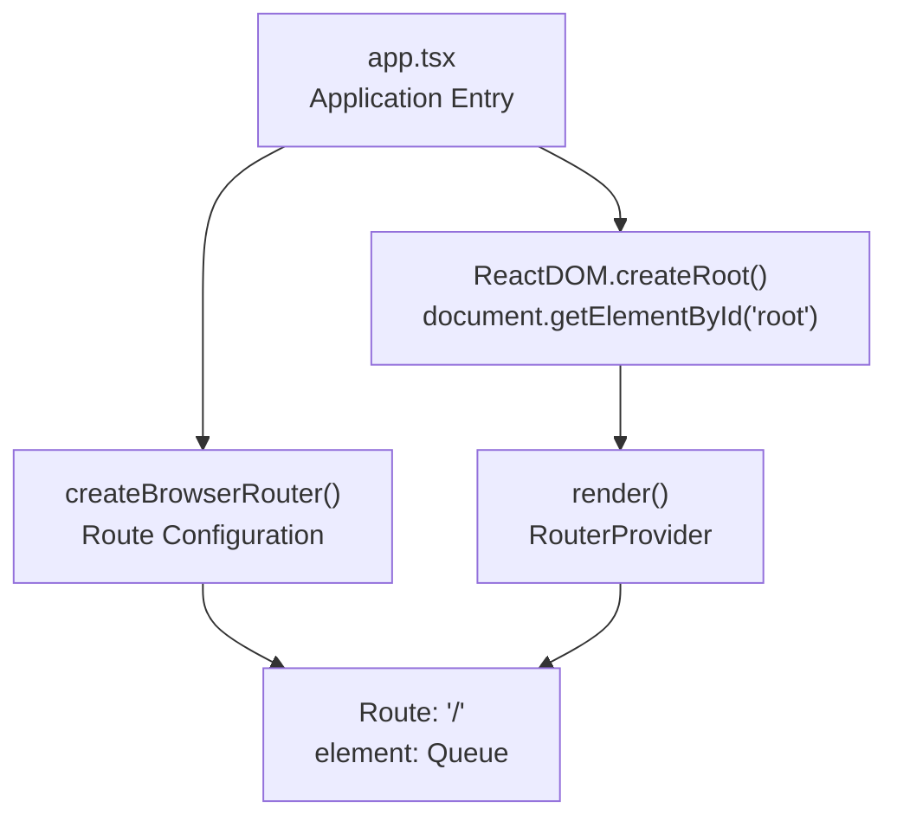
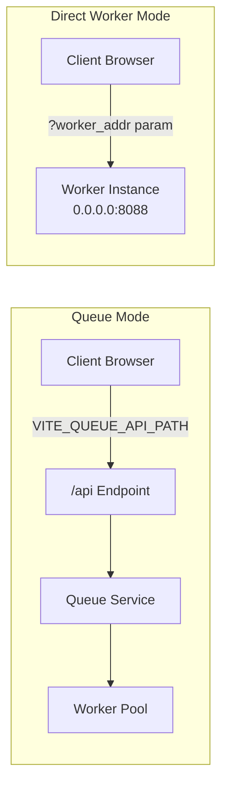
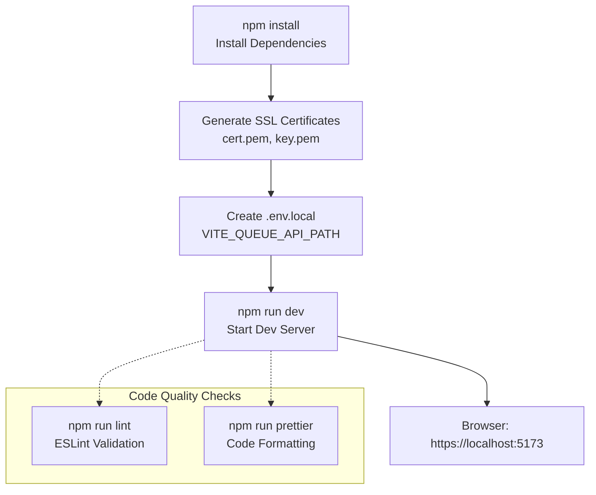
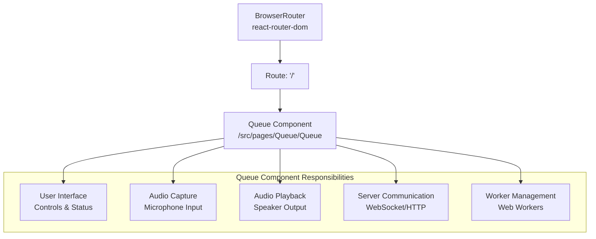

<!-- source: DeepWiki mcp.deepwiki.com · repo NVIDIA/personaplex · page 4 Client Application · fetched 2026-10-26 -->

# Client Application

Relevant source files

The following files were used as context for generating this wiki page:

- [client/README.md](client/README.md)
- [client/package.json](client/package.json)
- [client/src/app.tsx](client/src/app.tsx)

## Purpose and Scope

The Client Application is a React-based web interface that provides the user-facing layer of PersonaPlex. It runs on port 5173 and handles microphone input capture, real-time audio streaming, sophisticated audio decoding and playback, and communication with the Moshi server. This document provides an overview of the client's architecture, technology stack, and core components.

For detailed instructions on installing dependencies and configuring the development environment, see [Client Setup and Configuration](#4.1). For an in-depth explanation of the audio processing pipeline, see [Audio Processing Pipeline](#4.2). For UI component structure and routing, see [Client Routing and UI](#4.3). For build system details, see [Client Build Pipeline](#4.4).

**Sources:** [client/README.md:1-21](), [client/src/app.tsx:1-19]()

---

## Architecture Overview

The client application is structured as a modern single-page application (SPA) built with React 18 and TypeScript. It leverages browser APIs including WebRTC for audio capture, Web Workers for background processing, WebAssembly for audio decoding, and AudioWorklet for low-latency audio playback.

### High-Level Client Architecture

**Sources:** [client/index.html:1-15](), [client/src/app.tsx:1-19](), [client/README.md:14-16]()

---

## Technology Stack

The client application uses a modern JavaScript/TypeScript ecosystem with carefully selected dependencies for performance and developer experience.

### Core Technologies

| Technology | Version | Purpose |
|------------|---------|---------|
| React | 18.3.1 | UI framework for component-based architecture |
| TypeScript | 5.2.2+ | Type-safe development with static analysis |
| Vite | 5.2.14+ | Fast development server and build tool |
| React Router DOM | 6.23.1+ | Client-side routing |
| Tailwind CSS | 3.4.3+ | Utility-first styling framework |
| DaisyUI | 4.12.2+ | Component library built on Tailwind |

**Sources:** [client/package.json:38-48]()

### Audio Processing Dependencies

| Dependency | Purpose |
|------------|---------|
| `opus-recorder` | WebRTC audio recording with Opus encoding |
| `webm-duration-fix` | Fix WebM container duration metadata |
| `ws` | WebSocket client for real-time communication |
| WebAssembly modules | Opus decoding and Speex resampling (pre-compiled) |

**Sources:** [client/package.json:39-46]()

### Development Tools

| Tool | Purpose |
|------|---------|
| ESLint | Code linting with TypeScript and React rules |
| Prettier | Code formatting with Tailwind plugin |
| PostCSS | CSS processing with Autoprefixer |
| Nodemon | Watch mode for continuous builds |

**Sources:** [client/package.json:15-34]()

---

## Entry Points and Execution Flow

### HTML Entry Point

The application starts from `index.html`, which defines a minimal HTML structure with a root div and script reference:

The HTML document [client/index.html:1-15]() sets up:
- UTF-8 character encoding
- Responsive viewport meta tag
- Favicon references (32x32 and 16x16 PNG)
- Title set to "PersonaPlex"
- Neutral background styling (`bg-neutral-50`, `text-zinc-700`)
- Root div with id `root` for React mounting
- Module script loading `src/app.tsx`

**Sources:** [client/index.html:1-15]()

### React Application Initialization

The `app.tsx` file bootstraps the React application with routing:

The initialization sequence [client/src/app.tsx:1-19]():
1. Imports `ReactDOM` from `react-dom/client`
2. Imports routing utilities from `react-router-dom`
3. Imports global styles from `./index.css`
4. Imports the `Queue` component from `./pages/Queue/Queue`
5. Creates a `BrowserRouter` configuration with a single route (`/` → `Queue`)
6. Finds the root DOM element by id
7. Creates a React root and renders the `RouterProvider` with the router

**Sources:** [client/src/app.tsx:1-19]()

---

## Connection Modes

The client supports two distinct connection modes for communicating with PersonaPlex backend services:

### Queue Mode (Default)

In queue mode, the client connects through a queue management system via the `/api` endpoint. This mode is suitable for production deployments where multiple users may need to wait for available worker resources.

**Configuration:**
- Environment variable: `VITE_QUEUE_API_PATH` (default: `/api`)
- Full URL configurable via: `VITE_QUEUE_API_URL`
- No URL parameters required

**Usage:** Simply navigate to `https://localhost:5173/` without query parameters.

### Direct Worker Connection Mode

For standalone use or development, the client can bypass the queue system and connect directly to a worker instance.

**Configuration:**
- URL parameter: `?worker_addr={WORKER_ADDR}`
- Example: `https://localhost:5173/?worker_addr=0.0.0.0:8088`

This mode [client/README.md:14-16]() allows developers to:
- Test against specific worker instances
- Bypass queue wait times during development
- Debug worker-specific issues
- Run isolated testing scenarios

**Sources:** [client/README.md:14-16](), [client/README.md:9]()

---

## Development and Build Scripts

The client provides several npm scripts for development, building, and maintenance tasks:

### Available Scripts

| Script | Command | Purpose |
|--------|---------|---------|
| `dev` | `vite` | Start development server with hot reload |
| `build` | `tsc && vite build` | TypeScript compilation + production build |
| `build:watch` | `nodemon --watch src --ext ts,js,css,html --exec "npm run build"` | Continuous build on file changes |
| `lint` | `eslint` | Run ESLint to check code quality |
| `lint:fix` | `eslint --fix` | Run ESLint with automatic fixes |
| `prettier` | `prettier --write .` | Format all files with Prettier |
| `preview` | `vite preview` | Preview production build locally |

**Sources:** [client/package.json:6-13]()

### Development Workflow

The recommended setup sequence [client/README.md:5-11]():
1. Use NVM to ensure Node.js version 20.12.2 (via `nvm use`)
2. Generate SSL certificate pair (`cert.pem`, `key.pem`)
3. Create `.env.local` with `VITE_QUEUE_API_PATH` entry
4. Run `npm install` to install dependencies
5. Run `npm run dev` to start development server
6. Access application at `https://localhost:5173`

**Sources:** [client/README.md:5-11](), [client/package.json:6-13]()

---

## Core Component Structure

The client application uses a component-based architecture with a single-route configuration:

The `Queue` component serves as the primary interface and orchestrates all major client-side functionality including:
- User interface for persona selection and controls
- Microphone input capture and processing
- Audio output management with Web Workers and AudioWorklet
- WebSocket communication with backend services
- State management for connection and conversation lifecycle

For detailed information about the Queue component's UI structure and routing logic, see [Client Routing and UI](#4.3).

**Sources:** [client/src/app.tsx:7-18]()

---

## SSL and Security

The client application requires SSL/TLS certificates for local development to support:
- Secure WebSocket connections (WSS protocol)
- Microphone access (requires HTTPS in modern browsers)
- Service Worker registration (if used)

### Certificate Requirements

The client expects SSL certificate files at the root of the client package:
- `cert.pem` - Public certificate
- `key.pem` - Private key

These certificates are used by the Vite development server to serve the application over HTTPS on port 5173.

For containerized deployments, the client Dockerfile includes OpenSSL commands to generate self-signed certificates automatically. See [Client Container](#5.2) for details on automated certificate generation.

**Sources:** [client/README.md:8]()

---

## License

The client application code is provided under the MIT license, as stated in [client/README.md:18-20]().

**Sources:** [client/README.md:18-20]()

---

