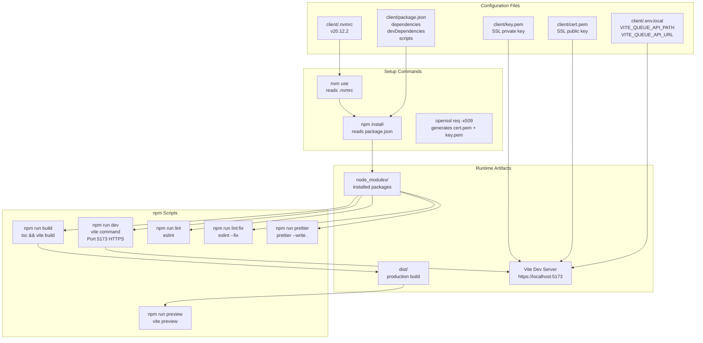
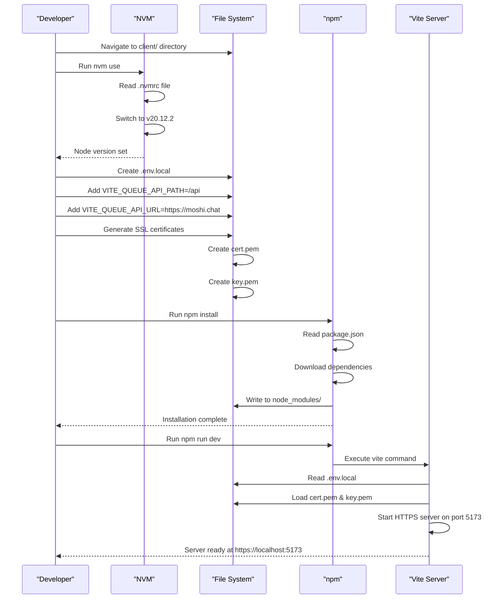
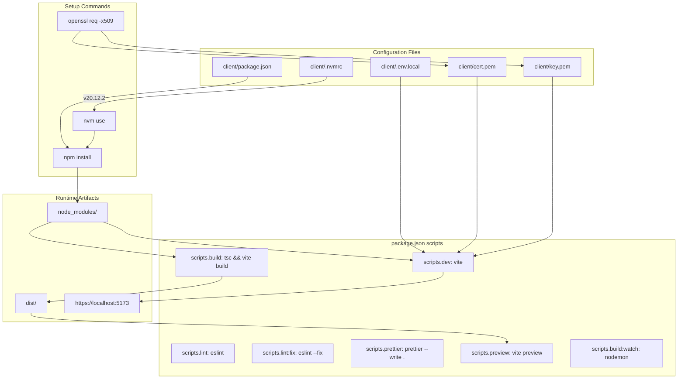
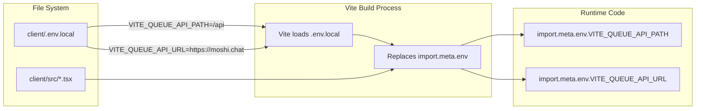

<!-- source: DeepWiki mcp.deepwiki.com · repo NVIDIA/personaplex · page 4.1 Client Setup and Configuration · fetched 2026-10-26 -->

# Client Setup and Configuration

<details>
<summary>Relevant source files</summary>

The following files were used as context for generating this wiki page:

- [client/.env.local](client/.env.local)
- [client/.nvmrc](client/.nvmrc)
- [client/README.md](client/README.md)
- [client/package.json](client/package.json)

</details>


This page provides step-by-step instructions for setting up the PersonaPlex web client development environment. It covers Node.js installation, environment variable configuration, SSL certificate generation, dependency installation, and launching the development server. For information about the client's audio processing implementation, see [Audio Processing Pipeline](#4.2). For Docker-based deployment, see [Client Container](#5.2). For a comprehensive environment variable reference, see [Environment Variables](#7.1).

---

## Overview

The PersonaPlex client is a React-based web application built with Vite and TypeScript. The setup process requires Node.js, SSL certificates for HTTPS development, and proper environment variable configuration to connect to the Moshi server.

**Sources:** [client/README.md]()

---

## Prerequisites

### Node Version Management

The client requires **Node.js v20.12.2** as specified in [client/.nvmrc:1](). Using Node Version Manager (NVM) is recommended to ensure version consistency across development environments.

| Requirement | Value | Specification |
|-------------|-------|---------------|
| Node Version | v20.12.2 | [client/.nvmrc:1]() |
| Package Manager | npm | Included with Node.js |
| Recommended Tool | NVM | For version management |

**Installation Steps:**

1. Install NVM from [nvm-sh/nvm](https://github.com/nvm-sh/nvm)
2. Navigate to the client directory
3. Run `nvm use` to automatically switch to the correct Node version

If the specified version is not installed, NVM will prompt you to install it with `nvm install v20.12.2`.

**Sources:** [client/README.md:7](), [client/.nvmrc:1]()

---

## Configuration Files and Dependencies



**Sources:** [client/README.md](), [client/.nvmrc](), [client/.env.local](), [client/package.json]()
</thinking>

## Setup Workflow Diagram



**Sources:** [client/README.md](), [client/.nvmrc](), [client/.env.local](), [client/package.json]()
</old_str>

<new_str>
## Configuration Files and Dependencies



**Sources:** [client/README.md](), [client/.nvmrc](), [client/.env.local](), [client/package.json:6-13]()

---

## Vite Environment Variable Processing



**Sources:** [client/.env.local:1-2](), [client/README.md:9]()

---

## Environment Variables

The client uses Vite's environment variable system, which requires variables to be prefixed with `VITE_`. Configuration is stored in `.env.local` at the root of the client directory.

### Required Variables

| Variable | Purpose | Default Value | Configuration File |
|----------|---------|---------------|-------------------|
| `VITE_QUEUE_API_PATH` | API endpoint path | `/api` | [client/.env.local:1]() |
| `VITE_QUEUE_API_URL` | Server base URL | `https://moshi.chat` | [client/.env.local:2]() |

### Configuration File Setup

Create a file named `.env.local` in the `client/` directory:

```
VITE_QUEUE_API_PATH=/api
VITE_QUEUE_API_URL=https://moshi.chat
```

**Variable Usage:**

- **`VITE_QUEUE_API_PATH`**: The path component of the Queue API endpoint. The client appends this to the base URL when connecting to the server. For local development with a server running on `localhost:8998`, you may want to adjust `VITE_QUEUE_API_URL` accordingly.

- **`VITE_QUEUE_API_URL`**: The base URL of the Moshi server. In production, this points to `https://moshi.chat`. For local development, set this to your local server address (e.g., `https://localhost:8998`).

### Direct Worker Connection

The client supports bypassing the queue system for standalone use by passing the `worker_addr` query parameter:

```
https://localhost:5173/?worker_addr=0.0.0.0:8088
```

This allows direct connection to a worker instance without going through the Queue API.

**Sources:** [client/.env.local](), [client/README.md:9](), [client/README.md:14-16]()

---

## SSL Certificate Generation

The client requires SSL certificates for HTTPS development. The certificates must be named `cert.pem` (public key) and `key.pem` (private key) and placed at the root of the client directory.

### Certificate Requirements

| File | Type | Location | Purpose |
|------|------|----------|---------|
| `cert.pem` | Public certificate | `client/cert.pem` | HTTPS server certificate |
| `key.pem` | Private key | `client/key.pem` | HTTPS server private key |

### Generation Using OpenSSL

Generate a self-signed certificate pair:

```bash
openssl req -x509 -newkey rsa:4096 -keyout key.pem -out cert.pem -days 365 -nodes
```

| Parameter | Value | Purpose |
|-----------|-------|---------|
| `-x509` | - | Generate self-signed certificate |
| `-newkey` | `rsa:4096` | Create 4096-bit RSA key pair |
| `-keyout` | `key.pem` | Private key output filename |
| `-out` | `cert.pem` | Certificate output filename |
| `-days` | `365` | Certificate validity period |
| `-nodes` | - | No private key encryption |

### Certificate Placement

Place generated certificates in `client/` directory:

| File | Type | Required By |
|------|------|-------------|
| `client/cert.pem` | X.509 certificate | Vite HTTPS server |
| `client/key.pem` | RSA private key | Vite HTTPS server |

**Browser Warnings:** Self-signed certificates trigger browser security warnings. Accept the warning to proceed with local development.

**Vite Auto-loading:** The `vite` command automatically detects `cert.pem` and `key.pem` in the client root and enables HTTPS on port 5173.

**Sources:** [client/README.md:8]()

---

## Dependency Installation

The client uses npm for dependency management. All dependencies are specified in [client/package.json]().

### Installation Command

```bash
npm install
```

Reads [client/package.json]() and installs dependencies to `client/node_modules/`. Run after:
- Initial setup
- Changes to `package.json`
- Branch switches with different dependencies

### Key Dependencies

#### Production Dependencies

| Package | Version | Purpose | Reference |
|---------|---------|---------|-----------|
| `react` | ^18.3.1 | UI framework | [client/package.json:41]() |
| `react-dom` | ^18.3.1 | React renderer | [client/package.json:42]() |
| `react-router-dom` | ^6.23.1 | Client routing | [client/package.json:43]() |
| `opus-recorder` | ^8.0.5 | Audio recording | [client/package.json:40]() |
| `ws` | ^8.16.0 | WebSocket client | [client/package.json:45]() |
| `zod` | ^3.23.8 | Schema validation | [client/package.json:46]() |

#### Development Dependencies

| Package | Version | Purpose | Reference |
|---------|---------|---------|-----------|
| `vite` | ^5.2.14 | Build tool, dev server | [client/package.json:35]() |
| `typescript` | ^5.2.2 | TypeScript compiler | [client/package.json:33]() |
| `eslint` | ^8.57.0 | Code linting | [client/package.json:22]() |
| `prettier` | ^3.2.5 | Code formatting | [client/package.json:29]() |
| `tailwindcss` | ^3.4.3 | CSS framework | [client/package.json:32]() |
| `autoprefixer` | ^10.4.19 | CSS prefixing | [client/package.json:20]() |

**Sources:** [client/package.json:38-47](), [client/package.json:15-37]()

---

## Development Server

### Available npm Scripts

| Script | Command | Purpose | File Reference |
|--------|---------|---------|----------------|
| `dev` | `vite` | Start dev server on port 5173 | [client/package.json:7]() |
| `build` | `tsc && vite build` | TypeScript compile + production build | [client/package.json:8]() |
| `build:watch` | `nodemon --watch src --ext ts,js,css,html --exec "npm run build"` | Auto-rebuild on file changes | [client/package.json:9]() |
| `lint` | `eslint` | Run ESLint | [client/package.json:10]() |
| `lint:fix` | `eslint --fix` | Run ESLint with auto-fix | [client/package.json:11]() |
| `prettier` | `prettier --write .` | Format all files | [client/package.json:12]() |
| `preview` | `vite preview` | Preview production build | [client/package.json:13]() |

### Starting Development Server

```bash
npm run dev
```

Launches Vite dev server:
- **URL**: `https://localhost:5173`
- **Features**: Hot module replacement (HMR), fast rebuilds
- **SSL**: Auto-loads `cert.pem` and `key.pem`
- **Environment**: Injects variables from `.env.local`

**Sources:** [client/package.json:6-14](), [client/README.md:11]()


---

## Verification Steps

After completing the setup, verify the installation:

### 1. Check Node Version

```bash
node --version
```

Expected output: `v20.12.2`

### 2. Verify Dependencies

Confirm that `node_modules/` directory exists and is populated:

```bash
ls -la node_modules/ | wc -l
```

Should show a large number of directories (100+).

### 3. Test Development Server

1. Start the server: `npm run dev`
2. Open browser to `https://localhost:5173`
3. Accept the self-signed certificate warning
4. Verify the client UI loads

### 4. Check Environment Variables

In browser console, verify `import.meta.env` injection:

```javascript
console.log(import.meta.env.VITE_QUEUE_API_PATH)  // Expected: "/api"
console.log(import.meta.env.VITE_QUEUE_API_URL)   // Expected: "https://moshi.chat"
```

**Troubleshooting:** If `undefined`, verify:
- `.env.local` exists in `client/` directory
- Variables prefixed with `VITE_`
- Restart dev server after changing `.env.local`

### 5. Verify SSL Certificate Loading

Check the development server console output. It should indicate HTTPS is enabled and display the local network address.

**Sources:** [client/README.md](), [client/.env.local]()

---

## Troubleshooting

### Common Issues

| Issue | Possible Cause | Solution |
|-------|----------------|----------|
| `nvm: command not found` | NVM not installed | Install NVM from [nvm-sh/nvm](https://github.com/nvm-sh/nvm) |
| `EACCES` errors during `npm install` | Permission issues | Use `sudo` or fix npm permissions |
| Certificate errors | Missing cert.pem/key.pem | Generate SSL certificates with OpenSSL |
| `Cannot find module` errors | Dependencies not installed | Run `npm install` |
| Port 5173 already in use | Another process using port | Stop the other process or use a different port |
| Environment variables not loading | .env.local not created | Create `.env.local` with required variables |

### Debug Mode

The `eruda` package [client/package.json:39]() provides mobile debugging console. Enabled via code import, displays overlay for logs, network requests, and errors on mobile browsers.

**Sources:** [client/README.md](), [client/package.json]()

---

## Next Steps

After completing the client setup:

1. **Audio Processing**: Learn about the client's audio pipeline in [Audio Processing Pipeline](#4.2)
2. **UI Structure**: Understand the React component architecture in [Client Routing and UI](#4.3)
3. **Production Build**: Prepare for production deployment in [Client Build Pipeline](#4.4)
4. **Server Connection**: Ensure the Moshi server is running as described in [Server Deployment](#3.1)

**Sources:** [client/README.md]()

---

