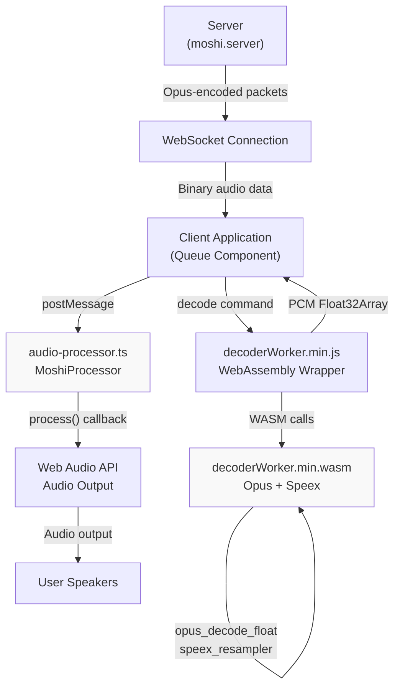
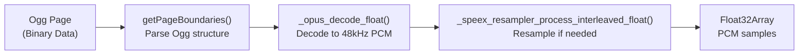
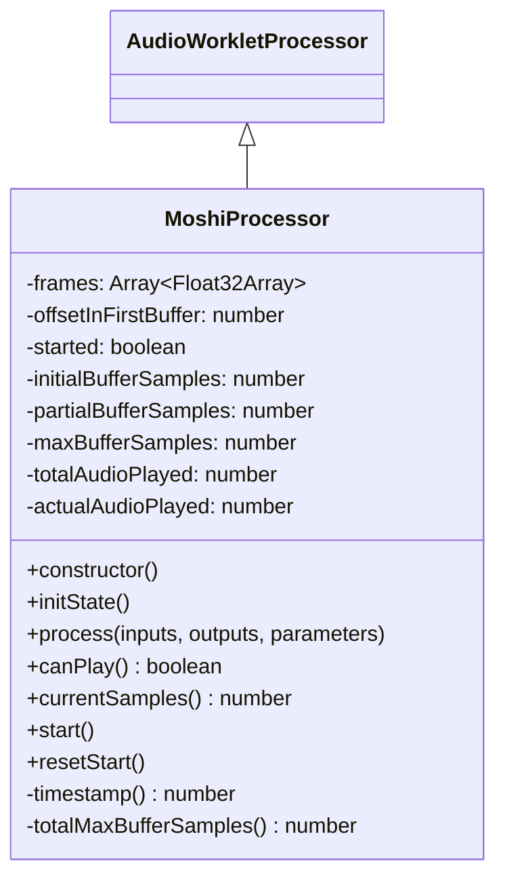
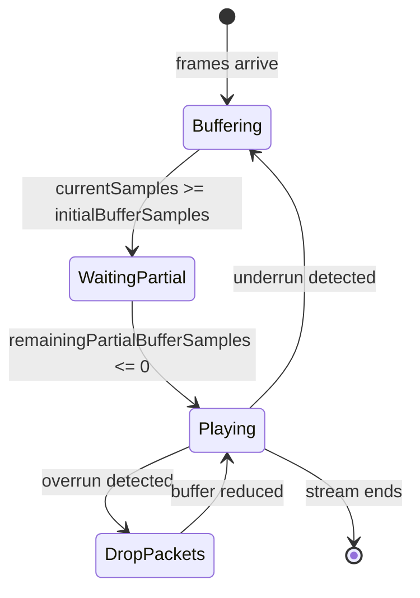
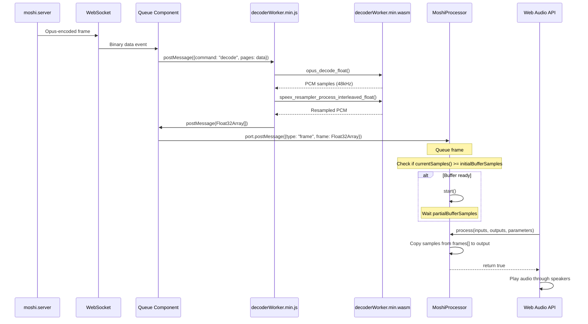

<!-- source: DeepWiki mcp.deepwiki.com · repo NVIDIA/personaplex · page 4.2 Audio Processing Pipeline · fetched 2026-10-26 -->

# Audio Processing Pipeline

Relevant source files

The following files were used as context for generating this wiki page:

- [client/public/assets/decoderWorker.min.js](client/public/assets/decoderWorker.min.js)
- [client/public/assets/decoderWorker.min.wasm](client/public/assets/decoderWorker.min.wasm)
- [client/src/audio-processor.ts](client/src/audio-processor.ts)

## Purpose and Scope

This document describes the client-side audio processing pipeline in PersonaPlex, which handles real-time decoding and playback of audio streams received from the server. The pipeline consists of two main components: a WebAssembly-based Opus decoder that performs audio decoding and resampling, and an AudioWorklet processor (`MoshiProcessor`) that manages buffering and playback to ensure smooth audio output despite network variability.

For information about server-side audio processing and model inference, see [Server Application](#3). For client setup and SSL configuration, see [Client Setup and Configuration](#4.1).

---

## Architecture Overview

The audio processing pipeline receives Opus-encoded audio packets from the server via WebSocket, decodes them using a WebAssembly module, and plays them through an AudioWorklet that manages buffering to prevent audio dropouts and overruns.

**Sources:**
- [client/public/assets/decoderWorker.min.js:1-903]()
- [client/src/audio-processor.ts:1-186]()

---

## WebAssembly Decoder Module

The audio decoder is implemented as a WebAssembly module with a JavaScript wrapper that handles Opus decoding and Speex resampling. The decoder is loaded from two files: `decoderWorker.min.js` (JavaScript wrapper) and `decoderWorker.min.wasm` (compiled binary).

### Decoder Components

| Component | Purpose | Location |
|-----------|---------|----------|
| `Module` | Emscripten runtime environment | [decoderWorker.min.js:1-902]() |
| `OggOpusDecoder` | Main decoder class | [decoderWorker.min.js:89-289]() |
| `_opus_decoder_create` | Creates Opus decoder instance | [decoderWorker.min.js:816-818]() |
| `_opus_decode_float` | Decodes Opus frame to float PCM | [decoderWorker.min.js:820-822]() |
| `_speex_resampler_init` | Initializes resampler | [decoderWorker.min.js:828-830]() |
| `_speex_resampler_process_interleaved_float` | Performs resampling | [decoderWorker.min.js:837-843]() |

### Decoder Configuration

The decoder is initialized with configuration parameters that control sample rates and buffer sizes:

| Parameter | Default Value | Description |
|-----------|---------------|-------------|
| `bufferLength` | 4096 samples | Output buffer size for decoded audio |
| `decoderSampleRate` | 48000 Hz | Opus decoder native sample rate |
| `outputBufferSampleRate` | 48000 Hz | Target output sample rate |
| `resampleQuality` | 3 | Speex resampler quality (0-10 scale) |

**Sources:** [client/public/assets/decoderWorker.min.js:95-103]()

### Decoding Process

The decoding workflow is managed by the `decode()` method:

1. **Page Boundary Detection**: [decoderWorker.min.js:177-181]() scans for Ogg page headers (magic number `0x4f676753`)
2. **Channel Configuration**: [decoderWorker.min.js:124-125]() extracts channel count from Ogg header
3. **Opus Decoding**: [decoderWorker.min.js:142-149]() calls `_opus_decode_float` to decode compressed audio
4. **Resampling**: [decoderWorker.min.js:156-162]() resamples decoded audio if output rate differs from 48kHz
5. **Output Buffering**: [decoderWorker.min.js:163-169]() accumulates decoded samples into output buffers

**Sources:** [client/public/assets/decoderWorker.min.js:118-176]()

### Memory Management

The decoder uses Emscripten heap memory for efficient data transfer between JavaScript and WebAssembly:

- `decoderBufferPointer`: Input buffer for encoded Opus packets (max 4000 bytes)
- `decoderOutputPointer`: Output buffer for decoded PCM samples
- `resampleOutputBufferPointer`: Buffer for resampled audio

Memory is allocated via `_malloc()` and freed via `_free()` [decoderWorker.min.js:845-853](). The decoder accesses memory through typed array views (`HEAPU8`, `HEAP32`, `HEAPF32`) [decoderWorker.min.js:113-115]().

**Sources:** [client/public/assets/decoderWorker.min.js:185-237]()

---

## AudioWorklet Processor (MoshiProcessor)

The `MoshiProcessor` class extends `AudioWorkletProcessor` to manage real-time audio playback with adaptive buffering. It runs on the audio rendering thread, separate from the main thread, to ensure consistent low-latency processing.

### Class Structure

**Sources:** [client/src/audio-processor.ts:10-185]()

### Buffer Parameters

The processor maintains several buffer thresholds to balance latency and playback reliability:

| Parameter | Initial Value | Purpose |
|-----------|---------------|---------|
| `initialBufferSamples` | 1 × frameSize (80ms) | Minimum samples before starting playback |
| `partialBufferSamples` | 10ms | Additional wait time after reaching initial buffer |
| `maxBufferSamples` | 10ms | Maximum buffer before dropping packets |
| `partialBufferIncrement` | 5ms | Increment when underrun occurs |
| `maxBufferSamplesIncrement` | 5ms | Increment when overrun occurs |

**Sources:** [client/src/audio-processor.ts:16-30]()

### State Management

The processor maintains playback state through several variables:

- `frames`: Queue of decoded audio frames awaiting playback
- `offsetInFirstBuffer`: Current read position in the first queued frame
- `started`: Boolean indicating if initial buffer has been reached
- `remainingPartialBufferSamples`: Countdown for partial buffer delay

**Sources:** [client/src/audio-processor.ts:80-99]()

---

## Buffer Management Strategy

The audio processor implements adaptive buffering to handle network jitter while minimizing latency. The strategy involves three key behaviors: initial buffering, underrun recovery, and overrun prevention.

### Buffering State Machine

**Sources:** [client/src/audio-processor.ts:118-130]()

### Initial Buffering Phase

Before starting playback, the processor waits until sufficient audio has been buffered:

1. Accumulate frames until `currentSamples() >= initialBufferSamples` [audio-processor.ts:43-45]()
2. Call `start()` to set `remainingPartialBufferSamples = partialBufferSamples` [audio-processor.ts:122-126]()
3. Continue waiting while `remainingPartialBufferSamples > 0` [audio-processor.ts:129]()
4. Begin playback once partial buffer countdown completes

This two-stage buffering allows for non-frame-aligned buffer lengths while ensuring smooth playback start.

**Sources:** [client/src/audio-processor.ts:18-26](), [client/src/audio-processor.ts:43-45](), [client/src/audio-processor.ts:122-126]()

### Underrun Recovery

When the buffer empties during playback (underrun), the processor:

1. Detects underrun when `out_idx < output.length` [audio-processor.ts:168]()
2. Applies fade-out to prevent click artifacts [audio-processor.ts:175-177]()
3. Increases `partialBufferSamples` by `partialBufferIncrement` (5ms) [audio-processor.ts:170]()
4. Resets to buffering state via `resetStart()` [audio-processor.ts:174]()
5. Resumes playback once buffer refills

The incremental increase in `partialBufferSamples` (capped at 80ms) adapts to persistent network delays.

**Sources:** [client/src/audio-processor.ts:168-178]()

### Overrun Prevention

When the buffer grows too large (overrun), the processor:

1. Detects overrun when `currentSamples() >= totalMaxBufferSamples()` [audio-processor.ts:50]()
2. Drops oldest audio frames to reduce buffer to target size [audio-processor.ts:52-63]()
3. Updates `timeInStream` to track dropped samples [audio-processor.ts:58]()
4. Increases `maxBufferSamples` by `maxBufferSamplesIncrement` (5ms) [audio-processor.ts:65-66]()

This adaptive behavior prevents unbounded latency growth while accommodating burst delays.

**Sources:** [client/src/audio-processor.ts:50-68]()

---

## Audio Flow Sequence

The complete audio flow from server to speakers involves coordination between multiple components:

**Sources:**
- [client/public/assets/decoderWorker.min.js:75-88]()
- [client/src/audio-processor.ts:35-77]()
- [client/src/audio-processor.ts:132-183]()

### Message Protocol

The processor receives messages from the main thread via the `port.onmessage` handler:

| Message Type | Data Structure | Action |
|--------------|----------------|--------|
| Frame data | `{frame: Float32Array, micDuration: number}` | Queue frame, update metrics |
| Reset | `{type: "reset"}` | Call `initState()` to clear buffers |

The processor sends metrics back to the main thread:

| Metric | Description |
|--------|-------------|
| `totalAudioPlayed` | Total time the processor has been running |
| `actualAudioPlayed` | Actual time audio has been output (excludes underruns) |
| `delay` | Current buffering delay in seconds |
| `minDelay` | Minimum observed delay |
| `maxDelay` | Maximum observed delay |

**Sources:** [client/src/audio-processor.ts:35-77]()

### Process Callback

The `process()` method is called by the Web Audio API for each audio rendering quantum (typically 128 samples at 48kHz ≈ 2.67ms):

1. Check if playback can proceed via `canPlay()` [audio-processor.ts:139]()
2. If not ready, output silence and decrement `remainingPartialBufferSamples` [audio-processor.ts:139-144]()
3. If ready, copy samples from `frames[]` queue to output buffer [audio-processor.ts:150-161]()
4. Apply fade-in on first output to prevent clicks [audio-processor.ts:162-167]()
5. Handle underrun if insufficient samples available [audio-processor.ts:168-178]()
6. Update playback metrics [audio-processor.ts:179-181]()

**Sources:** [client/src/audio-processor.ts:132-183]()

---

## Performance Considerations

The audio processing pipeline is designed for low-latency performance:

- **Sample Rate**: Fixed 48kHz decoder output matches typical audio hardware
- **Frame Size**: 80ms frames (3840 samples) provide balance between latency and efficiency
- **Initial Buffer**: Starts at 80ms, adapts upward if underruns occur
- **Max Buffer**: Starts at 10ms above initial, increases if overruns occur
- **Processing Thread**: AudioWorklet runs on dedicated audio thread, isolated from main thread

The adaptive buffering parameters allow the system to handle network variability while maintaining the lowest possible latency for the given conditions.

**Sources:** [client/src/audio-processor.ts:16-30]()

---

