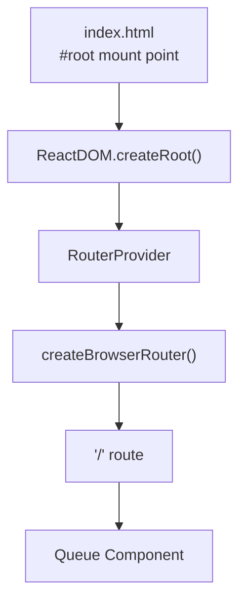
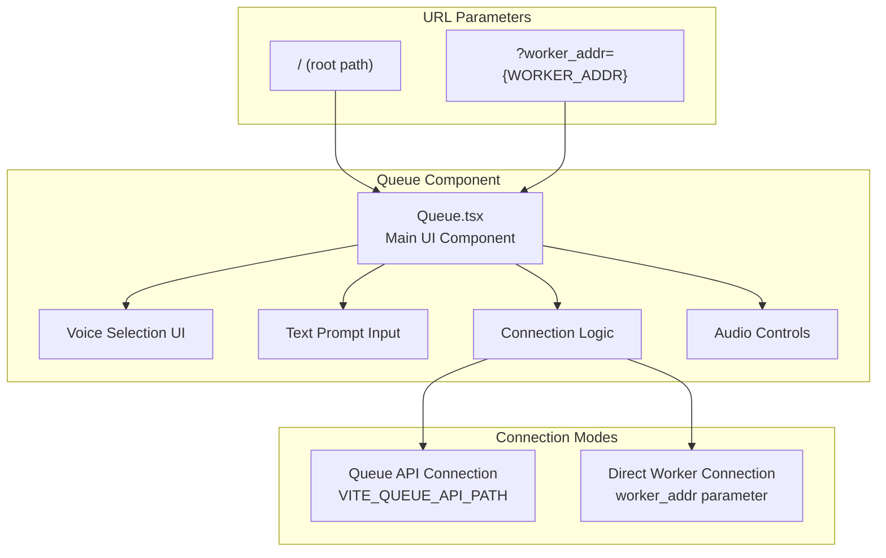
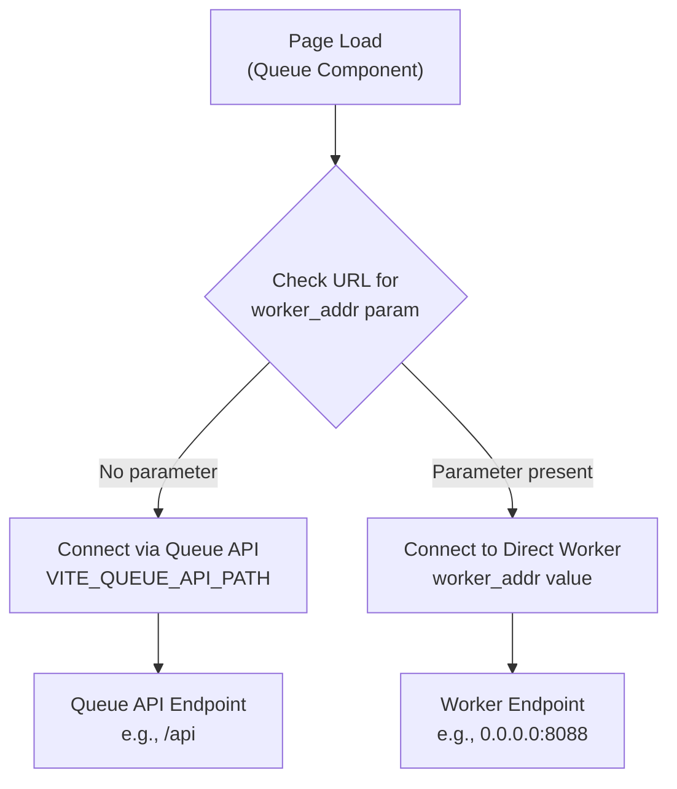
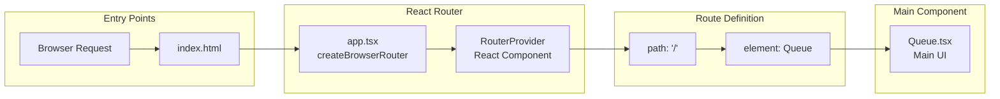

<!-- source: DeepWiki mcp.deepwiki.com · repo NVIDIA/personaplex · page 4.3 Client Routing and UI · fetched 2026-10-26 -->

# Client Routing and UI

<details>
<summary>Relevant source files</summary>

The following files were used as context for generating this wiki page:

- [client/index.html](client/index.html)
- [client/src/app.tsx](client/src/app.tsx)

</details>


## Purpose and Scope

This document describes the client application's routing configuration and user interface structure. It covers the React Router setup in `app.tsx`, the HTML entry point in `index.html`, and the main Queue component that serves as the primary user interface. For details on audio processing within the UI, see [Audio Processing Pipeline](#4.2). For client setup and SSL configuration, see [Client Setup and Configuration](#4.1).

---

## Application Entry Point

The PersonaPlex client uses a standard React application structure with an HTML entry point that loads the React application via Vite's module system.

### HTML Structure

The HTML document [client/index.html:1-14]() provides the basic page structure:

| Element | Purpose |
|---------|---------|
| `<html data-theme="light">` | Sets the default theme for the application |
| `<meta charset="UTF-8">` | Ensures proper character encoding |
| `<meta name="viewport">` | Configures responsive design for mobile devices |
| Favicon links | Provides 16x16 and 32x32 PNG icons for browser tabs |
| `<title>PersonaPlex</title>` | Sets the browser tab title |
| `<div id="root">` | Mount point for the React application |
| `<script src="/src/app.tsx">` | Loads the TypeScript/React application entry point |

The page uses Tailwind CSS classes for base styling, with `bg-neutral-50` for the background and `text-zinc-700` for text color [client/index.html:2,10]().

**Sources:** [client/index.html:1-14]()

---

## Router Configuration

The routing layer is configured in `app.tsx` using React Router DOM v6. PersonaPlex uses a minimal routing structure with a single route that serves the Queue component.



**Diagram: Application Initialization Flow**

### Router Setup

The router is created using `createBrowserRouter()` with a single route definition [client/src/app.tsx:9-14]():

```typescript
const router = createBrowserRouter([
  {
    path: "/",
    element: <Queue />,
  },
]);
```

This configuration maps the root path `/` directly to the Queue component, which handles all user interactions including voice selection, text prompt input, and WebSocket communication.

### React DOM Mounting

The application is mounted to the DOM using React 18's `createRoot` API [client/src/app.tsx:16-18]():

```typescript
ReactDOM.createRoot(document.getElementById("root") as HTMLElement).render(
    <RouterProvider router={router}/>
);
```

The `RouterProvider` wraps the entire application, enabling client-side routing capabilities.

**Sources:** [client/src/app.tsx:1-18]()

---

## Queue Component Architecture

The Queue component serves as the primary and only UI page in the PersonaPlex client. It handles all user interactions and orchestrates the connection to the backend server.



**Diagram: Queue Component Structure and Connection Modes**

### Component Responsibilities

The Queue component is responsible for:

- **Voice Selection**: Presenting available voice embeddings (NAT/VAR voices) for voice conditioning
- **Text Prompt Input**: Allowing users to enter or select persona-defining text prompts
- **Connection Management**: Establishing and maintaining WebSocket connections to the backend
- **Audio Control**: Starting/stopping audio capture and playback
- **UI State Management**: Managing connection state, errors, and user feedback

**Sources:** [client/src/app.tsx:7,12](), [client/README.md:1-21]()

---

## Direct Worker Connection

PersonaPlex supports bypassing the queue system for direct connections to worker instances. This is useful for development, testing, or standalone deployments.

### URL Parameter Syntax

To connect directly to a worker, append the `worker_addr` query parameter to the URL [client/README.md:14-16]():

```
https://localhost:5173/?worker_addr={WORKER_ADDR}
```

Where `{WORKER_ADDR}` is the host and port of the worker instance, for example:

```
https://localhost:5173/?worker_addr=0.0.0.0:8088
```

### Connection Mode Selection



**Diagram: Connection Mode Decision Flow**

This dual-mode connection architecture provides flexibility:

| Mode | Use Case | Configuration |
|------|----------|---------------|
| Queue API | Production deployment with load balancing | `VITE_QUEUE_API_PATH` environment variable |
| Direct Worker | Development, testing, standalone instances | `worker_addr` URL parameter |

**Sources:** [client/README.md:14-16]()

---

## UI Styling and Theming

The client application uses a modern styling stack built on Tailwind CSS with a consistent design system.

### Styling Configuration

| Technology | Purpose | Configuration File |
|------------|---------|-------------------|
| Tailwind CSS | Utility-first CSS framework | Referenced in build pipeline |
| PostCSS | CSS processing and optimization | Part of Vite build chain |
| CSS Classes | Base styling applied directly in HTML | `bg-neutral-50`, `text-zinc-700` |

### Theme System

The HTML document specifies a light theme using the `data-theme` attribute [client/index.html:2]():

```html
<html lang="en" class="bg-neutral-50" data-theme="light">
```

This theme attribute can be read by CSS to apply theme-specific styles throughout the application.

### Color Scheme

The base color scheme uses neutral tones for a clean, professional appearance:

- **Background**: `bg-neutral-50` (light neutral gray)
- **Text**: `text-zinc-700` (darker zinc gray for readable contrast)
- **Body Background**: `bg-neutral-50` (consistent with HTML element)

**Sources:** [client/index.html:2,10](), [client/README.md:1-21]()

---

## Routing and Navigation Summary

The PersonaPlex client implements a minimal routing structure optimized for its single-page application architecture. The routing configuration can be summarized as:



**Diagram: Complete Routing Flow from Browser to UI Component**

### Key Routing Characteristics

1. **Single Route Application**: Only one route (`/`) is defined, serving the Queue component
2. **No Complex Navigation**: No multi-page navigation or nested routes
3. **URL Parameter Support**: The Queue component interprets URL parameters for connection configuration
4. **Client-Side Rendering**: All routing handled by React Router in the browser

This simple routing architecture aligns with PersonaPlex's focused purpose as a conversational interface, where all functionality is accessible from a single page without requiring navigation between multiple views.

**Sources:** [client/src/app.tsx:1-18](), [client/index.html:1-14](), [client/README.md:14-16]()

---

