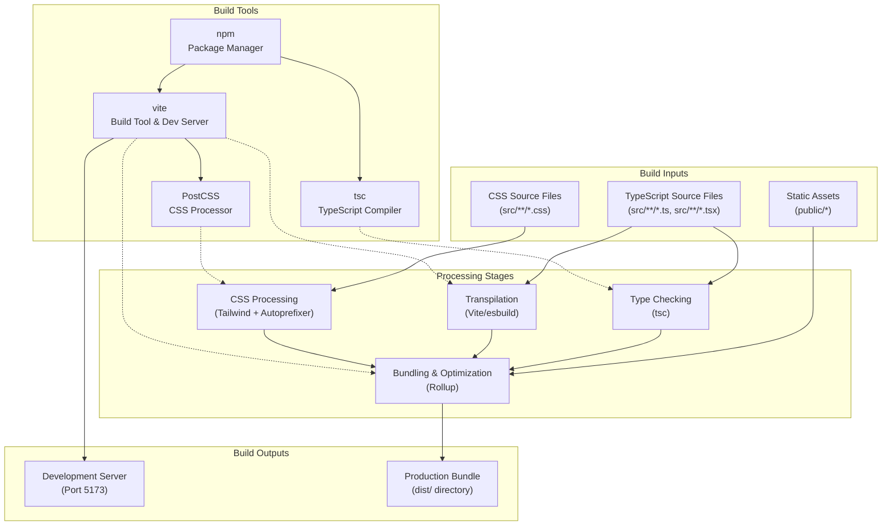
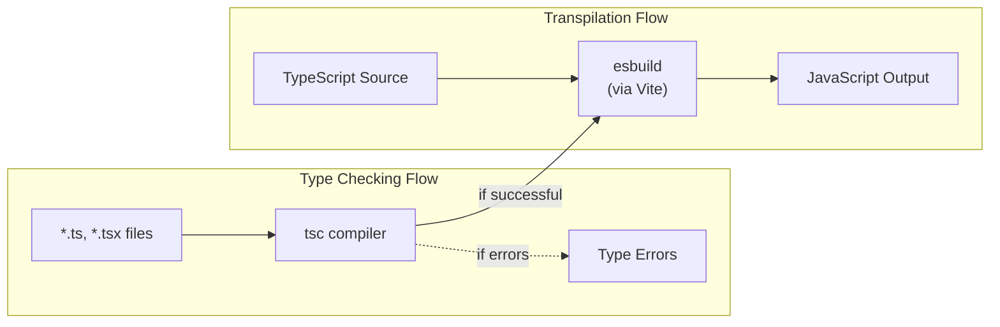
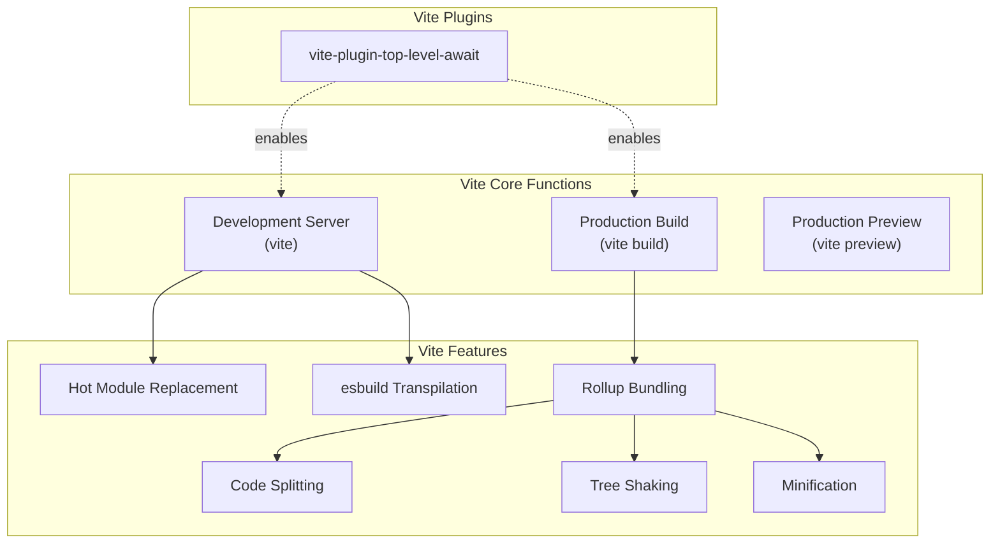
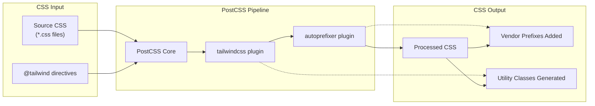
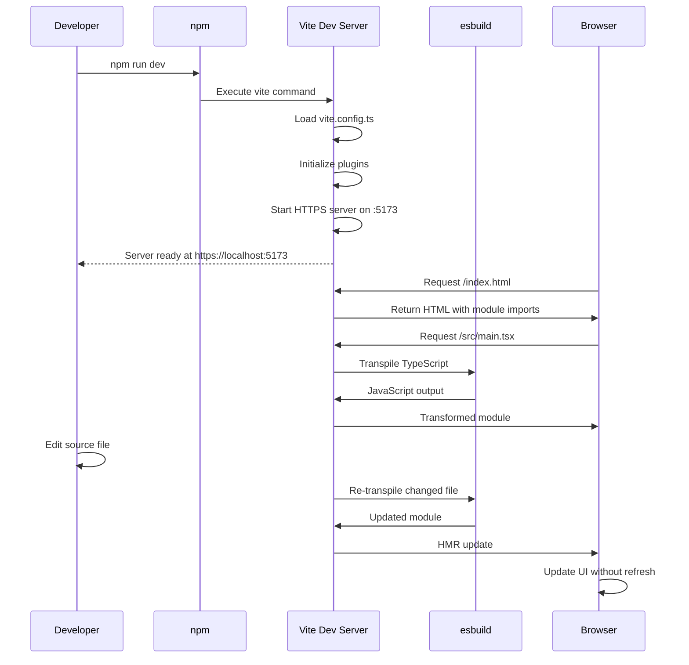
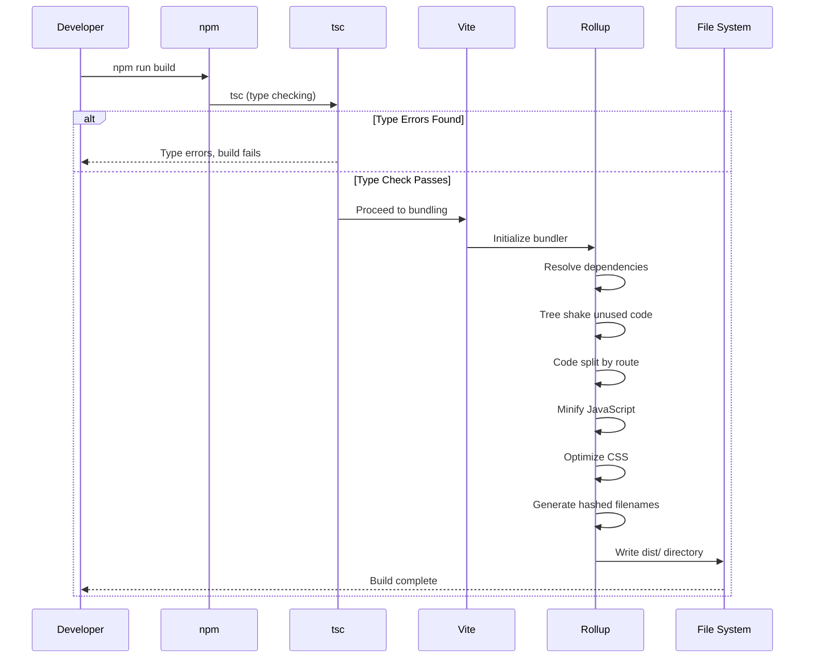
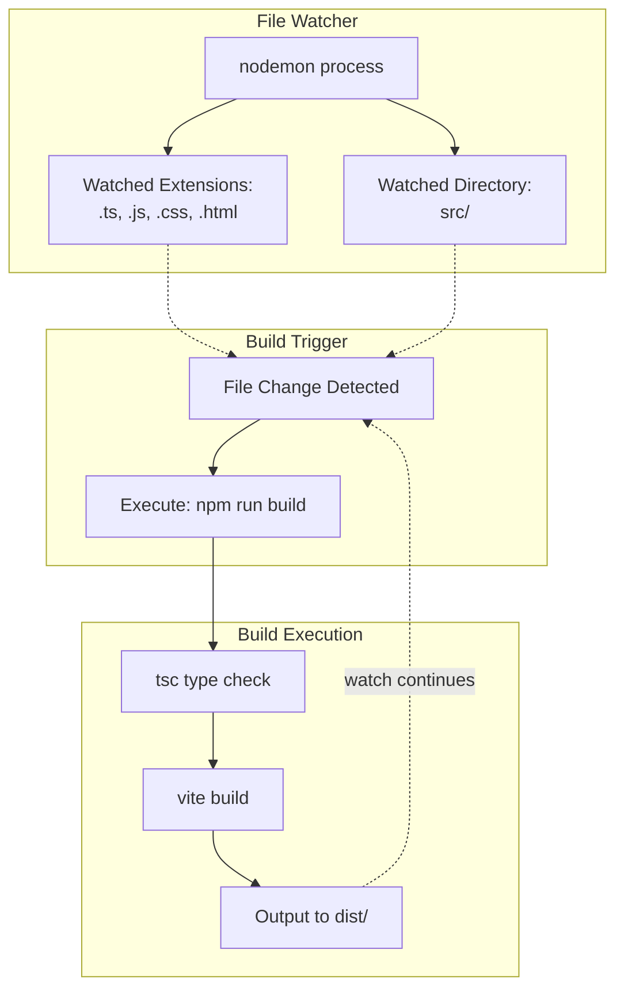

<!-- source: DeepWiki mcp.deepwiki.com · repo NVIDIA/personaplex · page 4.4 Client Build Pipeline · fetched 2026-10-26 -->

# Client Build Pipeline

<details>
<summary>Relevant source files</summary>

The following files were used as context for generating this wiki page:

- [client/Dockerfile](client/Dockerfile)
- [client/package.json](client/package.json)
- [client/postcss.config.js](client/postcss.config.js)

</details>


## Purpose and Scope

This document details the client application's build system, which transforms TypeScript source code, React components, and CSS into optimized production bundles. The build pipeline leverages Vite as the primary build tool, TypeScript for type checking, and PostCSS for CSS processing.

For information about client setup and configuration (environment variables, SSL certificates), see [Client Setup and Configuration](#4.1). For details about code quality tools (ESLint, Prettier), see [Code Quality and Formatting](#6.1). For production deployment of built artifacts, see [Client Container](#5.2).

---

## Build System Architecture

The client build system is orchestrated through NPM scripts defined in `package.json` and uses Vite as the core bundler. The architecture separates development and production workflows, with integrated type checking and CSS processing.



**Sources**: [client/package.json:1-48]()

---

## NPM Scripts Reference

The build system is controlled through NPM scripts that orchestrate different build modes and tools. Each script serves a specific purpose in the development or production workflow.

| Script | Command | Purpose |
|--------|---------|---------|
| `dev` | `vite` | Starts Vite development server with HMR |
| `build` | `tsc && vite build` | Type checks then builds production bundle |
| `build:watch` | `nodemon --watch src --ext ts,js,css,html --exec "npm run build"` | Watches for changes and rebuilds continuously |
| `lint` | `eslint` | Runs ESLint code quality checks |
| `lint:fix` | `eslint --fix` | Runs ESLint and auto-fixes issues |
| `prettier` | `prettier --write .` | Formats all files using Prettier |
| `preview` | `vite preview` | Serves production build for local testing |

The `build` script at [client/package.json:8]() executes a two-stage process: first running `tsc` for type checking, then `vite build` for bundling. This ensures type errors are caught before the bundling process begins.

The `build:watch` script at [client/package.json:9]() uses `nodemon` to monitor source files (`.ts`, `.js`, `.css`, `.html`) and automatically triggers rebuilds, useful for testing production builds during development.

**Sources**: [client/package.json:6-13]()

---

## TypeScript Compilation Pipeline

TypeScript compilation is handled in two distinct ways depending on the build mode:



### Type Checking (tsc)

The standalone `tsc` command performs type checking without emitting output. It validates:
- Type annotations and interfaces
- Module resolution and imports
- Generic constraints
- React component prop types

Type checking must complete successfully before Vite bundling begins in production builds ([client/package.json:8]()).

### Transpilation (esbuild via Vite)

Vite uses esbuild internally for fast TypeScript transpilation during both development and production builds. esbuild:
- Strips type annotations
- Transpiles JSX/TSX to JavaScript
- Handles module resolution
- Performs minimal syntax transformations

This separation allows esbuild to focus on speed while `tsc` ensures type safety.

**Sources**: [client/package.json:8](), [client/package.json:33]()

---

## Vite Build Configuration

Vite serves as the core build tool, providing both development server capabilities and production bundling. The tool is explicitly declared as a dependency at [client/package.json:35]().



### Development Mode

When running `npm run dev` ([client/package.json:7]()), Vite:
- Starts an HTTPS development server on port 5173
- Serves source files on-demand with esbuild transpilation
- Provides instant Hot Module Replacement (HMR)
- Pre-bundles dependencies for faster reloads

### Production Mode

When running `npm run build` ([client/package.json:8]()), Vite:
- Uses Rollup for bundling (optimized for production)
- Performs tree shaking to eliminate dead code
- Minifies JavaScript and CSS
- Generates code-split bundles for optimal loading
- Outputs static assets to the `dist/` directory

### Top-Level Await Plugin

The `vite-plugin-top-level-await` dependency at [client/package.json:36]() enables ES module top-level await syntax, which is used by WebAssembly loading in the audio processing pipeline.

**Sources**: [client/package.json:7-8](), [client/package.json:13](), [client/package.json:35-36]()

---

## CSS Processing Pipeline

CSS is processed through a multi-stage pipeline that applies Tailwind utility classes, performs vendor prefixing, and optimizes output.



### PostCSS Configuration

The PostCSS pipeline is configured in [client/postcss.config.js:1-6]() with two plugins:

1. **tailwindcss** ([client/postcss.config.js:3]()): Processes `@tailwind` directives and generates utility classes based on usage in HTML/JSX files
2. **autoprefixer** ([client/postcss.config.js:4]()): Adds vendor prefixes (`-webkit-`, `-moz-`, etc.) for cross-browser compatibility

Both plugins are declared as devDependencies at [client/package.json:20]() and [client/package.json:32]().

### DaisyUI Integration

The `daisyui` library at [client/package.json:21]() extends Tailwind with pre-built component classes, providing UI components like buttons, cards, and modals without custom CSS.

### Prettier Tailwind Plugin

The `prettier-plugin-tailwindcss` at [client/package.json:31]() automatically sorts Tailwind utility classes in a consistent order during formatting, integrated via [client/.prettierrc.json:9]().

**Sources**: [client/postcss.config.js:1-6](), [client/package.json:20-21](), [client/package.json:31-32](), [client/.prettierrc.json:9]()

---

## Development Build Process

The development build process prioritizes speed and developer experience over optimization.



### Development Server Features

When running `npm run dev`:

1. **Instant Server Start**: Vite starts in milliseconds by deferring bundling
2. **On-Demand Compilation**: Files are only transpiled when requested
3. **Fast Refresh**: React Fast Refresh preserves component state during updates
4. **Source Maps**: Full source maps for debugging TypeScript in browser DevTools
5. **HTTPS Support**: Serves over HTTPS for WebRTC/WebSocket compatibility

### File Watching

The development server watches the `src/` directory for changes and triggers HMR updates. No explicit configuration is needed as Vite handles this automatically.

**Sources**: [client/package.json:7]()

---

## Production Build Process

The production build process optimizes for bundle size, load performance, and runtime efficiency.



### Build Stages

The two-stage build command at [client/package.json:8]() executes:

1. **Type Checking Phase**: `tsc` validates all TypeScript files without emitting output
2. **Bundling Phase**: `vite build` creates optimized production bundles

This sequential execution ensures type safety before spending time on bundling.

### Optimization Techniques

Vite applies several optimizations during production builds:

| Optimization | Description |
|--------------|-------------|
| **Minification** | Removes whitespace, shortens variable names, removes comments |
| **Tree Shaking** | Eliminates unused exports from modules |
| **Code Splitting** | Separates code into chunks loaded on-demand |
| **Asset Hashing** | Adds content hashes to filenames for cache busting |
| **CSS Extraction** | Extracts CSS into separate files |
| **Dependency Pre-bundling** | Pre-bundles node_modules for faster loading |

### Build Output Structure

Production builds output to the `dist/` directory with structure:
- `dist/index.html` - Entry HTML file
- `dist/assets/` - JavaScript, CSS, and static assets with hashed filenames
- `dist/public/` - Public assets copied without transformation

**Sources**: [client/package.json:8]()

---

## Continuous Build Mode

The `build:watch` script at [client/package.json:9]() provides continuous production builds during development.



This mode uses `nodemon` ([client/package.json:27]()) to watch the `src/` directory for changes to TypeScript, JavaScript, CSS, and HTML files, then triggers a full production build. This is useful for:
- Testing production build behavior during development
- Validating bundle size changes
- Ensuring production builds succeed before deployment

**Sources**: [client/package.json:9](), [client/package.json:27]()

---

## Dependency Categories

The build system distinguishes between development dependencies (build-time tools) and runtime dependencies (bundled into the application).

### Build-Time Dependencies (devDependencies)

| Category | Packages | Purpose |
|----------|----------|---------|
| **Build Tools** | `vite`, `typescript`, `vite-plugin-top-level-await` | Core build and transpilation |
| **CSS Processing** | `postcss`, `tailwindcss`, `autoprefixer`, `daisyui` | CSS transformation and utilities |
| **Code Quality** | `eslint`, `prettier`, `eslint-plugin-react`, `eslint-plugin-prettier` | Linting and formatting |
| **Type Definitions** | `@types/react`, `@types/react-dom`, `@types/ws` | TypeScript type information |
| **Watch Mode** | `nodemon` | Continuous build triggering |

These dependencies at [client/package.json:15-37]() are only needed during development and build processes.

### Runtime Dependencies (dependencies)

| Package | Purpose |
|---------|---------|
| `react`, `react-dom` | React framework and DOM renderer |
| `react-router-dom` | Client-side routing |
| `opus-recorder` | Audio encoding |
| `ws` | WebSocket client |
| `zod` | Runtime type validation |
| `webm-duration-fix` | WebM metadata correction |
| `eruda` | Mobile debugging console |

These dependencies at [client/package.json:38-47]() are bundled into the production build and shipped to the browser.

**Sources**: [client/package.json:15-47]()

---

## Build Artifact Preview

The `preview` script at [client/package.json:13]() serves the production build locally for testing:

```bash
npm run build    # Build production bundle
npm run preview  # Serve from dist/ on :4173
```

This allows testing the production build behavior (minification, code splitting, asset loading) before deploying to production environments. The preview server mimics production HTTP headers and caching behavior.

**Sources**: [client/package.json:13]()

---

