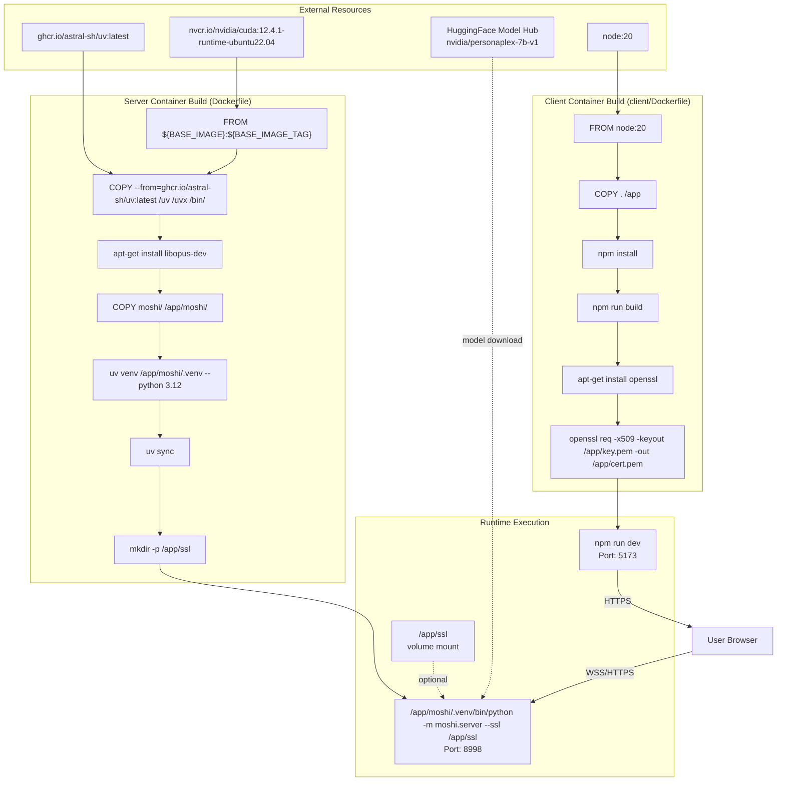
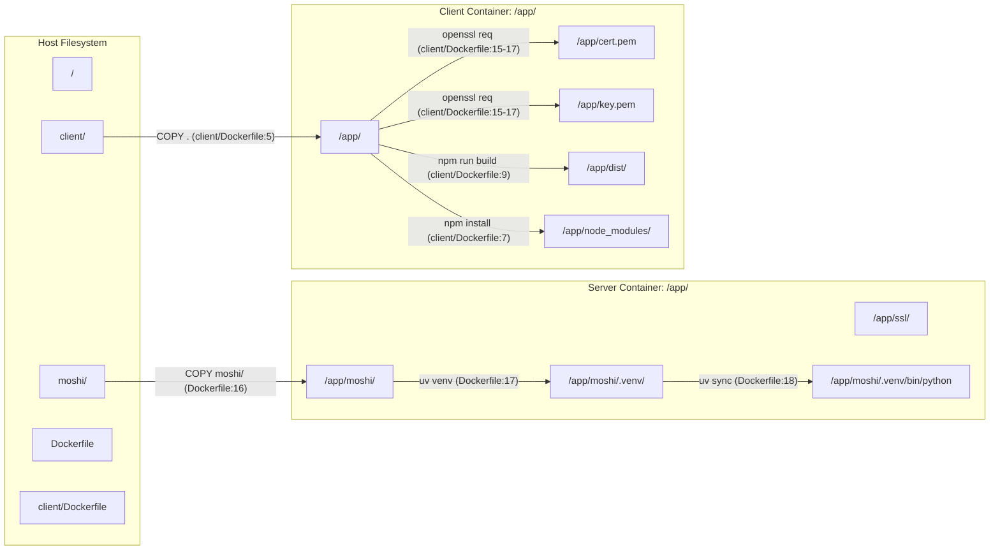
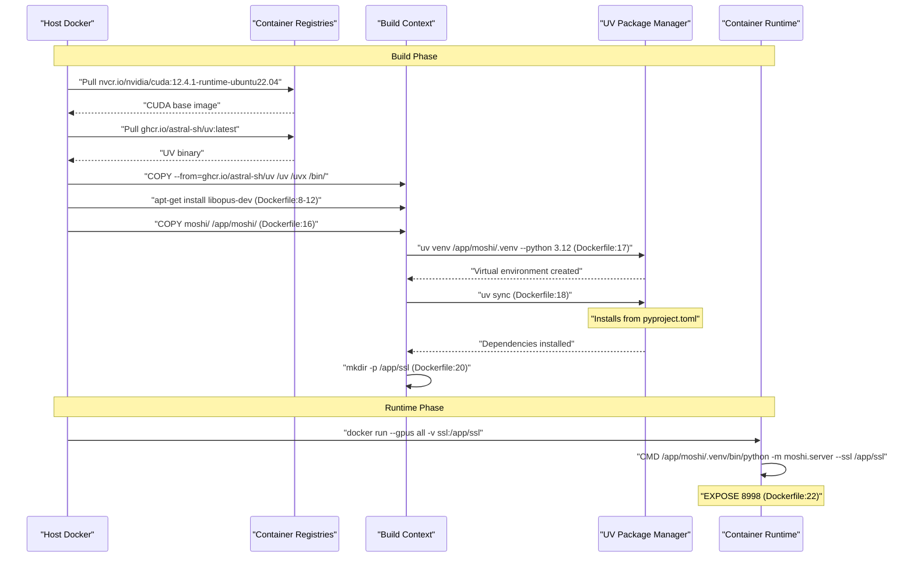
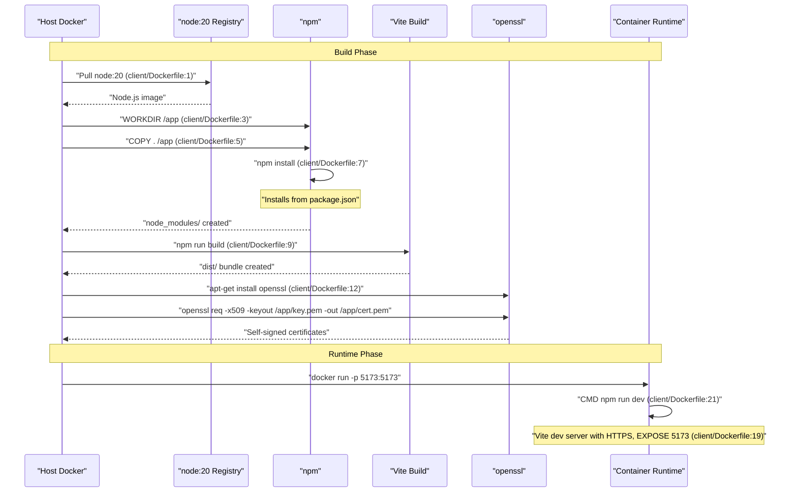
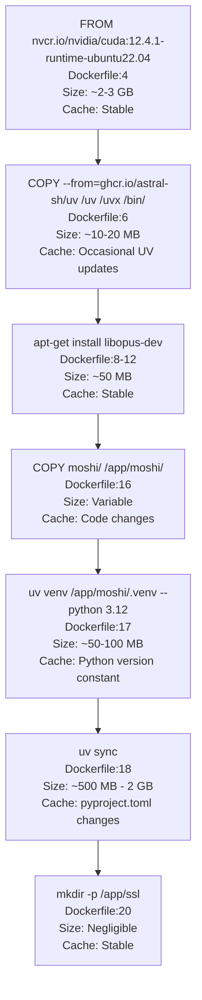
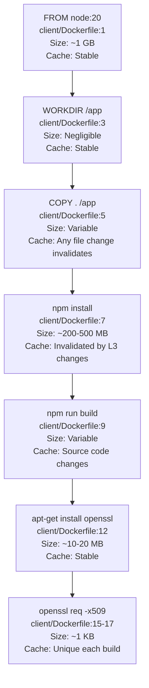

<!-- source: DeepWiki mcp.deepwiki.com · repo NVIDIA/personaplex · page 5 Deployment and Containerization · fetched 2026-10-26 -->

# Deployment and Containerization

<details>
<summary>Relevant source files</summary>

The following files were used as context for generating this wiki page:

- [Dockerfile](Dockerfile)
- [client/Dockerfile](client/Dockerfile)

</details>


## Purpose and Scope

PersonaPlex uses a Docker-based deployment architecture with separate containers for the server (`moshi.server` Python module) and client (React/Vite application). This separation enables independent scaling, isolated runtime environments, and distinct resource allocation for model inference versus UI delivery.

### Container Overview

| Container | Base Image | Primary Executable | Exposed Port | Purpose |
|-----------|-----------|-------------------|--------------|---------|
| Server | `nvcr.io/nvidia/cuda:12.4.1-runtime-ubuntu22.04` | `/app/moshi/.venv/bin/python -m moshi.server` | 8998 | GPU-accelerated model inference |
| Client | `node:20` | `npm run dev` (Vite dev server) | 5173 | Web UI serving and build system |

For detailed implementation:
- Server container CUDA configuration, build process, and package management: [Server Container](#5.1)
- Client container build pipeline, SSL generation, and Node.js environment: [Client Container](#5.2)
- Production considerations, security hardening, and scaling: [Production Deployment](#5.3)

For non-containerized deployment options, see [Server Deployment](#3.1) and [Client Setup and Configuration](#4.1).

**Sources:** [Dockerfile:1-26](), [client/Dockerfile:1-22]()

---

## Container Architecture

PersonaPlex employs a two-container architecture that separates concerns between model inference and user interface delivery. This design allows independent scaling, updates, and resource allocation for each component.

### Container Comparison

| Aspect | Server Container | Client Container |
|--------|------------------|------------------|
| **Base Image** | `nvcr.io/nvidia/cuda:12.4.1-runtime-ubuntu22.04` | `node:20` |
| **Language Runtime** | Python 3.12 | Node.js 20 |
| **Package Manager** | UV (astral-sh/uv) | npm |
| **Exposed Port** | 8998 | 5173 |
| **SSL Generation** | External (mounted volume) | Internal (OpenSSL self-signed) |
| **GPU Support** | Yes (CUDA 12.4.1) | No |
| **Primary Purpose** | Model inference, audio streaming | UI serving, build system |

**Sources:** Dockerfile, client/Dockerfile

## Container Build and Runtime Architecture

### Build Dependency Flow



**Sources:** [Dockerfile:1-26](), [client/Dockerfile:1-22]()

### File Structure Mapping



**Sources:** [Dockerfile:14-18](), [client/Dockerfile:4-17]()

---

## Build Context and Ignored Files

Build context exclusions reduce image size and build time by preventing unnecessary files from being copied into containers.

### Server Build Context

The `.dockerignore` file specifies:
```
.cache
```

This excludes Python cache directories. The server Dockerfile copies only `moshi/` [Dockerfile:16](), containing the `moshi.server` module and its dependencies defined in `pyproject.toml`.

### Client Build Context

No dedicated `.dockerignore` exists for the client. The `COPY . /app` directive [client/Dockerfile:5]() includes all files from the `client/` directory. The Vite build process [client/Dockerfile:9]() transpiles TypeScript and bundles assets into `dist/`, excluding source files and development dependencies from the runtime bundle.

**Sources:** [Dockerfile:16](), [client/Dockerfile:5-9]()

---

## Build and Execution Flow

### Server Container Execution Sequence



**Sources:** [Dockerfile:1-26]()

### Client Container Execution Sequence



**Sources:** [client/Dockerfile:1-22]()

---

## Runtime Configuration

### Command Specifications

| Container | Entry Point | Command | Port | Key Arguments |
|-----------|-------------|---------|------|---------------|
| Server | `ENTRYPOINT []` [Dockerfile:24]() | `/app/moshi/.venv/bin/python -m moshi.server --ssl /app/ssl` [Dockerfile:25]() | 8998 [Dockerfile:22]() | `--ssl` specifies SSL certificate directory |
| Client | Default (from `node:20`) | `npm run dev` [client/Dockerfile:21]() | 5173 [client/Dockerfile:19]() | Vite dev server with HMR |

### Server Runtime Behavior

The `ENTRYPOINT []` [Dockerfile:24]() clears the default entry point, allowing the `CMD` to execute directly. The command invokes `moshi.server` module with `--ssl /app/ssl`, expecting mounted certificates (`cert.pem`, `key.pem`). Without these certificates, the server will fail to start.

### Client Runtime Behavior

The `npm run dev` command [client/Dockerfile:21]() executes the Vite development server defined in `package.json`. This serves the React application with hot module replacement, using the self-signed certificates generated during build [client/Dockerfile:15-17]().

**Sources:** [Dockerfile:22-25](), [client/Dockerfile:19-21]()

---

## Network and SSL Configuration

### Port Mapping

| Container | Internal Port | Protocol | Service | SSL Source |
|-----------|--------------|----------|---------|------------|
| Server | 8998 [Dockerfile:22]() | HTTPS/WSS | `moshi.server` inference and streaming | External mount to `/app/ssl/` [Dockerfile:25]() |
| Client | 5173 [client/Dockerfile:19]() | HTTPS | Vite dev server | Build-time generated `/app/cert.pem`, `/app/key.pem` [client/Dockerfile:15-17]() |

### SSL Certificate Requirements

**Server Container:**
- **Directory:** `/app/ssl/` [Dockerfile:20]()
- **Required files:** `cert.pem`, `key.pem`
- **Mount strategy:** Volume mount at runtime
- **Command reference:** `--ssl /app/ssl` [Dockerfile:25]()

**Client Container:**
- **Generated files:** `/app/key.pem`, `/app/cert.pem` [client/Dockerfile:16-17]()
- **Certificate type:** Self-signed X.509, RSA 2048-bit
- **Validity:** 365 days
- **Subject:** `CN=localhost`

### Client-Server Connection

The client connects to the server using environment variables:
- `VITE_QUEUE_API_URL` - Server base URL
- `VITE_QUEUE_API_PATH` - API endpoint path

See [Environment Variables](#7.1) for configuration details.

**Sources:** [Dockerfile:20-25](), [client/Dockerfile:15-19]()

---

## Package Management

### UV Package Manager (Server)

The server uses UV, a Rust-based Python package manager with faster dependency resolution than pip.

**Binary acquisition:** Multi-stage copy from official image [Dockerfile:6]()
```dockerfile
COPY --from=ghcr.io/astral-sh/uv:latest /uv /uvx /bin/
```

**Build commands:**
- `uv venv /app/moshi/.venv --python 3.12` [Dockerfile:17]() - Creates Python 3.12 virtual environment
- `uv sync` [Dockerfile:18]() - Installs dependencies from lock file

The `uv sync` command reads `pyproject.toml` in the `moshi/` directory and installs exact versions from the lock file, ensuring reproducible builds.

### npm (Client)

The client uses npm for JavaScript package management [client/Dockerfile:7-9]():

```dockerfile
RUN npm install
RUN npm run build
```

**Process:**
1. `npm install` reads `package.json` and installs dependencies to `node_modules/`
2. `npm run build` invokes Vite, which transpiles TypeScript, bundles React components, and processes Tailwind CSS into `dist/`

**Sources:** [Dockerfile:6-18](), [client/Dockerfile:7-9]()

---

## SSL Certificate Strategies

### Server: External Mount Pattern

The server expects certificates to be provided at runtime [Dockerfile:20-25]():

```dockerfile
RUN mkdir -p /app/ssl
...
CMD ["/app/moshi/.venv/bin/python", "-m", "moshi.server", "--ssl", "/app/ssl"]
```

**Deployment pattern:**
```bash
docker run -v /path/to/certs:/app/ssl ...
```

**Benefits:**
- Supports production certificates from certificate authorities
- Enables certificate rotation without container rebuild
- Compatible with Kubernetes secrets and Docker volumes

**Required files in mount:**
- `cert.pem` - TLS certificate
- `key.pem` - Private key

### Client: Build-Time Generation

The client generates self-signed certificates during image build [client/Dockerfile:15-17]():

```dockerfile
RUN openssl req -x509 -nodes -days 365 -newkey rsa:2048 \
    -keyout /app/key.pem -out /app/cert.pem \
    -subj "/C=US/ST=State/L=City/O=Organization/CN=localhost"
```

**Output:**
- `/app/key.pem` - RSA 2048-bit private key
- `/app/cert.pem` - X.509 certificate, 365-day validity, `CN=localhost`

**Production note:** Replace with trusted certificates for production use. See [Production Deployment](#5.3) for certificate management strategies.

**Sources:** [Dockerfile:20-25](), [client/Dockerfile:15-17]()

---

## Image Layer Analysis

### Server Layer Caching Strategy



**Optimization notes:**
- CUDA base [Dockerfile:4]() is large but rarely changes
- UV binary copy [Dockerfile:6]() uses multi-stage `--from` to extract only binary
- Code copy [Dockerfile:16]() is separate from dependencies [Dockerfile:18](), allowing cache reuse when only code changes

### Client Layer Caching Strategy



**Optimization concern:** The `COPY . /app` [client/Dockerfile:5]() includes all files before `npm install` [client/Dockerfile:7](), invalidating dependency cache on any file change. Optimal pattern would copy `package.json` first, run `npm install`, then copy source files.

**Sources:** [Dockerfile:4-20](), [client/Dockerfile:1-17]()

---

## GPU Support and CUDA Integration

The server container explicitly includes CUDA support through its base image selection:

```dockerfile
ARG BASE_IMAGE="nvcr.io/nvidia/cuda"
ARG BASE_IMAGE_TAG="12.4.1-runtime-ubuntu22.04"
```

**Key aspects:**
- **Runtime vs. Devel:** Uses `runtime` variant [Dockerfile:2](), which includes CUDA libraries for running GPU code but not compilation tools, reducing image size
- **CUDA Version:** 12.4.1 provides compatibility with modern PyTorch distributions
- **Ubuntu Base:** 22.04 LTS ensures long-term support and stability

To utilize GPU acceleration at runtime, the container must be launched with NVIDIA Container Toolkit support (`--gpus all` flag or equivalent orchestration configuration). See [Production Deployment](#5.3) for GPU runtime requirements.

**Sources:** Dockerfile:1-4

---

