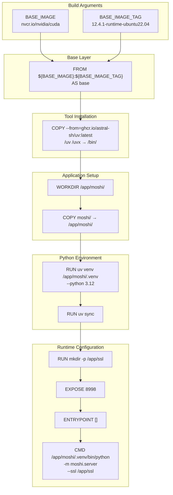
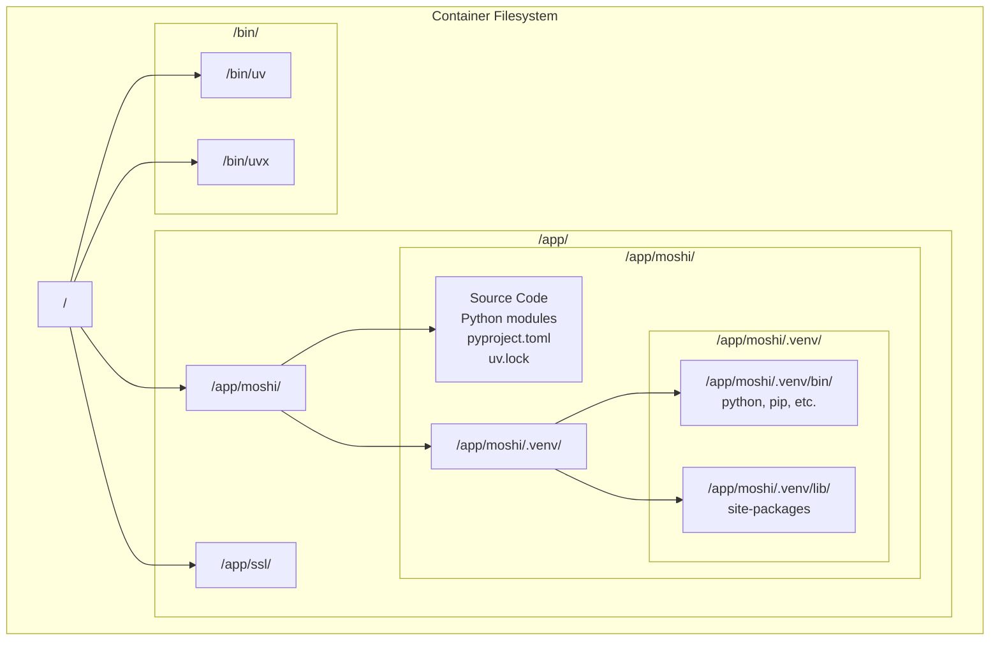
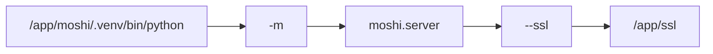
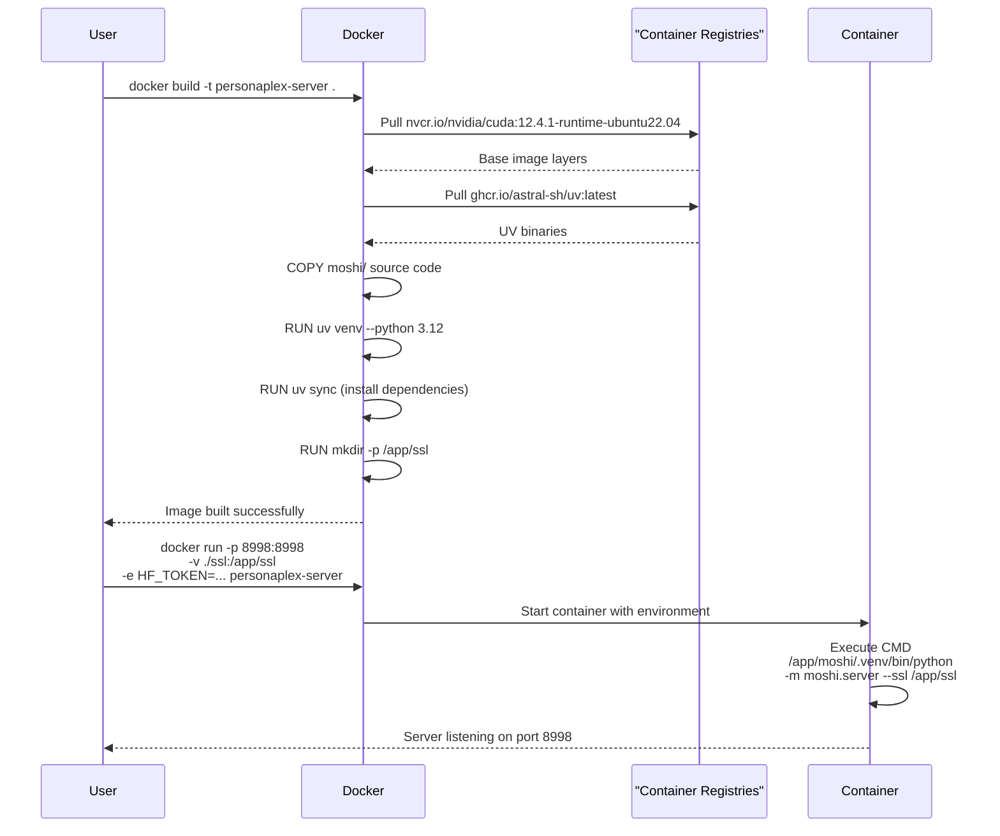

<!-- source: DeepWiki mcp.deepwiki.com · repo NVIDIA/personaplex · page 5.1 Server Container · fetched 2026-10-26 -->

# Server Container

<details>
<summary>Relevant source files</summary>

The following files were used as context for generating this wiki page:

- [.dockerignore](.dockerignore)
- [Dockerfile](Dockerfile)

</details>


## Purpose and Scope

This document provides a detailed walkthrough of the server container defined in the root-level `Dockerfile`. The server container packages the Python-based Moshi server application with GPU acceleration support, dependency management via UV, and SSL configuration. 

For information about deploying this container in production environments, see [Production Deployment](#5.3). For details about the client container, see [Client Container](#5.2). For runtime server configuration and operational details, see [Server Deployment](#3.1).

**Sources:** [Dockerfile:1-19]()

---

## Base Image Configuration

The server container uses NVIDIA's CUDA runtime image as its foundation, enabling GPU acceleration for model inference. The base image is parameterized through build arguments for flexibility:

| Build Argument | Default Value | Purpose |
|----------------|---------------|---------|
| `BASE_IMAGE` | `nvcr.io/nvidia/cuda` | NVIDIA Container Registry CUDA image |
| `BASE_IMAGE_TAG` | `12.4.1-runtime-ubuntu22.04` | CUDA 12.4.1 runtime on Ubuntu 22.04 |

The `runtime` variant is chosen over the `devel` variant because the container only needs to execute GPU-accelerated code, not compile CUDA programs. This reduces image size while retaining necessary CUDA libraries for PyTorch operations.

**Sources:** [Dockerfile:1-4]()

---

## Container Build Architecture

The following diagram illustrates the build stages and resulting filesystem structure:



**Sources:** [Dockerfile:1-19]()

---

## UV Package Manager Integration

The container uses UV, a high-performance Python package manager written in Rust, instead of pip. UV is obtained through a multi-stage copy from the official Astral SH container image:

```dockerfile
COPY --from=ghcr.io/astral-sh/uv:latest /uv /uvx /bin/
```

This instruction copies two binaries:
- `/uv` - The main UV package manager executable
- `/uvx` - UV's package runner (similar to `pipx`)

Both are placed in `/bin/`, making them available in the system PATH. This approach provides several advantages:

| Aspect | Benefit |
|--------|---------|
| **Speed** | UV resolves and installs dependencies 10-100x faster than pip |
| **Reproducibility** | Lockfile-based dependency resolution ensures consistent builds |
| **Disk Efficiency** | Shared package cache reduces duplicate downloads |
| **Image Size** | No need to install pip, setuptools, or wheel separately |

**Sources:** [Dockerfile:6]()

---

## Workspace and Source Code Setup

The container establishes a structured workspace hierarchy:

```dockerfile
WORKDIR /app/moshi/
COPY moshi/ /app/moshi/
```

The `WORKDIR` instruction sets `/app/moshi/` as the working directory for all subsequent commands and serves as the container's default directory at runtime. The source code from the host's `moshi/` directory is copied into this workspace, including:

- Python package modules (`moshi.server`, `moshi.offline`, etc.)
- `pyproject.toml` - Project metadata and dependencies
- `uv.lock` - UV lockfile for reproducible dependency versions
- Additional package resources and configuration files

**Sources:** [Dockerfile:8-10]()

---

## Python Virtual Environment Creation

The container creates an isolated Python 3.12 virtual environment using UV's `venv` command:

```dockerfile
RUN uv venv /app/moshi/.venv --python 3.12
```

This command:
1. Creates a new virtual environment at `/app/moshi/.venv`
2. Specifies Python 3.12 as the interpreter version
3. Installs a minimal Python environment without pip (UV replaces pip)

The virtual environment location (`/app/moshi/.venv`) is significant because:
- It's co-located with the source code for organizational clarity
- UV automatically detects and uses this virtual environment for subsequent operations
- The `.venv` naming convention is recognized by Python tooling

**Sources:** [Dockerfile:11]()

---

## Dependency Installation

Dependencies are installed into the virtual environment using UV's sync command:

```dockerfile
RUN uv sync
```

The `uv sync` command:
1. Reads `pyproject.toml` to determine required dependencies
2. Uses `uv.lock` to install exact versions for reproducibility
3. Installs the `moshi` package itself in editable mode
4. Resolves and caches dependencies in UV's global cache

This approach differs from traditional `pip install -e .` by providing:
- Faster installation through parallel downloads
- Lockfile-based version pinning
- Better caching across builds

**Sources:** [Dockerfile:12]()

---

## Container Filesystem Layout

The following diagram shows the resulting filesystem structure after the build completes:



**Sources:** [Dockerfile:6-14]()

---

## SSL Certificate Configuration

The container prepares a directory for SSL certificates:

```dockerfile
RUN mkdir -p /app/ssl
```

This directory serves as the mount point for SSL/TLS certificates required for HTTPS and WSS (WebSocket Secure) communication. The directory is created at build time but remains empty in the image. At runtime, SSL certificates should be mounted into this location using Docker volume mounts:

```bash
docker run -v /host/path/to/ssl:/app/ssl ...
```

The server application reads certificates from this directory via the `--ssl` command-line argument (see [Entry Point and Command](#entry-point-and-command) below).

**Sources:** [Dockerfile:14]()

---

## Port Exposure

The container exposes port 8998 for external communication:

```dockerfile
EXPOSE 8998
```

This port serves:
- HTTPS API requests from the web client
- WSS (WebSocket Secure) connections for real-time audio streaming
- Queue API endpoints at `/api`

The `EXPOSE` instruction documents the port but does not actually publish it. Port publishing occurs at runtime using the `-p` flag:

```bash
docker run -p 8998:8998 ...
```

**Sources:** [Dockerfile:16]()

---

## Entry Point and Command

The container's startup behavior is defined by the `ENTRYPOINT` and `CMD` instructions:

```dockerfile
ENTRYPOINT []
CMD ["/app/moshi/.venv/bin/python", "-m", "moshi.server", "--ssl", "/app/ssl"]
```

| Instruction | Value | Purpose |
|-------------|-------|---------|
| `ENTRYPOINT` | `[]` | Clears the default shell entry point |
| `CMD` | Python command array | Directly executes Python interpreter |

The `CMD` instruction launches the Moshi server module with the following components:



**Execution Flow:**
1. `/app/moshi/.venv/bin/python` - Uses the virtual environment's Python interpreter
2. `-m moshi.server` - Executes the `moshi.server` module as a script
3. `--ssl /app/ssl` - Configures SSL certificate directory path

The empty `ENTRYPOINT` combined with a list-form `CMD` ensures the Python process runs as PID 1, allowing proper signal handling for container shutdown.

**Sources:** [Dockerfile:18-19]()

---

## Build Context and Docker Ignore

The `.dockerignore` file controls which files are excluded from the build context:

```
.cache
```

This exclusion prevents the `.cache` directory from being copied into the container image. Cache directories may contain:
- HuggingFace model cache (`.cache/huggingface/`)
- Python bytecode cache (`__pycache__/`)
- Build artifacts and temporary files

Excluding these directories:
- Reduces build context upload time
- Decreases image size
- Prevents stale cache data from being baked into the image

At runtime, cache directories should be mounted as volumes if needed for model caching across container restarts.

**Sources:** [.dockerignore:1]()

---

## Build and Run Example

The following sequence demonstrates building and running the server container:



**Build command:**
```bash
docker build -t personaplex-server .
```

**Run command with SSL certificates and GPU:**
```bash
docker run -p 8998:8998 \
  -v $(pwd)/ssl:/app/ssl \
  -e HF_TOKEN=your_token_here \
  --gpus all \
  personaplex-server
```

**Sources:** [Dockerfile:1-19]()

---

