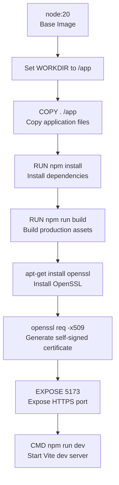
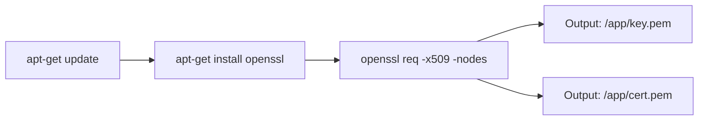
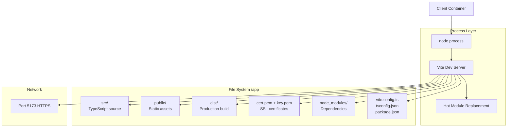
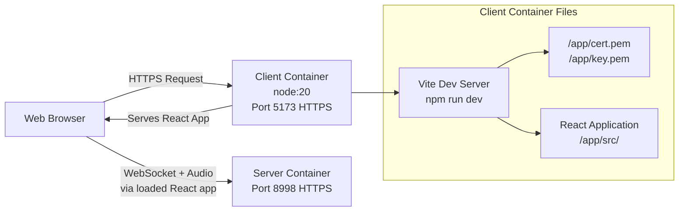

<!-- source: DeepWiki mcp.deepwiki.com · repo NVIDIA/personaplex · page 5.2 Client Container · fetched 2026-10-26 -->

# Client Container

<details>
<summary>Relevant source files</summary>

The following files were used as context for generating this wiki page:

- [client/Dockerfile](client/Dockerfile)

</details>


This document details the Docker containerization of the PersonaPlex client application, including the build process, SSL certificate generation, and runtime configuration. For information about setting up the client application locally without Docker, see [Client Setup and Configuration](#4.1). For server containerization, see [Server Container](#5.1).

---

## Purpose and Scope

The client container packages the React/TypeScript web application into a Docker image based on Node.js 20. The container handles:

- Installation of Node.js dependencies
- Production build generation via Vite
- Self-signed SSL certificate creation for HTTPS support
- Development server execution on port 5173

This containerized deployment allows the client to run independently while maintaining the HTTPS requirement for secure WebSocket connections and browser API access.

---

## Container Build Stages

The client container build follows a sequential process defined in [client/Dockerfile:1-21]().

### Build Stage Flow



**Sources:** [client/Dockerfile:1-21]()

---

## Base Image Configuration

The container uses the official Node.js 20 Docker image as its base [client/Dockerfile:1](). This provides:

| Component | Version/Details |
|-----------|-----------------|
| Base Image | `node:20` |
| Working Directory | `/app` |
| Operating System | Debian-based (from node:20) |
| Package Manager | `npm` (bundled with Node.js) |

The working directory is set to `/app` [client/Dockerfile:3](), where all application files and build artifacts reside.

**Sources:** [client/Dockerfile:1-3]()

---

## Application Build Process

### File Copy and Dependency Installation

The container copies all application files into the working directory [client/Dockerfile:5]():

```
COPY . /app
```

This includes:
- Source code (`src/` directory)
- Configuration files (`package.json`, `vite.config.ts`, `tsconfig.json`)
- Public assets (`public/` directory)
- Environment configuration (`.env.local` if present)

Dependency installation occurs via npm [client/Dockerfile:7]():

```
RUN npm install
```

### Production Build

A production build is generated using Vite [client/Dockerfile:9]():

```
RUN npm run build
```

This command executes the build script defined in `package.json`, which compiles TypeScript, bundles JavaScript modules, processes CSS with Tailwind, and optimizes assets for production. The build output is placed in the `dist/` directory.

**Sources:** [client/Dockerfile:5-9]()

---

## SSL Certificate Generation

The container generates self-signed SSL certificates required for HTTPS operation.

### Certificate Generation Process



**Sources:** [client/Dockerfile:11-17]()

### OpenSSL Installation

The container installs OpenSSL from the Debian package repository [client/Dockerfile:12]():

```
RUN apt-get update && apt-get install -y openssl
```

### Certificate Creation

A self-signed X.509 certificate is generated with the following parameters [client/Dockerfile:15-17]():

| Parameter | Value | Description |
|-----------|-------|-------------|
| `-x509` | - | Generate self-signed certificate |
| `-nodes` | - | No DES encryption for private key |
| `-days 365` | 365 | Certificate validity period |
| `-newkey rsa:2048` | RSA 2048-bit | Key algorithm and size |
| `-keyout` | `/app/key.pem` | Private key output path |
| `-out` | `/app/cert.pem` | Certificate output path |
| `-subj` | `/C=US/ST=State/L=City/O=Organization/CN=localhost` | Certificate subject |

The certificate is configured for `CN=localhost` to support local development and testing.

**Sources:** [client/Dockerfile:11-17]()

---

## Runtime Configuration

### Port Exposure

The container exposes port 5173 [client/Dockerfile:19]():

```
EXPOSE 5173
```

This port is used by the Vite development server to serve the client application over HTTPS.

### Startup Command

The container starts the Vite development server [client/Dockerfile:21]():

```
CMD ["npm", "run", "dev"]
```

This command executes the `dev` script from `package.json`, which starts Vite in development mode with hot module replacement (HMR) enabled.

**Sources:** [client/Dockerfile:19-21]()

---

## Container Runtime Environment

### Running Container Structure



**Sources:** [client/Dockerfile:1-21]()

### Environment Variables

The container runtime can be configured with environment variables for:

- `VITE_QUEUE_API`: Queue API endpoint URL
- `VITE_WORKER_ADDR`: Direct worker address (optional)

These variables are typically defined in `.env.local` or passed at container runtime. See [Environment Variables](#7.1) for details.

**Sources:** [client/Dockerfile:1-21]()

---

## Integration with Deployment Architecture

### Container Communication



**Sources:** [client/Dockerfile:1-21]()

The client container serves the web application which, once loaded in the browser, establishes WebSocket connections to the server container. The HTTPS requirement is satisfied by the self-signed certificates generated during the build process.

---

## Container Usage

### Running the Container

To build and run the client container:

```bash
# Build the image
docker build -t personaplex-client -f client/Dockerfile client/

# Run the container
docker run -p 5173:5173 personaplex-client
```

### Port Mapping

| Host Port | Container Port | Protocol | Purpose |
|-----------|----------------|----------|---------|
| 5173 | 5173 | HTTPS | Vite development server |

### Volume Mounts (Optional)

For development with live code updates, mount source directories:

```bash
docker run -p 5173:5173 \
  -v $(pwd)/client/src:/app/src \
  personaplex-client
```

**Sources:** [client/Dockerfile:1-21]()

---

## Build Optimization Considerations

The current Dockerfile creates a development-ready container. For production deployments:

1. **Multi-stage build**: Separate build and runtime stages to reduce image size
2. **Production server**: Replace `npm run dev` with `npm run preview` or a production-grade server like `serve`
3. **SSL certificates**: Use externally managed certificates instead of self-signed
4. **Build caching**: Optimize layer ordering to cache `npm install` separately from source code changes

See [Production Deployment](#5.3) for production-specific configurations.

**Sources:** [client/Dockerfile:1-21]()

---

