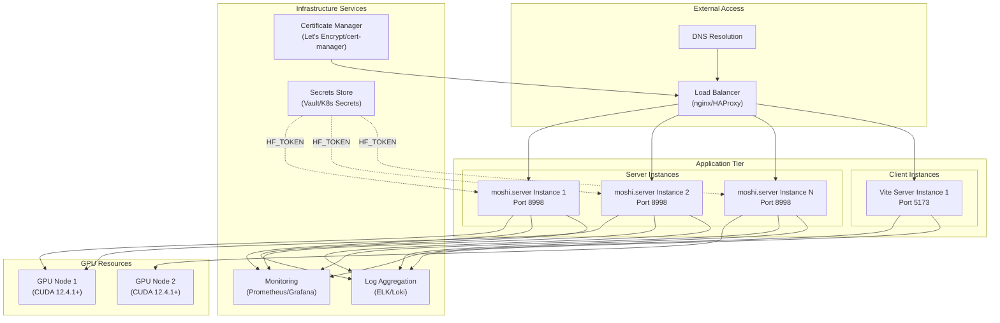
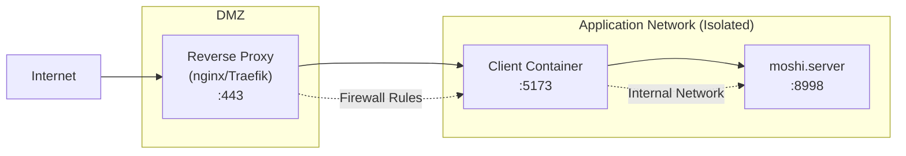
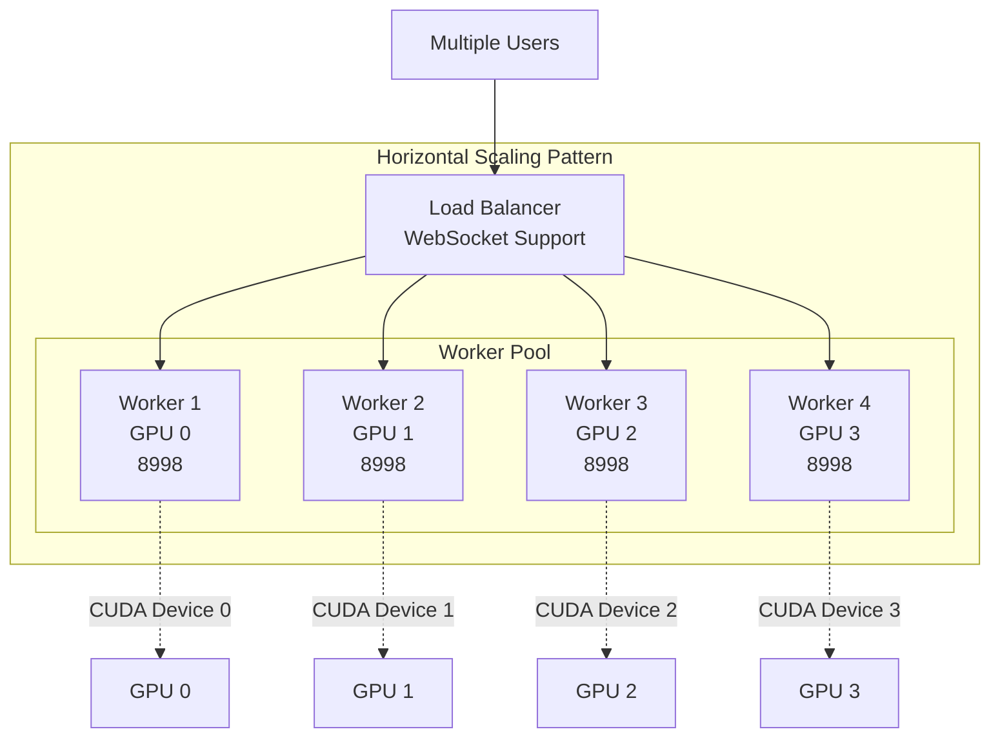
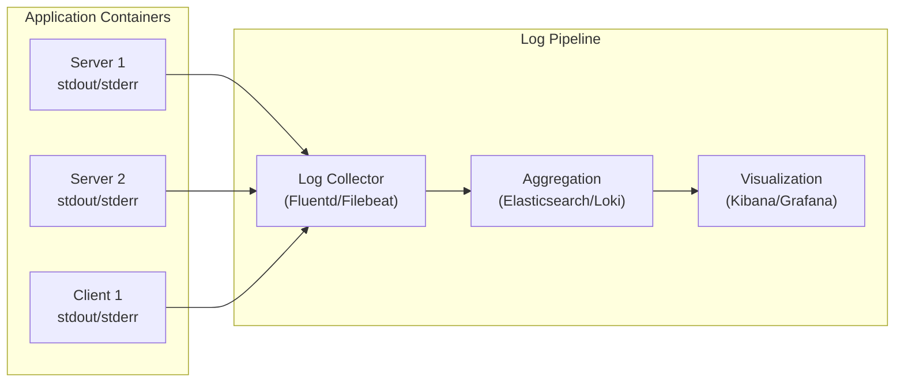
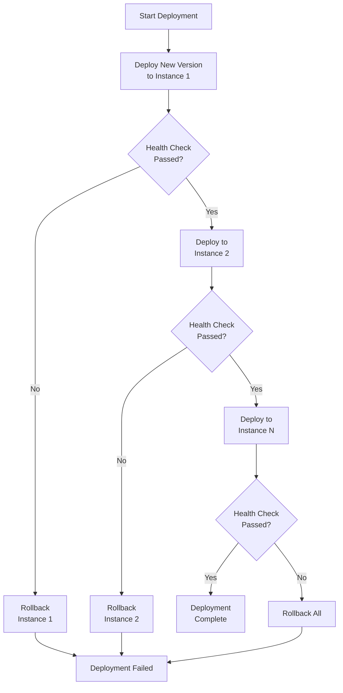
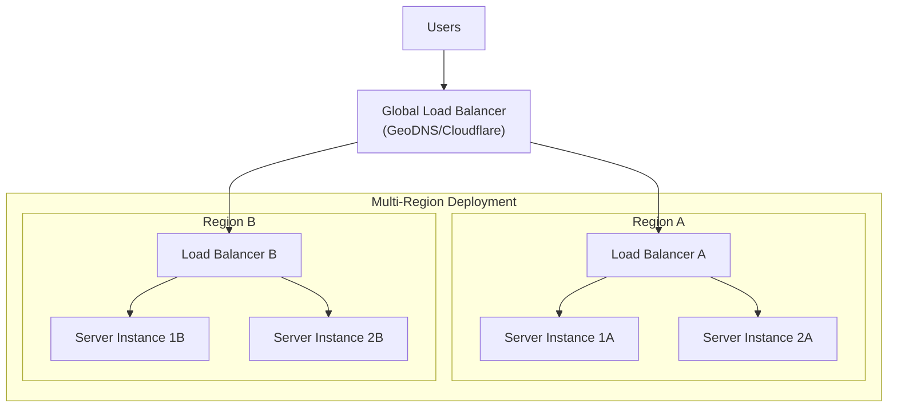

<!-- source: DeepWiki mcp.deepwiki.com · repo NVIDIA/personaplex · page 5.3 Production Deployment · fetched 2026-10-26 -->

# Production Deployment

<details>
<summary>Relevant source files</summary>

The following files were used as context for generating this wiki page:

- [Dockerfile](Dockerfile)
- [README.md](README.md)
- [client/Dockerfile](client/Dockerfile)

</details>


This document provides best practices and considerations for deploying PersonaPlex to production environments. It covers security hardening, performance optimization, resource planning, and operational considerations beyond the development setup described in [Server Container](#5.1) and [Client Container](#5.2). For initial setup and configuration, see [Quick Start](#1.1).

## Purpose and Scope

Production deployment requires careful attention to security, reliability, scalability, and maintainability. This guide addresses:

- Security hardening (SSL certificates, authentication, network isolation)
- Hardware requirements and GPU resource planning
- High availability and load balancing strategies
- Monitoring, logging, and health checks
- Performance optimization and tuning
- Environment-specific configuration management
- Operational procedures and troubleshooting

---

## Production Architecture Overview

The production deployment architecture differs from development by introducing proper SSL certificate management, external load balancing, monitoring infrastructure, and secure secrets management.



**Sources:** [Dockerfile:1-26](), [client/Dockerfile:1-22](), [README.md:49-64]()

---

## Security Hardening

### SSL Certificate Management

Development uses self-signed certificates, but production requires trusted certificates from a Certificate Authority.

**Certificate Acquisition:**

| Method | Use Case | Renewal |
|--------|----------|---------|
| Let's Encrypt | Public-facing deployments | Automated (90 days) |
| Commercial CA | Enterprise environments | Manual/Automated (1+ years) |
| Internal PKI | Private networks | Organization-specific |

**Server SSL Configuration:**

The server expects SSL certificates in a dedicated directory specified via the `--ssl` flag [Dockerfile:20-25]():

```bash
# Production certificate mount
docker run -v /etc/ssl/personaplex:/app/ssl \
  nvidia/personaplex-server \
  /app/moshi/.venv/bin/python -m moshi.server --ssl /app/ssl
```

Required certificate files in the SSL directory:
- `cert.pem` - Server certificate
- `key.pem` - Private key
- `chain.pem` (optional) - Certificate chain

**Client SSL Configuration:**

The client container generates self-signed certificates by default [client/Dockerfile:14-17](). For production, mount trusted certificates:

```bash
docker run -v /etc/ssl/personaplex-client:/app/ssl \
  -e SSL_CERT_FILE=/app/ssl/cert.pem \
  -e SSL_KEY_FILE=/app/ssl/key.pem \
  personaplex-client
```

### Authentication and Secrets Management

**HuggingFace Token Security:**

The `HF_TOKEN` environment variable provides access to model weights [README.md:42-47](). In production:

1. **Never hardcode tokens** in Dockerfiles or code
2. Use secrets management systems (HashiCorp Vault, Kubernetes Secrets, AWS Secrets Manager)
3. Rotate tokens periodically
4. Use service accounts with minimal permissions

**Secrets Injection Examples:**

```bash
# Docker Secrets (Swarm/Compose)
docker service create \
  --secret hf_token \
  --env HF_TOKEN_FILE=/run/secrets/hf_token \
  nvidia/personaplex-server

# Kubernetes Secret
kubectl create secret generic personaplex-secrets \
  --from-literal=hf-token=${HF_TOKEN}
```

### Network Security

**Port Exposure:**

- Server: `8998` [Dockerfile:22]()
- Client: `5173` [client/Dockerfile:19]()

**Production Recommendations:**



- Use a reverse proxy (nginx, Traefik, HAProxy) for SSL termination
- Restrict direct access to application ports
- Implement network policies/firewalls between tiers
- Use private networks for server-to-server communication

**Sources:** [Dockerfile:22](), [client/Dockerfile:19](), [README.md:61-64]()

---

## Hardware Requirements and Resource Planning

### GPU Requirements

PersonaPlex requires NVIDIA GPUs with CUDA support. The base container uses CUDA 12.4.1 [Dockerfile:1-2]().

**Minimum Requirements:**

| Component | Specification | Notes |
|-----------|---------------|-------|
| GPU Memory | 24GB VRAM | For full model; use `--cpu-offload` for less |
| CUDA Version | 12.4.1+ | Base runtime requirement |
| Compute Capability | 7.0+ (Volta) | Recommended: 8.0+ (Ampere/Hopper) |
| GPU Count | 1 per instance | Model does not support multi-GPU |

**CPU Offload Mode:**

For GPUs with insufficient memory [README.md:56-59]():

```bash
python -m moshi.server --ssl /app/ssl --cpu-offload
```

Requires the `accelerate` package. Performance trade-off:
- **Reduced VRAM:** Can run on GPUs with <24GB VRAM
- **Increased latency:** Layer transfers between CPU/GPU add overhead
- **Higher CPU usage:** CPU handles part of inference

### Memory and CPU Requirements

| Configuration | GPU VRAM | System RAM | CPU Cores |
|---------------|----------|------------|-----------|
| Standard (GPU-only) | 24GB | 32GB | 8+ |
| CPU Offload | 12GB | 64GB | 16+ |
| Client Only | - | 4GB | 2+ |

### Scaling Considerations

**Vertical Scaling:**
- Upgrade to higher-tier GPUs (A100, H100)
- Increase system RAM for caching
- Not effective beyond single-GPU limits

**Horizontal Scaling:**
- Deploy multiple server instances behind a load balancer
- Each instance requires its own GPU
- Client can connect to load balancer endpoint
- Session affinity (sticky sessions) not required due to stateless design



**GPU Assignment:**

```bash
# Assign specific GPU to each container
docker run --gpus device=0 -p 8998:8998 personaplex-server
docker run --gpus device=1 -p 8999:8998 personaplex-server
docker run --gpus device=2 -p 9000:8998 personaplex-server
```

**Sources:** [Dockerfile:1-2](), [README.md:56-59]()

---

## Environment Configuration

### Production Environment Variables

**Server Environment:**

| Variable | Purpose | Example | Required |
|----------|---------|---------|----------|
| `HF_TOKEN` | HuggingFace authentication | `hf_xxxxx` | Yes |
| `CUDA_VISIBLE_DEVICES` | GPU selection | `0,1,2` | No |
| `TORCH_HOME` | Model cache location | `/data/models` | No |
| `HF_HOME` | HuggingFace cache | `/data/hf_cache` | No |

**Client Environment:**

The client uses `.env.local` for configuration. For production, use environment-specific variables:

| Variable | Purpose | Default | Production Override |
|----------|---------|---------|---------------------|
| `VITE_QUEUE_API_URL` | Queue API endpoint | - | `https://api.prod.example.com` |
| `VITE_WORKER_URL` | Direct worker URL | - | `https://worker.prod.example.com` |

**Configuration Management:**

```bash
# Production server launch with env overrides
docker run \
  -e HF_TOKEN=${HF_TOKEN} \
  -e CUDA_VISIBLE_DEVICES=0 \
  -e TORCH_HOME=/data/torch_cache \
  -e HF_HOME=/data/hf_cache \
  -v /production/models:/data \
  nvidia/personaplex-server
```

### Model Cache Management

Model weights are downloaded from HuggingFace on first run. For production:

1. **Pre-populate cache** during build or initialization
2. **Use persistent volumes** to avoid re-downloading
3. **Share cache volumes** across instances to save space

```bash
# Pre-download models in init container
docker run --rm \
  -e HF_TOKEN=${HF_TOKEN} \
  -v model-cache:/root/.cache/huggingface \
  nvidia/personaplex-server \
  python -c "from transformers import AutoModel; AutoModel.from_pretrained('nvidia/personaplex-7b-v1')"

# Mount shared cache in production containers
docker run -v model-cache:/root/.cache/huggingface nvidia/personaplex-server
```

**Sources:** [README.md:42-47](), [Dockerfile:14-18]()

---

## Monitoring and Health Checks

### Application Metrics

**Key Metrics to Monitor:**

| Metric | Target | Alert Threshold |
|--------|--------|-----------------|
| GPU Utilization | 60-90% | >95% sustained |
| GPU Memory | <90% | >95% |
| Inference Latency | <200ms | >500ms |
| WebSocket Connections | - | Sudden drops |
| HTTP Response Time | <100ms | >1000ms |
| Error Rate | <0.1% | >1% |

### Health Check Implementation

**Server Health Check:**

```bash
# HTTP endpoint check (if implemented)
curl -k https://localhost:8998/health

# Alternative: WebSocket connection test
timeout 5 python -c "
import ssl
import websocket
ws = websocket.create_connection(
    'wss://localhost:8998',
    sslopt={'cert_reqs': ssl.CERT_NONE}
)
ws.close()
" && echo "healthy" || echo "unhealthy"
```

**Docker Health Check Configuration:**

```dockerfile
HEALTHCHECK --interval=30s --timeout=10s --start-period=60s --retries=3 \
  CMD python -m moshi.server --health-check || exit 1
```

### Logging Strategy

**Log Aggregation:**



**Log Levels for Production:**

- Application logs: `INFO` level
- Error tracking: Capture `ERROR` and `CRITICAL` to alerting system
- Structured logging: Use JSON format for parsing

**Sources:** [Dockerfile:1-26](), [client/Dockerfile:1-22]()

---

## Performance Optimization

### Inference Optimization

**Model Configuration:**

The server runs with default optimization settings. For production tuning:

```bash
# Adjust batch size for throughput vs latency
python -m moshi.server --ssl /app/ssl --batch-size 1

# Enable TorchScript/ONNX compilation (if supported)
python -m moshi.server --ssl /app/ssl --compile
```

### Network Optimization

**WebSocket Configuration:**

- Enable WebSocket compression for bandwidth reduction
- Configure appropriate timeout values
- Use HTTP/2 if reverse proxy supports it

**Reverse Proxy Example (nginx):**

```nginx
upstream personaplex_backend {
    least_conn;
    server 10.0.1.10:8998 max_fails=3 fail_timeout=30s;
    server 10.0.1.11:8998 max_fails=3 fail_timeout=30s;
}

server {
    listen 443 ssl http2;
    server_name personaplex.example.com;
    
    ssl_certificate /etc/ssl/cert.pem;
    ssl_certificate_key /etc/ssl/key.pem;
    
    # WebSocket support
    location / {
        proxy_pass https://personaplex_backend;
        proxy_http_version 1.1;
        proxy_set_header Upgrade $http_upgrade;
        proxy_set_header Connection "upgrade";
        proxy_set_header Host $host;
        proxy_read_timeout 3600s;
        proxy_send_timeout 3600s;
    }
}
```

### Resource Limits

**Docker Resource Constraints:**

```bash
docker run \
  --gpus device=0 \
  --memory=32g \
  --memory-swap=32g \
  --cpus=8 \
  --shm-size=8g \
  nvidia/personaplex-server
```

**Kubernetes Resource Requests/Limits:**

```yaml
resources:
  requests:
    memory: "32Gi"
    cpu: "8"
    nvidia.com/gpu: "1"
  limits:
    memory: "64Gi"
    cpu: "16"
    nvidia.com/gpu: "1"
```

**Sources:** [Dockerfile:1-26](), [README.md:49-64]()

---

## Deployment Checklist

### Pre-Deployment

**Security:**
- [ ] Production SSL certificates obtained and installed
- [ ] HuggingFace token stored in secrets manager
- [ ] Network policies/firewalls configured
- [ ] Reverse proxy configured with security headers
- [ ] Rate limiting implemented

**Infrastructure:**
- [ ] GPU resources allocated and tested
- [ ] Persistent volumes configured for model cache
- [ ] Monitoring and alerting configured
- [ ] Log aggregation pipeline established
- [ ] Backup and disaster recovery plan documented

**Configuration:**
- [ ] Environment variables validated
- [ ] Model weights pre-downloaded and cached
- [ ] Health checks configured and tested
- [ ] Resource limits tuned for workload

### Deployment Procedure

**Rolling Update Strategy:**



**Deployment Steps:**

1. **Validate Configuration:**
   ```bash
   # Test configuration with dry-run
   docker run --rm -e HF_TOKEN=${HF_TOKEN} nvidia/personaplex-server \
     /app/moshi/.venv/bin/python -m moshi.server --dry-run
   ```

2. **Update Single Instance:**
   ```bash
   # Stop old container
   docker stop personaplex-server-1
   
   # Start new container
   docker run -d --name personaplex-server-1 \
     --gpus device=0 \
     -v /etc/ssl/personaplex:/app/ssl \
     -v model-cache:/root/.cache/huggingface \
     -e HF_TOKEN=${HF_TOKEN} \
     nvidia/personaplex-server:v1.1.0
   ```

3. **Verify Health:**
   ```bash
   # Wait for startup
   sleep 30
   
   # Verify health
   curl -k https://localhost:8998/health
   
   # Check logs
   docker logs personaplex-server-1 --tail 100
   ```

4. **Monitor Metrics:**
   - Watch GPU utilization
   - Check inference latency
   - Monitor error rates
   - Verify WebSocket connections

5. **Repeat for Remaining Instances**

### Post-Deployment

**Validation:**
- [ ] All instances healthy and serving traffic
- [ ] Metrics within expected ranges
- [ ] No error spikes in logs
- [ ] SSL certificates valid and trusted
- [ ] End-to-end user testing completed

**Monitoring:**
- [ ] Set up continuous metric monitoring
- [ ] Configure alerting thresholds
- [ ] Document on-call procedures
- [ ] Schedule regular health checks

**Sources:** [Dockerfile:1-26](), [client/Dockerfile:1-22](), [README.md:49-64]()

---

## Troubleshooting Guide

### Common Production Issues

**GPU Memory Exhaustion:**

```bash
# Symptom: CUDA out of memory errors
# Solution 1: Enable CPU offload
python -m moshi.server --ssl /app/ssl --cpu-offload

# Solution 2: Reduce concurrent connections
# Configure load balancer to limit connections per instance

# Solution 3: Monitor and restart
docker restart personaplex-server-1
```

**SSL Certificate Issues:**

```bash
# Verify certificate validity
openssl x509 -in /app/ssl/cert.pem -text -noout

# Check certificate expiration
openssl x509 -in /app/ssl/cert.pem -enddate -noout

# Validate certificate chain
openssl verify -CAfile /app/ssl/chain.pem /app/ssl/cert.pem
```

**Model Download Failures:**

```bash
# Check HuggingFace token validity
curl -H "Authorization: Bearer ${HF_TOKEN}" \
  https://huggingface.co/api/whoami

# Manually download model
docker run -it --rm \
  -e HF_TOKEN=${HF_TOKEN} \
  -v model-cache:/root/.cache/huggingface \
  nvidia/personaplex-server \
  python -c "from huggingface_hub import snapshot_download; \
             snapshot_download('nvidia/personaplex-7b-v1')"
```

**WebSocket Connection Drops:**

- Check reverse proxy timeout settings
- Verify network stability between client and server
- Review firewall rules for WebSocket traffic
- Monitor system resource usage (CPU, memory, GPU)

**Sources:** [README.md:42-47,56-59](), [Dockerfile:1-26]()

---

## High Availability Considerations

### Redundancy Strategy



**Failure Scenarios:**

| Scenario | Impact | Mitigation |
|----------|--------|------------|
| Single instance failure | Reduced capacity | Automatic failover to healthy instances |
| GPU failure | Instance unavailable | Replace instance, reroute traffic |
| Regional outage | Partial unavailability | Route to alternate region via GeoDNS |
| Model cache corruption | Increased latency | Persistent volume backups, re-download |

### Graceful Shutdown

```bash
# Signal container for graceful shutdown
docker stop --time=60 personaplex-server-1

# Allow in-flight requests to complete
# Kubernetes: configure terminationGracePeriodSeconds: 60
```

**Sources:** [Dockerfile:1-26](), [README.md:49-64]()

---

## Summary

Production deployment of PersonaPlex requires attention to:

1. **Security:** Trusted SSL certificates, secrets management, network isolation
2. **Resources:** GPU allocation (24GB VRAM), model cache management, horizontal scaling
3. **Monitoring:** Health checks, metrics collection, log aggregation
4. **Performance:** Reverse proxy configuration, resource limits, inference optimization
5. **Reliability:** Rolling updates, redundancy, graceful degradation

For development and testing deployment, see [Server Container](#5.1) and [Client Container](#5.2). For initial setup, refer to [Quick Start](#1.1).

---

