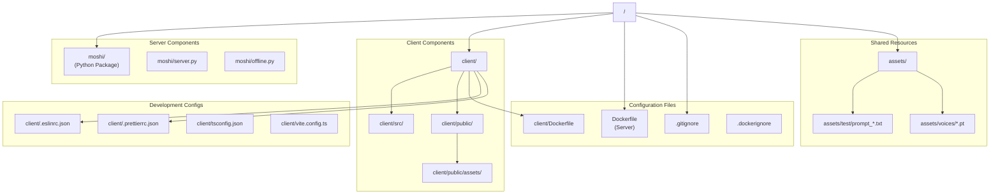
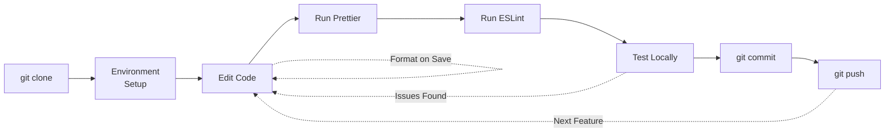
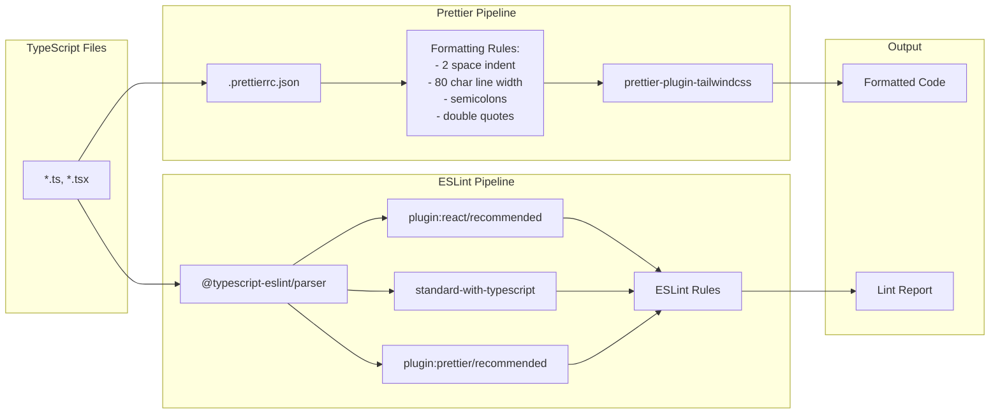

<!-- source: DeepWiki mcp.deepwiki.com · repo NVIDIA/personaplex · page 6 Development Workflow · fetched 2026-10-26 -->

# Development Workflow

<details>
<summary>Relevant source files</summary>

The following files were used as context for generating this wiki page:

- [.gitignore](.gitignore)
- [client/.eslinrc.json](client/.eslinrc.json)
- [client/.prettierrc.json](client/.prettierrc.json)

</details>


This document provides a guide for developers contributing to PersonaPlex. It covers the typical development process, including environment setup, code organization, quality assurance tools, and version control practices. For detailed information on specific topics, see [Code Quality and Formatting](#6.1), [Testing and Issue Reporting](#6.2), and [Version Control and Git Workflow](#6.3).

## Purpose and Scope

The development workflow encompasses the processes and tools used to maintain code quality and consistency across both the Python server components and TypeScript client application. This includes local development setup, code formatting standards, linting configurations, and the typical edit-test-commit cycle.

## Repository Structure

The PersonaPlex repository is organized into distinct server and client components, each with their own development environments and tooling.

**Repository Organization**



**Sources:** [.gitignore:1-186](), [client/.eslinrc.json:1-24](), [client/.prettierrc.json:1-11]()

## Development Environment Overview

PersonaPlex uses different toolchains for server and client development:

| Component | Language | Package Manager | Build Tool | Key Dependencies |
|-----------|----------|-----------------|------------|------------------|
| Server | Python 3.12 | uv | N/A | PyTorch, moshi package |
| Client | TypeScript | npm | Vite | React, AudioWorklet APIs |

Both components can be developed locally or within Docker containers. For detailed setup instructions, see [Quick Start](#1.1) for server setup and [Client Setup and Configuration](#4.1) for client setup.

## Standard Development Workflow

The typical development cycle follows this pattern:

**Development Cycle**



**Sources:** [client/.eslinrc.json:1-24](), [client/.prettierrc.json:1-11]()

### Client Development Workflow

For client-side development, the typical commands are:

```bash
cd client
npm install                 # Install dependencies
npm run dev                 # Start development server
npm run lint               # Run ESLint checks
npm run format             # Run Prettier formatting
npm run build              # Build production bundle
```

The development server runs on `https://localhost:5173` with hot module replacement enabled. Changes to TypeScript files trigger automatic recompilation.

**Sources:** [client/.eslinrc.json:1-24](), [client/.prettierrc.json:1-11]()

### Server Development Workflow

For server-side development:

```bash
# Install dependencies
uv venv
source .venv/bin/activate
uv pip install -e .

# Run server locally
python -m moshi.server

# Run offline evaluation
python -m moshi.offline
```

The server runs on `https://localhost:8998` by default.

## Code Quality Tools

PersonaPlex uses automated tools to maintain code quality and consistency, particularly for the TypeScript client application.

**Code Quality Pipeline**



**Sources:** [client/.eslinrc.json:1-24](), [client/.prettierrc.json:1-11]()

### ESLint Configuration

The client uses ESLint with TypeScript support. Configuration is located at [client/.eslinrc.json:1-24]().

**Key ESLint Settings:**

| Setting | Value | Purpose |
|---------|-------|---------|
| `parser` | `@typescript-eslint/parser` | Parse TypeScript syntax |
| `parserOptions.ecmaVersion` | `latest` | Use latest ECMAScript features |
| `parserOptions.sourceType` | `module` | Use ES modules |
| `env.browser` | `true` | Enable browser global variables |

**Extends Configurations:**
- `plugin:react/recommended` - React-specific linting rules
- `standard-with-typescript` - TypeScript standard style guide
- `plugin:import/typescript` - Import/export validation
- `plugin:prettier/recommended` - Integrate Prettier formatting

**Custom Rules:**
- `@typescript-eslint/triple-slash-reference: off` - Allows triple-slash references needed for TypeScript declarations

**Sources:** [client/.eslinrc.json:1-24]()

### Prettier Configuration

Prettier handles automatic code formatting. Configuration is at [client/.prettierrc.json:1-11]().

**Formatting Rules:**

| Rule | Value | Effect |
|------|-------|--------|
| `singleQuote` | `false` | Use double quotes for strings |
| `semi` | `true` | Always add semicolons |
| `tabWidth` | `2` | Use 2 spaces for indentation |
| `useTabs` | `false` | Use spaces, not tabs |
| `printWidth` | `80` | Wrap lines at 80 characters |
| `trailingComma` | `all` | Add trailing commas everywhere possible |
| `arrowParens` | `avoid` | Omit parens for single-arg arrow functions |

**Plugins:**
- `prettier-plugin-tailwindcss` - Automatically sorts Tailwind CSS class names

**Sources:** [client/.prettierrc.json:1-11]()

## Version Control Practices

The repository uses Git for version control with specific ignore patterns to exclude build artifacts, dependencies, and sensitive files.

### Ignored Files and Directories

The [.gitignore:1-186]() file excludes several categories of files:

**Python Artifacts:**
- `__pycache__/` - Bytecode cache directories [.gitignore:2]()
- `*.pyc`, `*.pyo`, `*.pyd` - Compiled Python files [.gitignore:3]()
- `.venv/`, `venv/` - Virtual environments [.gitignore:125-130]()
- `*.egg-info/` - Package metadata [.gitignore:24]()

**Build Artifacts:**
- `dist/`, `build/` - Build output directories [.gitignore:13-14]()
- `.cache` - Cache directories [.gitignore:45]()
- `client/node_modules` - Client dependencies [.gitignore:179]()

**Media Files:**
- `*.wav`, `*.flac`, `*.mp3`, `*.ogg` - Audio files [.gitignore:166-175]()
- `*.safetensors` - Model weight files [.gitignore:165]()

**Security Sensitive:**
- `*.pem` - SSL certificates [.gitignore:172]()

**Important Exception:**
The `assets/` directory is explicitly included despite other ignore patterns [.gitignore:184-185](). This ensures that test prompts, voice embeddings, and test audio files are version controlled.

**Sources:** [.gitignore:1-186]()

## Testing and Development Resources

The repository includes test assets for development and validation:

**Test Resources:**
- `assets/test/*.txt` - Sample role prompt templates
- `assets/voices/*.pt` - Voice embedding files for testing voice conditioning
- Test audio files in various formats (when not ignored by patterns)

For detailed information on running tests and using test assets, see [Testing and Issue Reporting](#6.2).

## Integration with Build Systems

The development workflow integrates with the build systems for both components:

**Build Integration Points:**

```mermaid
graph TB
    subgraph "Client Build Chain"
        TSSource["TypeScript Source<br/>client/src/**/*.ts"]
        Vite["vite.config.ts"]
        TSCompiler["TypeScript Compiler<br/>tsconfig.json"]
        TailwindCSS["Tailwind CSS<br/>postcss.config.js"]
        ESLintCheck["ESLint Validation<br/>.eslinrc.json"]
        PrettierFormat["Prettier Formatting<br/>.prettierrc.json"]
        ClientDist["client/dist/"]
    end
    
    subgraph "Server Build Chain"
        PythonSource["Python Source<br/>moshi/*.py"]
        UVInstall["uv pip install"]
        ServerRuntime["moshi.server"]
    end
    
    TSSource --> PrettierFormat
    PrettierFormat --> ESLintCheck
    ESLintCheck --> TSCompiler
    TSCompiler --> TailwindCSS
    TailwindCSS --> Vite
    Vite --> ClientDist
    
    PythonSource --> UVInstall
    UVInstall --> ServerRuntime
```



**Sources:** [client/.eslinrc.json:1-24](), [client/.prettierrc.json:1-11]()

### Development vs Production Builds

| Aspect | Development | Production |
|--------|-------------|------------|
| Client Build | `npm run dev` - HMR enabled | `npm run build` - Minified bundle |
| Server | Direct Python execution | Docker container with CUDA |
| SSL Certificates | Self-signed for localhost | Trusted certificates required |
| Source Maps | Enabled | Optional |
| Type Checking | On-demand | Strict checking enforced |

For production deployment considerations, see [Production Deployment](#5.3).

## Common Development Tasks

### Adding New Client Features

1. Create or modify TypeScript files in `client/src/`
2. Run `npm run format` to apply Prettier formatting
3. Run `npm run lint` to check for ESLint violations
4. Test in development server (`npm run dev`)
5. Build production bundle (`npm run build`) to verify
6. Commit changes following version control practices

### Modifying Server Logic

1. Edit Python files in `moshi/` directory
2. Test locally with `python -m moshi.server`
3. Validate with test audio using `moshi.offline` if applicable
4. Ensure changes work in Docker environment
5. Commit changes following version control practices

### Updating Dependencies

**Client Dependencies:**
```bash
cd client
npm install <package>@<version>  # Add or update package
npm update                        # Update all dependencies
```

**Server Dependencies:**
```bash
uv pip install <package>         # Add new dependency
uv pip install -e .              # Reinstall local package
```

## Related Documentation

For more detailed information on specific aspects of the development workflow:

- **Code formatting and linting details:** See [Code Quality and Formatting](#6.1)
- **Testing procedures and bug reporting:** See [Testing and Issue Reporting](#6.2)  
- **Git workflow and version control practices:** See [Version Control and Git Workflow](#6.3)
- **Client build system configuration:** See [Client Build Pipeline](#4.4)
- **Docker-based development:** See [Deployment and Containerization](#5)

**Sources:** [.gitignore:1-186](), [client/.eslinrc.json:1-24](), [client/.prettierrc.json:1-11]()

---

