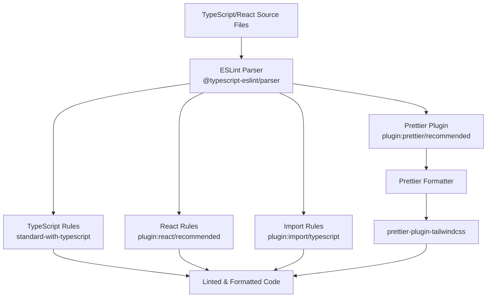
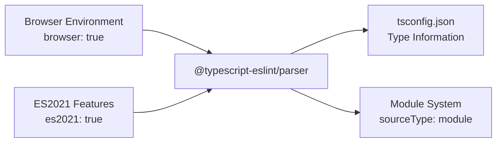
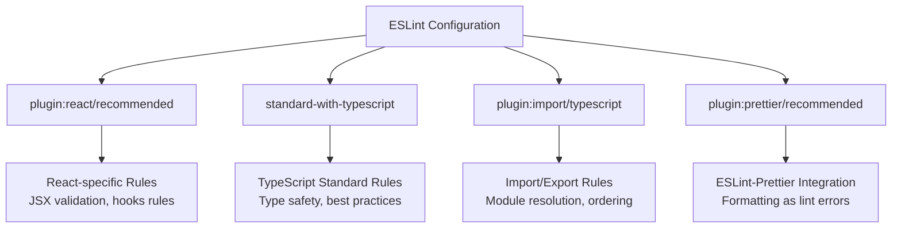
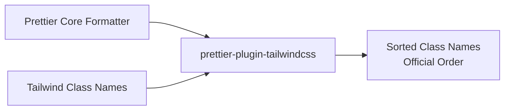
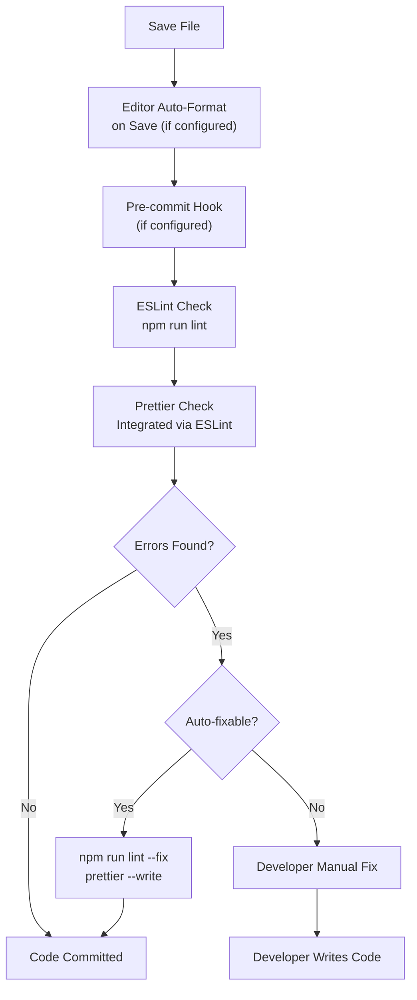
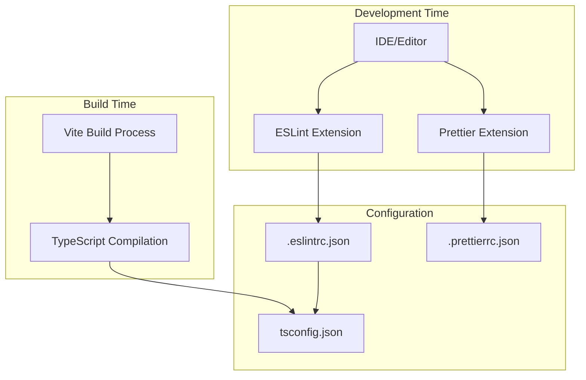

<!-- source: DeepWiki mcp.deepwiki.com · repo NVIDIA/personaplex · page 6.1 Code Quality and Formatting · fetched 2026-10-26 -->

# Code Quality and Formatting

<details>
<summary>Relevant source files</summary>

The following files were used as context for generating this wiki page:

- [client/.eslinrc.json](client/.eslinrc.json)
- [client/.prettierignore](client/.prettierignore)
- [client/.prettierrc.json](client/.prettierrc.json)

</details>


This document describes the code quality tools and formatting standards used in the PersonaPlex client application. The client codebase uses ESLint for static code analysis and Prettier for automatic code formatting, configured to work together seamlessly.

For information about testing and issue reporting, see [Testing and Issue Reporting](#6.2). For version control practices, see [Version Control and Git Workflow](#6.3). For client build pipeline details, see [Client Build Pipeline](#4.4).

## Overview

The PersonaPlex client application enforces code quality and consistent formatting through two complementary tools:

- **ESLint**: Static analysis tool that identifies problematic patterns and enforces coding standards
- **Prettier**: Opinionated code formatter that automatically formats code to a consistent style

These tools are configured in [client/.eslintrc.json:1-24]() and [client/.prettierrc.json:1-11]() respectively, with integration between them handled through the `plugin:prettier/recommended` ESLint plugin.

**Sources:** client/.eslintrc.json, client/.prettierrc.json

## Tool Integration Architecture



**Diagram**: Tool integration showing how ESLint and Prettier work together to analyze and format code, with Prettier integrated as an ESLint plugin and extended with Tailwind CSS class sorting.

**Sources:** client/.eslintrc.json, client/.prettierrc.json

## ESLint Configuration

The ESLint configuration is defined in [client/.eslintrc.json:1-24]() and provides comprehensive TypeScript and React linting.

### Environment and Parser



**Diagram**: ESLint parser configuration showing how the TypeScript parser is configured with environment settings and project references.

**Sources:** client/.eslintrc.json

### Configuration Details

| Configuration Key | Value | Purpose |
|------------------|-------|---------|
| `env.browser` | `true` | Enables browser global variables (window, document, etc.) |
| `env.es2021` | `true` | Enables ES2021 syntax and globals |
| `parser` | `@typescript-eslint/parser` | Uses TypeScript-aware parser for type checking |
| `parserOptions.ecmaVersion` | `latest` | Supports latest ECMAScript features |
| `parserOptions.sourceType` | `module` | Uses ES module syntax |
| `parserOptions.project` | `./tsconfig.json` | Links to TypeScript configuration for type information |

**Sources:** client/.eslintrc.json:2-18

### Extended Rule Sets

The ESLint configuration extends four primary rule sets, as defined in [client/.eslintrc.json:6-11]():



**Diagram**: ESLint rule set inheritance showing the four extended configurations that combine to provide comprehensive linting.

**Sources:** client/.eslintrc.json:6-11

| Extended Configuration | Purpose |
|----------------------|---------|
| `plugin:react/recommended` | React-specific rules for JSX syntax, component patterns, and hooks usage |
| `standard-with-typescript` | TypeScript-flavored JavaScript Standard Style guide |
| `plugin:import/typescript` | Import/export statement validation with TypeScript support |
| `plugin:prettier/recommended` | Integrates Prettier formatting rules into ESLint |

**Sources:** client/.eslintrc.json:6-11

### Plugins and Custom Rules

The configuration uses two plugins as specified in [client/.eslintrc.json:19]():

- `react`: Provides React-specific linting rules
- `prettier`: Runs Prettier as an ESLint rule

One custom rule override is defined in [client/.eslintrc.json:20-22]():

| Rule | Setting | Reason |
|------|---------|--------|
| `@typescript-eslint/triple-slash-reference` | `off` | Allows triple-slash references (e.g., `/// <reference types="vite/client" />`) which are required for Vite type definitions |

**Sources:** client/.eslintrc.json:19-22

## Prettier Configuration

Prettier is configured in [client/.prettierrc.json:1-11]() with specific formatting rules and Tailwind CSS plugin integration.

### Formatting Rules

| Rule | Value | Effect |
|------|-------|--------|
| `arrowParens` | `avoid` | Omits parentheses around single arrow function parameters: `x => x` |
| `singleQuote` | `false` | Uses double quotes for strings: `"hello"` |
| `trailingComma` | `all` | Adds trailing commas wherever valid in ES5+: `{ a: 1, b: 2, }` |
| `tabWidth` | `2` | Uses 2 spaces per indentation level |
| `useTabs` | `false` | Uses spaces instead of tabs |
| `semi` | `true` | Adds semicolons at the end of statements |
| `printWidth` | `80` | Wraps lines at 80 characters |

**Sources:** client/.prettierrc.json:2-8

### Formatting Examples

Based on the configuration:

```typescript
// Arrow function parameters - arrowParens: "avoid"
const single = x => x * 2;
const multiple = (x, y) => x + y;

// Quotes - singleQuote: false
const message = "Hello world";

// Trailing commas - trailingComma: "all"
const config = {
  host: "localhost",
  port: 8998,
};

// Semicolons - semi: true
const value = 42;
console.log(value);

// Print width - printWidth: 80
const longObject = { veryLongPropertyName: "value", another: "value" };
```

**Sources:** client/.prettierrc.json:2-8

### Tailwind CSS Integration

Prettier includes the Tailwind CSS plugin as specified in [client/.prettierrc.json:9]():



**Diagram**: Tailwind CSS plugin integration showing how class names are automatically sorted according to Tailwind's recommended order.

**Sources:** client/.prettierrc.json:9

The `prettier-plugin-tailwindcss` plugin automatically sorts Tailwind CSS class names according to the official recommended order. For example:

```typescript
// Before formatting
<div className="pt-4 text-center bg-blue-500 hover:bg-blue-700">

// After formatting with plugin
<div className="bg-blue-500 pt-4 text-center hover:bg-blue-700">
```

**Sources:** client/.prettierrc.json:9

## File Exclusions

Prettier is configured to ignore certain files and directories via [client/.prettierignore:1]():

| Pattern | Description |
|---------|-------------|
| `dist/*` | Production build output directory is excluded from formatting |

This exclusion prevents Prettier from attempting to format bundled/minified code in the build output directory, which would be unnecessary and potentially problematic.

**Sources:** client/.prettierignore

## Code Quality Workflow



**Diagram**: Complete code quality workflow showing how developers interact with ESLint and Prettier during development, from file save through commit.

**Sources:** client/.eslintrc.json, client/.prettierrc.json

## Usage Commands

While not explicitly defined in the provided configuration files, typical commands for these tools in an npm-based project would be:

| Command | Purpose |
|---------|---------|
| `npm run lint` | Run ESLint to check for code quality issues |
| `npm run lint:fix` | Run ESLint with auto-fix enabled |
| `npm run format` | Run Prettier to format all files |
| `npm run format:check` | Check if files are formatted without making changes |

These commands would typically be defined in the `package.json` scripts section (see [Package Dependencies](#7.2) for full package details).

**Sources:** client/.eslintrc.json, client/.prettierrc.json

## Integration with Development Workflow

The code quality tools integrate with the development workflow in several ways:



**Diagram**: Integration points showing how code quality tools connect with development environment and build process.

**Sources:** client/.eslintrc.json, client/.prettierrc.json

### TypeScript Integration

ESLint's TypeScript integration is configured through the `parserOptions.project` setting in [client/.eslintrc.json:17](), which references `./tsconfig.json`. This enables:

- Type-aware linting rules
- Import path validation
- Type checking during lint process
- Consistent type definitions across linting and compilation

**Sources:** client/.eslintrc.json:14-18

### Build Process Integration

The code quality tools complement the Vite build process (see [Client Build Pipeline](#4.4)):

1. **Development**: ESLint and Prettier provide real-time feedback during development
2. **Type Checking**: ESLint uses TypeScript parser for type-aware rules
3. **Production Build**: Code is linted and formatted before bundling
4. **Quality Gates**: Linting errors can prevent builds if configured in CI/CD

**Sources:** client/.eslintrc.json, client/.prettierrc.json

## Summary

The PersonaPlex client enforces code quality through:

1. **ESLint** configured with TypeScript, React, and Standard Style rules
2. **Prettier** configured with consistent formatting preferences and Tailwind CSS class sorting
3. **Seamless integration** between ESLint and Prettier via `plugin:prettier/recommended`
4. **Targeted exclusions** preventing formatting of build artifacts
5. **Type-aware linting** through TypeScript parser integration

This configuration ensures consistent code style and catches common issues during development, improving code quality and maintainability across the codebase.

**Sources:** client/.eslintrc.json, client/.prettierrc.json, client/.prettierignore

---

