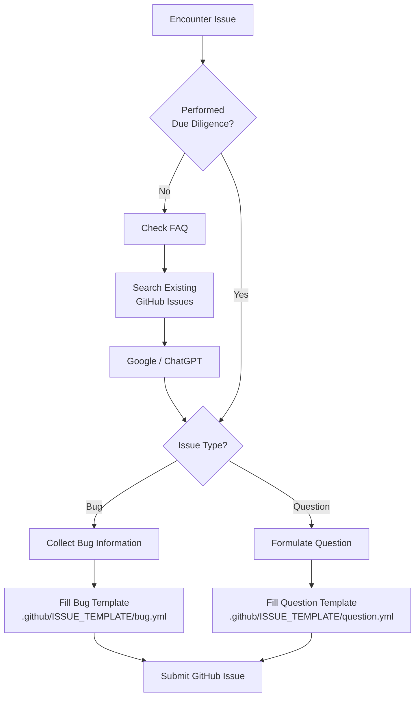
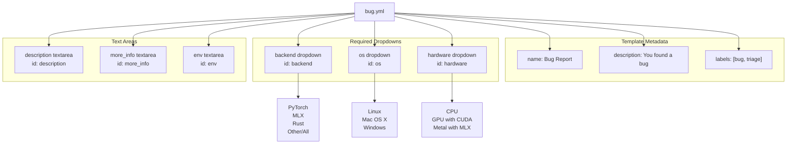
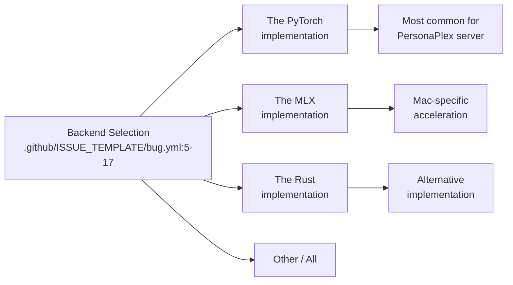
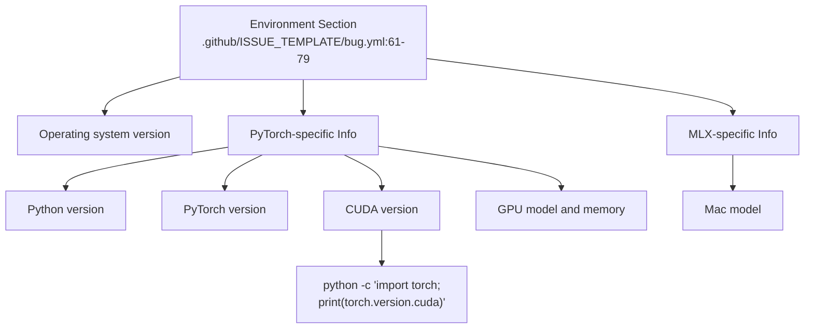
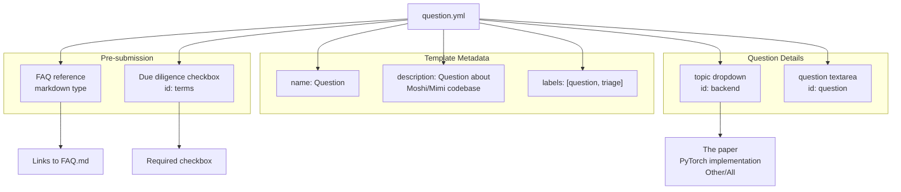
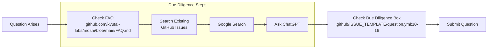

<!-- source: DeepWiki mcp.deepwiki.com · repo NVIDIA/personaplex · page 6.2 Testing and Issue Reporting · fetched 2026-10-26 -->

# Testing and Issue Reporting

<details>
<summary>Relevant source files</summary>

The following files were used as context for generating this wiki page:

- [.github/ISSUE_TEMPLATE/bug.yml](.github/ISSUE_TEMPLATE/bug.yml)
- [.github/ISSUE_TEMPLATE/question.yml](.github/ISSUE_TEMPLATE/question.yml)
- [assets/test/input_assistant.wav](assets/test/input_assistant.wav)
- [assets/test/input_service.wav](assets/test/input_service.wav)

</details>


This document covers testing resources, bug reporting procedures, and question submission guidelines for PersonaPlex. It explains how to use available test assets, what information to collect when encountering issues, and how to properly submit bug reports or questions through GitHub issue templates.

For information about code quality standards and linting, see [Code Quality and Formatting](#6.1). For version control practices, see [Version Control and Git Workflow](#6.3).

---

## Overview

PersonaPlex provides structured GitHub issue templates for bug reports and questions. The system includes test audio assets for validating audio processing pipelines and voice conditioning capabilities. Issue templates are designed to collect comprehensive environment and reproduction information to facilitate debugging.

**Sources:** [.github/ISSUE_TEMPLATE/bug.yml](), [.github/ISSUE_TEMPLATE/question.yml]()

---

## Test Assets

The repository includes test audio resources located in the client's static assets directory. These resources are used for validating audio processing pipelines and voice conditioning functionality.

### Available Test Resources

| Resource Type | Location | Purpose |
|--------------|----------|---------|
| Test Audio Files | `client/public/assets/` | Audio samples for testing (.wav format) |
| Voice Embeddings | Server assets | NAT/VAR voice preset files (.pt format) |
| Role Prompts | `assets/test/` | Example text prompts for persona control |

### Using Test Assets

Test audio files can be used with the offline evaluation mode to validate audio processing without requiring real-time interaction. Voice embeddings and role prompts serve as reference implementations for persona and voice control.

**Sources:** Architecture diagrams (Diagram 6), [client/README.md]()

---

## Issue Reporting Workflow



**Sources:** [.github/ISSUE_TEMPLATE/bug.yml](), [.github/ISSUE_TEMPLATE/question.yml]()

---

## Bug Report Template Structure

The bug report template located at [.github/ISSUE_TEMPLATE/bug.yml]() is a structured YAML form that automatically creates labeled issues in GitHub.



### Bug Template Fields

| Field ID | Type | Required | Purpose |
|----------|------|----------|---------|
| `backend` | dropdown | Yes | Identifies affected implementation (PyTorch/MLX/Rust) |
| `os` | dropdown | Yes | Operating system (Linux/macOS/Windows) |
| `hardware` | dropdown | Yes | Hardware configuration (CPU/GPU/Metal) |
| `description` | textarea | Yes | Detailed bug description |
| `more_info` | textarea | Yes | Additional context, logs, code snippets |
| `env` | textarea | Yes | Environment details (versions, system info) |

**Sources:** [.github/ISSUE_TEMPLATE/bug.yml:1-80]()

---

## Backend Selection

The bug template supports three backend implementations:



**Default Selection:** PyTorch implementation (index 0)

**Sources:** [.github/ISSUE_TEMPLATE/bug.yml:5-17]()

---

## Operating System and Hardware Configuration

### Operating System Options

The template collects OS information through a dropdown menu:

| Option | Support Status | Notes |
|--------|---------------|-------|
| Linux | Supported | Primary development platform |
| Mac OS X | Supported | Compatible with MLX backend |
| Windows | Unsupported | Listed but not officially supported |

**Sources:** [.github/ISSUE_TEMPLATE/bug.yml:18-29]()

### Hardware Configuration Options

| Hardware Type | Use Case | Backend Compatibility |
|--------------|----------|----------------------|
| CPU | CPU-only inference | PyTorch (with offload) |
| GPU with CUDA | NVIDIA GPU acceleration | PyTorch |
| Metal with MLX | Apple Silicon acceleration | MLX |

**Sources:** [.github/ISSUE_TEMPLATE/bug.yml:30-41]()

---

## Environment Information Collection

The bug template includes a pre-formatted environment section that guides users to provide system-specific details.

### Required Environment Details



### PyTorch Environment Template

For PyTorch-related bugs, the template requests:

1. **Python version** - Confirms compatibility (Python 3.12 recommended)
2. **PyTorch version** - Identifies library version
3. **CUDA version** - Retrieved via: `python -c 'import torch; print(torch.version.cuda)'`
4. **GPU model and memory** - Validates hardware requirements

### MLX Environment Template

For MLX-related bugs:

1. **Mac model** - Identifies Apple Silicon variant

**Sources:** [.github/ISSUE_TEMPLATE/bug.yml:61-79]()

---

## Question Template Structure

The question template at [.github/ISSUE_TEMPLATE/question.yml]() provides a structured format for asking questions about the codebase.



### Question Template Fields

| Field ID | Type | Required | Purpose |
|----------|------|----------|---------|
| `terms` | checkbox | Yes | Confirms due diligence performed |
| `backend` | dropdown | Yes | Question topic (Paper/PyTorch/Other) |
| `question` | textarea | Yes | The actual question |

**Sources:** [.github/ISSUE_TEMPLATE/question.yml:1-39]()

---

## Due Diligence Requirements

Before submitting a question, users must confirm they have performed due diligence:



The template enforces this through a required checkbox at [.github/ISSUE_TEMPLATE/question.yml:10-16]():

- Label: "I have done my due diligence in trying to find the answer myself."
- Required: `true`

**Sources:** [.github/ISSUE_TEMPLATE/question.yml:10-16]()

---

## Question Topics

Questions can be categorized into three topics:

| Topic | Scope | Example Questions |
|-------|-------|-------------------|
| The paper | Research methodology, results | Training data composition, architecture choices |
| The PyTorch implementation | Code-specific questions | API usage, model initialization, inference |
| Other / All | General or multi-topic | Deployment, performance optimization |

**Note:** The template explicitly states that questions should be directly related to the codebase. Support is not provided for installing PyTorch, CUDA, Rust, or other dependencies.

**Sources:** [.github/ISSUE_TEMPLATE/question.yml:18-29]()

---

## Best Practices for Issue Submission

### Bug Reports

1. **Reproduce the Issue:** Ensure the bug is reproducible before reporting
2. **Minimize the Example:** Create a minimal reproduction case
3. **Include Logs:** Attach relevant error messages and stack traces
4. **Specify Environment:** Complete all environment fields accurately
5. **Provide Context:** Include what you expected vs. what actually happened

### Example Bug Information Checklist

```
✓ Operating system version
✓ Python version
✓ PyTorch version
✓ CUDA version (if using GPU)
✓ GPU model and memory (if using GPU)
✓ Detailed description of the bug
✓ Steps to reproduce
✓ Error logs or stack traces
✓ Expected behavior vs. actual behavior
```

### Questions

1. **Check FAQ First:** Review existing documentation at the Moshi FAQ
2. **Search Existing Issues:** Avoid duplicate questions
3. **Be Specific:** Ask about specific code or concepts
4. **Provide Context:** Explain what you've already tried
5. **Scope Appropriately:** Keep questions related to the codebase

### Example Question Structure

```
Context: I'm trying to [specific goal]
What I've tried: [attempted solutions]
Question: [specific question about code/architecture]
Code reference: [file path or function name if applicable]
```

**Sources:** [.github/ISSUE_TEMPLATE/bug.yml](), [.github/ISSUE_TEMPLATE/question.yml]()

---

## Label System

Both templates automatically apply labels to facilitate issue triage:

| Template | Automatic Labels | Purpose |
|----------|------------------|---------|
| Bug Report | `bug`, `triage` | Identifies bugs needing review |
| Question | `question`, `triage` | Identifies questions needing answer |

The `triage` label indicates the issue needs initial review and categorization by maintainers.

**Sources:** [.github/ISSUE_TEMPLATE/bug.yml:3](), [.github/ISSUE_TEMPLATE/question.yml:3]()

---

## Summary

PersonaPlex uses structured GitHub issue templates to streamline bug reporting and question submission. The bug template collects comprehensive environment information including backend type, operating system, hardware configuration, and version details. The question template enforces due diligence requirements and provides clear categorization. Both templates automatically apply labels for efficient issue triage.

When encountering issues, always verify your environment matches the supported configurations (Linux/macOS with PyTorch/MLX backends), collect relevant logs and reproduction steps, and use the appropriate template to ensure all necessary information is provided.

---

