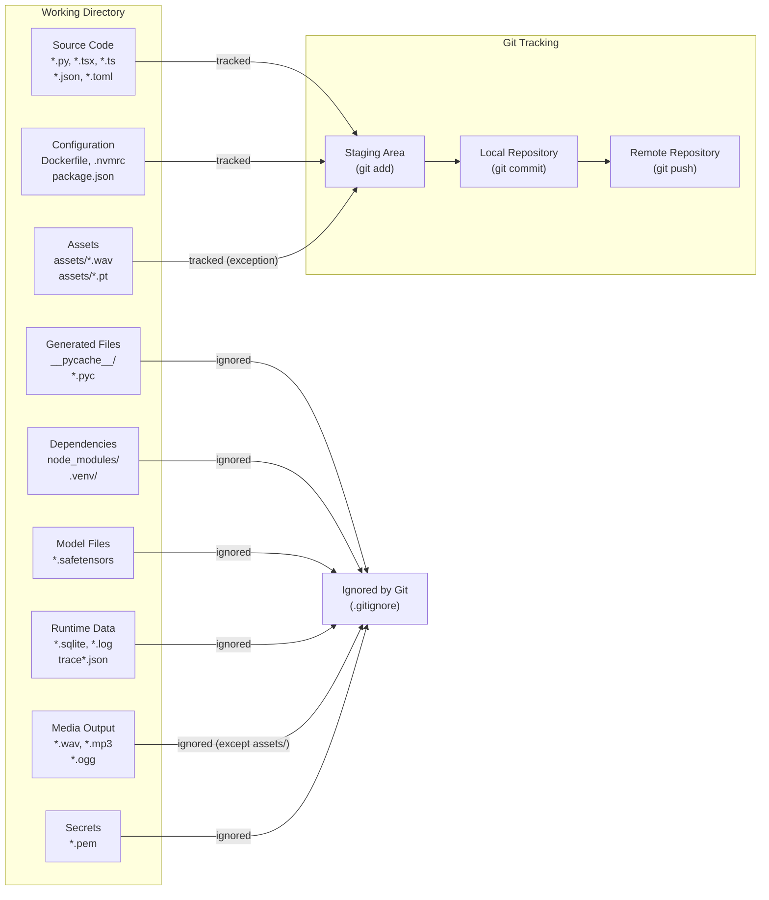
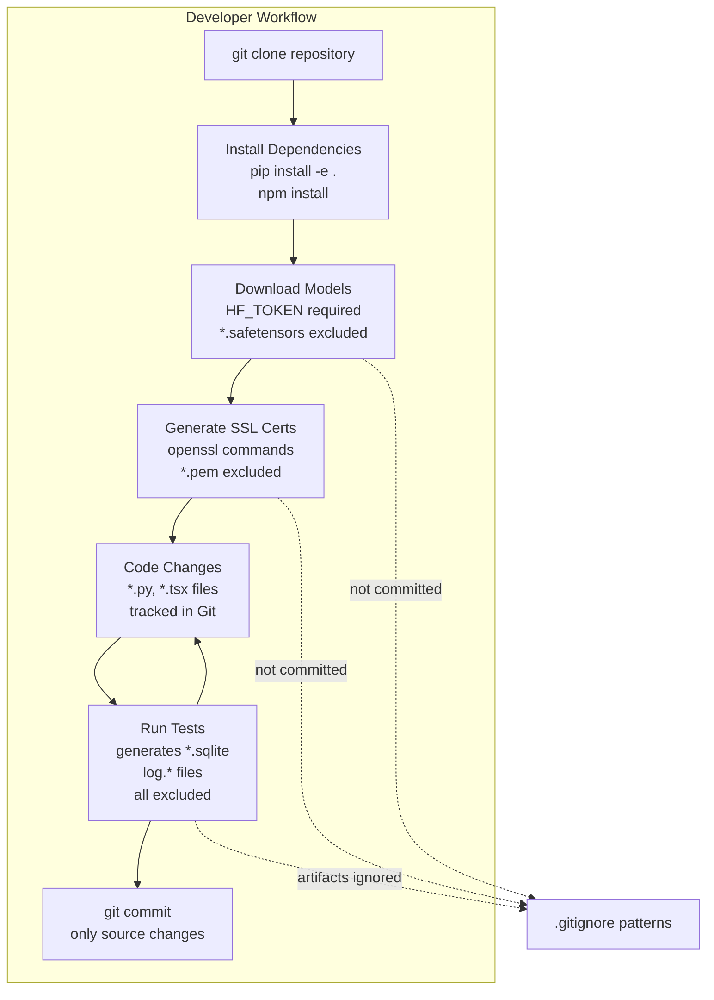
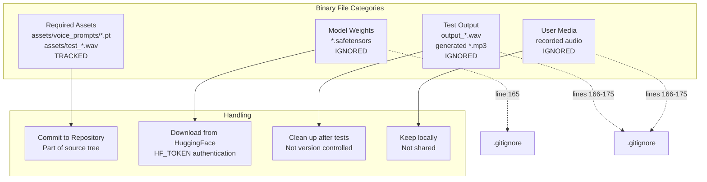

<!-- source: DeepWiki mcp.deepwiki.com · repo NVIDIA/personaplex · page 6.3 Version Control and Git Workflow · fetched 2026-10-26 -->

# Version Control and Git Workflow

<details>
<summary>Relevant source files</summary>

The following files were used as context for generating this wiki page:

- [.dockerignore](.dockerignore)
- [.gitignore](.gitignore)

</details>


## Purpose and Scope

This document explains the version control configuration and Git workflow for the PersonaPlex repository. It covers the `.gitignore` patterns that determine which files are tracked in version control, the `.dockerignore` configuration that affects Docker build contexts, and best practices for contributing to the codebase. 

For information about code quality tools and formatting standards, see [Code Quality and Formatting](#6.1). For deployment-related file handling, see [Deployment and Containerization](#5).

**Sources:** [.gitignore:1-186](), [.dockerignore:1-1]()

---

## Git Ignore Configuration

The repository uses a comprehensive `.gitignore` file to exclude generated files, dependencies, build artifacts, and sensitive data from version control. The configuration is organized into standard Python patterns and custom project-specific exclusions.

### Python Standard Patterns

The `.gitignore` file begins with standard Python exclusion patterns covering common artifacts from the Python ecosystem:

| Category | Patterns | Purpose | Line Reference |
|----------|----------|---------|----------------|
| **Bytecode** | `__pycache__/`, `*.py[cod]`, `*$py.class` | Compiled Python bytecode files | [.gitignore:1-4]() |
| **Native Extensions** | `*.so` | Compiled C extensions | [.gitignore:6-7]() |
| **Distribution** | `build/`, `dist/`, `*.egg-info/`, `*.egg`, `MANIFEST` | Package distribution artifacts | [.gitignore:9-27]() |
| **Installers** | `*.manifest`, `*.spec`, `pip-log.txt` | PyInstaller and pip artifacts | [.gitignore:29-37]() |
| **Testing** | `.pytest_cache/`, `.coverage`, `htmlcov/`, `*.cover` | Test execution and coverage data | [.gitignore:39-52]() |
| **Translations** | `*.mo`, `*.pot` | Compiled translation files | [.gitignore:54-56]() |
| **Frameworks** | `local_settings.py`, `db.sqlite3`, `instance/` | Django and Flask artifacts | [.gitignore:58-66]() |
| **Documentation** | `docs/_build/`, `/site` | Generated documentation | [.gitignore:71-72](), [.gitignore:139-140]() |
| **Notebooks** | `.ipynb_checkpoints` | Jupyter notebook checkpoints | [.gitignore:79-80]() |
| **Virtual Environments** | `.env`, `.venv`, `venv/`, `ENV/` | Python virtual environment directories | [.gitignore:123-130]() |
| **Type Checkers** | `.mypy_cache/`, `.pytype/`, `.pyre/` | Static analysis artifacts | [.gitignore:142-151]() |

**Sources:** [.gitignore:1-161]()

### Project-Specific Patterns

The repository includes custom ignore patterns specific to PersonaPlex's architecture and dependencies:

```mermaid
graph TB
    subgraph "Build Artifacts"
        CargoLock["Cargo.lock<br/>(Rust dependencies)"]
        PkgDir["pkg<br/>(package output)"]
        TargetDirs["target/<br/>target-trunk/<br/>(build outputs)"]
    end
    
    subgraph "Model and Media Files"
        ModelFiles["*.safetensors<br/>(model weights)"]
        AudioFiles["*.wav, *.flac<br/>*.mp3, *.ogg<br/>(audio samples)"]
    end
    
    subgraph "Runtime and Debug"
        TraceFiles["trace*.json<br/>mlx-trace.json<br/>timings.json<br/>(profiling data)"]
        ProfileFiles["*.nsys-rep<br/>(NVIDIA profiler)"]
        LogFiles["log.*<br/>(runtime logs)"]
    end
    
    subgraph "Dependencies and Secrets"
        NodeModules["client/node_modules<br/>(npm packages)"]
        SSLCerts["*.pem<br/>(SSL certificates)"]
        ConfigFiles["/moshi-demo/config.sh<br/>(local config)"]
    end
    
    subgraph "Database and Archives"
        DatabaseFiles["*.sqlite<br/>(SQLite databases)"]
        ArchiveFiles["*.tgz<br/>(compressed archives)"]
    end
    
    subgraph "Temporary Files"
        BackupFiles["*~<br/>(editor backups)"]
        TestDirs["laurent/cuda-test/check<br/>(test artifacts)"]
    end
    
    GitIgnore[".gitignore"] --> CargoLock
    GitIgnore --> ModelFiles
    GitIgnore --> AudioFiles
    GitIgnore --> TraceFiles
    GitIgnore --> NodeModules
    GitIgnore --> SSLCerts
    GitIgnore --> DatabaseFiles
    GitIgnore --> BackupFiles
```



**Project-Specific Ignore Patterns Breakdown:**

| File Type | Pattern | Reason for Exclusion | Line Reference |
|-----------|---------|---------------------|----------------|
| **Rust Artifacts** | `Cargo.lock` | Dependency lock file, regenerated | [.gitignore:163]() |
| **Editor Backups** | `*~` | Temporary backup files | [.gitignore:164]() |
| **Model Weights** | `*.safetensors` | Large binary files, downloaded from HuggingFace | [.gitignore:165]() |
| **Audio Samples** | `*.wav`, `*.flac`, `*.mp3`, `*.ogg` | Test and output audio files | [.gitignore:166](), [.gitignore:168](), [.gitignore:174-175]() |
| **Profiling Data** | `trace*.json`, `mlx-trace.json`, `timings.json` | Runtime performance traces | [.gitignore:167](), [.gitignore:180-181]() |
| **Build Output** | `pkg` | Package build artifacts | [.gitignore:169]() |
| **NVIDIA Profiles** | `*.nsys-rep` | NVIDIA Nsight Systems profiler output | [.gitignore:170]() |
| **Databases** | `*.sqlite` | Runtime database files | [.gitignore:171]() |
| **SSL Certificates** | `*.pem` | Self-signed certificates, generated locally | [.gitignore:172]() |
| **Archives** | `*.tgz` | Compressed archive files | [.gitignore:173]() |
| **Local Config** | `/moshi-demo/config.sh` | User-specific configuration | [.gitignore:176]() |
| **Log Files** | `log.*` | Application logs | [.gitignore:177]() |
| **Test Artifacts** | `laurent/cuda-test/check` | CUDA test outputs | [.gitignore:178]() |
| **Node Dependencies** | `client/node_modules` | npm package installations | [.gitignore:179]() |

**Sources:** [.gitignore:163-181]()

### Asset Exceptions

The configuration explicitly includes all files under the `assets/` directory, overriding other ignore patterns:

```
# Include everything in assets
!assets/
!assets/**
```

This ensures that pre-packaged voice prompts, test assets, and other required resources are tracked in version control despite matching other ignore patterns (such as `*.wav` for audio files).

**Sources:** [.gitignore:183-185]()

---

## Docker Ignore Configuration

The `.dockerignore` file complements `.gitignore` by excluding files from Docker build contexts. This reduces build context size and speeds up image builds.

```
.cache
```

Currently, the configuration excludes only the `.cache` directory, which may contain temporary cached data from various tools. This minimal configuration relies on `.gitignore` patterns to exclude most unnecessary files, as Docker automatically respects `.gitignore` for files not tracked in Git when building from a repository.

**Sources:** [.dockerignore:1-1]()

---

## File Classification and Git State Flow

The following diagram illustrates how different file types flow through Git states based on the ignore configuration:



**Sources:** [.gitignore:1-186]()

### Tracked File Categories

The following file types are tracked in version control:

1. **Source Code**: Python modules (`.py`), TypeScript/React files (`.ts`, `.tsx`), JavaScript (`.js`)
2. **Configuration Files**: `Dockerfile`, `package.json`, `.nvmrc`, `.eslintrc.json`, `.prettierrc.json`, `postcss.config.js`
3. **Documentation**: `README.md`, GitHub issue templates, documentation source files
4. **Asset Exceptions**: Files under `assets/` directory, including pre-packaged voice prompts (`.pt` files) and test audio samples (`.wav` files)

### Ignored File Categories

The following file types are explicitly excluded from version control:

1. **Build Artifacts**: Compiled bytecode, distribution packages, build directories
2. **Dependencies**: `node_modules/`, `.venv/`, virtual environment directories
3. **Generated Files**: Coverage reports, profiling traces, log files
4. **Large Binary Files**: Model weights (`.safetensors`), audio output files (`.wav`, `.mp3`, `.ogg`)
5. **Sensitive Data**: SSL certificates (`.pem`), local configuration files
6. **Runtime Data**: SQLite databases, temporary files, editor backups

**Sources:** [.gitignore:1-186]()

---

## Git Workflow Best Practices

### Repository Structure and File Handling

When working with the PersonaPlex codebase, follow these guidelines:



**Sources:** [.gitignore:1-186](), README.md

### Contribution Guidelines

#### 1. Source File Modifications

When modifying tracked source files, ensure changes are committed:

- **Python Server Code**: Files under `moshi/` directory
- **Client Code**: TypeScript/React files in `client/src/`
- **Configuration**: Docker, package, and build configuration files
- **Documentation**: README updates, new issue templates

**Sources:** [.gitignore:1-186]()

#### 2. Generated File Handling

Do not commit generated files that match ignore patterns:

- **Python Bytecode**: `__pycache__/` directories and `.pyc` files are automatically regenerated
- **Node Modules**: `client/node_modules/` should be installed via `npm install`
- **Build Outputs**: `build/`, `dist/`, and `pkg/` directories are regenerated during builds
- **Virtual Environments**: `.venv/` and `venv/` directories should be created locally

**Sources:** [.gitignore:2](), [.gitignore:179](), [.gitignore:10-11](), [.gitignore:125-126]()

#### 3. Model and Media Files

Handle large binary files according to their purpose:



- **Pre-packaged Assets**: Files under `assets/` are tracked due to explicit exception rules [.gitignore:183-185]()
- **Model Weights**: `.safetensors` files should be downloaded from HuggingFace, not committed [.gitignore:165]()
- **Audio Output**: Test and generated audio files (`.wav`, `.mp3`, `.ogg`) are excluded [.gitignore:166](), [.gitignore:168](), [.gitignore:174-175]()

**Sources:** [.gitignore:165-175](), [.gitignore:183-185]()

#### 4. Sensitive Data Protection

Never commit sensitive data:

- **SSL Certificates**: `.pem` files are excluded [.gitignore:172]()
- **API Tokens**: Use environment variables, not committed configuration files
- **Local Configuration**: Files like `/moshi-demo/config.sh` are excluded [.gitignore:176]()

For environment variable configuration, see [Environment Variables](#7.1).

**Sources:** [.gitignore:172](), [.gitignore:176]()

#### 5. Runtime and Debug Files

Development artifacts should not be committed:

| Artifact Type | Patterns | Purpose | Line Reference |
|--------------|----------|---------|----------------|
| **Log Files** | `log.*` | Application runtime logs | [.gitignore:177]() |
| **Profiling Data** | `trace*.json`, `*.nsys-rep`, `mlx-trace.json`, `timings.json` | Performance profiling traces | [.gitignore:167](), [.gitignore:170](), [.gitignore:180-181]() |
| **Database Files** | `*.sqlite` | Runtime database state | [.gitignore:171]() |
| **Test Artifacts** | `laurent/cuda-test/check` | CUDA test outputs | [.gitignore:178]() |
| **Editor Backups** | `*~` | Temporary editor files | [.gitignore:164]() |

**Sources:** [.gitignore:164](), [.gitignore:167](), [.gitignore:170-171](), [.gitignore:177-178](), [.gitignore:180-181]()

---

## Docker Build Context Optimization

When building Docker images, the `.dockerignore` file reduces build context size by excluding the `.cache` directory. Additional exclusions rely on `.gitignore` patterns for files not tracked in Git.

### Effective Exclusions During Docker Build

When running `docker build`, the following files are automatically excluded from the build context:

1. **Git-Ignored Files**: All patterns in `.gitignore` for untracked files
2. **Explicit Docker Ignores**: `.cache/` directory [.dockerignore:1]()

This dual-layer approach ensures:
- Faster build context transfer to Docker daemon
- Smaller layer sizes in resulting images
- Exclusion of sensitive data and large binary files
- Efficient incremental builds

For detailed Docker configuration, see [Server Container](#5.1) and [Client Container](#5.2).

**Sources:** [.dockerignore:1](), [.gitignore:1-186]()

---

## Common Pitfall Resolution

### Issue: Model Weights Not Found After Clone

**Problem**: After cloning the repository, the PersonaPlex model weights are missing.

**Explanation**: Model weight files (`*.safetensors`) are excluded by `.gitignore` [.gitignore:165]() because they are large binary files unsuitable for Git storage.

**Resolution**: Download models from HuggingFace using your authentication token:
```bash
export HF_TOKEN=your_token_here
# Models are automatically downloaded when server starts
```

### Issue: SSL Certificate Errors in Development

**Problem**: Local development fails with SSL errors.

**Explanation**: SSL certificate files (`*.pem`) are excluded by `.gitignore` [.gitignore:172]() to prevent committing sensitive key material.

**Resolution**: Generate self-signed certificates locally:
```bash
# Certificates are generated during Docker build
# Or manually using OpenSSL commands
```

### Issue: node_modules or .venv Committed by Mistake

**Problem**: Dependency directories appear in Git status.

**Explanation**: These directories should be excluded by `.gitignore` patterns [.gitignore:179]() for `node_modules` and [.gitignore:125-130]() for Python virtual environments.

**Resolution**: 
1. Verify `.gitignore` is present in repository root
2. Remove from Git tracking: `git rm -r --cached client/node_modules` or `git rm -r --cached .venv`
3. Commit the removal

### Issue: Audio Files Tracked Unexpectedly

**Problem**: Audio files under `assets/` are tracked, but others are not.

**Explanation**: The `.gitignore` has explicit exception rules [.gitignore:183-185]() that include everything under `assets/`, overriding the `*.wav` exclusion pattern [.gitignore:166]().

**Clarification**: This is intentional. Pre-packaged voice prompts and test assets must be in version control, while generated or user audio files should not be.

**Sources:** [.gitignore:125-130](), [.gitignore:165-166](), [.gitignore:172](), [.gitignore:179](), [.gitignore:183-185]()

---

