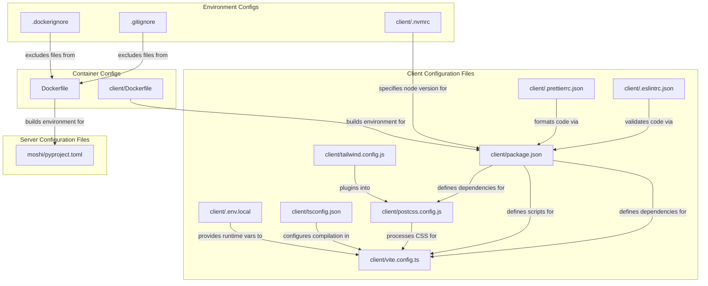
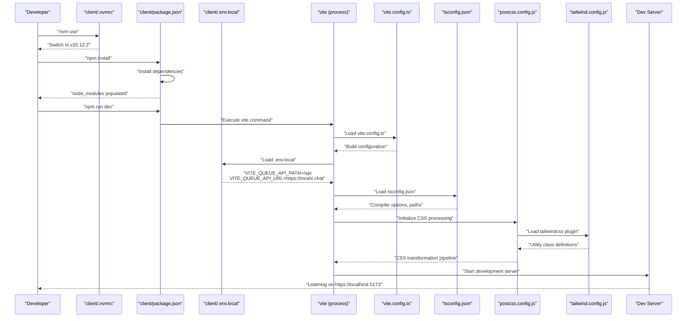
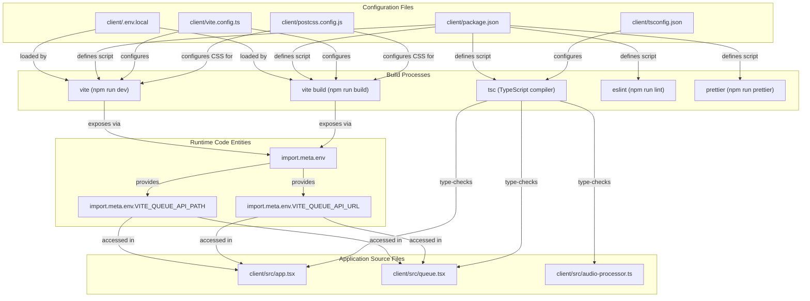
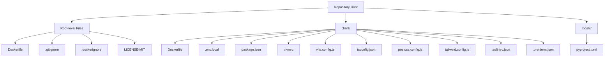

<!-- source: DeepWiki mcp.deepwiki.com · repo NVIDIA/personaplex · page 7 Configuration Reference · fetched 2026-10-26 -->

# Configuration Reference

Relevant source files

The following files were used as context for generating this wiki page:

- [client/.env.local](client/.env.local)
- [client/package.json](client/package.json)
- [client/postcss.config.js](client/postcss.config.js)

This page provides a comprehensive reference for all configuration files and settings in PersonaPlex. Configuration is distributed across client and server components, build tools, development tooling, and deployment containers.

## Subsection Overview

This section is organized into three subsections for detailed configuration documentation:

| Subsection | Coverage | Key Files |
|------------|----------|-----------|
| **7.1 Environment Variables** | Runtime configuration, API endpoints, feature flags | [client/.env.local]() |
| **7.2 Package Dependencies** | Client and server dependencies, version constraints | [client/package.json](), [moshi/pyproject.toml]() |
| **7.3 Build and Styling Configuration** | Build tools, TypeScript, CSS processing, code quality | [client/vite.config.ts](), [client/postcss.config.js](), [client/tailwind.config.js](), [client/tsconfig.json](), [client/.eslintrc.json](), [client/.prettierrc.json]() |

This page provides an overview of the configuration system architecture and how different configuration files interact. For specific configuration values and detailed usage, consult the subsection pages.

## Configuration Files Overview

PersonaPlex uses multiple configuration files across its client and server components to control behavior, dependencies, build processes, and development tooling.

### Configuration File Structure

**Sources:** [client/.env.local](), [client/package.json](), [client/postcss.config.js](), [client/vite.config.ts](), [client/tsconfig.json](), [Dockerfile](), [client/Dockerfile](), [.gitignore](), [.dockerignore](), [client/.nvmrc]()

### Configuration Categories

The configuration files are organized into functional categories:

| Category | Files | Purpose | Documented In |
|----------|-------|---------|---------------|
| **Environment** | [client/.env.local]() | Runtime environment variables for API endpoints | Section 7.1 |
| **Package Management** | [client/package.json](), [moshi/pyproject.toml]() | Dependencies, versions, and npm scripts | Section 7.2 |
| **Build System** | [client/vite.config.ts](), [client/tsconfig.json]() | TypeScript compilation and module bundling | Section 7.3 |
| **Styling** | [client/postcss.config.js](), [client/tailwind.config.js]() | CSS processing and utility class generation | Section 7.3 |
| **Code Quality** | [client/.eslintrc.json](), [client/.prettierrc.json]() | Linting rules and formatting standards | Section 7.3 |
| **Version Control** | [.gitignore](), [.dockerignore](), [client/.nvmrc]() | Source control exclusions and environment pinning | Section 6.3 |
| **Containerization** | [Dockerfile](), [client/Dockerfile]() | Container build instructions and runtime configuration | Section 5 |

**Sources:** [client/.env.local](), [client/package.json](), [client/postcss.config.js](), [client/vite.config.ts](), [client/tsconfig.json](), [Dockerfile](), [client/Dockerfile]()

## Configuration Loading Flow

This diagram shows how configuration files are loaded and processed during the `npm run dev` command execution.

**Sources:** [client/package.json:6-7](), [client/.env.local:1-2](), [client/.nvmrc]()

## Configuration by Component

### Client Script Commands

The client [package.json]() defines npm scripts at [client/package.json:6-13]():

| Script | Command | Purpose | Config Files Used |
|--------|---------|---------|-------------------|
| `dev` | `vite` | Start Vite development server with HMR | [vite.config.ts](), [.env.local]() |
| `build` | `tsc && vite build` | Type-check with `tsc`, then build production bundle | [tsconfig.json](), [vite.config.ts]() |
| `build:watch` | `nodemon --watch src --ext ts,js,css,html --exec "npm run build"` | Continuous build on file changes | [package.json]() |
| `lint` | `eslint` | Validate code against ESLint rules | [.eslintrc.json]() |
| `lint:fix` | `eslint --fix` | Auto-fix ESLint violations | [.eslintrc.json]() |
| `prettier` | `prettier --write .` | Format all files with Prettier | [.prettierrc.json]() |
| `preview` | `vite preview` | Preview production build locally | [vite.config.ts]() |

See Section 7.2 for complete dependency documentation.

**Sources:** [client/package.json:6-13]()

### Environment Variables Overview

Environment variables are defined in [client/.env.local:1-2]() and injected at build time by Vite:

| Variable | Default Value | Accessed In Code As |
|----------|---------------|---------------------|
| `VITE_QUEUE_API_PATH` | `/api` | `import.meta.env.VITE_QUEUE_API_PATH` |
| `VITE_QUEUE_API_URL` | `https://moshi.chat` | `import.meta.env.VITE_QUEUE_API_URL` |

The `VITE_` prefix is required for Vite to expose these variables to client code. Variables without this prefix remain server-side only. See Section 7.1 for complete environment variable documentation including usage examples and HuggingFace token configuration.

**Sources:** [client/.env.local:1-2]()

### CSS Processing Pipeline

The PostCSS configuration at [client/postcss.config.js]() defines a two-stage CSS processing pipeline:

1. **Tailwind CSS Plugin** - Generates utility classes from [tailwind.config.js]()
2. **Autoprefixer Plugin** - Adds vendor prefixes for cross-browser compatibility

The plugin execution order is significant: Tailwind generates utility classes first, then Autoprefixer processes the output to add vendor-specific prefixes (e.g., `-webkit-`, `-moz-`).

See Section 7.3 for complete build and styling configuration documentation.

**Sources:** [client/postcss.config.js]()

## Configuration to Code Entity Mapping

This diagram shows how configuration files map to specific code entities and build processes in the PersonaPlex system.

**Sources:** [client/.env.local](), [client/package.json](), [client/postcss.config.js](), [client/vite.config.ts](), [client/tsconfig.json]()

## Configuration Requirements

### Required Configuration Files

The following configuration files must be present for PersonaPlex to function correctly:

| Configuration | Component | Required | Default Available | Notes |
|---------------|-----------|----------|-------------------|-------|
| [client/.env.local]() | Client | Yes | Yes | Defines `VITE_QUEUE_API_PATH` and `VITE_QUEUE_API_URL` |
| [client/package.json]() | Client | Yes | Yes | Defines dependencies and npm scripts |
| [client/.nvmrc]() | Client | No (recommended) | Yes | Pins Node.js to v20.12.2 |
| `HF_TOKEN` (env var) | Server | Yes | No | Required for HuggingFace model access |
| [moshi/pyproject.toml]() | Server | Yes | Yes | Defines Python package metadata |

Missing any required configuration will result in build or runtime failures. See subsection pages for detailed configuration values.

**Sources:** [client/.env.local](), [client/package.json](), [client/.nvmrc](), [moshi/pyproject.toml]()

### Development vs Production Mode

Different operational modes use different configuration behavior:

| Aspect | Development (`npm run dev`) | Production (`npm run build`) |
|--------|----------------------------|------------------------------|
| **Server Process** | Vite dev server with HMR | Static files served by web server |
| **Port** | 5173 (default) | Configured by deployment environment |
| **SSL Certificates** | Self-signed (generated locally) | Valid certificates required |
| **Source Maps** | Enabled (inline) | Configurable in [vite.config.ts]() |
| **Minification** | Disabled | Enabled by Vite |
| **Environment Variables** | Loaded from [.env.local]() | Injected at build time |
| **TypeScript Checking** | On-demand by IDE | Required before build (`tsc`) |
| **Hot Module Replacement** | Enabled | Not applicable |

For production deployment configuration, see Section 5.3.

**Sources:** [client/package.json:6-13]()

## Configuration Precedence Hierarchy

Configuration values follow a precedence order when multiple sources define the same setting:

### Precedence Order (Highest to Lowest)

1. **Command-line arguments** - Passed directly to `vite`, `eslint`, etc.
2. **Environment variables** - Defined in shell or [client/.env.local:1-2]()
3. **Tool configuration files** - [vite.config.ts](), [postcss.config.js](), etc.
4. **Package dependencies** - Defaults from packages in [package.json]()
5. **Tool built-in defaults** - Vite, TypeScript, ESLint defaults

### Precedence Examples

| Setting | CLI Override | Config File | Default |
|---------|--------------|-------------|---------|
| Vite port | `vite --port 3000` | `vite.config.ts: server.port` | 5173 |
| Node version | `node --version` | `.nvmrc` | System Node.js |
| ESLint rules | `--rule 'no-console: off'` | `.eslintrc.json` | ESLint defaults |

This hierarchy enables overriding configuration without modifying tracked files, useful for local development variations.

**Sources:** [client/.env.local](), [client/package.json](), [client/vite.config.ts]()

## Configuration File Locations

All configuration files are organized by directory scope:

**Sources:** [Dockerfile](), [client/Dockerfile](), [client/.env.local](), [client/package.json](), [client/vite.config.ts](), [moshi/pyproject.toml]()

## Quick Reference Tables

### Client Dependencies by Category

The following table summarizes key client dependencies from [client/package.json:38-47]():

| Category | Key Dependencies | Versions | Usage |
|----------|-----------------|----------|-------|
| **UI Framework** | `react`, `react-dom` | ^18.3.1 | Core React rendering |
| **Routing** | `react-router-dom` | ^6.23.1 | Client-side routing in [app.tsx]() |
| **Audio** | `opus-recorder`, `webm-duration-fix` | ^8.0.5, ^1.0.4 | Audio capture and processing |
| **Communication** | `ws` | ^8.16.0 | WebSocket connections to server |
| **Validation** | `zod` | ^3.23.8 | Schema validation |
| **Build Tool** | `vite` | ^5.2.14 | Development server and bundling |
| **Styling** | `tailwindcss`, `daisyui` | ^3.4.3, ^4.12.2 | Utility CSS and UI components |
| **Type Checking** | `typescript` | ^5.2.2 | Static type checking |
| **Debugging** | `eruda` | ^3.0.1 | Mobile debugging console |

Full dependency list with version constraints documented in Section 7.2.

**Sources:** [client/package.json:38-47]()

### PostCSS Plugins Configuration

PostCSS plugins defined in [client/postcss.config.js]():

| Plugin | Purpose | Input | Output |
|--------|---------|-------|--------|
| `tailwindcss` | Generate utility classes from [tailwind.config.js]() | CSS with `@tailwind` directives | Expanded utility classes |
| `autoprefixer` | Add vendor-specific CSS prefixes | Standard CSS properties | Prefixed properties (`-webkit-`, `-moz-`, etc.) |

Plugin execution order: `tailwindcss` → `autoprefixer`. See Section 7.3 for complete build configuration.

**Sources:** [client/postcss.config.js]()

### Build Output and Cache Directories

| Directory | Contents | Tracked in Git | Excluded in Docker |
|-----------|----------|----------------|-------------------|
| `client/node_modules/` | npm package installations | No | Yes |
| `client/dist/` | Production build artifacts from `vite build` | No | No |
| `client/.vite/` | Vite development cache and metadata | No | Yes |
| `moshi/.venv/` | Python virtual environment | No | Yes |
| `moshi/.cache/` | HuggingFace model cache | No | Yes |

These directories are excluded via [.gitignore]() and [.dockerignore](). The `dist/` directory is included in Docker for production deployment. See Section 6.3 for version control details.

**Sources:** [client/package.json](), [.gitignore](), [.dockerignore]()

## Troubleshooting Configuration Issues

Common configuration problems and solutions:

| Problem | Likely Cause | Solution |
|---------|--------------|----------|
| Build fails with "Module not found" | Missing dependencies | Run `npm install` in `client/` directory |
| Environment variables undefined | Missing `.env.local` | Copy example file and set values |
| Wrong Node.js version errors | Node version mismatch | Use `nvm use` to switch to v20.12.2 |
| TypeScript errors | Outdated type definitions | Run `npm install` to update `@types/*` packages |
| CSS not applying | PostCSS misconfiguration | Verify `postcss.config.js` plugins array |
| Port 5173 already in use | Another Vite server running | Stop other processes or change port in `vite.config.ts` |

**Sources**: client/package.json, client/.env.local, client/postcss.config.js

---

