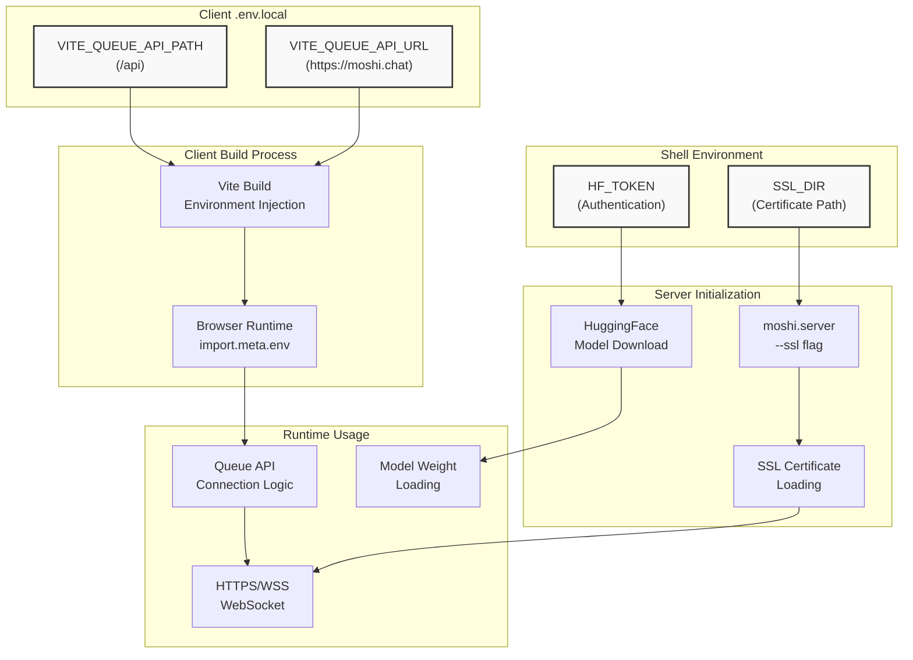

<!-- source: DeepWiki mcp.deepwiki.com · repo NVIDIA/personaplex · page 7.1 Environment Variables · fetched 2026-10-26 -->

# Environment Variables

<details>
<summary>Relevant source files</summary>

The following files were used as context for generating this wiki page:

- [README.md](README.md)
- [client/.env.local](client/.env.local)

</details>


This document provides a comprehensive reference for all environment variables used by the PersonaPlex system, including both client-side and server-side configuration. Environment variables control API connectivity, authentication, SSL certificate paths, and deployment modes.

For client-side configuration files, see [Build and Styling Configuration](#7.3). For package dependencies, see [Package Dependencies](#7.2).

---

## Overview

PersonaPlex uses environment variables to configure two distinct subsystems:

1. **Client Application**: Vite-based environment variables prefixed with `VITE_` that control API connectivity and queue service integration
2. **Server Application**: Shell environment variables that control authentication, SSL configuration, and model deployment options

Environment variables are set differently depending on the deployment context (local development, Docker containers, or production).

**Sources:** client/.env.local, README.md

---

## Client Environment Variables

The client application uses Vite's environment variable system, which requires variables to be prefixed with `VITE_` to be exposed to the browser runtime. Client environment variables are defined in `client/.env.local`.

### VITE_QUEUE_API_PATH

**Type:** String  
**Default Value:** `/api`  
**Required:** No  
**Purpose:** Specifies the API path prefix for queue service endpoints

This variable defines the base path for queue API requests. When the client connects to a queue service, it appends this path to the queue API URL to construct the full endpoint.

**Usage Context:**
- Used when connecting through a load-balanced queue system
- Not used when connecting directly to a worker via `?worker_addr` parameter

```
VITE_QUEUE_API_PATH=/api
```

**Sources:** client/.env.local

---

### VITE_QUEUE_API_URL

**Type:** String (URL)  
**Default Value:** `https://moshi.chat`  
**Required:** No  
**Purpose:** Specifies the base URL for the queue API service

This variable defines the queue service endpoint that manages connections to PersonaPlex workers. The client uses this URL to request worker assignments and establish WebSocket connections through the queue system.

**Usage Context:**
- Enables load-balanced deployment with multiple workers
- Can be overridden by direct worker connection via `?worker_addr` URL parameter
- Production deployments typically use a centralized queue service

```
VITE_QUEUE_API_URL=https://moshi.chat
```

**Sources:** client/.env.local

---

## Server Environment Variables

The server application uses standard shell environment variables for configuration. These variables must be set in the shell environment before launching the server.

### HF_TOKEN

**Type:** String (Authentication Token)  
**Default Value:** None  
**Required:** Yes  
**Purpose:** HuggingFace authentication token for downloading model weights

This variable provides authentication credentials to access the PersonaPlex model weights hosted on HuggingFace. Users must accept the model license and generate a token from their HuggingFace account.

**Setup Instructions:**
1. Log in to HuggingFace
2. Accept the PersonaPlex model license at: `https://huggingface.co/nvidia/personaplex-7b-v1`
3. Generate a user access token from HuggingFace settings
4. Set the environment variable:

```bash
export HF_TOKEN=<YOUR_HUGGINGFACE_TOKEN>
```

**Usage Examples:**

Server launch:
```bash
HF_TOKEN=<TOKEN> python -m moshi.server --ssl "$SSL_DIR"
```

Offline evaluation:
```bash
HF_TOKEN=<TOKEN> python -m moshi.offline --voice-prompt "NATF2.pt" --input-wav "input.wav"
```

**Sources:** README.md:43-47, README.md:74-93

---

### SSL_DIR

**Type:** String (File Path)  
**Default Value:** None  
**Required:** Yes (for HTTPS operation)  
**Purpose:** Directory path containing SSL certificates for HTTPS server

This variable specifies the directory containing SSL certificate files (`cert.pem` and `key.pem`) required for HTTPS operation. The server uses these certificates to establish secure WebSocket connections with clients.

**Certificate Files Expected:**
- `cert.pem`: SSL certificate file
- `key.pem`: Private key file

**Usage Patterns:**

Temporary directory (development):
```bash
SSL_DIR=$(mktemp -d); python -m moshi.server --ssl "$SSL_DIR"
```

Permanent directory (production):
```bash
export SSL_DIR=/app/ssl
python -m moshi.server --ssl "$SSL_DIR"
```

**Notes:**
- The server generates self-signed certificates if the directory is empty
- Production deployments should use proper SSL certificates from a certificate authority
- See [Server Deployment](#3.1) for detailed SSL setup instructions

**Sources:** README.md:52-58

---

## Environment Variable Flow Architecture

The following diagram illustrates how environment variables flow through the system during initialization and runtime.



**Sources:** README.md:43-58, client/.env.local

---

## Configuration Scenarios

The following diagram shows different configuration scenarios and which environment variables are required for each deployment mode.

```mermaid
graph TB
    subgraph "Scenario 1: Local Development"
        Dev1["Developer Machine"]
        Dev1Vars["HF_TOKEN=xxx<br/>SSL_DIR=$(mktemp -d)"]
        Dev1Client["Client:<br/>Default .env.local"]
        Dev1Server["moshi.server<br/>localhost:8998"]
        
        Dev1 --> Dev1Vars
        Dev1Vars --> Dev1Server
        Dev1Client --> Dev1Server
    end
    
    subgraph "Scenario 2: Direct Worker Connection"
        Dev2["Client Browser"]
        Dev2Params["URL: ?worker_addr=<IP:PORT>"]
        Dev2Worker["Worker Server<br/>HF_TOKEN + SSL_DIR"]
        
        Dev2 --> Dev2Params
        Dev2Params -.->|"Bypasses Queue API"| Dev2Worker
    end
    
    subgraph "Scenario 3: Queue-Based Deployment"
        Client3["Client Browser"]
        Client3Env["VITE_QUEUE_API_URL=https://moshi.chat<br/>VITE_QUEUE_API_PATH=/api"]
        Queue["Queue Service<br/>moshi.chat/api"]
        Worker3A["Worker A<br/>HF_TOKEN + SSL_DIR"]
        Worker3B["Worker B<br/>HF_TOKEN + SSL_DIR"]
        
        Client3 --> Client3Env
        Client3Env --> Queue
        Queue --> Worker3A
        Queue --> Worker3B
    end
    
    subgraph "Scenario 4: Docker Deployment"
        Docker["Docker Container"]
        DockerEnv["ENV HF_TOKEN<br/>VOLUME /app/ssl"]
        DockerServer["moshi.server<br/>--ssl /app/ssl"]
        
        Docker --> DockerEnv
        DockerEnv --> DockerServer
    end
    
    style Dev1Vars fill:#f9f9f9,stroke:#333,stroke-width:2px
    style Client3Env fill:#f9f9f9,stroke:#333,stroke-width:2px
    style DockerEnv fill:#f9f9f9,stroke:#333,stroke-width:2px
    style Dev2Worker fill:#f9f9f9,stroke:#333,stroke-width:2px
```



**Sources:** README.md:52-65, client/.env.local, client/README.md

---

## Environment Variable Summary Table

| Variable | Component | Type | Required | Default | Purpose |
|----------|-----------|------|----------|---------|---------|
| `VITE_QUEUE_API_PATH` | Client | String | No | `/api` | Queue API path prefix |
| `VITE_QUEUE_API_URL` | Client | URL | No | `https://moshi.chat` | Queue service base URL |
| `HF_TOKEN` | Server | Token | Yes | None | HuggingFace authentication |
| `SSL_DIR` | Server | Path | Yes* | None | SSL certificate directory |

\* Required for HTTPS operation; the server can generate self-signed certificates if the directory exists but is empty.

**Sources:** README.md, client/.env.local

---

## Setting Environment Variables

### Development (Local)

For local development, environment variables are set in different ways depending on the component:

**Client Variables:**
Edit `client/.env.local`:
```bash
VITE_QUEUE_API_PATH=/api
VITE_QUEUE_API_URL=https://moshi.chat
```

**Server Variables:**
Set in shell before launching server:
```bash
export HF_TOKEN=<YOUR_TOKEN>
SSL_DIR=$(mktemp -d); python -m moshi.server --ssl "$SSL_DIR"
```

**Sources:** client/.env.local, README.md:52-58

---

### Docker Deployment

Docker containers handle environment variables through Dockerfile `ENV` directives and runtime `-e` flags.

**Server Container:**
```bash
docker run -e HF_TOKEN=<TOKEN> -v /path/to/ssl:/app/ssl personaplex-server
```

**Client Container:**
Environment variables are baked into the build through `client/.env.local` during the Docker build process.

See [Server Container](#5.1) and [Client Container](#5.2) for detailed Docker deployment instructions.

**Sources:** Dockerfile, client/Dockerfile

---

### Production Deployment

Production deployments should follow these best practices:

1. **HF_TOKEN**: Store in secure secrets management (e.g., Kubernetes Secrets, AWS Secrets Manager)
2. **SSL_DIR**: Mount persistent volume with valid CA-signed certificates
3. **VITE_QUEUE_API_URL**: Point to production queue service endpoint
4. **VITE_QUEUE_API_PATH**: Maintain consistent API path across deployments

See [Production Deployment](#5.3) for comprehensive production guidance.

**Sources:** README.md

---

## Relationship to Other Configuration

Environment variables work in conjunction with other configuration mechanisms:

| Configuration Type | Scope | Reference |
|-------------------|-------|-----------|
| Environment Variables | Runtime behavior, API endpoints, authentication | This page (#7.1) |
| Package Dependencies | Build-time dependencies, libraries | [Package Dependencies](#7.2) |
| Build Configuration | Compilation settings, bundling | [Build and Styling Configuration](#7.3) |
| Command-line Arguments | Server options (e.g., `--cpu-offload`) | [Server Deployment](#3.1) |

**Sources:** README.md, client/package.json

---

## Troubleshooting

### Common Issues

**HF_TOKEN not set:**
```
Error: HuggingFace authentication failed
```
Solution: Ensure `HF_TOKEN` is exported before running server commands.

**SSL_DIR invalid:**
```
Error: Cannot find SSL certificates in directory
```
Solution: Verify directory exists and contains `cert.pem` and `key.pem`, or let server generate self-signed certificates.

**VITE_ variables not available:**
- Vite only exposes variables prefixed with `VITE_` to the browser
- Ensure `.env.local` file exists in `client/` directory
- Restart Vite dev server after modifying `.env.local`

**Queue API connection fails:**
- Verify `VITE_QUEUE_API_URL` is accessible from client browser
- Check that `VITE_QUEUE_API_PATH` matches queue service configuration
- Consider using direct worker connection via `?worker_addr` parameter

**Sources:** client/README.md, README.md

---

