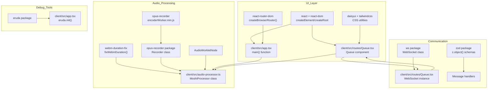
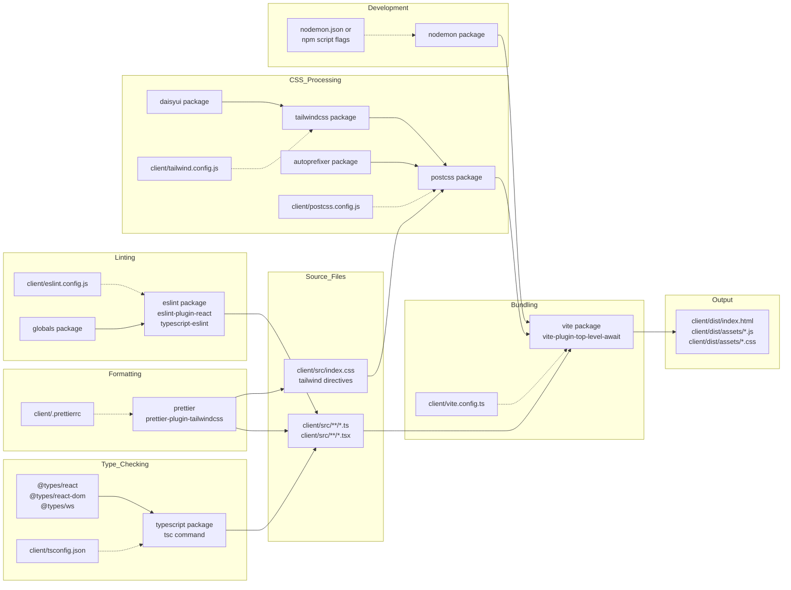
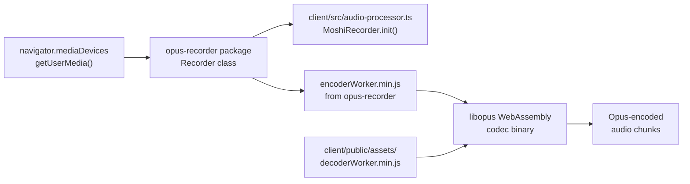
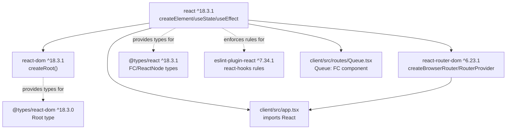

<!-- source: DeepWiki mcp.deepwiki.com · repo NVIDIA/personaplex · page 7.2 Package Dependencies · fetched 2026-10-26 -->

# Package Dependencies

<details>
<summary>Relevant source files</summary>

The following files were used as context for generating this wiki page:

- [client/package-lock.json](client/package-lock.json)
- [client/package.json](client/package.json)

</details>


## Overview

This document catalogs the npm dependencies used by the PersonaPlex client application, their purposes, and version constraints. The client application relies on 8 runtime dependencies and 17 development dependencies to provide full-duplex audio communication, React-based UI, and a modern build pipeline.

For environment variable configuration, see [Environment Variables](#7.1). For build tool and styling configuration details, see [Build and Styling Configuration](#7.3). For Python server dependencies, refer to the Dockerfile and server documentation.

**Sources:** [client/package.json:1-48]()

---

## Runtime Dependencies

Runtime dependencies are bundled with the application and required for production execution. The PersonaPlex client uses a minimal set of runtime dependencies focused on audio processing, UI rendering, and WebSocket communication.

### Core Application Dependencies

| Package | Version | Purpose |
|---------|---------|---------|
| `react` | ^18.3.1 | Core React library for building the user interface |
| `react-dom` | ^18.3.1 | React renderer for DOM manipulation |
| `react-router-dom` | ^6.23.1 | Client-side routing for navigation between Queue and worker connection |
| `zod` | ^3.23.8 | Runtime type validation and schema parsing |

### Audio Processing Dependencies

| Package | Version | Purpose |
|---------|---------|---------|
| `opus-recorder` | ^8.0.5 | WebAssembly-based Opus audio encoding/decoding for microphone capture |
| `webm-duration-fix` | ^1.0.4 | Fixes duration metadata in WebM audio streams |

### Communication Dependencies

| Package | Version | Purpose |
|---------|---------|---------|
| `ws` | ^8.16.0 | WebSocket client for real-time bidirectional communication with Moshi server |

### Development/Debugging Dependencies

| Package | Version | Purpose |
|---------|---------|---------|
| `eruda` | ^3.0.1 | Mobile browser developer console for debugging on mobile devices |

**Sources:** [client/package.json:38-47]()

---

## Development Dependencies

Development dependencies are used during the build process, code quality checks, and local development but are not included in production builds.

### Build Tools

| Package | Version | Purpose |
|---------|---------|---------|
| `vite` | ^5.2.14 | Fast build tool and development server with HMR |
| `typescript` | ^5.2.2 | TypeScript compiler for type checking and compilation |
| `vite-plugin-top-level-await` | ^1.4.1 | Vite plugin enabling top-level await for WebAssembly module loading |
| `nodemon` | ^3.1.11 | File watcher for automatic rebuilds during development |

### Type Definitions

| Package | Version | Purpose |
|---------|---------|---------|
| `@types/react` | ^18.3.1 | TypeScript type definitions for React |
| `@types/react-dom` | ^18.3.0 | TypeScript type definitions for ReactDOM |
| `@types/ws` | ^8.5.10 | TypeScript type definitions for WebSocket library |

### Code Quality Tools

| Package | Version | Purpose |
|---------|---------|---------|
| `eslint` | ^8.57.0 | JavaScript/TypeScript linter for code quality |
| `@eslint/js` | ^9.3.0 | ESLint JavaScript configuration |
| `typescript-eslint` | ^7.9.0 | ESLint plugin for TypeScript-specific rules |
| `eslint-plugin-react` | ^7.34.1 | ESLint rules for React best practices |
| `eslint-plugin-prettier` | ^5.1.3 | ESLint plugin integrating Prettier formatting |
| `eslint-config-prettier` | ^9.1.0 | Disables ESLint rules that conflict with Prettier |
| `prettier` | ^3.2.5 | Code formatter for consistent style |
| `prettier-eslint` | ^16.3.0 | Integrates Prettier with ESLint |
| `prettier-plugin-tailwindcss` | ^0.5.14 | Prettier plugin for sorting Tailwind CSS classes |
| `globals` | ^15.2.0 | Global variable definitions for ESLint |

### Styling Tools

| Package | Version | Purpose |
|---------|---------|---------|
| `tailwindcss` | ^3.4.3 | Utility-first CSS framework |
| `daisyui` | ^4.12.2 | Tailwind CSS component library |
| `postcss` | ^8.4.38 | CSS transformation tool |
| `autoprefixer` | ^10.4.19 | PostCSS plugin for vendor prefixes |

**Sources:** [client/package.json:15-37]()

---

## Dependency Architecture

The following diagram illustrates how runtime dependencies map to specific client application files and classes.



**Sources:** [client/package.json:38-47](), [client/src/app.tsx](), [client/src/audio-processor.ts](), [client/src/routes/Queue.tsx]()

---

## Build Pipeline Dependencies

The following diagram shows which development dependencies are invoked at each stage of the build pipeline and which config files control them.



**Sources:** [client/package.json:6-13](), [client/package.json:15-37](), [client/vite.config.ts](), [client/tsconfig.json](), [client/postcss.config.js](), [client/tailwind.config.js]()

---

## Version Constraints and Compatibility

### Semantic Versioning

All dependencies use caret (`^`) version constraints, allowing minor and patch updates but preventing breaking changes:

- `^18.3.1` allows versions `>=18.3.1 <19.0.0`
- `^8.16.0` allows versions `>=8.16.0 <9.0.0`

This approach balances security updates with stability.

### Critical Version Requirements

| Dependency | Minimum Version | Reason |
|------------|----------------|--------|
| `react` | 18.3.1 | Requires React 18 concurrent features for performance |
| `typescript` | 5.2.2 | Uses TypeScript 5.2+ features for type safety |
| `vite` | 5.2.14 | Requires Vite 5 for ESM and build optimization |
| `node` | 20.12.2 | Specified in `.nvmrc`, required for build tools |

### Peer Dependencies

Several packages have implicit peer dependencies managed by the lock file:

- `eslint-plugin-react` requires `eslint ^7.0.0 || ^8.0.0`
- `eslint-plugin-prettier` requires both `eslint` and `prettier`
- `tailwindcss` requires `postcss ^8.0.0`
- `autoprefixer` requires `postcss ^8.1.0`

These relationships are automatically resolved during `npm install`.

**Sources:** [client/package.json:1-48](), [client/.nvmrc]()

---

## Dependency Installation

### Installation Commands

```bash
# Install all dependencies
npm install

# Install only production dependencies
npm install --production

# Update dependencies within constraint ranges
npm update

# Audit for security vulnerabilities
npm audit
```

### Lock File

The [client/package-lock.json:1-10000+]() file locks exact versions of all dependencies and transitive dependencies, ensuring reproducible builds across environments. This file should be committed to version control.

### Platform-Specific Dependencies

Several development dependencies include platform-specific binaries:

- `@esbuild/*` packages (lines 57-447 in lock file) - Platform-specific ESBuild binaries
- `@swc/*` packages (lines 1055-1287 in lock file) - Platform-specific SWC compiler binaries  
- `@rollup/*` packages (lines 698-1047 in lock file) - Platform-specific Rollup binaries

These are marked as `optional: true` and automatically selected based on the host platform.

**Sources:** [client/package-lock.json:1-10000+]()

---

## Key Dependency Patterns

### WebAssembly Audio Processing

The `opus-recorder` package provides critical audio encoding functionality:



This dependency must be version 8.0.5+ for compatibility with the WebAssembly-based audio pipeline. The `MoshiRecorder` class wraps the `opus-recorder` Recorder and integrates it with `AudioWorkletNode`.

**Sources:** [client/package.json:40](), [client/public/assets/decoderWorker.min.js](), [client/src/audio-processor.ts]()

### React Ecosystem

The React dependencies form a cohesive ecosystem with runtime and development packages:



All React-related packages must maintain compatible versions (React 18.x family). The `FC` type from `@types/react` is used throughout component definitions.

**Sources:** [client/package.json:17-18](), [client/package.json:22](), [client/package.json:25](), [client/package.json:41-43](), [client/src/app.tsx](), [client/src/routes/Queue.tsx]()

### Build Tool Chain

The build process relies on a tightly integrated tool chain:

- `vite` (^5.2.14) - Build tool and dev server
- `typescript` (^5.2.2) - Type system
- `vite-plugin-top-level-await` (^1.4.1) - WebAssembly support
- `postcss` (^8.4.38) - CSS processing
- `tailwindcss` (^3.4.3) - Styling framework

These tools are coordinated through [client/vite.config.ts](), [client/tsconfig.json](), and [client/postcss.config.js]().

**Sources:** [client/package.json:28](), [client/package.json:32-36](), [client/package.json:40]()

---

## NPM Scripts

The `package.json` defines several scripts that utilize these dependencies:

| Script | Command | Dependencies Used |
|--------|---------|-------------------|
| `dev` | `vite` | `vite` |
| `build` | `tsc && vite build` | `typescript`, `vite` |
| `build:watch` | `nodemon --watch src --ext ts,js,css,html --exec "npm run build"` | `nodemon`, `typescript`, `vite` |
| `lint` | `eslint` | `eslint`, `typescript-eslint`, `eslint-plugin-react` |
| `lint:fix` | `eslint --fix` | Same as `lint` |
| `prettier` | `prettier --write .` | `prettier`, `prettier-plugin-tailwindcss` |
| `preview` | `vite preview` | `vite` |

**Sources:** [client/package.json:6-13]()

---

## Transitive Dependencies

While the application directly depends on 25 packages, the complete dependency tree includes hundreds of transitive dependencies. Notable transitive dependencies include:

- **ESBuild** (via Vite) - Fast JavaScript bundler
- **Rollup** (via Vite) - Module bundler for production builds
- **SWC** (via various tools) - Fast TypeScript/JavaScript compiler
- **PostCSS plugins** (via Tailwind) - CSS transformation plugins

The full dependency tree with exact versions is locked in [client/package-lock.json:1-10000+]().

**Sources:** [client/package-lock.json:1-10000+]()

---

## Dependency Updates and Maintenance

### Update Strategy

Dependencies should be updated regularly to receive security patches and bug fixes. The caret (`^`) version constraints allow automatic minor and patch updates.

```bash
# Check for outdated dependencies
npm outdated

# Update to latest within constraints
npm update

# Audit for security issues
npm audit

# Fix security issues automatically
npm audit fix
```

### Breaking Change Considerations

Major version updates require manual intervention and testing:

- **React 18 → 19**: Would require code migration for concurrent features
- **Vite 5 → 6**: May require configuration updates
- **TypeScript 5 → 6**: May introduce stricter type checking

**Sources:** [client/package.json:1-48]()

---

## Summary

The PersonaPlex client maintains a lean dependency footprint with 8 runtime dependencies focused on core functionality (React, audio processing, WebSocket communication) and 17 development dependencies for building, testing, and code quality. The locked dependency tree ensures reproducible builds while allowing automatic security updates through semantic versioning constraints.

**Sources:** [client/package.json:1-48](), [client/package-lock.json:1-10000+]()

---

