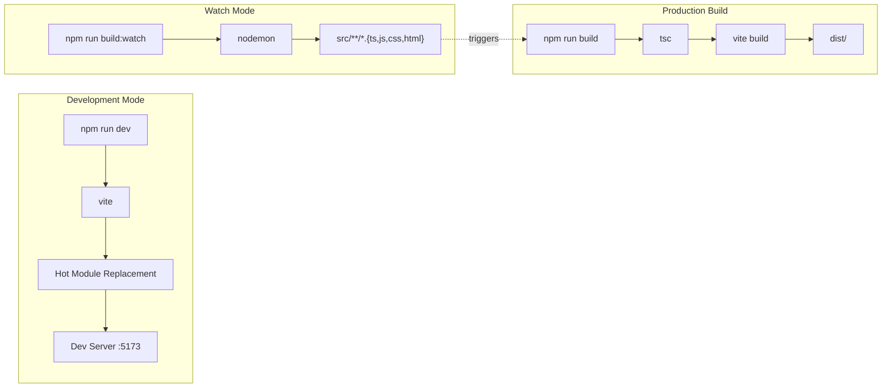
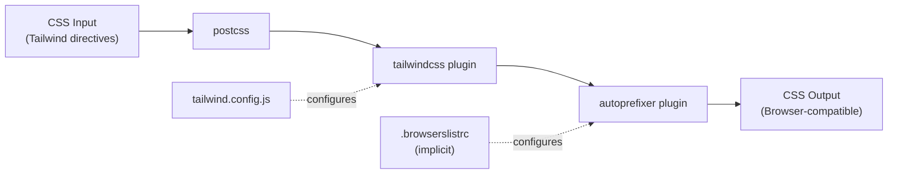
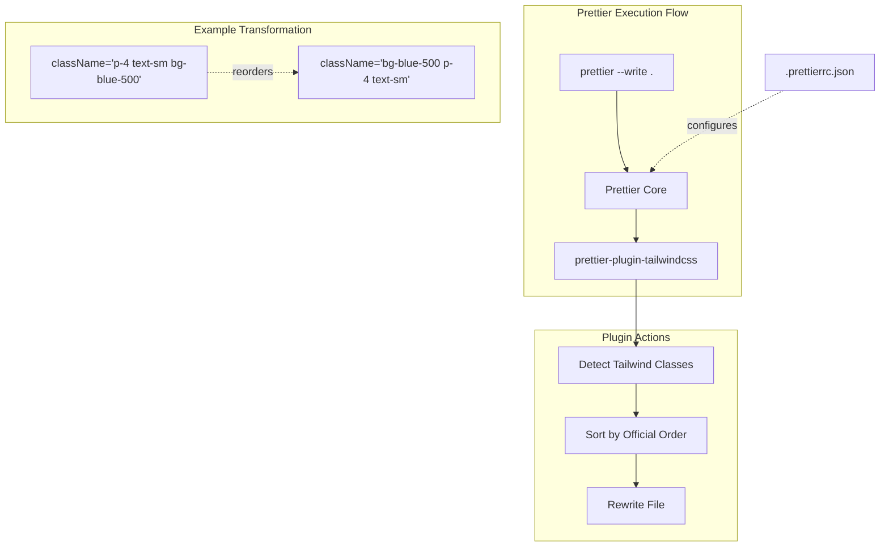
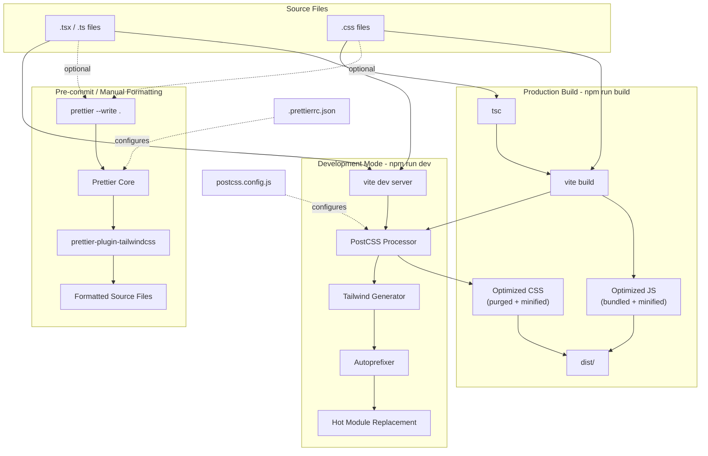

<!-- source: DeepWiki mcp.deepwiki.com · repo NVIDIA/personaplex · page 7.3 Build and Styling Configuration · fetched 2026-10-26 -->

# Build and Styling Configuration

<details>
<summary>Relevant source files</summary>

The following files were used as context for generating this wiki page:

- [client/.eslinrc.json](client/.eslinrc.json)
- [client/.prettierrc.json](client/.prettierrc.json)
- [client/postcss.config.js](client/postcss.config.js)

</details>


This document details the build system and styling configuration for the PersonaPlex web client. It covers the Vite build tool configuration, the PostCSS processing pipeline with Tailwind CSS, and the Prettier code formatting setup with Tailwind integration. For information about using these tools during development, see [Code Quality and Formatting](#6.1). For details on the TypeScript compilation and production bundling process, see [Client Build Pipeline](#4.4).

## Overview

The client build and styling system consists of three integrated subsystems:

| Subsystem | Configuration File | Primary Tools |
|-----------|-------------------|---------------|
| Build System | `vite.config.ts` | Vite 5.2.14 |
| Styling Pipeline | `postcss.config.js` | PostCSS 8.4.38, Tailwind CSS 3.4.3, Autoprefixer 10.4.19 |
| Code Formatting | `.prettierrc.json` | Prettier 3.2.5, prettier-plugin-tailwindcss 0.5.14 |

**Sources**: [client/package.json:1-48](), [client/postcss.config.js:1-7](), [client/.prettierrc.json:1-11]()

## Build System Configuration

### Vite Configuration

The PersonaPlex client uses Vite as its build tool. Vite is configured through `vite.config.ts` (not shown in provided files but referenced in package.json). The build process is defined by two primary npm scripts:

| Script | Command | Purpose |
|--------|---------|---------|
| `dev` | `vite` | Starts development server with hot module replacement |
| `build` | `tsc && vite build` | Type-checks TypeScript then bundles for production |
| `build:watch` | `nodemon --watch src --ext ts,js,css,html --exec "npm run build"` | Watches for changes and rebuilds automatically |

The build pipeline executes in sequence: TypeScript compiler (`tsc`) validates types, then Vite bundles the application with optimizations for production deployment.



**Diagram**: Build script execution flow showing development, production, and watch modes with actual npm script names

**Sources**: [client/package.json:6-13]()

### Vite Plugin Configuration

The client includes the `vite-plugin-top-level-await` plugin to enable top-level await syntax in ES modules. This is essential for the WebAssembly audio processing initialization in the client application.

| Plugin | Version | Purpose |
|--------|---------|---------|
| `vite-plugin-top-level-await` | 1.4.1 | Enables top-level await for WebAssembly initialization |

**Sources**: [client/package.json:36]()

## Styling System Configuration

### PostCSS Pipeline

The styling system uses PostCSS as a processing pipeline. The configuration in `postcss.config.js` defines two plugins that transform CSS:



**Diagram**: PostCSS processing pipeline showing plugin execution order and configuration inputs

The pipeline executes in a fixed order defined in [client/postcss.config.js:2-4]():

1. **tailwindcss**: Processes Tailwind directives (`@tailwind`, `@apply`, etc.) and generates utility classes
2. **autoprefixer**: Adds vendor prefixes for cross-browser compatibility

**Sources**: [client/postcss.config.js:1-7](), [client/package.json:20,28,32]()

### Tailwind CSS Configuration

The client uses Tailwind CSS 3.4.3 for utility-first styling. The framework is enhanced with DaisyUI 4.12.2, which provides pre-built component classes built on top of Tailwind utilities.

| Package | Version | Role |
|---------|---------|------|
| `tailwindcss` | 3.4.3 | Core utility framework |
| `daisyui` | 4.12.2 | Component library extension |

Configuration is managed through `tailwind.config.js` (not provided in files but referenced by the PostCSS plugin).

**Sources**: [client/package.json:21,32]()

### Autoprefixer Integration

Autoprefixer 10.4.19 automatically adds vendor prefixes to CSS properties based on browser compatibility targets. It processes the output from Tailwind, ensuring styles work across different browser engines without manual prefixing.

**Sources**: [client/package.json:20](), [client/postcss.config.js:4]()

## Code Formatting Configuration

### Prettier Settings

Prettier is configured via `.prettierrc.json` with settings optimized for consistency and integration with Tailwind CSS:

| Setting | Value | Purpose |
|---------|-------|---------|
| `arrowParens` | `"avoid"` | Omit parentheses around single arrow function parameters |
| `singleQuote` | `false` | Use double quotes for strings |
| `trailingComma` | `"all"` | Add trailing commas wherever valid in ES5+ |
| `tabWidth` | `2` | Use 2 spaces per indentation level |
| `useTabs` | `false` | Use spaces instead of tabs |
| `semi` | `true` | Add semicolons at statement ends |
| `printWidth` | `80` | Wrap lines at 80 characters |

**Sources**: [client/.prettierrc.json:2-9]()

### Prettier-Tailwind Plugin Integration

The configuration includes `prettier-plugin-tailwindcss` which automatically sorts Tailwind CSS class names according to the official recommended order. This ensures consistent class ordering across the codebase.



**Diagram**: Prettier execution flow with Tailwind plugin showing how class names are automatically reordered

The plugin is declared in the `plugins` array at [client/.prettierrc.json:9]():

```json
"plugins": ["prettier-plugin-tailwindcss"]
```

This integration ensures that Tailwind classes are consistently ordered following the official style guide, improving code readability and reducing diff noise in version control.

**Sources**: [client/.prettierrc.json:9](), [client/package.json:29,31]()

### npm Scripts for Formatting

The package.json defines two scripts for running Prettier:

| Script | Command | Use Case |
|--------|---------|----------|
| `prettier` | `prettier --write .` | Format all files in the project |
| `lint` | `eslint` | Check code quality (includes Prettier via eslint-plugin-prettier) |
| `lint:fix` | `eslint --fix` | Fix code quality issues automatically |

The `lint` and `lint:fix` scripts integrate Prettier through `eslint-plugin-prettier` and `eslint-config-prettier`, allowing unified code quality and formatting checks. See [Code Quality and Formatting](#6.1) for usage details.

**Sources**: [client/package.json:10-12](), [client/package.json:23-24]()

## Integration Architecture

The following diagram shows how the build, styling, and formatting systems integrate during development and production builds:



**Diagram**: Complete integration architecture showing how configuration files control the development, formatting, and build processes

### Configuration File Relationships

| Configuration File | Consumed By | Purpose |
|-------------------|-------------|---------|
| `.prettierrc.json` | `prettier` CLI, `eslint-plugin-prettier` | Define code formatting rules |
| `postcss.config.js` | Vite (via internal PostCSS integration) | Define CSS transformation pipeline |
| `tailwind.config.js` | `tailwindcss` PostCSS plugin | Configure Tailwind utility generation |
| `vite.config.ts` | `vite` CLI | Configure build and dev server |

**Sources**: [client/.prettierrc.json:1-11](), [client/postcss.config.js:1-7](), [client/package.json:1-48]()

## Build Output Optimization

During production builds (`npm run build`), the integrated pipeline performs several optimizations:

1. **TypeScript Compilation**: `tsc` validates types and generates type declarations
2. **CSS Purging**: Tailwind removes unused utility classes based on template scanning
3. **CSS Minification**: PostCSS minifies the final CSS output
4. **JavaScript Bundling**: Vite bundles modules with tree-shaking and code splitting
5. **Asset Optimization**: Images and fonts are optimized and fingerprinted

The output is placed in the `dist/` directory, ready for deployment in production environments.

**Sources**: [client/package.json:8]()

---

