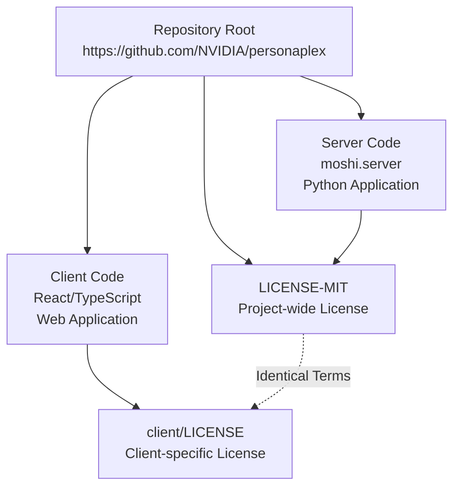
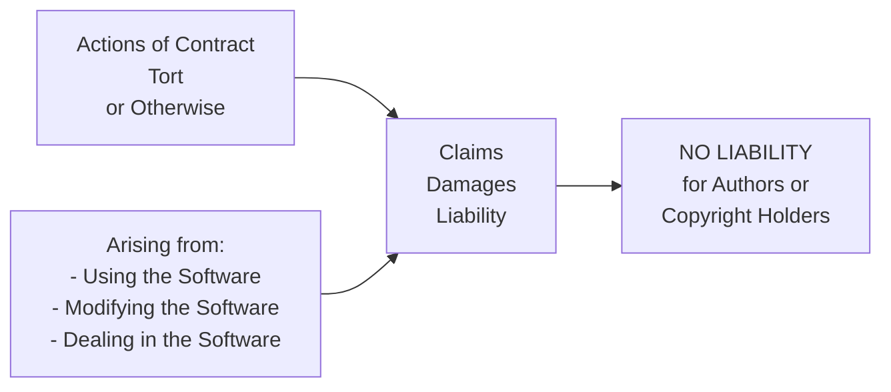
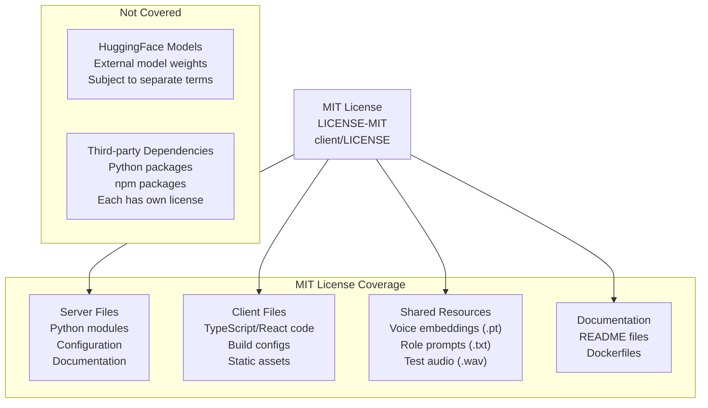

<!-- source: DeepWiki mcp.deepwiki.com · repo NVIDIA/personaplex · page 8 Licensing · fetched 2026-10-26 -->

# Licensing

Relevant source files

The following files were used as context for generating this wiki page:

- [LICENSE-MIT](LICENSE-MIT)
- [client/LICENSE](client/LICENSE)

This document details the licensing terms that govern the use, modification, and distribution of the PersonaPlex codebase. Both the server and client components are released under permissive open-source licenses.

---

## License Overview

PersonaPlex is distributed under the **MIT License**, one of the most permissive open-source licenses available. The MIT License applies to both the server application (Python-based) and the client application (TypeScript/React-based).

The repository contains two license files with identical terms:
- [LICENSE-MIT:1-24]() - Root-level license covering the overall project
- [client/LICENSE:1-24]() - Client-specific license file

Both files contain the standard MIT License text without modifications.

**Sources:** LICENSE-MIT, client/LICENSE

---

## License Structure

The following diagram illustrates how the license files are organized within the repository:

**Sources:** LICENSE-MIT, client/LICENSE

---

## License Terms

The MIT License grants the following permissions without restriction:

| Permission | Description |
|------------|-------------|
| **Use** | Run the software for any purpose, commercial or non-commercial |
| **Copy** | Make unlimited copies of the software |
| **Modify** | Change the source code to suit your needs |
| **Merge** | Combine with other software |
| **Publish** | Make the software publicly available |
| **Distribute** | Share copies with others |
| **Sublicense** | Grant the same rights to others under different terms |
| **Sell** | Distribute copies for commercial purposes |

**Sources:** LICENSE-MIT:1-9

---

## License Conditions

The MIT License imposes only two conditions on users:

### Copyright Notice Requirement

All copies or substantial portions of the software must include the copyright notice and permission notice from the license file:

- Copyright notice: As specified by NVIDIA or the original copyright holders
- Permission notice: The full text from [LICENSE-MIT:1-24]()

This requirement applies to:
- Source code distributions
- Binary distributions
- Modified versions
- Derivative works

### As-Is Warranty Disclaimer

The software is provided "AS IS" without any warranty of any kind, express or implied. This includes but is not limited to:

- **Merchantability**: No guarantee the software is fit for sale
- **Fitness for a particular purpose**: No guarantee it will work for your specific use case
- **Non-infringement**: No guarantee it doesn't violate third-party rights

**Sources:** LICENSE-MIT:11-23

---

## Liability Limitations

The license explicitly limits liability for the authors and copyright holders:

The authors and copyright holders shall **not be liable** for any claim, damages, or other liability arising from the software's use, regardless of whether the claim is based on contract, tort, or any other legal theory.

**Sources:** LICENSE-MIT:18-23

---

## Component-Specific Licensing

### Server Application

The server application (Python code in the root directory and subdirectories) is covered by [LICENSE-MIT:1-24](). This includes:

- `moshi/` module and all submodules
- Python scripts and utilities
- Configuration files
- Server-side assets (voice embeddings, role prompts)

### Client Application

The client application (TypeScript/React code in the `client/` directory) has its own license file at [client/LICENSE:1-24]() with identical terms. This includes:

- React components in `client/src/`
- TypeScript files
- Build configuration
- Client-side assets (WebAssembly decoders, audio worklets)

The duplication of license files ensures that the client can be distributed independently if needed while maintaining the same licensing terms.

**Sources:** LICENSE-MIT, client/LICENSE

---

## License Scope Diagram

**Sources:** LICENSE-MIT, client/LICENSE

---

## Third-Party Dependencies

While PersonaPlex itself is MIT licensed, it depends on various third-party packages, each with their own licenses:

### Server Dependencies

The server uses Python packages managed via `uv` package manager. These dependencies have their own licenses (not documented in this repository). Common dependency licenses may include:
- Apache 2.0
- BSD variants
- MIT
- Other permissive licenses

### Client Dependencies

The client uses npm packages documented in `client/package.json`. Each package has its own license specified in its package metadata. See [7.2](#7.2) for the complete list of client dependencies.

### External Models

The PersonaPlex system uses model weights from HuggingFace (Moshi and Helium models). These models are subject to their own licensing terms as specified on the HuggingFace model hub and are **not** covered by the PersonaPlex MIT License.

**Sources:** LICENSE-MIT, client/LICENSE

---

## Usage Guidelines

Based on the MIT License terms, you may:

### Permitted Uses

✓ Use PersonaPlex in commercial products or services  
✓ Modify the source code for your specific needs  
✓ Distribute modified or unmodified versions  
✓ Combine PersonaPlex with proprietary software  
✓ Sublicense under different terms (while maintaining original notice)  
✓ Use in closed-source applications  

### Requirements

⚠ Include the copyright and permission notice in all copies  
⚠ Retain the license text when distributing  
⚠ Acknowledge that the software is provided "as is"  

### Prohibited/Not Granted

✗ Hold authors liable for damages or issues  
✗ Use authors' names for endorsement without permission  
✗ Expect warranty or support  

**Sources:** LICENSE-MIT:1-24

---

## Comparison with Other Licenses

The MIT License is one of the most permissive open-source licenses:

| License | Permissiveness | Key Difference from MIT |
|---------|----------------|------------------------|
| **MIT** | Very High | Minimal restrictions |
| Apache 2.0 | High | Requires patent grant, contributor attribution |
| BSD 3-Clause | Very High | Includes non-endorsement clause |
| GPL 3.0 | Moderate | Requires derivative works to be open-source (copyleft) |
| LGPL 3.0 | Moderate-High | Copyleft for library modifications only |
| Proprietary | None | No rights granted without explicit permission |

PersonaPlex's choice of MIT License maximizes flexibility for both open-source and commercial use cases.

**Sources:** LICENSE-MIT

---

## License Compliance Checklist

When using PersonaPlex in your project, ensure you:

- [ ] Include a copy of [LICENSE-MIT:1-24]() in your distribution
- [ ] If using client code separately, include [client/LICENSE:1-24]()
- [ ] Maintain the copyright notice and permission text
- [ ] Document PersonaPlex as a dependency with its license
- [ ] Review licenses of third-party dependencies separately
- [ ] Check HuggingFace model licenses if using external model weights
- [ ] Do not represent the work as having warranty or support unless you provide it
- [ ] Do not hold NVIDIA or contributors liable for issues

**Sources:** LICENSE-MIT, client/LICENSE

---

## Summary

PersonaPlex uses the MIT License for both server and client components, granting users broad permissions to use, modify, and distribute the software with minimal restrictions. The only requirements are attribution (including the license notice) and accepting the "as is" warranty disclaimer. This permissive licensing makes PersonaPlex suitable for both commercial and non-commercial applications.

For questions about licensing or specific use cases, refer to the license text in [LICENSE-MIT:1-24]() or contact the project maintainers through the GitHub repository.

**Sources:** LICENSE-MIT, client/LICENSE