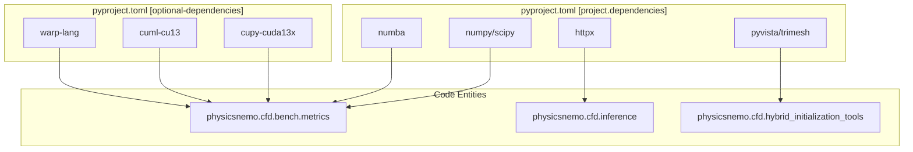
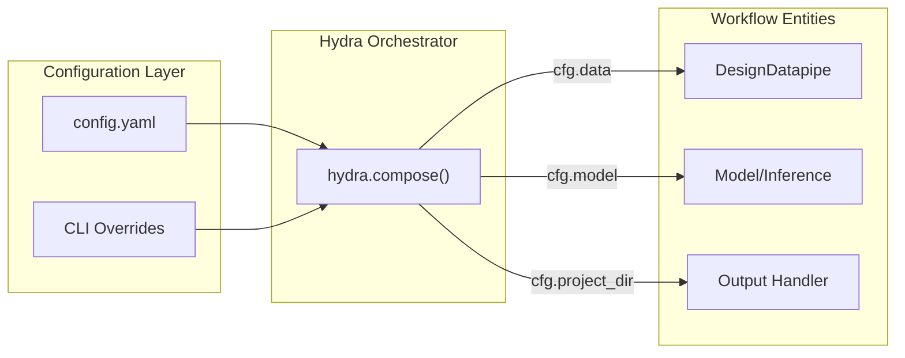

<!-- source: DeepWiki mcp.deepwiki.com · repo NVIDIA/physicsnemo-cfd · page 1.1 Installation and Configuration · fetched 2026-10-26 -->

# Installation and Configuration

<details>
<summary>Relevant source files</summary>

The following files were used as context for generating this wiki page:

- [pyproject.toml](pyproject.toml)
- [workflows/domino_design_sensitivities/conf/config.yaml](workflows/domino_design_sensitivities/conf/config.yaml)

</details>


This page provides technical details for installing the `nvidia-physicsnemo-cfd` package and understanding its configuration architecture. The library is designed to bridge AI/ML models with Computational Fluid Dynamics (CFD) workflows, offering both standard CPU-based utilities and high-performance GPU-accelerated kernels.

## Package Installation

The library is a Python-based package requiring **Python 3.10 or higher** [pyproject.toml:12-12](). It utilizes `setuptools` for distribution and defines dependencies across different execution modes.

### Standard Installation
The base installation includes core dependencies for CFD data handling, basic physics calculations, and communication with NVIDIA Inference Microservices (NIM). Key dependencies include:
*   `numpy` and `scipy` for numerical operations [pyproject.toml:16-21]().
*   `pyvista` and `trimesh` for mesh and geometry processing [pyproject.toml:17-23]().
*   `numba` for JIT-compiled physics kernels [pyproject.toml:19-19]().
*   `nvidia-physicsnemo` for core AI model components [pyproject.toml:25-25]().

### GPU-Accelerated Installation
For high-performance workflows (e.g., large-scale benchmarking or sensitivity analysis), the library provides an optional `gpu` dependency group. This group introduces specialized libraries for CUDA-accelerated computing:

| Dependency | Purpose |
| :--- | :--- |
| `cupy-cuda13x` | GPU-accelerated array operations (CUDA 13.x requirement) |
| `cuml-cu13` | GPU-accelerated K-Nearest Neighbors (KNN) and manifold learning |
| `warp-lang` | NVIDIA Warp for high-performance geometry kernels |

To install with GPU support, use:
```bash
pip install nvidia-physicsnemo-cfd[gpu]
```
[pyproject.toml:33-42]()

### Installation Entity Mapping
The following diagram illustrates how the installation configuration in `pyproject.toml` maps to the functional components of the library.

**Figure 1: Dependency Mapping to Functional Modules**

Sources: [pyproject.toml:14-42]()

---

## Configuration System (Hydra)

The library utilizes **Hydra** for hierarchical configuration management across all workflows. This allows users to override complex parameters via YAML files or command-line arguments without modifying the source code.

### Configuration Structure
Workflows, such as the `domino_design_sensitivities`, utilize a centralized `config.yaml` to define data paths, model hyperparameters, and execution environments.

Key configuration blocks include:
*   **Project Details**: Defines output directories and experiment tagging [workflows/domino_design_sensitivities/conf/config.yaml:20-35]().
*   **Data Preprocessing**: Controls the behavior of data loaders, including `kind` (e.g., `drivaer_aws`) and cache settings [workflows/domino_design_sensitivities/conf/config.yaml:39-45]().
*   **Model Parameters**: Configures the neural network architecture, including `interp_res` for latent space resolution and `geometry_encoding_type` (SDF, STL, or both) [workflows/domino_design_sensitivities/conf/config.yaml:89-110]().
*   **GPU Settings**: Explicit flags like `gpu_preprocessing` and `gpu_output` toggle between CPU and GPU execution paths [workflows/domino_design_sensitivities/conf/config.yaml:75-76]().

### Configuration Data Flow
The configuration is parsed at runtime and injected into core classes like `DesignDatapipe` or `DoMINOInference`.

**Figure 2: Hydra Configuration Injection**

Sources: [workflows/domino_design_sensitivities/conf/config.yaml:20-110]()

### Key Configuration Parameters

| Parameter | Type | Description |
| :--- | :--- | :--- |
| `project_dir` | String | Root path for all experiment outputs [workflows/domino_design_sensitivities/conf/config.yaml:25-25](). |
| `bounding_box` | List | Min/Max coordinates defining the computational domain [workflows/domino_design_sensitivities/conf/config.yaml:69-71](). |
| `surface_sampling_algorithm` | Enum | Method for sampling points on STL (`random` or `area_weighted`) [workflows/domino_design_sensitivities/conf/config.yaml:99-99](). |
| `integral_loss_scaling_factor` | Float | Multiplier for physics-based integral losses [workflows/domino_design_sensitivities/conf/config.yaml:105-105](). |
| `pin_memory` | Boolean | Optimization for CPU-to-GPU data transfer in dataloaders [workflows/domino_design_sensitivities/conf/config.yaml:154-154](). |

Sources: [workflows/domino_design_sensitivities/conf/config.yaml:1-177]()

---

