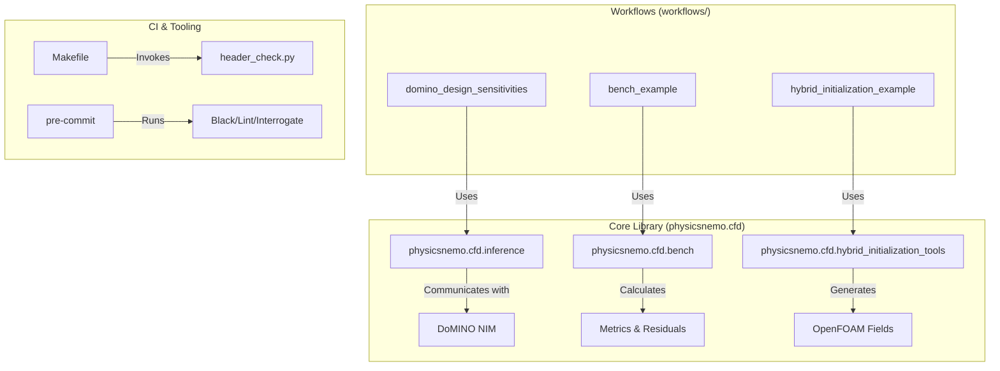

<!-- source: DeepWiki mcp.deepwiki.com · repo NVIDIA/physicsnemo-cfd · page 1.2 Repository Structure and Contributing · fetched 2026-10-26 -->

# Repository Structure and Contributing

Relevant source files

The following files were used as context for generating this wiki page:

- [.github/PULL_REQUEST_TEMPLATE.md](.github/PULL_REQUEST_TEMPLATE.md)
- [.github/workflows/blossom-ci.yml](.github/workflows/blossom-ci.yml)
- [.github/workflows/mq-blossom-faker.yml](.github/workflows/mq-blossom-faker.yml)
- [CONTRIBUTING.md](CONTRIBUTING.md)
- [Makefile](Makefile)
- [SECURITY.md](SECURITY.md)
- [test/ci_tests/copyright.txt](test/ci_tests/copyright.txt)
- [test/ci_tests/header_check.py](test/ci_tests/header_check.py)

This page details the organizational layout of the PhysicsNeMo-CFD repository, the standards for contributing code, and the automated pipelines used to maintain code quality and legal compliance.

## Repository Layout

The repository is divided into two primary areas: the core `physicsnemo.cfd` library and the `workflows` directory which contains end-to-end reference implementations.

### Top-Level Structure

| Directory / File | Description |
| :--- | :--- |
| `physicsnemo/cfd/` | The core Python package containing modular tools for inference, benchmarking, and initialization. |
| `workflows/` | High-level scripts and notebooks demonstrating specific engineering use cases (e.g., design sensitivities). |
| `test/` | Contains CI/CD utility scripts, including copyright header enforcement. |
| `.github/` | GitHub-specific configurations, including issue templates, PR templates, and CI workflows. |
| `Makefile` | Shortcuts for common development tasks like linting, installing, and running checks. |

### Code Entity Mapping

The following diagram maps the high-level functional pillars of the project to their respective locations in the codebase.

**System to Code Entity Mapping**

**Sources:** `physicsnemo/cfd/` (implied structure), `workflows/` (implied structure), [Makefile:1-36](), [test/ci_tests/header_check.py:124-160]()

---

## Contributing Guidelines

PhysicsNeMo-CFD is an open-source project that follows a standard fork-and-pull-request model.

### Development Workflow
1.  **Fork and Clone**: Developers must fork the upstream repository and push changes to their personal fork [[CONTRIBUTING.md:32-35]]().
2.  **Issue Linking**: Every Pull Request (PR) should correspond to an open issue and be linked accordingly [[CONTRIBUTING.md:47-49]]().
3.  **Sign-off**: All commits must be signed off using `git commit -s` to certify the Developer Certificate of Origin (DCO) [[CONTRIBUTING.md:75-85]]().
4.  **Changelog**: Contributors are required to update `CHANGELOG.md` to reflect their changes [[CONTRIBUTING.md:43-43]]().

### Pull Request Checklist
When submitting a PR, the following items must be verified:
*   Documentation is updated [[.github/PULL_REQUEST_TEMPLATE.md:12-12]]().
*   New or existing tests cover the changes [[.github/PULL_REQUEST_TEMPLATE.md:11-11]]().
*   The `CHANGELOG.md` is updated [[.github/PULL_REQUEST_TEMPLATE.md:13-13]]().

**Sources:** [CONTRIBUTING.md:30-49](), [CONTRIBUTING.md:75-131](), [.github/PULL_REQUEST_TEMPLATE.md:1-18]()

---

## CI/CD and Quality Control

The repository employs several automated checks to ensure code style, documentation coverage, and legal compliance.

### Pre-commit Hooks
The use of `pre-commit` is mandatory for all contributors [[CONTRIBUTING.md:135-137]](). These hooks run automatically on every commit to check:
*   **Black**: Code formatting [[Makefile:13-14]]().
*   **Interrogate**: Documentation coverage [[Makefile:16-17]]().
*   **Markdownlint**: Documentation formatting [[Makefile:19-20]]().
*   **Large File Check**: Prevents accidental commits of heavy binaries [[Makefile:21-21]]().

### Copyright and Licensing
All source files must include the standard NVIDIA SPDX copyright header [[CONTRIBUTING.md:53-71]](). Compliance is enforced via a specialized script:
*   **Script**: `test/ci_tests/header_check.py` [[test/ci_tests/header_check.py:18-18]]()
*   **Template**: `test/ci_tests/copyright.txt` [[test/ci_tests/copyright.txt:1-15]]()
*   **Execution**: Can be run via `make license` [[Makefile:23-24]]().

The `header_check.py` script validates the presence of the header, checks for the correct year range, and respects `.gitignore` patterns [[test/ci_tests/header_check.py:163-168]]().

### Blossom-CI
For internal NVIDIA runners and specialized GPU testing, the repository uses **Blossom-CI**.
*   Triggered by comments such as `/blossom-ci` or `/multi-gpu-ci` on PRs [[.github/workflows/blossom-ci.yml:41-42]]().
*   Includes authorization checks to ensure only authorized actors can trigger CI jobs [[.github/workflows/blossom-ci.yml:43-46]]().
*   Performs vulnerability scans as part of the pipeline [[.github/workflows/blossom-ci.yml:55-56]]().

**Sources:** [CONTRIBUTING.md:133-149](), [Makefile:9-25](), [test/ci_tests/header_check.py:124-203](), [.github/workflows/blossom-ci.yml:17-56]()

---

## Development Automation (Makefile)

The `Makefile` provides a standardized interface for common development tasks.

| Target | Command | Purpose |
| :--- | :--- | :--- |
| `install` | `pip install -e .` | Standard package installation [[Makefile:1-3]](). |
| `editable-install`| `pip install -e .[dev]` | Installation with development dependencies in strict editable mode [[Makefile:5-7]](). |
| `setup-ci` | `pip install pre-commit && pre-commit install` | Initializes the local environment for development [[Makefile:9-11]](). |
| `lint` | `pre-commit run markdownlint -a ...` | Runs formatting and file size checks [[Makefile:19-21]](). |
| `license` | `python test/ci_tests/header_check.py --all-files` | Verifies copyright headers across the entire project [[Makefile:23-24]](). |
| `all-ci` | Runs all checks | Executes setup, linting, license checks, and tests [[Makefile:35-35]](). |

**Sources:** [Makefile:1-36]()

---

## Security
Security vulnerabilities should **not** be reported via GitHub issues. NVIDIA provides a dedicated Product Security Incident Response Team (PSIRT) for reporting potential vulnerabilities [[SECURITY.md:7-14]]().

**Sources:** [SECURITY.md:1-36]()

---

