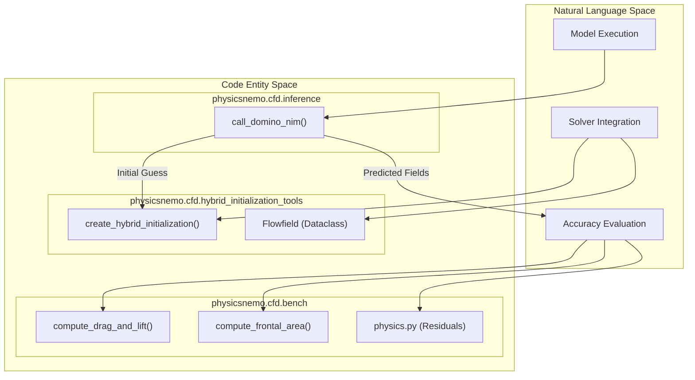
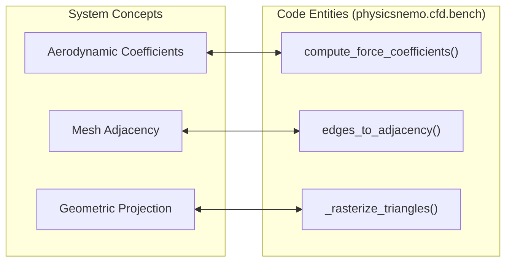

<!-- source: DeepWiki mcp.deepwiki.com · repo NVIDIA/physicsnemo-cfd · page 2 Core Library: physicsnemo.cfd · fetched 2026-10-26 -->

# Core Library: physicsnemo.cfd

Relevant source files

The following files were used as context for generating this wiki page:

- [.pre-commit-config.yaml](.pre-commit-config.yaml)
- [physicsnemo/cfd/__init__.py](physicsnemo/cfd/__init__.py)
- [physicsnemo/cfd/bench/metrics/aero_forces.py](physicsnemo/cfd/bench/metrics/aero_forces.py)
- [physicsnemo/cfd/bench/metrics/frontal_area.py](physicsnemo/cfd/bench/metrics/frontal_area.py)
- [physicsnemo/cfd/bench/metrics/physics.py](physicsnemo/cfd/bench/metrics/physics.py)
- [physicsnemo/cfd/hybrid_initialization_tools/__init__.py](physicsnemo/cfd/hybrid_initialization_tools/__init__.py)
- [workflows/bench_example/notebooks/img/design_scatter_plot.png](workflows/bench_example/notebooks/img/design_scatter_plot.png)
- [workflows/bench_example/notebooks/img/design_trend_plot.png](workflows/bench_example/notebooks/img/design_trend_plot.png)

The `physicsnemo.cfd` package serves as the foundational library for the PhysicsNeMo-CFD project. It provides the core logic for interacting with AI surrogate models, evaluating their physical accuracy against ground truth, and integrating their predictions back into traditional CFD solvers.

The library is organized into three primary sub-modules that handle distinct stages of an AI-augmented CFD workflow:

1.  **`inference`**: Communication with the DoMINO NIM microservice.
2.  **`bench`**: Evaluation of model performance using geometric and physical metrics.
3.  **`hybrid_initialization_tools`**: Data blending and interpolation for CFD solver initialization.

### System Architecture and Module Relationships

The following diagram illustrates how the three core sub-modules interact within the broader engineering workflow.

**Workflow Integration Diagram**

**Sources:** [physicsnemo/cfd/__init__.py:1-18](), [physicsnemo/cfd/hybrid_initialization_tools/__init__.py:17-24](), [physicsnemo/cfd/bench/metrics/aero_forces.py:72-146]().

---

### 2.1 Inference Module (`physicsnemo.cfd.inference`)
The `inference` module provides the interface for the **DoMINO NIM** (NVIDIA Inference Microservice). It abstracts the HTTP/REST communication required to send geometry data (STL) to the microservice and receive predicted volumetric flow fields.

*   **Key Functionality**: The `call_domino_nim` function handles payload serialization, service requests, and response parsing.
*   **Data Handling**: Supports input as STL files and returns data as structured numpy arrays or PyVista datasets.
*   **Deployment**: Includes scripts like `launch_local_domino_nim.sh` for managing local containerized deployments of the inference engine.

For details, see [Inference Module (physicsnemo.cfd.inference)](#2.1).

---

### 2.2 Benchmarking Module (`physicsnemo.cfd.bench`)
The `bench` module is used to quantify the "goodness" of an AI prediction. It compares predicted fields against "Ground Truth" (GT) data typically generated by high-fidelity CFD solvers (e.g., OpenFOAM).

| Sub-Directory | Primary Responsibility | Key Code Entities |
| :--- | :--- | :--- |
| `metrics` | Physics and Error calculations | `compute_drag_and_lift`, `compute_frontal_area` |
| `geometry` | Spatial relationship analysis | Hausdorff/Chamfer distance functions |
| `interpolation` | Mapping data between meshes | KNN-based IDW interpolation |
| `visualization` | Generating performance plots | `utils.py` (Streamlines, hexbins) |

**Code-to-System Mapping: Benchmarking Metrics**

For details, see [Benchmarking Module (physicsnemo.cfd.bench)](#2.2).

**Sources:** [physicsnemo/cfd/bench/metrics/aero_forces.py:21-69](), [physicsnemo/cfd/bench/metrics/physics.py:27-87](), [physicsnemo/cfd/bench/metrics/frontal_area.py:24-68]().

---

### 2.3 Hybrid Initialization Tools (`physicsnemo.cfd.hybrid_initialization_tools`)
This module provides utilities to use AI predictions as a "warm start" for traditional CFD solvers. By providing a physically informed initial guess rather than a uniform field, solvers can reach convergence significantly faster.

*   **`Flowfield`**: A specialized dataclass [physicsnemo/cfd/hybrid_initialization_tools/flowfield.py]() used to represent and manipulate multi-component fields (e.g., $U, p, k, \omega$).
*   **`create_hybrid_initialization`**: The primary entry point for blending different initialization strategies (e.g., potential flow vs. AI prediction).
*   **Blending Strategies**: Implements k-field weighting to transition between different flow regimes.
*   **Interoperability**: Includes `openfoam_utils` and `pyvista_utils` to bridge the gap between Python-based AI data and solver-specific file formats.

For details, see [Hybrid Initialization Tools (physicsnemo.cfd.hybrid_initialization_tools)](#2.3).

**Sources:** [physicsnemo/cfd/hybrid_initialization_tools/__init__.py:17-24]().

---

