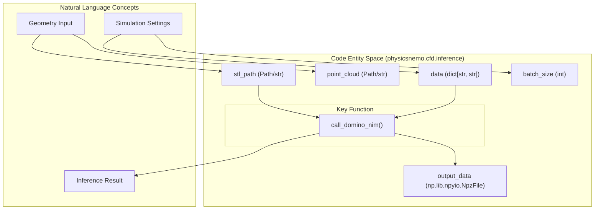
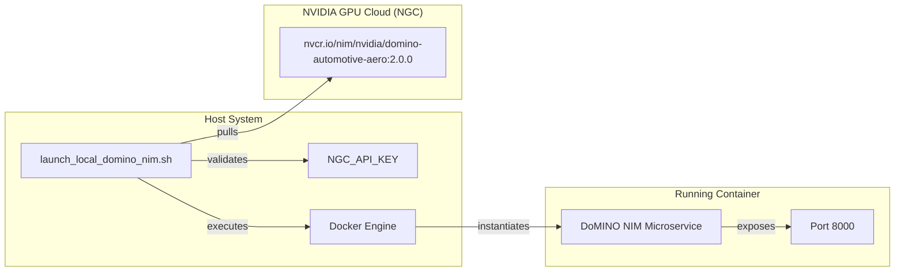

<!-- source: DeepWiki mcp.deepwiki.com · repo NVIDIA/physicsnemo-cfd · page 2.1 Inference Module (physicsnemo.cfd.inference) · fetched 2026-10-26 -->

# Inference Module (physicsnemo.cfd.inference)

Relevant source files

The following files were used as context for generating this wiki page:

- [physicsnemo/cfd/inference/domino_nim.py](physicsnemo/cfd/inference/domino_nim.py)
- [physicsnemo/cfd/inference/launch_local_domino_nim.sh](physicsnemo/cfd/inference/launch_local_domino_nim.sh)

The Inference Module provides a standardized interface for interacting with the **DoMINO NIM** (NVIDIA Inference Microservice), a specialized AI surrogate model for automotive aerodynamics. This module abstracts the complexities of HTTP communication, geometry preprocessing, and data serialization, allowing users to obtain high-fidelity CFD-like predictions (velocity, pressure, turbulent quantities) directly from STL geometry files.

## DoMINO NIM Interface

The primary entry point for the inference module is the `call_domino_nim` function. This function manages the lifecycle of an inference request, from preparing the mesh to parsing the multi-modal response from the microservice.

### The `call_domino_nim` Function
The function `call_domino_nim` handles the transmission of geometry and simulation parameters to the NIM endpoint. It supports both default random point cloud generation and user-provided point clouds for targeted inference.

**Key Features:**
*   **Mesh Consolidation**: Automatically converts complex `trimesh.Scene` objects into a single consolidated STL mesh before transmission [physicsnemo/cfd/inference/domino_nim.py:94-98]().
*   **Flexible Endpoints**: While it defaults to the full inference path (`/v1/infer`), it can be configured to target volume-only or surface-only endpoints [physicsnemo/cfd/inference/domino_nim.py:39-44]().
*   **Robust Communication**: Implements error handling for connection timeouts and REST API failures [physicsnemo/cfd/inference/domino_nim.py:123-132]().

### Data Flow: Natural Language to Code Entities
The following diagram illustrates how high-level inference concepts map to specific code implementations and data structures within the module.

**Inference Mapping Diagram**

Sources: [physicsnemo/cfd/inference/domino_nim.py:23-77]()

## Communication and Data Formats

The module communicates with the NIM microservice via HTTP/REST using the `httpx` library. Data is exchanged using `multipart/form-data` for files and standard form fields for simulation parameters.

### Input Parameters
The NIM accepts several parameters that control the fidelity and scope of the surrogate prediction:
| Parameter | Type | Default | Description |
| :--- | :--- | :--- | :--- |
| `stream_velocity` | `str` | "40" | Freestream velocity in m/s. |
| `stencil_size` | `str` | "1" | Controls the spatial resolution of the simulation. |
| `point_cloud_size`| `str` | "500000" | Number of points sampled in the output volume. |
| `batch_size` | `str` | None | Processing batch size for the model backbone. |

Sources: [physicsnemo/cfd/inference/domino_nim.py:45-59](), [physicsnemo/cfd/inference/domino_nim.py:78-83]()

### Output Data Structure
The response from the NIM is a serialized NumPy archive (`.npz`). The `call_domino_nim` function deserializes this into a dictionary containing the following fields:

*   **Volume Fields**: `coordinates`, `velocity`, `pressure`, `sdf`, `turbulent-kinetic-energy`, `turbulent-viscosity`.
*   **Surface Fields**: `surface_coordinates`, `pressure_surface`, `wall-shear-stress`.
*   **Integrated Metrics**: `drag_force`, `lift_force`.
*   **Metadata**: `bounding_box_dims`.

Sources: [physicsnemo/cfd/inference/domino_nim.py:63-77](), [physicsnemo/cfd/inference/domino_nim.py:168-170]()

## Local Deployment

To facilitate local development and testing, the module includes a utility script for deploying the DoMINO NIM as a Docker container.

### `launch_local_domino_nim.sh`
This script automates the deployment of the `domino-automotive-aero` NIM container. It performs several pre-flight checks:
1.  **Authentication**: Verifies the `NGC_API_KEY` environment variable and logs into `nvcr.io` [physicsnemo/cfd/inference/launch_local_domino_nim.sh:7-28]().
2.  **Port Management**: Checks if the default port (`8000`) is occupied and offers to stop conflicting containers [physicsnemo/cfd/inference/launch_local_domino_nim.sh:31-47]().
3.  **GPU Configuration**: Launches the container with the NVIDIA runtime and specific shared memory requirements (`--shm-size 2g`) [physicsnemo/cfd/inference/launch_local_domino_nim.sh:51-58]().

**Local Deployment Architecture**

Sources: [physicsnemo/cfd/inference/launch_local_domino_nim.sh:1-59]()

---

