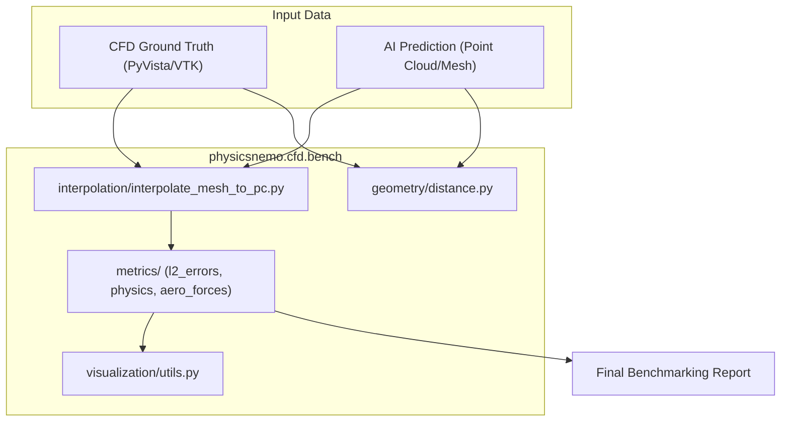

<!-- source: DeepWiki mcp.deepwiki.com · repo NVIDIA/physicsnemo-cfd · page 2.2 Benchmarking Module (physicsnemo.cfd.bench) · fetched 2026-10-26 -->

# Benchmarking Module (physicsnemo.cfd.bench)

<details>
<summary>Relevant source files</summary>

The following files were used as context for generating this wiki page:

- [.pre-commit-config.yaml](.pre-commit-config.yaml)
- [physicsnemo/cfd/bench/geometry/distance.py](physicsnemo/cfd/bench/geometry/distance.py)
- [physicsnemo/cfd/bench/interpolation/interpolate_mesh_to_pc.py](physicsnemo/cfd/bench/interpolation/interpolate_mesh_to_pc.py)
- [physicsnemo/cfd/bench/metrics/aero_forces.py](physicsnemo/cfd/bench/metrics/aero_forces.py)
- [physicsnemo/cfd/bench/metrics/frontal_area.py](physicsnemo/cfd/bench/metrics/frontal_area.py)
- [physicsnemo/cfd/bench/metrics/l2_errors.py](physicsnemo/cfd/bench/metrics/l2_errors.py)
- [physicsnemo/cfd/bench/metrics/physics.py](physicsnemo/cfd/bench/metrics/physics.py)
- [physicsnemo/cfd/bench/metrics/streamlines.py](physicsnemo/cfd/bench/metrics/streamlines.py)
- [physicsnemo/cfd/bench/visualization/utils.py](physicsnemo/cfd/bench/visualization/utils.py)
- [physicsnemo/cfd/hybrid_initialization_tools/__init__.py](physicsnemo/cfd/hybrid_initialization_tools/__init__.py)
- [workflows/bench_example/setup.sh](workflows/bench_example/setup.sh)

</details>


The `physicsnemo.cfd.bench` module provides a comprehensive suite of tools for evaluating AI surrogate models against high-fidelity Computational Fluid Dynamics (CFD) ground truth. It facilitates the calculation of standard error metrics, physics-based residuals on unstructured meshes, aerodynamic coefficients, and geometric fidelity measures.

The module is organized into four functional areas:
1.  **Metrics**: Quantitative evaluation of field accuracy and physics consistency.
2.  **Geometry**: Comparison of geometric shapes and point cloud distances.
3.  **Interpolation**: Data transfer between meshes and point clouds for cross-format evaluation.
4.  **Visualization**: Qualitative analysis through field comparisons, streamlines, and trend plots.

### System Architecture: Benchmarking Components

The following diagram illustrates how the various sub-packages interact to process CFD data and AI predictions into benchmarking results.

**Benchmarking Data Flow**

**Sources:** [physicsnemo/cfd/bench/metrics/l2_errors.py:22-43](), [physicsnemo/cfd/bench/interpolation/interpolate_mesh_to_pc.py:96-114](), [physicsnemo/cfd/bench/visualization/utils.py:29-39]()

---

### Physics Metrics: Residuals and Aerodynamic Forces
This sub-package provides tools to evaluate if AI predictions satisfy the underlying governing equations of fluid dynamics and if they accurately predict engineering quantities of interest like Drag ($C_d$) and Lift ($C_l$).

*   **Residuals**: Computes continuity and momentum residuals directly on unstructured meshes using Numba-accelerated kernels [physicsnemo/cfd/bench/metrics/physics.py:27-87]().
*   **Aerodynamic Forces**: Integrates pressure and Wall Shear Stress (WSS) over surface meshes to compute force coefficients [physicsnemo/cfd/bench/metrics/aero_forces.py:21-69]().
*   **Frontal Area**: Provides exact (polygon union) and approximate (GPU-accelerated rasterization) methods to calculate the reference area for coefficient normalization [physicsnemo/cfd/bench/metrics/frontal_area.py:117-175]().

For details, see [Physics Metrics: Residuals and Aerodynamic Forces](#2.2.1).

**Sources:** [physicsnemo/cfd/bench/metrics/physics.py](), [physicsnemo/cfd/bench/metrics/aero_forces.py](), [physicsnemo/cfd/bench/metrics/frontal_area.py]()

---

### Error Metrics and Geometry Distances
Beyond physics, the module implements standard statistical error measures and geometric comparison algorithms to quantify the "closeness" of the AI output to the target.

*   **L2 Errors**: Supports standard and area-weighted L2 error calculations for both scalar and vector fields [physicsnemo/cfd/bench/metrics/l2_errors.py:22-194]().
*   **Geometry Distances**: Implements Hausdorff and Chamfer distances to compare the similarity of point clouds or surface meshes. It supports both CPU-based `scipy.spatial.cKDTree` and GPU-accelerated `cuml.neighbors` paths [physicsnemo/cfd/bench/geometry/distance.py:23-126]().
*   **Interpolation**: Uses Inverse Distance Weighting (IDW) with K-Nearest Neighbors (KNN) to map results from unstructured volume/surface meshes to point clouds for uniform comparison [physicsnemo/cfd/bench/interpolation/interpolate_mesh_to_pc.py:96-138]().

For details, see [Error Metrics, Geometry Distances, and Interpolation](#2.2.2).

**Sources:** [physicsnemo/cfd/bench/metrics/l2_errors.py](), [physicsnemo/cfd/bench/geometry/distance.py](), [physicsnemo/cfd/bench/interpolation/interpolate_mesh_to_pc.py]()

---

### Visualization Utilities
The visualization sub-package provides high-level plotting functions to interpret benchmarking results. These utilities leverage `PyVista` for 3D rendering and `Matplotlib` for statistical plotting.

*   **Field Comparisons**: Generates side-by-side plots of Ground Truth, Prediction, and Absolute Error fields [physicsnemo/cfd/bench/visualization/utils.py:29-162]().
*   **Streamlines**: Robustly generates streamlines from vector fields (e.g., velocity) using Poisson disk sampling for seed points [physicsnemo/cfd/bench/metrics/streamlines.py:22-59]().
*   **Engineering Plots**: Includes utilities for R² regression plots of aerodynamic coefficients and aggregate error maps [physicsnemo/cfd/bench/visualization/utils.py:20-25]().

For details, see [Visualization Utilities](#2.2.3).

**Sources:** [physicsnemo/cfd/bench/visualization/utils.py](), [physicsnemo/cfd/bench/metrics/streamlines.py]()

---

### Code Entity Mapping

The following diagram maps the logical benchmarking tasks to the specific Python entities and files within the `bench` module.

**Benchmarking Entity Map**
```mermaid
classDiagram
    class Metrics {
        +compute_l2_errors()
        +compute_drag_and_lift()
        +compute_frontal_area()
        +edges_to_adjacency()
    }
    class Geometry {
        +hausdorff_distance()
        +chamfer_distance()
    }
    class Interpolation {
        +interpolate_mesh_to_pc()
        +_create_nbrs_surface()
    }
    class Visualization {
        +plot_field_comparisons()
        +compute_streamlines()
    }

    Metrics --|> "physics.py"
    Metrics --|> "l2_errors.py"
    Metrics --|> "aero_forces.py"
    Geometry --|> "distance.py"
    Interpolation --|> "interpolate_mesh_to_pc.py"
    Visualization --|> "utils.py"
```
**Sources:** [physicsnemo/cfd/bench/metrics/physics.py:28](), [physicsnemo/cfd/bench/metrics/l2_errors.py:22](), [physicsnemo/cfd/bench/metrics/aero_forces.py:72](), [physicsnemo/cfd/bench/geometry/distance.py:23](), [physicsnemo/cfd/bench/interpolation/interpolate_mesh_to_pc.py:96](), [physicsnemo/cfd/bench/visualization/utils.py:29]()

---

