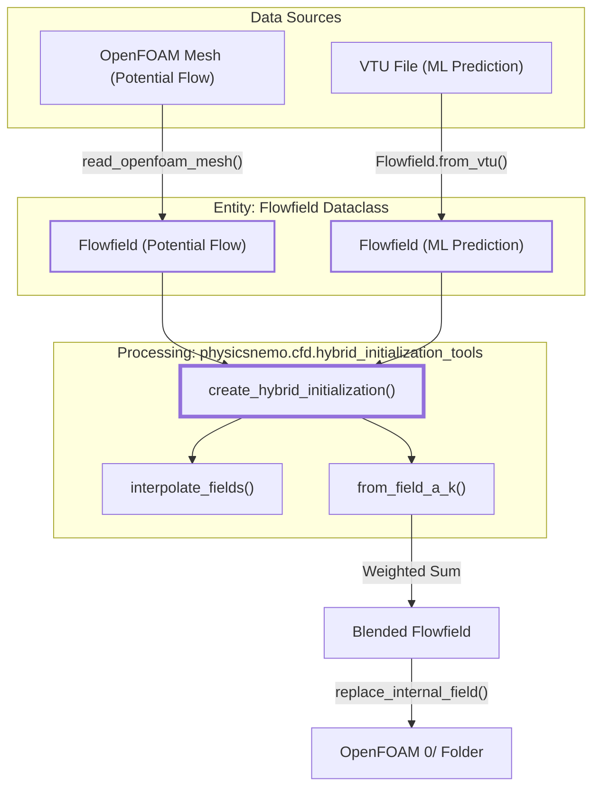
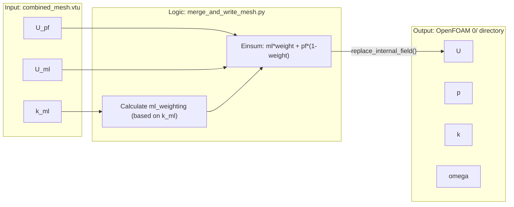

<!-- source: DeepWiki mcp.deepwiki.com · repo NVIDIA/physicsnemo-cfd · page 2.3 Hybrid Initialization Tools (physicsnemo.cfd.hybrid_initialization_tools) · fetched 2026-10-26 -->

# Hybrid Initialization Tools (physicsnemo.cfd.hybrid_initialization_tools)

<details>
<summary>Relevant source files</summary>

The following files were used as context for generating this wiki page:

- [physicsnemo/cfd/hybrid_initialization_tools/README.md](physicsnemo/cfd/hybrid_initialization_tools/README.md)
- [physicsnemo/cfd/hybrid_initialization_tools/create_combined_vtu.py](physicsnemo/cfd/hybrid_initialization_tools/create_combined_vtu.py)
- [physicsnemo/cfd/hybrid_initialization_tools/flowfield.py](physicsnemo/cfd/hybrid_initialization_tools/flowfield.py)
- [physicsnemo/cfd/hybrid_initialization_tools/main.py](physicsnemo/cfd/hybrid_initialization_tools/main.py)
- [physicsnemo/cfd/hybrid_initialization_tools/merge_and_write_mesh.py](physicsnemo/cfd/hybrid_initialization_tools/merge_and_write_mesh.py)
- [physicsnemo/cfd/hybrid_initialization_tools/utilities/__init__.py](physicsnemo/cfd/hybrid_initialization_tools/utilities/__init__.py)
- [physicsnemo/cfd/hybrid_initialization_tools/utilities/openfoam_utils.py](physicsnemo/cfd/hybrid_initialization_tools/utilities/openfoam_utils.py)
- [physicsnemo/cfd/hybrid_initialization_tools/utilities/pyvista_utils.py](physicsnemo/cfd/hybrid_initialization_tools/utilities/pyvista_utils.py)

</details>


The `physicsnemo.cfd.hybrid_initialization_tools` sub-package provides utilities for creating "hybrid initializations" for transient CFD simulations. These initializations combine the global accuracy of a potential flow solution with the local wake/separation fidelity of an ML surrogate model (such as a DoMINO NIM) to accelerate convergence in transient solvers like OpenFOAM's `pimpleFoam` [physicsnemo/cfd/hybrid_initialization_tools/README.md:1-16]().

## System Overview and Data Flow

The hybrid initialization process bridges the gap between different mesh topologies and data sources. It typically involves interpolating ML predictions onto a simulation mesh and blending them with a baseline potential flow field using physics-informed weighting.

### Code Entity Map: Hybrid Initialization Pipeline
The following diagram maps the logical stages of hybrid initialization to the specific classes and functions in the codebase.


Sources: [physicsnemo/cfd/hybrid_initialization_tools/flowfield.py:25-50](), [physicsnemo/cfd/hybrid_initialization_tools/main.py:70-103](), [physicsnemo/cfd/hybrid_initialization_tools/utilities/openfoam_utils.py:24-58]()

## Core Data Structures

### Flowfield Dataclass
The `Flowfield` class is the central data container. It encapsulates a `pyvista.PolyData` mesh and standardizes the naming of CFD fields across different formats [physicsnemo/cfd/hybrid_initialization_tools/flowfield.py:25-50]().

| Attribute | Type | Description |
| :--- | :--- | :--- |
| `mesh` | `pv.PolyData` | The geometry and field data container. |
| `velocity_fieldname` | `str` | Name of the velocity field (default: "U"). |
| `pressure_fieldname` | `str` | Name of the pressure field (default: "p"). |
| `k_fieldname` | `str` | Name of the turbulent kinetic energy field (default: "k"). |
| `omega_fieldname` | `str` | Name of the specific dissipation rate field (default: "omega"). |

**Key Methods:**
*   `from_vtu()`: Reads a VTU file and automatically identifies field names by matching against common naming conventions (e.g., "Velocity", "U", "Vel") [physicsnemo/cfd/hybrid_initialization_tools/flowfield.py:53-142]().
*   `parse_fieldnames()`: A static utility that uses regex and literal matching to find CFD fields in a mesh [physicsnemo/cfd/hybrid_initialization_tools/flowfield.py:145-170]().

Sources: [physicsnemo/cfd/hybrid_initialization_tools/flowfield.py:25-170]()

## Hybridization Logic

### create_hybrid_initialization
The `create_hybrid_initialization` function is the primary entry point for blending two flowfields. It handles mesh alignment, interpolation, and the application of a blending strategy [physicsnemo/cfd/hybrid_initialization_tools/main.py:70-103]().

1.  **Coordinate Extraction**: Determines whether to use cell centers or points for interpolation based on `flowfield_a_data_location` and `flowfield_b_data_location` [physicsnemo/cfd/hybrid_initialization_tools/main.py:140-149]().
2.  **Interpolation**: If meshes differ, it uses `interpolate_fields` to map data from mesh B to mesh A (or vice versa) [physicsnemo/cfd/hybrid_initialization_tools/main.py:167-175]().
3.  **Blending**: Applies the `blend_strategy` callback to compute weights and combine fields [physicsnemo/cfd/hybrid_initialization_tools/main.py:214-222]().

### Blending Strategies (k-field Weighting)
The default strategy, `from_field_a_k`, uses Turbulent Kinetic Energy (TKE) to determine where the ML model should take precedence. In regions of high TKE (wakes, separation zones), the ML solution is weighted more heavily; in low TKE regions (freestream), the potential flow solution is preferred [physicsnemo/cfd/hybrid_initialization_tools/main.py:27-67]().

The weight is calculated using a squared sine ramp between a lower and upper threshold of $k$:
```python
weight = np.sin(np.pi / 2 * np.clip((k - k_min) / (k_max - k_min), 0, 1))**2
```
[physicsnemo/cfd/hybrid_initialization_tools/main.py:53-65]()

Sources: [physicsnemo/cfd/hybrid_initialization_tools/main.py:27-222]()

## Utility Sub-modules

### OpenFOAM Utilities (`openfoam_utils.py`)
Provides low-level functions for interacting with OpenFOAM data formats.

*   **`read_openfoam_mesh`**: Uses `pv.POpenFOAMReader` to load the `internalMesh` from a case directory [physicsnemo/cfd/hybrid_initialization_tools/utilities/openfoam_utils.py:24-58]().
*   **`interpolate_fields`**: Implements Inverse Distance Weighting (IDW) interpolation using `sklearn.neighbors.NearestNeighbors`. It computes weights based on the $1/d^p$ relationship (default power $p=4$) [physicsnemo/cfd/hybrid_initialization_tools/utilities/openfoam_utils.py:198-250]().
*   **`replace_internal_field`**: A critical utility that parses an OpenFOAM field file (like `0/U`) and replaces the `internalField` block with new values while preserving boundary conditions and headers [physicsnemo/cfd/hybrid_initialization_tools/utilities/openfoam_utils.py:114-196]().

### PyVista Utilities (`pyvista_utils.py`)
Extends PyVista functionality for point cloud manipulation.

*   **`mask_pointset`**: Filters points and their associated data using a boolean mask [physicsnemo/cfd/hybrid_initialization_tools/utilities/pyvista_utils.py:45-82]().
*   **`add_points_to_pointset`**: Appends new coordinates and field data to an existing `PointSet`, ensuring data consistency across all arrays [physicsnemo/cfd/hybrid_initialization_tools/utilities/pyvista_utils.py:85-141]().

Sources: [physicsnemo/cfd/hybrid_initialization_tools/utilities/openfoam_utils.py:24-250](), [physicsnemo/cfd/hybrid_initialization_tools/utilities/pyvista_utils.py:45-141]()

## Implementation Example: Field Merging

The following diagram illustrates the data flow within the `merge_and_write_mesh.py` utility, which finalizes the hybrid initialization for OpenFOAM.


Sources: [physicsnemo/cfd/hybrid_initialization_tools/merge_and_write_mesh.py:37-84]()

---

