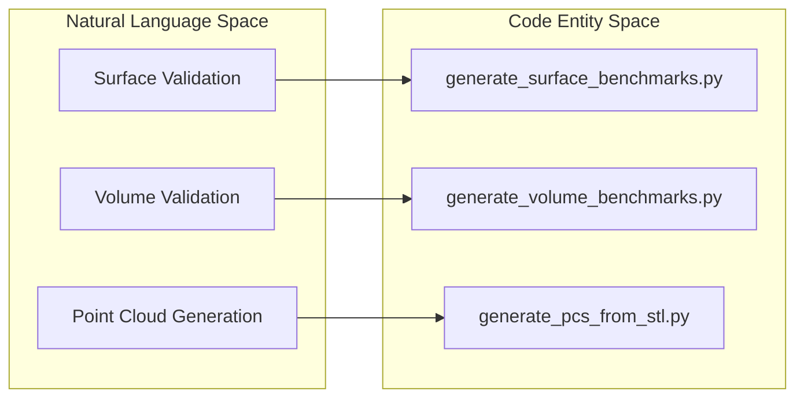
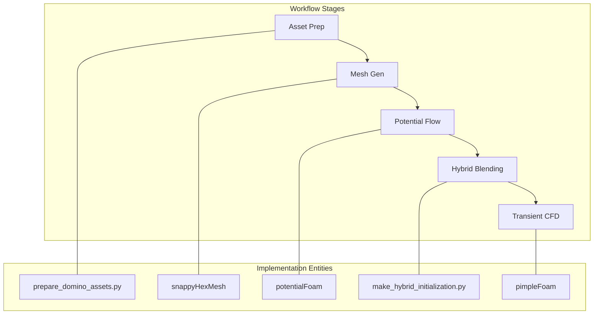

<!-- source: DeepWiki mcp.deepwiki.com · repo NVIDIA/physicsnemo-cfd · page 3 Workflows · fetched 2026-10-26 -->

# Workflows

Relevant source files

The following files were used as context for generating this wiki page:

- [README.md](README.md)
- [workflows/bench_example/README.md](workflows/bench_example/README.md)
- [workflows/domino_design_sensitivities/README.md](workflows/domino_design_sensitivities/README.md)
- [workflows/hybrid_initialization_example/README.md](workflows/hybrid_initialization_example/README.md)
- [workflows/hybrid_initialization_example/openfoam_interactive.sh](workflows/hybrid_initialization_example/openfoam_interactive.sh)
- [workflows/hybrid_initialization_example/run.sh](workflows/hybrid_initialization_example/run.sh)

The `workflows/` directory contains end-to-end reference implementations that demonstrate how to integrate the `physicsnemo.cfd` library into engineering pipelines. These workflows bridge the gap between raw AI model inference and actionable CFD results, covering model validation, design optimization, and simulation acceleration.

### Common Workflow Patterns

While each workflow serves a distinct purpose, they share several architectural patterns:
*   **Containerization**: Workflows are designed to run in specialized environments, such as the PhysicsNeMo Docker container or custom OpenFOAM+Python environments [workflows/hybrid_initialization_example/README.md:59-61](), [workflows/hybrid_initialization_example/openfoam_interactive.sh:5-36]().
*   **Hydra Configuration**: Complex parameters (domain bounds, stencil sizes, field mappings) are managed via Hydra YAML configurations to ensure reproducibility [workflows/domino_design_sensitivities/README.md:32-33](), [workflows/domino_design_sensitivities/README.md:125-134]().
*   **Data Interoperability**: Workflows consume and produce standard engineering formats, primarily STL for geometry and VTK (`.vtp`, `.vtu`) for field data [workflows/bench_example/README.md:22-25](), [workflows/domino_design_sensitivities/README.md:34-36]().

### Workflow Overview

| Workflow | Primary Objective | Key Technologies |
| :--- | :--- | :--- |
| **Benchmarking** | Validate AI surrogate accuracy against CFD ground truth. | PyVista, Numba, DrivAerML Dataset |
| **Design Sensitivities** | Compute gradients for shape optimization. | DoMINO NIM, Adjoint/Autograd, Laplacian Smoothing |
| **Hybrid Initialization** | Accelerate CFD convergence using ML-blended starts. | OpenFOAM, Potential Flow, DoMINO NIM |

---

### 3.1 Benchmarking Workflow (`bench_example`)

The benchmarking workflow provides a rigorous framework for evaluating AI surrogates for external aerodynamics [workflows/bench_example/README.md:3-5](). It compares model predictions against high-fidelity CFD results using a suite of engineering metrics, including L2 errors, aerodynamic force coefficients (Drag/Lift), and PDE residuals [README.md:37-41]().

The workflow supports both mesh-based evaluations and point-cloud-based inference, which is ideal for real-time workflows where traditional meshing is a bottleneck [workflows/bench_example/README.md:124-132]().

For details, see [Benchmarking Workflow (bench_example)](#3.1).

**Workflow Entity Mapping**

**Sources:** [workflows/bench_example/README.md:15-17](), [workflows/bench_example/README.md:134-137]()

---

### 3.2 Design Sensitivities Workflow (`domino_design_sensitivities`)

This workflow demonstrates how to use the DoMINO surrogate model to compute geometry sensitivities [workflows/domino_design_sensitivities/README.md:3-4](). It calculates the gradient of aerodynamic drag with respect to surface mesh coordinates, identifying regions where shape changes will most effectively reduce drag [workflows/domino_design_sensitivities/README.md:14-19]().

Key features include:
*   **Adjoint-based Gradients**: Efficient computation of sensitivities via autograd.
*   **Laplacian Smoothing**: Post-processing raw gradients into physically meaningful deformation fields [workflows/domino_design_sensitivities/README.md:7-9]().
*   **Gradient Checking**: Validation of AI-derived gradients against finite-difference perturbations [workflows/domino_design_sensitivities/README.md:142-154]().

For details, see [Design Sensitivities Workflow (domino_design_sensitivities)](#3.2).

**Sources:** [workflows/domino_design_sensitivities/README.md:23-31](), [workflows/domino_design_sensitivities/README.md:100-105]()

---

### 3.3 Hybrid Initialization Workflow (`hybrid_initialization_example`)

The hybrid initialization workflow accelerates transient CFD simulations by providing superior starting conditions [workflows/hybrid_initialization_example/README.md:3-6](). It blends a physics-based potential flow solution with an ML-based prediction from a DoMINO NIM [workflows/hybrid_initialization_example/README.md:32-34]().

The pipeline is orchestrated by a master script (`run.sh`) that manages the transition between Python-based ML inference and OpenFOAM-based solver execution [workflows/hybrid_initialization_example/run.sh:5-16]().

For details, see [Hybrid Initialization Workflow (hybrid_initialization_example)](#3.3).

**Simulation Pipeline Mapping**

**Sources:** [workflows/hybrid_initialization_example/run.sh:44-99](), [workflows/hybrid_initialization_example/README.md:17-30]()

---

