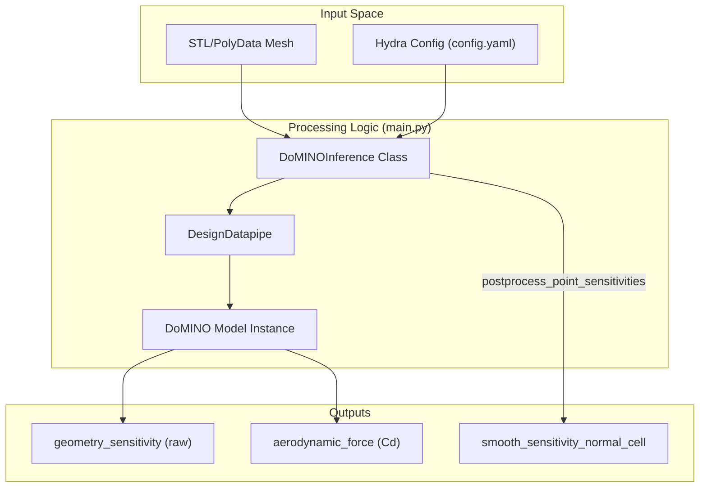
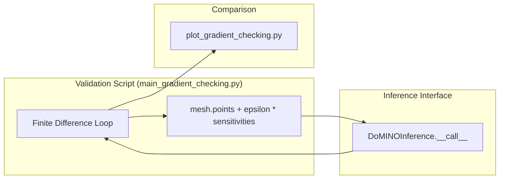

<!-- source: DeepWiki mcp.deepwiki.com · repo NVIDIA/physicsnemo-cfd · page 3.2 Design Sensitivities Workflow (domino_design_sensitivities) · fetched 2026-10-26 -->

# Design Sensitivities Workflow (domino_design_sensitivities)

Relevant source files

The following files were used as context for generating this wiki page:

- [workflows/domino_design_sensitivities/README.md](workflows/domino_design_sensitivities/README.md)
- [workflows/domino_design_sensitivities/__init__.py](workflows/domino_design_sensitivities/__init__.py)
- [workflows/domino_design_sensitivities/conf/config.yaml](workflows/domino_design_sensitivities/conf/config.yaml)
- [workflows/domino_design_sensitivities/design_datapipe.py](workflows/domino_design_sensitivities/design_datapipe.py)
- [workflows/domino_design_sensitivities/gradient_checking.ipynb](workflows/domino_design_sensitivities/gradient_checking.ipynb)
- [workflows/domino_design_sensitivities/main.ipynb](workflows/domino_design_sensitivities/main.ipynb)
- [workflows/domino_design_sensitivities/main.py](workflows/domino_design_sensitivities/main.py)
- [workflows/domino_design_sensitivities/requirements.txt](workflows/domino_design_sensitivities/requirements.txt)
- [workflows/domino_design_sensitivities/utilities/download.py](workflows/domino_design_sensitivities/utilities/download.py)
- [workflows/domino_design_sensitivities/utilities/mesh_postprocessing.py](workflows/domino_design_sensitivities/utilities/mesh_postprocessing.py)

This workflow provides a comprehensive pipeline for computing and validating geometry sensitivities in external aerodynamics using the DoMINO surrogate model. It enables engineers to understand how changes in vehicle geometry affect aerodynamic functionals, such as drag, by leveraging adjoint-based gradients and automated mesh preprocessing.

## Overview

The `domino_design_sensitivities` workflow automates the process of generating sensitivity maps that indicate where adding or removing material will reduce drag [workflows/domino_design_sensitivities/README.md:6-7](). The core of this workflow is the `DoMINOInference` class, which manages distributed inference, model loading, and the calculation of gradients of total drag with respect to mesh coordinates [workflows/domino_design_sensitivities/main.py:47-75]().

### Key Features
*   **Adjoint-based Sensitivities**: Predicts surface pressure and wall shear stress to compute gradients of drag with respect to mesh coordinates [workflows/domino_design_sensitivities/README.md:16-19]().
*   **Geometric Preprocessing**: Utilizes `DesignDatapipe` to convert raw STL or OpenFOAM meshes into structured point clouds and Signed Distance Fields (SDF) [workflows/domino_design_sensitivities/design_datapipe.py:17-23]().
*   **Field Smoothing**: Implements Numba-accelerated Laplacian smoothing to produce physically meaningful sensitivity fields [workflows/domino_design_sensitivities/README.md:119-121]().
*   **Gradient Validation**: Provides a rigorous check of AI-predicted gradients against finite-difference approximations [workflows/domino_design_sensitivities/README.md:27-28]().

### System Architecture: Sensitivity Inference
The following diagram illustrates how the `DoMINOInference` class coordinates various components to produce sensitivity results.

**Sensitivity Computation Flow**

Sources: [workflows/domino_design_sensitivities/main.py:47-105](), [workflows/domino_design_sensitivities/design_datapipe.py:42-56](), [workflows/domino_design_sensitivities/README.md:65-118]()

---

## Core Components

### DoMINOInference Class
The `DoMINOInference` class serves as the primary interface for the workflow. It handles:
1.  **Initialization**: Sets up the `DoMINO` model architecture and loads pre-trained checkpoints [workflows/domino_design_sensitivities/main.py:77-105]().
2.  **Distributed Execution**: Uses `DistributedManager` to scale inference across multiple GPUs [workflows/domino_design_sensitivities/main.py:114-123]().
3.  **Post-processing**: Projects raw sensitivity vectors onto surface normals and applies Laplacian smoothing to remove high-frequency noise [workflows/domino_design_sensitivities/README.md:99-118]().

### DesignDatapipe
The `DesignDatapipe` is a PyTorch-compatible `Dataset` that prepares geometry for the neural network. It computes Signed Distance Fields (SDF) for both volume and surface grids and constructs KNN stencils using `cuml.neighbors.NearestNeighbors` for efficient local geometric extraction [workflows/domino_design_sensitivities/design_datapipe.py:117-144]().

For details, see [DesignDatapipe: Geometry Preprocessing for Sensitivity Analysis](#3.2.1).

### Laplacian Smoothing
Raw gradients can often be noisy. The workflow includes a specialized post-processing step in `utilities/mesh_postprocessing.py` that uses a Compressed Sparse Row (CSR) adjacency representation to perform fast Laplacian averaging on the mesh 1-ring [workflows/domino_design_sensitivities/utilities/mesh_postprocessing.py:25-54](). This is exposed via `DoMINOInference.postprocess_point_sensitivities` [workflows/domino_design_sensitivities/README.md:99-105]().

---

## Gradient Validation
To ensure the predicted sensitivities are accurate, the workflow includes a validation suite. This involves perturbing the mesh geometry by a small magnitude $\epsilon$ in the direction of the predicted sensitivity and re-evaluating the drag [workflows/domino_design_sensitivities/gradient_checking.ipynb:211-231]().

**Validation Entity Map**

Sources: [workflows/domino_design_sensitivities/gradient_checking.ipynb:191-231](), [workflows/domino_design_sensitivities/README.md:142-155]()

For details, see [Gradient Checking and Validation](#3.2.2).

---

## Configuration
The workflow is governed by a Hydra configuration file (`conf/config.yaml`). Key parameters include:
*   **Bounding Boxes**: `data.bounding_box` and `data.bounding_box_surface` define the spatial limits for sampling [workflows/domino_design_sensitivities/conf/config.yaml:69-74]().
*   **Model Parameters**: `model.num_surface_neighbors` and `model.interp_res` control the resolution of the latent space and neighborhood search [workflows/domino_design_sensitivities/conf/config.yaml:94-102]().
*   **Variables**: Specifies the names of surface and volume variables (e.g., `pMeanTrim`, `UMeanTrim`) to be predicted [workflows/domino_design_sensitivities/conf/config.yaml:50-62]().

Sources: [workflows/domino_design_sensitivities/conf/config.yaml:1-177](), [workflows/domino_design_sensitivities/main.py:142-181]()

---

