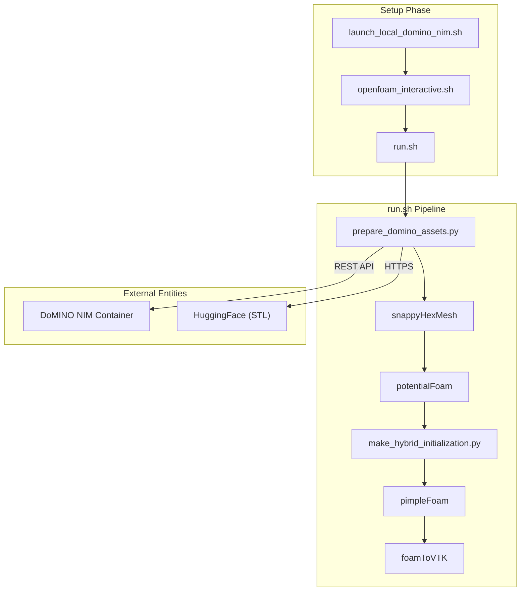
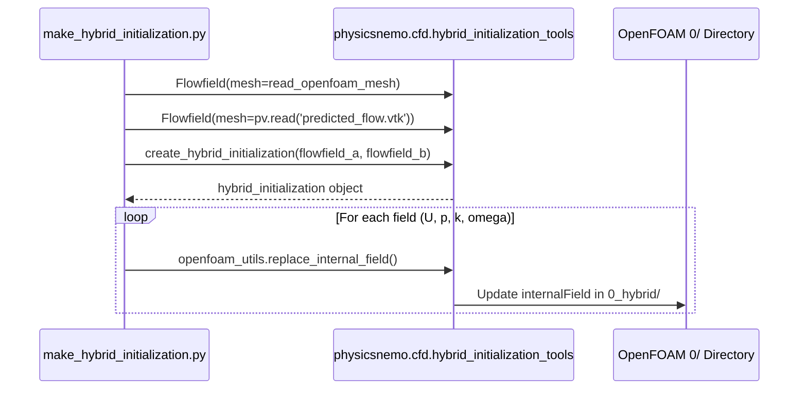

<!-- source: DeepWiki mcp.deepwiki.com · repo NVIDIA/physicsnemo-cfd · page 3.3 Hybrid Initialization Workflow (hybrid_initialization_example) · fetched 2026-10-26 -->

# Hybrid Initialization Workflow (hybrid_initialization_example)

Relevant source files

The following files were used as context for generating this wiki page:

- [workflows/hybrid_initialization_example/README.md](workflows/hybrid_initialization_example/README.md)
- [workflows/hybrid_initialization_example/container/Dockerfile](workflows/hybrid_initialization_example/container/Dockerfile)
- [workflows/hybrid_initialization_example/from_domino/README.md](workflows/hybrid_initialization_example/from_domino/README.md)
- [workflows/hybrid_initialization_example/make_hybrid_initialization.py](workflows/hybrid_initialization_example/make_hybrid_initialization.py)
- [workflows/hybrid_initialization_example/openfoam_interactive.sh](workflows/hybrid_initialization_example/openfoam_interactive.sh)
- [workflows/hybrid_initialization_example/prepare_domino_assets.py](workflows/hybrid_initialization_example/prepare_domino_assets.py)
- [workflows/hybrid_initialization_example/run.sh](workflows/hybrid_initialization_example/run.sh)
- [workflows/hybrid_initialization_example/utils.py](workflows/hybrid_initialization_example/utils.py)

The Hybrid Initialization workflow demonstrates an NVIDIA-developed approach to accelerating transient automotive aerodynamics simulations. By blending machine learning (ML) predictions from the **DoMINO NVIDIA Inference Microservice (NIM)** with traditional physics-based **Potential Flow** solutions, the workflow provides optimized initial conditions for OpenFOAM-based solvers (e.g., `pimpleFoam`), significantly reducing the time required for transient convergence [workflows/hybrid_initialization_example/README.md:3-6]().

## Workflow Architecture and Stages

The workflow is orchestrated by a central shell script, `run.sh`, which executes six primary stages within a containerized environment [workflows/hybrid_initialization_example/run.sh:5-16]().

### Pipeline Stages
1.  **Asset Preparation**: Downloads vehicle geometry (STL) and retrieves ML flow field predictions from the DoMINO NIM [workflows/hybrid_initialization_example/README.md:21-22]().
2.  **Mesh Generation**: Uses OpenFOAM utilities (`blockMesh`, `snappyHexMesh`) to create the computational volume around the vehicle [workflows/hybrid_initialization_example/README.md:23-24]().
3.  **Potential Flow**: Solves the inviscid potential flow equations using `potentialFoam` to establish a physics-consistent baseline [workflows/hybrid_initialization_example/README.md:25-26]().
4.  **Hybrid Blending**: Executes `make_hybrid_initialization.py` to interpolate and blend the ML prediction onto the OpenFOAM mesh [workflows/hybrid_initialization_example/README.md:27-28]().
5.  **Transient CFD**: Runs the `pimpleFoam` solver starting from the hybrid-initialized state [workflows/hybrid_initialization_example/README.md:29-30]().
6.  **Post-Processing**: Converts results to VTK format for visualization [workflows/hybrid_initialization_example/run.sh:104-105]().

### Workflow Control Flow
The following diagram maps the high-level stages to the specific scripts and OpenFOAM solvers involved.

**Hybrid Initialization Execution Logic**

Sources: [workflows/hybrid_initialization_example/README.md:17-30](), [workflows/hybrid_initialization_example/run.sh:44-105](), [workflows/hybrid_initialization_example/prepare_domino_assets.py:23-39]()

---

## Technical Implementation Detail

### Asset Preparation (`prepare_domino_assets.py`)
This script handles the interaction with external data sources. It downloads the DrivAerML vehicle geometry and communicates with the DoMINO NIM via the `call_domino_nim` function [workflows/hybrid_initialization_example/prepare_domino_assets.py:23-31]().

*   **Geometry**: Fetches `vehicle.stl` from a remote repository [workflows/hybrid_initialization_example/prepare_domino_assets.py:23-26]().
*   **Inference**: Calls the NIM endpoint (default `http://localhost:8000/v1/infer`) with parameters like `stream_velocity` and `point_cloud_size` [workflows/hybrid_initialization_example/prepare_domino_assets.py:31-39]().
*   **Data Conversion**: Converts the NIM response (numpy arrays) into a PyVista `PointSet` and saves it as `predicted_flow.vtk` [workflows/hybrid_initialization_example/prepare_domino_assets.py:43-49]().

### Hybrid Blending Logic (`make_hybrid_initialization.py`)
The core "hybridization" occurs in this script, which utilizes the `physicsnemo.cfd.hybrid_initialization_tools` (HIT) module [workflows/hybrid_initialization_example/make_hybrid_initialization.py:17-20]().

1.  **Load Flowfields**: It initializes two `hit.Flowfield` objects—one for the potential flow (`flowfield_pf`) and one for the ML prediction (`flowfield_ml`) [workflows/hybrid_initialization_example/make_hybrid_initialization.py:29-45]().
2.  **Field Mapping**:
    *   ML fields (`UMeanTrimPred`, `pMeanTrimPred`, `TKEPred`) are mapped to standard OpenFOAM fields (`U`, `p`, `k`) [workflows/hybrid_initialization_example/make_hybrid_initialization.py:40-44]().
    *   Turbulent viscosity (`nut`) is converted to specific dissipation rate (`omega`) using a density-based calculation [workflows/hybrid_initialization_example/make_hybrid_initialization.py:62-66]().
3.  **Blending**: The `hit.create_hybrid_initialization` function performs the spatial interpolation and data merging [workflows/hybrid_initialization_example/make_hybrid_initialization.py:68-74]().
4.  **OpenFOAM Injection**: The resulting fields are written back into the OpenFOAM `0_hybrid` directory using `hit.openfoam_utils.replace_internal_field` [workflows/hybrid_initialization_example/make_hybrid_initialization.py:77-83]().

**Code Entity Interaction: Blending Process**

Sources: [workflows/hybrid_initialization_example/make_hybrid_initialization.py:29-83](), [workflows/hybrid_initialization_example/prepare_domino_assets.py:43-49]()

---

## Environment and Execution

### Container Setup
The workflow requires two distinct container environments:
1.  **DoMINO NIM Container**: Launched via `launch_local_domino_nim.sh`. It serves the ML model via a REST API [workflows/hybrid_initialization_example/README.md:65]().
2.  **OpenFOAM+Python Container**: Built from the provided `Dockerfile`. It includes OpenFOAM v2206 and the necessary Python stack [workflows/hybrid_initialization_example/container/Dockerfile:18-63]().

The `openfoam_interactive.sh` script manages the launch of the development container, ensuring the host repository is mounted to `/workspace` and the NVIDIA runtime is utilized for GPU acceleration [workflows/hybrid_initialization_example/openfoam_interactive.sh:26-36]().

### Parallel Execution
The `run.sh` script automatically detects the number of physical CPU cores using `lscpu` and updates the OpenFOAM `system/decomposeParDict` to ensure optimal parallel performance during meshing and solving [workflows/hybrid_initialization_example/run.sh:57-66]().

### Expected Outputs
*   **Logs**: Detailed logs for every stage (e.g., `log.shm`, `log.potentialfoam`, `log.make_hybrid_initialization`) [workflows/hybrid_initialization_example/run.sh:18]().
*   **Visualization**: A PNG screenshot of the hybrid velocity field (`hybrid_velocity_slice.png`) and VTK files in the `VTK/` directory [workflows/hybrid_initialization_example/make_hybrid_initialization.py:119-121](), [workflows/hybrid_initialization_example/run.sh:105]().
*   **Analysis**: Force time-histories located in the `postProcessing/` directory [workflows/hybrid_initialization_example/README.md:167-168]().

Sources: [workflows/hybrid_initialization_example/README.md:45-108](), [workflows/hybrid_initialization_example/run.sh:57-66](), [workflows/hybrid_initialization_example/openfoam_interactive.sh:26-36]()

---

