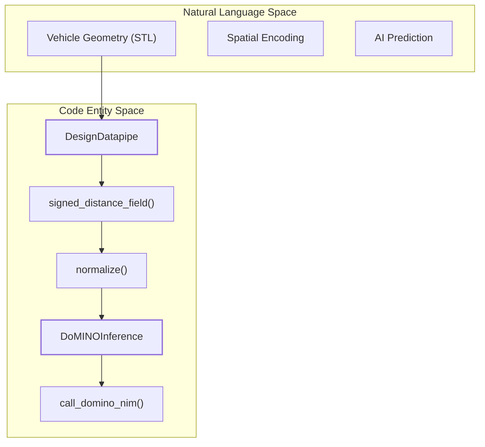
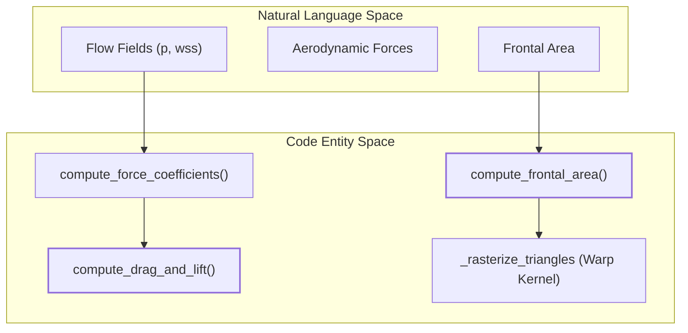

<!-- source: DeepWiki mcp.deepwiki.com · repo NVIDIA/physicsnemo-cfd · page 4 Glossary · fetched 2026-10-26 -->

# Glossary

Relevant source files

The following files were used as context for generating this wiki page:

- [.pre-commit-config.yaml](.pre-commit-config.yaml)
- [README.md](README.md)
- [physicsnemo/cfd/bench/geometry/distance.py](physicsnemo/cfd/bench/geometry/distance.py)
- [physicsnemo/cfd/bench/metrics/aero_forces.py](physicsnemo/cfd/bench/metrics/aero_forces.py)
- [physicsnemo/cfd/bench/metrics/frontal_area.py](physicsnemo/cfd/bench/metrics/frontal_area.py)
- [physicsnemo/cfd/bench/metrics/physics.py](physicsnemo/cfd/bench/metrics/physics.py)
- [physicsnemo/cfd/hybrid_initialization_tools/__init__.py](physicsnemo/cfd/hybrid_initialization_tools/__init__.py)
- [physicsnemo/cfd/hybrid_initialization_tools/flowfield.py](physicsnemo/cfd/hybrid_initialization_tools/flowfield.py)
- [pyproject.toml](pyproject.toml)
- [workflows/domino_design_sensitivities/design_datapipe.py](workflows/domino_design_sensitivities/design_datapipe.py)
- [workflows/domino_design_sensitivities/main.py](workflows/domino_design_sensitivities/main.py)
- [workflows/hybrid_initialization_example/README.md](workflows/hybrid_initialization_example/README.md)
- [workflows/hybrid_initialization_example/openfoam_interactive.sh](workflows/hybrid_initialization_example/openfoam_interactive.sh)
- [workflows/hybrid_initialization_example/run.sh](workflows/hybrid_initialization_example/run.sh)

This page provides definitions for codebase-specific terms, domain concepts, and technical abbreviations used throughout the PhysicsNeMo-CFD library. It serves as a reference for onboarding engineers to bridge the gap between CFD engineering terminology and the specific implementation in the code.

## Core Concepts & Terminology

### 1. DoMINO (Deep Multi-fidelity Iterative Network Optimization)
The primary AI surrogate model architecture supported by this library for automotive aerodynamics. It is designed to predict surface and volume flow fields (velocity, pressure) around complex geometries like the DrivAer vehicle [README.md:31-35]().

*   **Implementation**: Defined in the external `nvidia-physicsnemo` package but interfaced here via `DoMINOInference` [workflows/domino_design_sensitivities/main.py:47-69]() and `call_domino_nim` [physicsnemo/cfd/inference/domino_nim.py]().
*   **NIM**: NVIDIA Inference Microservice. A containerized deployment of DoMINO that provides a REST API for inference [README.md:31-35]().

### 2. Hybrid Initialization
A technique to accelerate CFD convergence by blending a physics-based potential flow solution with an AI-based surrogate prediction [README.md:45-49]().

*   **Flowfield**: A specialized dataclass used to store and manipulate mesh-based field data (U, p, k, omega) during the blending process [physicsnemo/cfd/hybrid_initialization_tools/flowfield.py]().
*   **Blending Logic**: Implemented in `make_hybrid_initialization.py` within the hybrid initialization workflow [workflows/hybrid_initialization_example/run.sh:89-94]().

### 3. Signed Distance Field (SDF)
A geometric representation where each point in space stores its distance to the nearest surface, with the sign indicating whether the point is inside or outside the geometry.

*   **Usage**: Crucial for DoMINO as a spatial encoding of the vehicle geometry [workflows/domino_design_sensitivities/design_datapipe.py:116-134]().
*   **Code Entity**: `signed_distance_field` function [workflows/domino_design_sensitivities/design_datapipe.py:38]().

### 4. Adjacency List
A data structure representing mesh connectivity, used for calculating gradients and PDE residuals on unstructured meshes [physicsnemo/cfd/bench/metrics/physics.py:24]().

*   **Components**: Consists of `offsets` and `indices` [physicsnemo/cfd/bench/metrics/physics.py:24]().
*   **Creation**: Generated from mesh edges via `edges_to_adjacency` [physicsnemo/cfd/bench/metrics/physics.py:27-87]().

---

## Technical Mapping: Natural Language to Code

The following diagrams map common engineering tasks to the specific classes and functions in the repository.

### Diagram 1: Inference & Geometry Pipeline
This diagram illustrates how a raw STL geometry is transformed into model inputs and processed by the DoMINO inference system.

**Sources**: [workflows/domino_design_sensitivities/design_datapipe.py:42-56](), [workflows/domino_design_sensitivities/main.py:47-48](), [README.md:94-118]()

### Diagram 2: Benchmarking & Metrics Pipeline
This diagram shows the flow from CFD/AI results to engineering metrics like Drag ($C_d$) and Lift ($C_l$).

**Sources**: [physicsnemo/cfd/bench/metrics/aero_forces.py:21-69](), [physicsnemo/cfd/bench/metrics/aero_forces.py:72-146](), [physicsnemo/cfd/bench/metrics/frontal_area.py:117-175]()

---

## Metric Definitions

| Term | Definition | Code Reference |
| :--- | :--- | :--- |
| **$C_p$** | Pressure coefficient component of drag/lift. | `compute_force_coefficients` [physicsnemo/cfd/bench/metrics/aero_forces.py:63]() |
| **$C_f$** | Skin friction coefficient component of drag/lift (from WSS). | `compute_force_coefficients` [physicsnemo/cfd/bench/metrics/aero_forces.py:64]() |
| **Hausdorff Distance** | Maximum distance from a point in one set to the nearest point in the other; used for surface error. | `hausdorff_distance` [physicsnemo/cfd/bench/distance.py:23]() |
| **Chamfer Distance** | Average distance between two point clouds. | `chamfer_distance` [physicsnemo/cfd/bench/distance.py:76]() |
| **WSS** | Wall Shear Stress; used to calculate the friction component of drag. | `wss_field` parameter [physicsnemo/cfd/bench/metrics/aero_forces.py:75]() |

---

## Workflow Specifics

### Design Sensitivities
The process of calculating how the aerodynamic drag changes with respect to small deformations in the vehicle geometry.
*   **DesignDatapipe**: Prepares the structured grid and KNN stencils required for sensitivity analysis [workflows/domino_design_sensitivities/design_datapipe.py:42]().
*   **Stencil Size**: Number of neighbors used in local geometric operations (default 7) [workflows/domino_design_sensitivities/design_datapipe.py:53]().

### Benchmarking
Evaluation of AI model performance against Ground Truth (GT) CFD.
*   **Frontal Area**: The projected area of the vehicle used to normalize force coefficients. Computed via `exact` (Shapely union) or `approximate` (Warp GPU rasterization) methods [physicsnemo/cfd/bench/metrics/frontal_area.py:117-130]().
*   **PDE Residuals**: Measures how well the AI solution satisfies Navier-Stokes equations (Continuity/Momentum) [README.md:37-41]().

**Sources**:
- [README.md:31-49]()
- [workflows/domino_design_sensitivities/design_datapipe.py:17-56]()
- [workflows/domino_design_sensitivities/main.py:47-69]()
- [physicsnemo/cfd/bench/metrics/aero_forces.py:21-146]()
- [physicsnemo/cfd/bench/metrics/physics.py:24-87]()
- [physicsnemo/cfd/bench/metrics/frontal_area.py:24-68, 117-175]()
- [physicsnemo/cfd/bench/geometry/distance.py:23-126]()