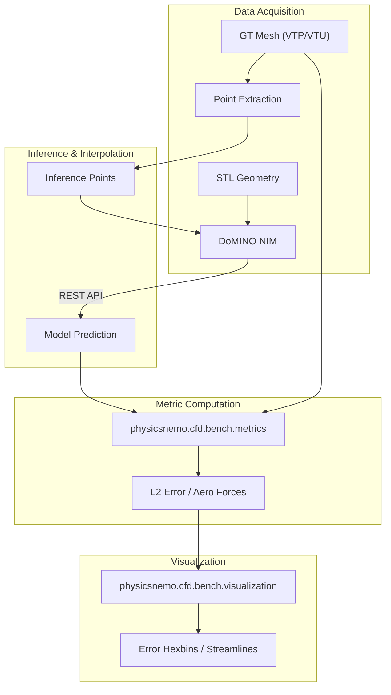
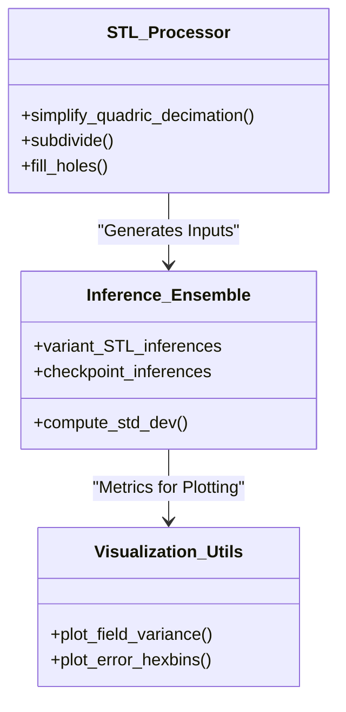

<!-- source: DeepWiki mcp.deepwiki.com · repo NVIDIA/physicsnemo-cfd · extra page Benchmarking Notebooks · fetched 2026-10-26 -->

# Benchmarking Notebooks

<details>
<summary>Relevant source files</summary>

The following files were used as context for generating this wiki page:

- [workflows/bench_example/notebooks/benchmarking_in_absence_of_gt.ipynb](workflows/bench_example/notebooks/benchmarking_in_absence_of_gt.ipynb)
- [workflows/bench_example/notebooks/surface_benchmarking.ipynb](workflows/bench_example/notebooks/surface_benchmarking.ipynb)
- [workflows/bench_example/notebooks/volume_benchmarking.ipynb](workflows/bench_example/notebooks/volume_benchmarking.ipynb)

</details>


The `bench_example/notebooks/` directory provides interactive Jupyter notebooks designed to demonstrate the evaluation of AI surrogate models against high-fidelity CFD ground truth data. These notebooks cover surface-based metrics, large-scale volume analysis, and strategies for estimating model reliability when ground truth data is unavailable.

## Overview of Benchmarking Notebooks

The notebooks utilize the `physicsnemo.cfd` library to perform inference via the DoMINO NIM and calculate a variety of physical and statistical metrics.

| Notebook | Focus | Key Operations |
| :--- | :--- | :--- |
| `surface_benchmarking.ipynb` | Surface fields (VTP) | Aerodynamic forces, $C_p$ distributions, wall shear stress (WSS) error maps. |
| `volume_benchmarking.ipynb` | Volume fields (VTU) | Large-scale 3D field evaluation, memory-efficient loading of 100M+ cell meshes. |
| `benchmarking_in_absence_of_gt.ipynb` | Reliability estimation | Input sensitivity analysis (STL resolution), variance across model checkpoints. |

Sources: [workflows/bench_example/notebooks/surface_benchmarking.ipynb:8-10](), [workflows/bench_example/notebooks/volume_benchmarking.ipynb:8-10](), [workflows/bench_example/notebooks/benchmarking_in_absence_of_gt.ipynb:8-12]()

## Data Flow and Implementation

The notebooks follow a structured pipeline: data acquisition, inference via REST API, metric computation, and visualization.

### Surface and Volume Pipelines
The benchmarking process for both surface and volume data involves comparing model predictions against the DrivAerML dataset.

Title: Benchmarking Workflow Data Flow

Sources: [workflows/bench_example/notebooks/surface_benchmarking.ipynb:32-44](), [workflows/bench_example/notebooks/volume_benchmarking.ipynb:32-51]()

### Handling Large Volume Data
The `volume_benchmarking.ipynb` notebook specifically addresses the challenges of large CFD meshes (e.g., sample 202 contains ~146 million cells). It demonstrates how to handle partitioned `.vtu` files by concatenating parts before loading them into `pyvista` for point-wise evaluation.

Sources: [workflows/bench_example/notebooks/volume_benchmarking.ipynb:37-41](), [workflows/bench_example/notebooks/volume_benchmarking.ipynb:90-91](), [workflows/bench_example/notebooks/volume_benchmarking.ipynb:144-145]()

## Benchmarking Without Ground Truth

The `benchmarking_in_absence_of_gt.ipynb` notebook addresses the "true inference" setting where no simulation data exists for comparison. It introduces two primary techniques for building confidence in model predictions:

### 1. STL Resolution Sensitivity
The notebook evaluates how sensitive the model is to the resolution of the input geometry. It uses `trimesh` to create variants of the original STL through:
* **Decimation**: Reducing face count (e.g., 50%, 25%) using `simplify_quadric_decimation` [workflows/bench_example/notebooks/benchmarking_in_absence_of_gt.ipynb:51-56]().
* **Subdivision**: Increasing mesh density using `subdivide()` [workflows/bench_example/notebooks/benchmarking_in_absence_of_gt.ipynb:59-59]().
* **Cleaning**: Ensuring manifold/watertight geometry using `fill_holes()` and `fix_normals()` [workflows/bench_example/notebooks/benchmarking_in_absence_of_gt.ipynb:88-93]().

The variance in model predictions across these variants serves as a proxy for uncertainty.

### 2. Multi-Checkpoint Ensembling
If multiple model checkpoints are available, the notebook demonstrates computing the standard deviation across different versions of the model architecture to identify regions of high epistemic uncertainty.

Title: Uncertainty Estimation Entities

Sources: [workflows/bench_example/notebooks/benchmarking_in_absence_of_gt.ipynb:20-25](), [workflows/bench_example/notebooks/benchmarking_in_absence_of_gt.ipynb:104-105]()

## Key Implementation Details

### Interactive Metrics
The notebooks utilize the following components from the `physicsnemo.cfd.bench` module:
* **Point Sampling**: Extracting coordinates from simulation meshes to feed into the NIM inference API.
* **Error Aggregation**: Computing global L2 errors and localized error distributions.
* **Aerodynamic Forces**: Integrating pressure and wall shear stress over the surface to calculate Drag ($C_d$) and Lift ($C_l$) coefficients.

### Environment Requirements
Users must install the library with the `[gpu]` group to support the accelerated benchmarking kernels (e.g., Numba-based residual calculations and cuML-based KNN).
```bash
pip install .[gpu] --extra-index-url=https://pypi.nvidia.com
```
Sources: [workflows/bench_example/notebooks/surface_benchmarking.ipynb:20-24](), [workflows/bench_example/notebooks/volume_benchmarking.ipynb:20-24]()

### NIM Connectivity
When running in Docker, the notebooks require the `--network host` flag to communicate with the DoMINO NIM microservice container.
Sources: [workflows/bench_example/notebooks/surface_benchmarking.ipynb:145-149]()

---

