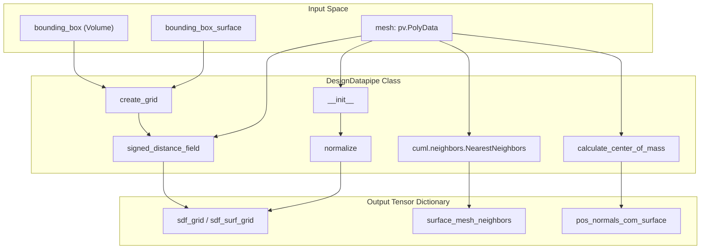
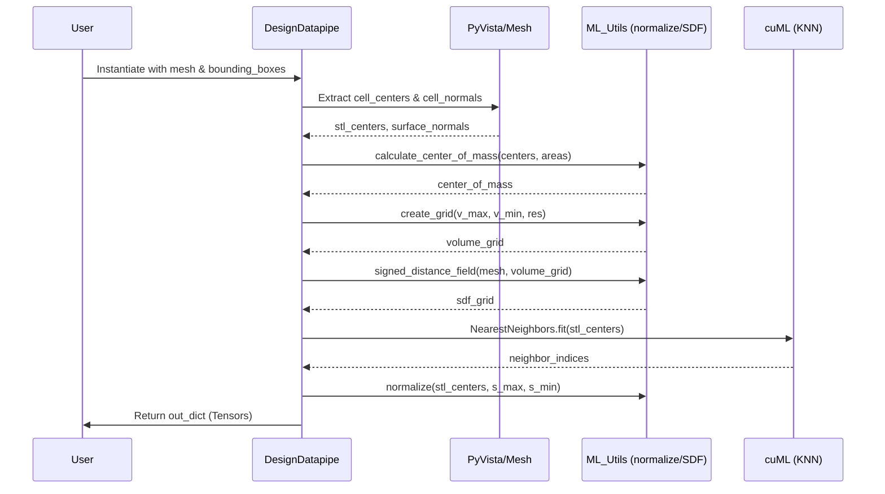

<!-- source: DeepWiki mcp.deepwiki.com · repo NVIDIA/physicsnemo-cfd · extra page DesignDatapipe: Geometry Preprocessing for Sensitivity Analysis · fetched 2026-10-26 -->

# DesignDatapipe: Geometry Preprocessing for Sensitivity Analysis

Relevant source files

The following files were used as context for generating this wiki page:

- [workflows/domino_design_sensitivities/design_datapipe.py](workflows/domino_design_sensitivities/design_datapipe.py)

The `DesignDatapipe` is a specialized data processing pipeline designed to convert raw CFD geometries (typically in STL or VTP formats) into structured tensor representations required for AI surrogate models, specifically the DoMINO architecture. It handles the computation of Signed Distance Fields (SDF), K-Nearest Neighbor (KNN) stencils, and geometric normalization to prepare inputs for sensitivity analysis and adjoint-based gradient computation.

## Overview and Data Flow

The pipeline transforms a `pyvista.PolyData` mesh into a structured dictionary of NumPy arrays. It operates on two distinct domains: a **Volume Domain** for field predictions and a **Surface Domain** for boundary-specific features.

### High-Level Data Flow

1.  **Mesh Analysis**: Extract cell centers, normals, and areas from the input `PolyData`.
2.  **Grid Generation**: Construct structured Cartesian grids for both volume and surface bounding boxes.
3.  **SDF Computation**: Calculate the distance from every grid point to the nearest mesh triangle.
4.  **Stencil Construction**: Use GPU-accelerated KNN to find local neighborhoods for surface points.
5.  **Normalization**: Map all coordinates to a normalized space $[0, 1]$ or $[-1, 1]$ based on bounding box constraints.

### DesignDatapipe Architecture

The following diagram illustrates the relationship between the input mesh and the processed tensors within `DesignDatapipe`.

**Figure 1: DesignDatapipe Processing Pipeline**

**Sources:** `[workflows/domino_design_sensitivities/design_datapipe.py:42-178]()`

---

## Core Implementation Details

### Signed Distance Field (SDF) Computation
The pipeline computes SDFs for two different grids: the global volume grid and a surface-specific grid. It utilizes the `signed_distance_field` functional which supports sign determination via winding numbers to distinguish between the interior and exterior of the geometry.

*   **Grid SDF**: Computed for the volume bounding box to provide a global spatial context `[workflows/domino_design_sensitivities/design_datapipe.py:117-123]()`.
*   **Surface Grid SDF**: Computed for a tighter bounding box around the object of interest `[workflows/domino_design_sensitivities/design_datapipe.py:128-134]()`.

### KNN Stencil Construction
To capture local geometric features, `DesignDatapipe` constructs a neighborhood stencil for each face center of the surface mesh. This is implemented using `cuml.neighbors.NearestNeighbors` for GPU acceleration, falling back to `scipy.spatial.KDTree` if necessary.

*   **Algorithm**: The `rbc` (Region Query Ball) algorithm is used for efficiency `[workflows/domino_design_sensitivities/design_datapipe.py:142-144]()`.
*   **Stencil Size**: Defaults to 7 neighbors. The first neighbor (the point itself) is often excluded or handled separately to focus on the surrounding local topology `[workflows/domino_design_sensitivities/design_datapipe.py:151-157]()`.

### Normalization and Center of Mass
Consistent spatial scaling is critical for neural network convergence.
1.  **Center of Mass (CoM)**: Calculated using face centers weighted by their respective surface areas via `calculate_center_of_mass` `[workflows/domino_design_sensitivities/design_datapipe.py:97-105]()`.
2.  **Relative Coordinates**: Features like `pos_normals_com_surface` represent the vector from the CoM to each surface point, providing translation-invariant geometric descriptors `[workflows/domino_design_sensitivities/design_datapipe.py:158]()`.
3.  **Min-Max Scaling**: Grid coordinates and mesh points are normalized using the provided bounding boxes through the `normalize` utility `[workflows/domino_design_sensitivities/design_datapipe.py:137-138]()`.

**Sources:** `[workflows/domino_design_sensitivities/design_datapipe.py:33-38]()`, `[workflows/domino_design_sensitivities/design_datapipe.py:137-162]()`

---

## Data Flow and Logic

The following sequence diagram tracks how a mesh is transformed into the final training/inference dictionary.

**Figure 2: Data Transformation Sequence**

**Sources:** `[workflows/domino_design_sensitivities/design_datapipe.py:85-178]()`

## Memory and Performance Management

For large meshes (e.g., full vehicle geometries with millions of faces), `DesignDatapipe` employs several strategies:
*   **Flattened Indices**: Mesh faces are flattened into a single array (`mesh_indices_flattened`) to optimize memory layout for the SDF kernel `[workflows/domino_design_sensitivities/design_datapipe.py:88-89]()`.
*   **GPU Neighbors**: By using `cuML`, the stencil construction avoids the high CPU overhead and memory bottleneck associated with standard KD-Trees on large datasets `[workflows/domino_design_sensitivities/design_datapipe.py:142-144]()`.
*   **Selective Computation**: The datapipe computes features like `volume_coordinates` using a random sample (default 1000 points) to estimate volume properties without requiring a dense volumetric mesh `[workflows/domino_design_sensitivities/design_datapipe.py:164-165]()`.

**Sources:** `[workflows/domino_design_sensitivities/design_datapipe.py:142-177]()`

---

