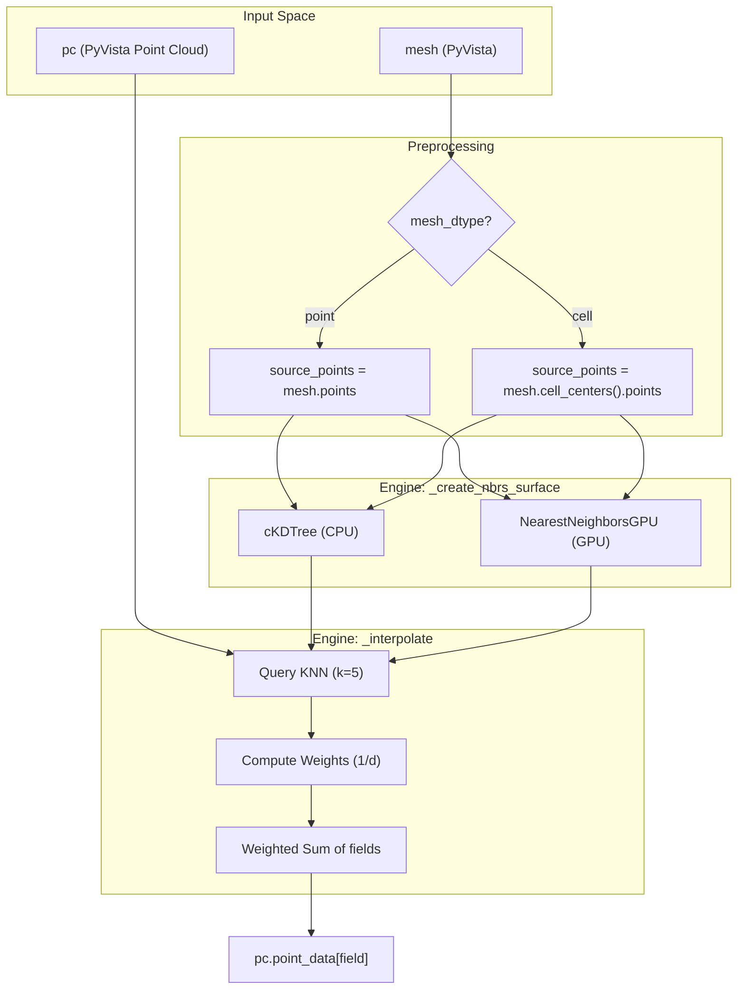
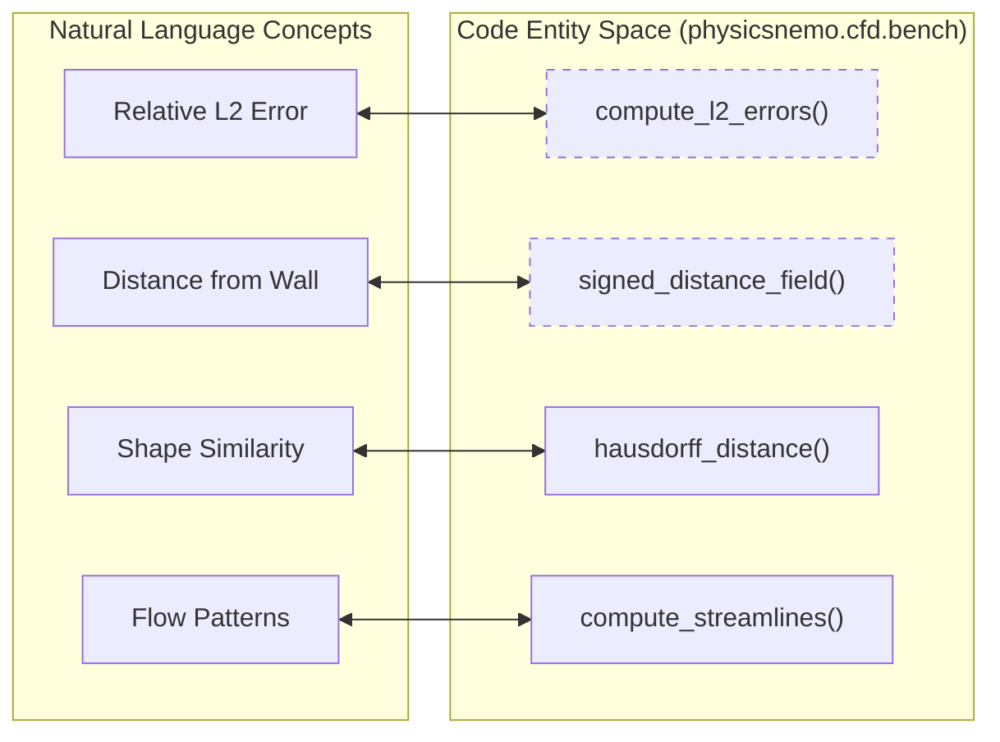

<!-- source: DeepWiki mcp.deepwiki.com · repo NVIDIA/physicsnemo-cfd · extra page Error Metrics, Geometry Distances, and Interpolation · fetched 2026-10-26 -->

# Error Metrics, Geometry Distances, and Interpolation

Relevant source files

The following files were used as context for generating this wiki page:

- [physicsnemo/cfd/bench/geometry/distance.py](physicsnemo/cfd/bench/geometry/distance.py)
- [physicsnemo/cfd/bench/interpolation/interpolate_mesh_to_pc.py](physicsnemo/cfd/bench/interpolation/interpolate_mesh_to_pc.py)
- [physicsnemo/cfd/bench/metrics/l2_errors.py](physicsnemo/cfd/bench/metrics/l2_errors.py)
- [physicsnemo/cfd/bench/metrics/streamlines.py](physicsnemo/cfd/bench/metrics/streamlines.py)
- [workflows/bench_example/setup.sh](workflows/bench_example/setup.sh)

This section details the core benchmarking utilities within `physicsnemo.cfd.bench` used to evaluate the accuracy of AI surrogate models against CFD ground truth. These utilities cover statistical error metrics, geometric similarity measures for point clouds, and interpolation methods for mapping data between unstructured meshes and point clouds.

## L2 Error Metrics

The library provides functions to compute standard and area-weighted L2 relative errors. These metrics are essential for quantifying the deviation of predicted flow fields (e.g., velocity, pressure) from reference CFD data.

### Standard L2 Error
The `compute_l2_errors` function calculates the relative L2 norm for specified fields. It supports both scalar and vector quantities and allows for spatial clipping using a bounding box `[xmin, xmax, ymin, ymax, zmin, zmax]` [physicsnemo/cfd/bench/metrics/l2_errors.py:22-43]().

For a vector field $\mathbf{u} = (u_x, u_y, u_z)$, the error is computed component-wise as:
$$ \text{Error}_i = \frac{||\text{true}_i - \text{pred}_i||_2}{||\text{true}_i||_2} $$
where $i \in \{x, y, z\}$ [physicsnemo/cfd/bench/metrics/l2_errors.py:80-92]().

### Area-Weighted L2 Error
In CFD, mesh cells often vary significantly in size. `compute_area_weighted_l2_errors` accounts for this by weighting the error of each point or cell by its associated surface area [physicsnemo/cfd/bench/metrics/l2_errors.py:102-120](). This is particularly useful for surface-based evaluations (e.g., wall shear stress on a vehicle body).

*   **Cell Data Path**: Uses `data.compute_cell_sizes()` to retrieve cell areas [physicsnemo/cfd/bench/metrics/l2_errors.py:123-124]().
*   **Point Data Path**: Expects an `"area"` array to be present in the point data [physicsnemo/cfd/bench/metrics/l2_errors.py:126]().

**Sources:**
* [physicsnemo/cfd/bench/metrics/l2_errors.py:22-194]()

---

## Geometry Distances

When comparing geometries (e.g., a predicted shape vs. a target shape), the library provides Hausdorff and Chamfer distances. These are implemented with two backends: a CPU-based path using `scipy.spatial.cKDTree` and a GPU-accelerated path using `cuml.neighbors.NearestNeighbors` [physicsnemo/cfd/bench/geometry/distance.py:18-20]().

### Hausdorff Distance
The Hausdorff distance measures the maximum distance from a point in one set to the nearest point in the other set [physicsnemo/cfd/bench/geometry/distance.py:23-34]().
$$ H(A, B) = \max(\sup_{a \in A} \inf_{b \in B} d(a, b), \sup_{b \in B} \inf_{a \in A} d(b, a)) $$

### Chamfer Distance
The Chamfer distance provides an average measure of similarity between two point clouds [physicsnemo/cfd/bench/geometry/distance.py:76-87]().
$$ C(A, B) = \frac{1}{2} \left( \frac{1}{|A|} \sum_{a \in A} \min_{b \in B} ||a-b||^2 + \frac{1}{|B|} \sum_{b \in B} \min_{a \in A} ||b-a||^2 \right) $$

### Implementation Flow

| Method | Backend | Entity |
| :--- | :--- | :--- |
| `kdtree` | CPU | `scipy.spatial.cKDTree` [physicsnemo/cfd/bench/geometry/distance.py:61-73]() |
| `cuml_knn` | GPU | `cuml.neighbors.NearestNeighbors` [physicsnemo/cfd/bench/geometry/distance.py:43-58]() |

**Sources:**
* [physicsnemo/cfd/bench/geometry/distance.py:23-126]()

---

## Interpolation: Mesh to Point Cloud

The `interpolate_mesh_to_pc` function maps simulation results from an unstructured PyVista mesh (source) to a point cloud (target) [physicsnemo/cfd/bench/interpolation/interpolate_mesh_to_pc.py:96-114](). This is a common preprocessing step for ML models that operate on fixed-size point sets.

### Inverse Distance Weighting (IDW)
The interpolation uses a K-Nearest Neighbors (KNN) approach with inverse distance weighting:
1.  **Neighbor Search**: Finds the $k=5$ nearest neighbors in the source mesh for every point in the target point cloud [physicsnemo/cfd/bench/interpolation/interpolate_mesh_to_pc.py:115-123]().
2.  **Weight Calculation**: Weights are computed as $w_i = 1 / (d_i + \epsilon)$ and normalized so they sum to 1 [physicsnemo/cfd/bench/interpolation/interpolate_mesh_to_pc.py:50-53]().
3.  **Field Mapping**: The interpolated value is the weighted sum of the neighbor values [physicsnemo/cfd/bench/interpolation/interpolate_mesh_to_pc.py:57-61]().

### Data Flow: Mesh to Point Cloud
The following diagram illustrates the flow from a PyVista `mesh` to an interpolated `pc`.

**Interpolation Logic Flow**

**Sources:**
* [physicsnemo/cfd/bench/interpolation/interpolate_mesh_to_pc.py:22-138]()

---

## Error Analysis vs. Geometry
The library includes utilities to analyze how errors correlate with the distance from the geometry surface. This is achieved by computing a Signed Distance Field (SDF) and binning errors accordingly.

### Distance-Based Analysis Components
The system maps "Natural Language" benchmarking requirements to specific "Code Entities" as shown below:

**Benchmarking Entity Mapping**

### Streamline Computation
For qualitative error analysis, `compute_streamlines` generates flow lines from a vector field using a `vtkPoissonDiskSampler` to create seed points [physicsnemo/cfd/bench/metrics/streamlines.py:22-47](). It leverages PyVista's `streamlines_from_source` to integrate the velocity field in both directions [physicsnemo/cfd/bench/metrics/streamlines.py:49-57]().

**Sources:**
* [physicsnemo/cfd/bench/metrics/l2_errors.py:19]()
* [physicsnemo/cfd/bench/metrics/streamlines.py:22-59]()
* [physicsnemo/cfd/bench/geometry/distance.py:23-76]()

---

