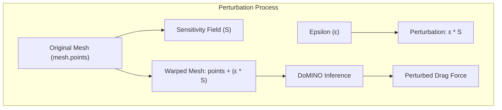
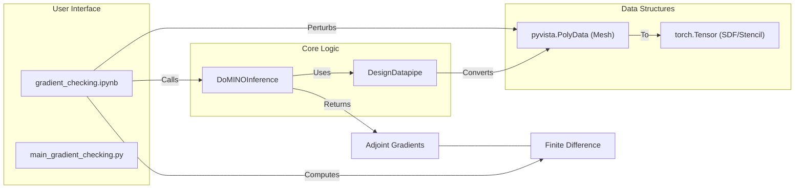

<!-- source: DeepWiki mcp.deepwiki.com · repo NVIDIA/physicsnemo-cfd · extra page Gradient Checking and Validation · fetched 2026-10-26 -->

# Gradient Checking and Validation

Relevant source files

The following files were used as context for generating this wiki page:

- [workflows/domino_design_sensitivities/gradient_checking.ipynb](workflows/domino_design_sensitivities/gradient_checking.ipynb)
- [workflows/domino_design_sensitivities/main.ipynb](workflows/domino_design_sensitivities/main.ipynb)

This page documents the workflows and utilities used to validate the accuracy of design sensitivities computed by the DoMINO model. The primary mechanism for validation is comparing adjoint-based gradients (computed via automatic differentiation through the neural network) against finite-difference approximations obtained by physically perturbing the input geometry.

### Overview of Gradient Checking

Gradient checking ensures that the sensitivities (gradients of a functional, like drag, with respect to mesh point positions) provided by the `DoMINOInference` class are mathematically sound. The process involves:
1.  **Baseline Inference**: Computing the aerodynamic forces and adjoint gradients for an initial geometry [workflows/domino_design_sensitivities/gradient_checking.ipynb:141-147]().
2.  **Geometry Perturbation**: Moving mesh points along the direction of the computed sensitivity by a small factor $\epsilon$ [workflows/domino_design_sensitivities/gradient_checking.ipynb:211-235]().
3.  **Finite Difference Estimation**: Running new inferences on the perturbed geometries to calculate the change in drag, forming a finite-difference gradient estimate [workflows/domino_design_sensitivities/gradient_checking.ipynb:236-242]().
4.  **Scaling Analysis**: Comparing the two gradients across multiple orders of magnitude of $\epsilon$ to identify the range where the linear approximation holds [workflows/domino_design_sensitivities/gradient_checking.ipynb:255-274]().

---

### Implementation Details

The validation logic is implemented across a Jupyter notebook for interactive analysis and a standalone Python script for automated execution.

#### Finite Difference Workflow
The core logic for perturbation is encapsulated in the `get_drag` function within the notebook. It takes a mesh, a sensitivity field, and a perturbation magnitude $\epsilon$, then returns the new drag value.

**Geometry Perturbation Logic**

Sources: [workflows/domino_design_sensitivities/gradient_checking.ipynb:211-242]()

#### Gradient Comparison
The sensitivity of the drag force $D$ with respect to a perturbation direction $S$ is compared as follows:
*   **Adjoint Gradient**: The projection of the model's output gradient onto the perturbation vector.
*   **Finite Difference**: $\frac{D(x + \epsilon S) - D(x)}{\epsilon}$.

The results are typically visualized on a **symlog scale** (symmetric logarithmic) to handle the wide range of $\epsilon$ values and the potential for both positive and negative gradient components [workflows/domino_design_sensitivities/gradient_checking.ipynb:18-19]().

---

### Key Components

#### 1. `main_gradient_checking.py`
This script automates the gradient checking process. It utilizes the `DoMINOInference` class to generate the baseline sensitivities and then loops through a range of $\epsilon$ values (e.g., $10^{-6}$ to $10^{-1}$) to generate the comparison data.

#### 2. `plot_gradient_checking.py`
A specialized visualization script that processes the output of the gradient checking runs.
*   **Drag Gradient Results**: It plots the predicted change in drag (linear approximation from adjoints) vs. the actual change in drag (from finite differences).
*   **Error Convergence**: It visualizes how the relative error between the two methods behaves as $\epsilon$ decreases, helping to identify the "sweet spot" before numerical precision issues dominate.

#### 3. Interpretation of Results
*   **Linear Regime**: For small $\epsilon$, the finite difference should match the adjoint gradient closely.
*   **Non-linear Effects**: As $\epsilon$ increases, the finite difference will deviate due to the higher-order terms in the Taylor expansion of the flow field.
*   **Numerical Noise**: For extremely small $\epsilon$ (e.g., $< 10^{-7}$), the finite difference may become unstable due to floating-point precision limits in the mesh representation or the model's inference [workflows/domino_design_sensitivities/gradient_checking.ipynb:255-274]().

---

### System Data Flow

The following diagram illustrates how the gradient checking workflow bridges the high-level geometry manipulation with the underlying `DoMINOInference` and `DesignDatapipe` entities.

**Gradient Validation Data Flow**

Sources: [workflows/domino_design_sensitivities/gradient_checking.ipynb:37-40](), [workflows/domino_design_sensitivities/gradient_checking.ipynb:84-88](), [workflows/domino_design_sensitivities/gradient_checking.ipynb:232-242]()

### Summary of Files
| File | Role |
| :--- | :--- |
| `gradient_checking.ipynb` | Interactive environment for running perturbations and visualizing symlog comparisons [workflows/domino_design_sensitivities/gradient_checking.ipynb:1-20](). |
| `main_gradient_checking.py` | Command-line utility for batch processing of gradient validation across different geometries. |
| `plot_gradient_checking.py` | Generates validation plots comparing adjoint vs. finite-difference results. |
| `main.py` | Contains the `DoMINOInference` class used to compute the baseline gradients [workflows/domino_design_sensitivities/main.ipynb:35](). |

Sources: [workflows/domino_design_sensitivities/gradient_checking.ipynb:1-20](), [workflows/domino_design_sensitivities/main.ipynb:1-10]()

---

