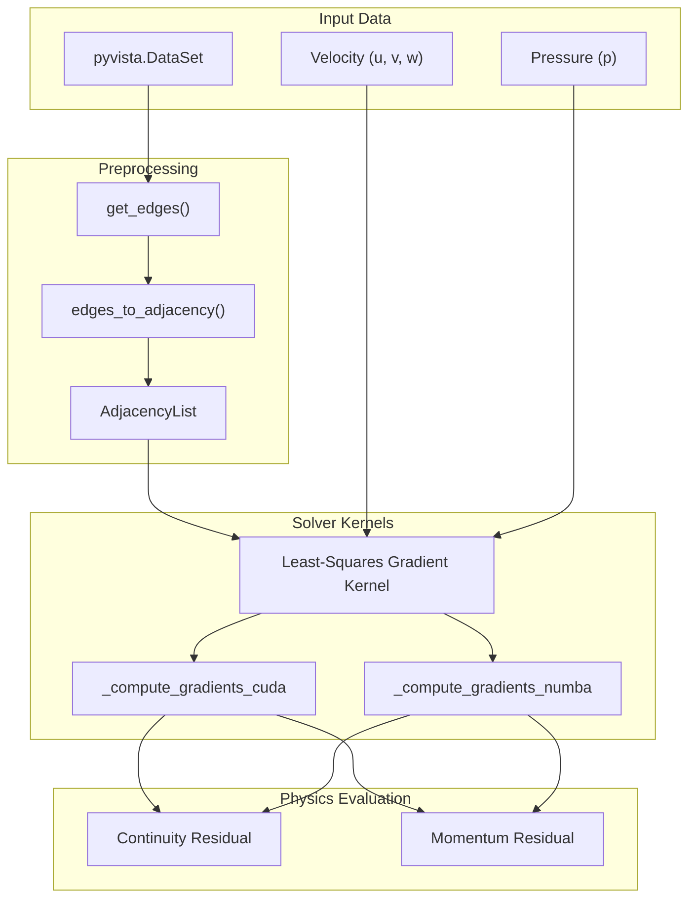
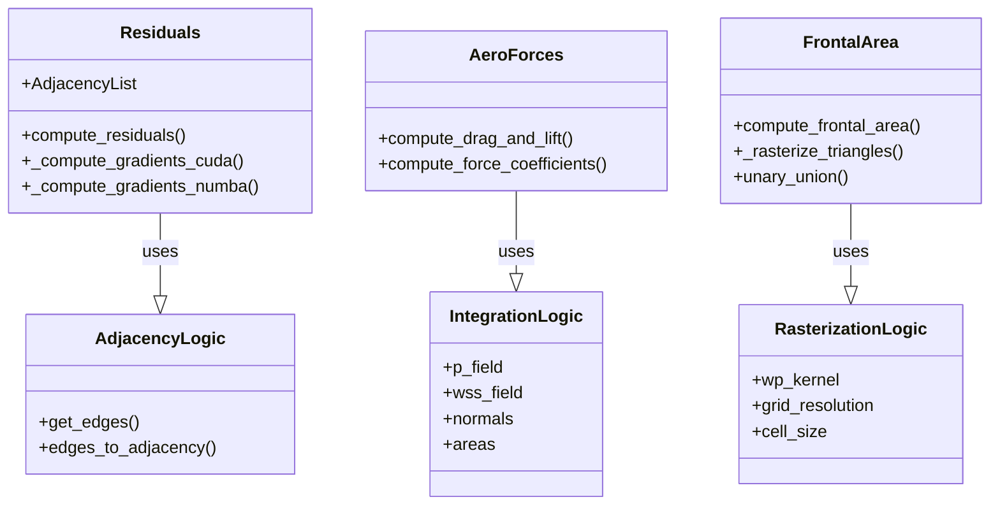

<!-- source: DeepWiki mcp.deepwiki.com · repo NVIDIA/physicsnemo-cfd · extra page Physics Metrics: Residuals and Aerodynamic Forces · fetched 2026-10-26 -->

# Physics Metrics: Residuals and Aerodynamic Forces

Relevant source files

The following files were used as context for generating this wiki page:

- [.pre-commit-config.yaml](.pre-commit-config.yaml)
- [physicsnemo/cfd/bench/metrics/aero_forces.py](physicsnemo/cfd/bench/metrics/aero_forces.py)
- [physicsnemo/cfd/bench/metrics/frontal_area.py](physicsnemo/cfd/bench/metrics/frontal_area.py)
- [physicsnemo/cfd/bench/metrics/physics.py](physicsnemo/cfd/bench/metrics/physics.py)
- [physicsnemo/cfd/hybrid_initialization_tools/__init__.py](physicsnemo/cfd/hybrid_initialization_tools/__init__.py)

This page provides a deep dive into the technical implementation of physics-based evaluation metrics within `physicsnemo.cfd.bench.metrics`. These metrics are used to assess the physical consistency of AI surrogate models by computing Navier-Stokes residuals on unstructured meshes and integrating surface distributions to determine aerodynamic coefficients.

## Residual Computation on Unstructured Meshes

The library evaluates the quality of a predicted flow field by calculating how well it satisfies the steady-state incompressible Navier-Stokes equations. This is implemented in `physicsnemo/cfd/bench/metrics/physics.py` using Numba-accelerated kernels and CUDA for high-performance computation on large meshes.

### Least-Squares Gradient Method

To compute residuals (continuity and momentum), gradients of velocity ($\nabla \mathbf{u}$) and pressure ($\nabla p$) must be calculated at each mesh point. Since the meshes are typically unstructured, `physicsnemo.cfd` employs a weighted least-squares (WLS) approach.

1.  **Adjacency Building**: The mesh connectivity is converted into an `AdjacencyList` (a `namedtuple` containing `offsets` and `indices`) [physicsnemo/cfd/bench/metrics/physics.py:24-24](). This is achieved by extracting edges [physicsnemo/cfd/bench/metrics/physics.py:114-114]() and mapping them to a CSR-like format via `edges_to_adjacency` [physicsnemo/cfd/bench/metrics/physics.py:27-27]().
2.  **Gradient Kernel**: The system solves for the gradient vector $\mathbf{g}$ that minimizes the error between the predicted value at a point and its neighbors. The library provides both CPU-parallelized (`_compute_gradients_numba`) and GPU-accelerated (`_compute_gradients_cuda`) implementations [physicsnemo/cfd/bench/metrics/physics.py:534-534]().

### Continuity and Momentum Residuals

Once gradients are obtained, the residuals are computed:
*   **Continuity**: $\nabla \cdot \mathbf{u}$ (divergence of velocity).
*   **Momentum**: $(\mathbf{u} \cdot \nabla) \mathbf{u} + \nabla p - \nu \nabla^2 \mathbf{u}$.

The `compute_residuals` function coordinates this process, accepting a `pyvista.DataSet` and returning the residuals as new point data arrays [physicsnemo/cfd/bench/metrics/physics.py:734-734]().

### Data Flow: Mesh to Residuals

The following diagram illustrates the transformation of raw mesh data into physical residuals.

**Residual Computation Pipeline**

**Sources:** [physicsnemo/cfd/bench/metrics/physics.py:24-87](), [physicsnemo/cfd/bench/metrics/physics.py:114-187](), [physicsnemo/cfd/bench/metrics/physics.py:534-730](), [physicsnemo/cfd/bench/metrics/physics.py:734-850]()

---

## Aerodynamic Force Integration

The `physicsnemo/cfd/bench/metrics/aero_forces.py` module computes Drag ($C_d$) and Lift ($C_l$) coefficients by integrating pressure and Wall Shear Stress (WSS) over the surface geometry.

### Force Components

The total force coefficient is decomposed into two primary components:
1.  **Pressure Component ($C_p$)**: The integral of pressure acting normal to the surface [physicsnemo/cfd/bench/metrics/aero_forces.py:63-63]().
2.  **Skin Friction Component ($C_f$)**: The integral of WSS acting tangential to the surface [physicsnemo/cfd/bench/metrics/aero_forces.py:64-64]().

### Implementation: `compute_drag_and_lift`

The function `compute_drag_and_lift` supports both `cell` and `point` data types [physicsnemo/cfd/bench/metrics/aero_forces.py:72-146]().
*   **Cell Mode**: Uses `pyvista` to compute cell normals and areas before passing them to the integration kernel [physicsnemo/cfd/bench/metrics/aero_forces.py:107-114]().
*   **Point Mode**: Designed for point clouds (e.g., from NVIDIA Modulus), where normals and areas are provided as point attributes [physicsnemo/cfd/bench/metrics/aero_forces.py:124-135]().

**Sources:** [physicsnemo/cfd/bench/metrics/aero_forces.py:21-69](), [physicsnemo/cfd/bench/metrics/aero_forces.py:72-146]()

---

## Frontal Area Calculation

Accurate force coefficients require an accurate reference area (Frontal Area). `physicsnemo/cfd/bench/metrics/frontal_area.py` provides two methods to compute the projected area of a 3D mesh along a principal axis (X, Y, or Z).

### Methods

| Method | Implementation | Pros/Cons |
| :--- | :--- | :--- |
| **Exact** | `shapely.ops.unary_union` [physicsnemo/cfd/bench/metrics/frontal_area.py:148-160]() | Highly accurate; computationally expensive for large meshes. |
| **Approximate** | NVIDIA Warp Rasterization [physicsnemo/cfd/bench/metrics/frontal_area.py:161-171]() | Extremely fast on GPU; accuracy depends on `grid_resolution`. |

### GPU Rasterization with NVIDIA Warp

The approximate method uses a custom Warp kernel `_rasterize_triangles` [physicsnemo/cfd/bench/metrics/frontal_area.py:24-67]().
1.  **Projection**: Vertices are projected onto a 2D plane based on the chosen direction [physicsnemo/cfd/bench/metrics/frontal_area.py:42-44]().
2.  **Bounding Box**: The kernel calculates the grid extent for each triangle [physicsnemo/cfd/bench/metrics/frontal_area.py:47-61]().
3.  **Atomic Marking**: Grid cells covered by the triangle's bounding box are marked using `wp.atomic_add` [physicsnemo/cfd/bench/metrics/frontal_area.py:64-66]().
4.  **Area Summation**: The total area is calculated by multiplying the count of covered cells by the square of the `cell_size` [physicsnemo/cfd/bench/metrics/frontal_area.py:110-112]().

**Sources:** [physicsnemo/cfd/bench/metrics/frontal_area.py:24-67](), [physicsnemo/cfd/bench/metrics/frontal_area.py:117-175]()

---

## Code Entity Map

This diagram maps the logical physics concepts to the specific Python functions and kernels in the codebase.

**Physics Concepts to Code Entities**

**Sources:** [physicsnemo/cfd/bench/metrics/physics.py:24-24](), [physicsnemo/cfd/bench/metrics/physics.py:734-734](), [physicsnemo/cfd/bench/metrics/aero_forces.py:21-21](), [physicsnemo/cfd/bench/metrics/aero_forces.py:72-72](), [physicsnemo/cfd/bench/metrics/frontal_area.py:24-24](), [physicsnemo/cfd/bench/metrics/frontal_area.py:117-117]()

---

